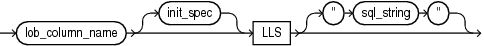

## 11 Loading Objects, LOBs, and Collections with SQL\*Loader

You can use SQL\*Loader to load column objects in various formats and to load object tables, REF columns, LOBs, and collections.

- Loading Column Objects  
	You can use SQL\*Loader to load obects of a specific object type. An object column is a column that is based on an object type.
- Loading Object Tables with SQL\*Loader  
	Learn how to load and manage object tables in Oracle Database instances using object identifiers (OIDs).
- Loading REF Columns with SQL\*Loader  
	SQL\*Loader can load system-generated OID `REF` columns, primary-key-based `REF` columns, and unscoped `REF` columns that allow primary keys.
- Loading LOBs with SQL\*Loader  
	Find out which large object types (LOBs) SQL\*Loader can load, and see examples of how to load LOB Data.
- Loading BFILE Columns with SQL\*Loader  
	The `BFILE` data type stores unstructured binary data in operating system files.
- Loading Collections (Nested Tables and VARRAYs)  
	With collections, you can load a set of nested tables, or a `VARRAY` with an ordered set of elements using SQL\*Loader.
- Choosing Dynamic or Static SDF Specifications  
	With SQL\*Loader, you can specify SDFs either statically (specifying the actual name of the file), or dynamically (using a `FILLER` field as the source of the file name).
- Loading a Parent Table Separately from Its Child Table  
	When you load a table that contains a nested table column, it may be possible to load the parent table separately from the child table.

**Parent topic:** [SQL\*Loader](oracle-sql-loader.md)

### 11.1 Loading Column Objects

You can use SQL\*Loader to load obects of a specific object type. An object column is a column that is based on an object type.

**Parent topic:** Loading Objects, LOBs, and Collections with SQL\*Loader

#### 11.1.1 Understanding Column Object Attributes

Column objects in the SQL\*Loader control file are described in terms of their attributes. An object type can have many attributes.

If you declare that the object type on which the column object is based is nonfinal, then the column object in the control file can be described in terms of the attributes, both derived and declared, of any subtype derived from the base object type. In the data file, the data corresponding to each of the attributes of a column object is in a data field similar to that corresponding to a simple relational column.

Note:

With SQL\*Loader support for complex data types such as column objects, the possibility arises that two identical field names could exist in the control file, one corresponding to a column, the other corresponding to a column object's attribute. Certain clauses can refer to fields (for example, `WHEN`, `NULLIF`, `DEFAULTIF`, `SID`, `OID`, `REF`, `BFILE`, and so on), which can cause a naming conflict if identically named fields exist in the control file.

Therefore, if you use clauses that refer to fields, then you must specify the full name. For example, if field `fld1` is specified to be a `COLUMN OBJECT`, and it contains field `fld2`, then when you specify `fld2` in a clause such as `NULLIF`, you must use the full field name `fld1.fld2`.

**Parent topic:** Loading Column Objects

#### 11.1.2 Loading Column Objects in Stream Record Format

With stream record formats, you can use SQL\*Loader to load records with multi-line fields by specifying a delimitor on column objects.

In stream record format, SQL\*Loader forms records by scanning for the record terminator. To show how to use stream record formats, consider the following example, in which the data is in predetermined size fields. The newline character marks the end of a physical record. You can also mark the end of a physical record by using a custom record separator in the operating system file-processing clause (`os_file_proc_clause`).

Example 11-1 Loading Column Objects in Stream Record Format

Control File Contents

```
LOAD DATA
INFILE 'example.dat'
INTO TABLE departments
   (dept_no     POSITION(01:03)    CHAR,
    dept_name   POSITION(05:15)    CHAR,
1   dept_mgr    COLUMN OBJECT
      (name     POSITION(17:33)    CHAR,
       age      POSITION(35:37)    INTEGER EXTERNAL,
       emp_id   POSITION(40:46)    INTEGER EXTERNAL) )
```

Data File (`example.dat`)

```
101 Mathematics  Johnny Quest       30   1024
237 Physics      Albert Einstein   65   0000
```

In the example, note the callout 1 at `dept_mgr COLUMN      OBJECT`. You can apply this type of column object specification recursively to describe nested column objects.

**Parent topic:** Loading Column Objects

#### 11.1.3 Loading Column Objects in Variable Record Format

You can load column objects in variable record format.

Example 11-2 shows a case in which the data is in delimited fields.

Example 11-2 Loading Column Objects in Variable Record Format

Control File Contents

```
LOAD DATA
1 INFILE 'sample.dat' "var 6"
INTO TABLE departments
FIELDS TERMINATED BY ',' OPTIONALLY ENCLOSED BY '"'
2  (dept_no
   dept_name, 
   dept_mgr       COLUMN OBJECT
      (name       CHAR(30), 
      age         INTEGER EXTERNAL(5), 
      emp_id      INTEGER EXTERNAL(5)) )
```

Data File (sample.dat)

```
3  000034101,Mathematics,Johny Q.,30,1024,
   000039237,Physics,"Albert Einstein",65,0000,
```

Note:

The callouts, in bold, to the left of the example correspond to the following notes:

1. The `"var"` string includes the number of bytes in the length field at the beginning of each record (in this example, the number is 6). If no value is specified, then the default is 5 bytes. The maximum size of a variable record is 2^32-1. Specifying larger values will result in an error.
2. Although no positional specifications are given, the general syntax remains the same (the column object's name followed by the list of its attributes enclosed in parentheses). Also note that an omitted type specification defaults to `CHAR` of length 255.
3. The first 6 bytes (italicized) specify the length of the forthcoming record. These length specifications include the newline characters, which are ignored thanks to the terminators after the `emp_id` field.

**Parent topic:** Loading Column Objects

#### 11.1.4 Loading Nested Column Objects

You can load nested column objects.

Example 11-3 shows a control file describing nested column objects (one column object nested in another column object).

Example 11-3 Loading Nested Column Objects

Control File Contents

```
LOAD DATA
INFILE \`sample.dat'
INTO TABLE departments_v2
FIELDS TERMINATED BY ',' OPTIONALLY ENCLOSED BY '"'
   (dept_no      CHAR(5), 
   dept_name     CHAR(30), 
   dept_mgr      COLUMN OBJECT
      (name      CHAR(30), 
      age        INTEGER EXTERNAL(3),
      emp_id     INTEGER EXTERNAL(7),
1     em_contact COLUMN OBJECT
         (name      CHAR(30), 
         phone_num  CHAR(20))))
```

Data File (sample.dat)

```
101,Mathematics,Johny Q.,30,1024,"Barbie",650-251-0010,
237,Physics,"Albert Einstein",65,0000,Wife Einstein,654-3210,
```

Note:

The callout, in bold, to the left of the example corresponds to the following note:

1. This entry specifies a column object nested within a column object.

**Parent topic:** Loading Column Objects

#### 11.1.5 Loading Column Objects with a Derived Subtype

You can load column objects with a derived subtype.

Example 11-4 shows a case in which a nonfinal base object type has been extended to create a new derived subtype. Although the column object in the table definition is declared to be of the base object type, SQL\*Loader allows any subtype to be loaded into the column object, provided that the subtype is derived from the base object type.

Example 11-4 Loading Column Objects with a Subtype

Object Type Definitions

```
CREATE TYPE person_type AS OBJECT
  (name     VARCHAR(30),
   ssn      NUMBER(9)) not final;

CREATE TYPE employee_type UNDER person_type
  (empid    NUMBER(5));

CREATE TABLE personnel
  (deptno   NUMBER(3),
   deptname VARCHAR(30),
   person   person_type);
```

Control File Contents

```
LOAD DATA
INFILE 'sample.dat'
INTO TABLE personnel
FIELDS TERMINATED BY ',' OPTIONALLY ENCLOSED BY '"'
   (deptno        INTEGER EXTERNAL(3),
    deptname      CHAR,
1   person        COLUMN OBJECT TREAT AS employee_type
      (name       CHAR,
       ssn        INTEGER EXTERNAL(9),
2      empid      INTEGER EXTERNAL(5)))
```

Data File (sample.dat)

```
101,Mathematics,Johny Q.,301189453,10249,
237,Physics,"Albert Einstein",128606590,10030,
```

Note:

The callouts, in bold, to the left of the example correspond to the following notes:

1. The `TREAT` `AS` clause indicates that SQL\*Loader should treat the column object `person` as if it were declared to be of the derived type `employee_type`, instead of its actual declared type, `person_type`.
2. The `empid` attribute is allowed here because it is an attribute of the `employee_type`. If the `TREAT` `AS` clause had not been specified, then this attribute would have resulted in an error, because it is not an attribute of the column's declared type.

**Parent topic:** Loading Column Objects

#### 11.1.6 Specifying Null Values for Objects

You can specify null values for objects.

Specifying null values for nonscalar data types is somewhat more complex than for scalar data types. An object can have a subset of its attributes be null, it can have all of its attributes be null (an attributively null object), or it can be null itself (an atomically null object).

- Specifying Attribute Nulls  
	You can specify attribute nulls.
- Specifying Atomic Nulls  
	You can specify atomic nulls.

**Parent topic:** Loading Column Objects

##### 11.1.6.1 Specifying Attribute Nulls

You can specify attribute nulls.

In fields corresponding to column objects, you can use the `NULLIF` clause to specify the field conditions under which a particular attribute should be initialized to `NULL`. Example 11-5 demonstrates this.

Example 11-5 Specifying Attribute Nulls Using the NULLIF Clause

Control File Contents

```
LOAD DATA
INFILE 'sample.dat'
INTO TABLE departments
  (dept_no      POSITION(01:03)    CHAR,
  dept_name     POSITION(05:15)    CHAR NULLIF dept_name=BLANKS,
  dept_mgr      COLUMN OBJECT
1    ( name     POSITION(17:33)    CHAR NULLIF dept_mgr.name=BLANKS,
1    age        POSITION(35:37)    INTEGER EXTERNAL NULLIF dept_mgr.age=BLANKS,
1    emp_id     POSITION(40:46)    INTEGER EXTERNAL NULLIF dept_mgr.empid=BLANKS))
```

Data File (sample.dat)

```
2  101             Johny Quest            1024
   237   Physics   Albert Einstein   65   0000
```

Note:

The callouts, in bold, to the left of the example correspond to the following notes:

1. The `NULLIF` clause corresponding to each attribute states the condition under which the attribute value should be `NULL`
2. The age attribute of the `dept_mgr ` value is null. The `dept_name` value is also null.

**Parent topic:** Specifying Null Values for Objects

##### 11.1.6.2 Specifying Atomic Nulls

You can specify atomic nulls.

To specify in the control file the condition under which a particular object should take a null value (atomic null), you must follow that object's name with a `NULLIF` clause based on a logical combination of any of the mapped fields (for example, in Example 11-5, the named mapped fields would be `dept_no`, `dept_name`, `name`, `age`, `emp_id`, but `dept_mgr` would not be a named mapped field because it does not correspond (is not mapped) to any field in the data file).

Although the preceding is workable, it is not ideal when the condition under which an object should take the value of null is independent of any of the mapped fields. In such situations, you can use filler fields.

You can map a filler field to the field in the data file (indicating if a particular object is atomically null or not) and use the filler field in the field condition of the `NULLIF` clause of the particular object. This is shown in Example 11-6.

Example 11-6 Loading Data Using Filler Fields

Control File Contents

```
LOAD DATA
INFILE 'sample.dat'
INTO TABLE departments_v2
FIELDS TERMINATED BY ',' OPTIONALLY ENCLOSED BY '"'
   (dept_no         CHAR(5),
   dept_name        CHAR(30),
1  is_null          FILLER CHAR,
2  dept_mgr         COLUMN OBJECT NULLIF is_null=BLANKS
      (name         CHAR(30) NULLIF dept_mgr.name=BLANKS, 
      age           INTEGER EXTERNAL(3) NULLIF dept_mgr.age=BLANKS,
      emp_id        INTEGER EXTERNAL(7) 
                    NULLIF dept_mgr.emp_id=BLANKS,
      em_contact    COLUMN OBJECT NULLIF is_null2=BLANKS
         (name      CHAR(30) 
                    NULLIF dept_mgr.em_contact.name=BLANKS, 
         phone_num  CHAR(20) 
                    NULLIF dept_mgr.em_contact.phone_num=BLANKS)),
1  is_null2         FILLER CHAR)
```

Data File (sample.dat)

```
101,Mathematics,n,Johny Q.,,1024,"Barbie",608-251-0010,,
237,Physics,,"Albert Einstein",65,0000,,650-654-3210,n,
```

Note:

The callouts, in bold, to the left of the example correspond to the following notes:

1. The filler field (data file mapped; no corresponding column) is of type `CHAR` (because it is a delimited field, the `CHAR` defaults to `CHAR(255)`). Note that the `NULLIF` clause is not applicable to the filler field itself
2. Gets the value of null (atomic null) if the `is_null` field is blank.

**Parent topic:** Specifying Null Values for Objects

#### 11.1.7 Loading Column Objects with User-Defined Constructors

You can load column objects with user-defined constructors.

The Oracle database automatically supplies a default constructor for every object type. This constructor requires that all attributes of the type be specified as arguments in a call to the constructor. When a new instance of the object is created, its attributes take on the corresponding values in the argument list. This constructor is known as the attribute-value constructor. SQL\*Loader uses the attribute-value constructor by default when loading column objects.

It is possible to override the attribute-value constructor by creating one or more user-defined constructors. When you create a user-defined constructor, you must supply a type body that performs the user-defined logic whenever a new instance of the object is created. A user-defined constructor may have the same argument list as the attribute-value constructor but differ in the logic that its type body implements.

When the argument list of a user-defined constructor function matches the argument list of the attribute-value constructor, there is a difference in behavior between conventional and direct path SQL\*Loader. Conventional path mode results in a call to the user-defined constructor. Direct path mode results in a call to the attribute-value constructor. Example 11-7 illustrates this difference.

Example 11-7 Loading a Column Object with Constructors That Match

Object Type Definitions

```
CREATE TYPE person_type AS OBJECT
     (name     VARCHAR(30),
      ssn      NUMBER(9)) not final;

   CREATE TYPE employee_type UNDER person_type
     (empid    NUMBER(5),
   -- User-defined constructor that looks like an attribute-value constructor
      CONSTRUCTOR FUNCTION
        employee_type (name VARCHAR2, ssn NUMBER, empid NUMBER)
        RETURN SELF AS RESULT);

   CREATE TYPE BODY employee_type AS
     CONSTRUCTOR FUNCTION
        employee_type (name VARCHAR2, ssn NUMBER, empid NUMBER)
      RETURN SELF AS RESULT AS
   --User-defined constructor makes sure that the name attribute is uppercase.
      BEGIN
        SELF.name  := UPPER(name);
        SELF.ssn   := ssn;
        SELF.empid := empid;
        RETURN;
      END;

   CREATE TABLE personnel
     (deptno   NUMBER(3),
      deptname VARCHAR(30),
      employee employee_type);
```

Control File Contents

```
LOAD DATA
   INFILE *
   REPLACE
   INTO TABLE personnel
   FIELDS TERMINATED BY ',' OPTIONALLY ENCLOSED BY '"'
      (deptno        INTEGER EXTERNAL(3),
       deptname      CHAR,
       employee      COLUMN OBJECT
         (name       CHAR,
          ssn        INTEGER EXTERNAL(9),
          empid      INTEGER EXTERNAL(5)))

   BEGINDATA
1  101,Mathematics,Johny Q.,301189453,10249,
   237,Physics,"Albert Einstein",128606590,10030,
```

Note:

The callout, in bold, to the left of the example corresponds to the following note:

1. When this control file is run in conventional path mode, the name fields, `Johny` `Q.` and `Albert` `Einstein`, are both loaded in uppercase. This is because the user-defined constructor is called in this mode. In contrast, when this control file is run in direct path mode, the name fields are loaded exactly as they appear in the input data. This is because the attribute-value constructor is called in this mode.

It is possible to create a user-defined constructor whose argument list does not match that of the attribute-value constructor. In this case, both conventional and direct path modes will result in a call to the attribute-value constructor. Consider the definitions in Example 11-8.

Example 11-8 Loading a Column Object with Constructors That Do Not Match

Object Type Definitions

```
CREATE SEQUENCE employee_ids
    START     WITH  1000
    INCREMENT BY    1;

   CREATE TYPE person_type AS OBJECT
     (name     VARCHAR(30),
      ssn      NUMBER(9)) not final;

   CREATE TYPE employee_type UNDER person_type
     (empid    NUMBER(5),
   -- User-defined constructor that does not look like an attribute-value 
   -- constructor
      CONSTRUCTOR FUNCTION
        employee_type (name VARCHAR2, ssn NUMBER)
        RETURN SELF AS RESULT);

   CREATE TYPE BODY employee_type AS
     CONSTRUCTOR FUNCTION
        employee_type (name VARCHAR2, ssn NUMBER)
      RETURN SELF AS RESULT AS
   -- This user-defined constructor makes sure that the name attribute is in
   -- lowercase and assigns the employee identifier based on a sequence.
        nextid     NUMBER;
        stmt       VARCHAR2(64);
      BEGIN

        stmt := 'SELECT employee_ids.nextval FROM DUAL';
        EXECUTE IMMEDIATE stmt INTO nextid;

        SELF.name  := LOWER(name);
        SELF.ssn   := ssn;
        SELF.empid := nextid; 
        RETURN;
      END;

   CREATE TABLE personnel
     (deptno   NUMBER(3),
      deptname VARCHAR(30),
      employee employee_type);
```

If the control file described in Example 11-7 is used with these definitions, then the name fields are loaded exactly as they appear in the input data (that is, in mixed case). This is because the attribute-value constructor is called in both conventional and direct path modes.

It is still possible to load this table using conventional path mode by explicitly making reference to the user-defined constructor in a SQL expression. Example 11-9 shows how this can be done.

Example 11-9 Using SQL to Load Column Objects When Constructors Do Not Match

Control File Contents

```
LOAD DATA
   INFILE *
   REPLACE
   INTO TABLE personnel
   FIELDS TERMINATED BY ',' OPTIONALLY ENCLOSED BY '"'
      (deptno        INTEGER EXTERNAL(3),
       deptname      CHAR,
       name          BOUNDFILLER CHAR,
       ssn           BOUNDFILLER INTEGER EXTERNAL(9),
1      employee      EXPRESSION "employee_type(:NAME, :SSN)")

   BEGINDATA
1  101,Mathematics,Johny Q.,301189453,
   237,Physics,"Albert Einstein",128606590,
```

Note:

The callouts, in bold, to the left of the example correspond to the following note:

1. When this control file is run in conventional path mode, the name fields, `Johny` `Q.` and `Albert` `Einstein`, are both loaded in uppercase. This is because the user-defined constructor is called in this mode. In contrast, when this control file is run in direct path mode, the name fields are loaded exactly as they appear in the input data. This is because the attribute-value constructor is called in this mode.

If the control file in Example 11-9 is used in direct path mode, then the following error is reported:

```
SQL*Loader-951: Error calling once/load initialization
ORA-26052: Unsupported type 121 for SQL expression on column EMPLOYEE.
```

**Parent topic:** Loading Column Objects

### 11.2 Loading Object Tables with SQL\*Loader

Learn how to load and manage object tables in Oracle Database instances using object identifiers (OIDs).

- Examples of Loading Object Tables with SQL\*Loader  
	See how you can load object tables with primary-key-based object identifiers (OIDs) and row-baesd OIDs.
- Loading Object Tables with Subtypes  
	If an object table's row object is based on a nonfinal type, then SQL\*Loader allows for any derived subtype to be loaded into the object table.

**Parent topic:** Loading Objects, LOBs, and Collections with SQL\*Loader

#### 11.2.1 Examples of Loading Object Tables with SQL\*Loader

See how you can load object tables with primary-key-based object identifiers (OIDs) and row-baesd OIDs.

The control file syntax required to load an object table is nearly identical to that used to load a typical relational table.

Example 11-10 Loading an Object Table with Primary Key OIDs

The following examples show the control file and data file used for a primary key OID load, and demonstrates loading an object table with primary-key-based object identifiers (OIDs).

Control File Contents

```
LOAD DATA
INFILE 'sample.dat'
DISCARDFILE 'sample.dsc'
BADFILE 'sample.bad'
REPLACE
INTO TABLE employees 
FIELDS TERMINATED BY ',' OPTIONALLY ENCLOSED BY '"'
   (name    CHAR(30)                NULLIF name=BLANKS,
   age      INTEGER EXTERNAL(3)     NULLIF age=BLANKS,
   emp_id   INTEGER EXTERNAL(5))
```

Data File (`sample.dat`)

```
Johny Quest, 18, 007,
Speed Racer, 16, 000,
```

By looking only at the preceding control file, it can be difficult to determine if the table being loaded was an object table with system-generated OIDs, an object table with primary-key-based OIDs, or a relational table.

If you want to load data that already contains system-generated OIDs, and to specify that instead of generating new OIDs, then use the existing OIDs in the data file. To use the existing OIDs, you add the OID clause after the `INTO                     TABLE` clause. For example:

```
OID (fieldname)
```

In this clause, `fieldname` is the name of one of the fields (typically a filler field) from the field specification list that is mapped to a data field that contains the system-generated OIDs. The SQL\*Loader processing assumes that the OIDs provided are in the correct format, and that they preserve OID global uniqueness. Therefore, to ensure uniqueness, Oracle recommends that you use the Oracle OID generator to generate the OIDs that you want to load.

Note:

You can only use he `OID` clause for system-generated OIDs, not primary-key-based OIDs.

Example 11-11 Loading OIDs

In this example, the control file and data file demonstrate how to load system-generated OIDs with the row objects. Note the callouts in bold:

Control File Contents

```
LOAD DATA
   INFILE 'sample.dat'
   INTO TABLE employees_v2 
1  OID (s_oid)
   FIELDS TERMINATED BY ',' OPTIONALLY ENCLOSED BY '"'
      (name    CHAR(30)                NULLIF name=BLANKS,
      age      INTEGER EXTERNAL(3)    NULLIF age=BLANKS,
      emp_id   INTEGER EXTERNAL(5),
2     s_oid    FILLER CHAR(32))
```

Data File (sample.dat)

```
3  Johny Quest, 18, 007, 21E978406D3E41FCE03400400B403BC3,
   Speed Racer, 16, 000, 21E978406D4441FCE03400400B403BC3,
```

Note:

The callouts in bold, to the left of the example, correspond to the following notes:

1. The `OID` clause specifies that the `s_oid` loader field contains the OID. The parentheses are required.
2. If `s_oid` does not contain a valid hexadecimal number, then the particular record is rejected.
3. The OID in the data file is a character string. This string is interpreted as a 32-digit hexadecimal number. The 32-digit hexadecimal number is later converted into a 16-byte `RAW` OID, and stored in the object table.

**Parent topic:** Loading Object Tables with SQL\*Loader

#### 11.2.2 Loading Object Tables with Subtypes

If an object table's row object is based on a nonfinal type, then SQL\*Loader allows for any derived subtype to be loaded into the object table.

The syntax required to load an object table with a derived subtype is almost identical to that used for a typical relational table. However, in this case, the actual subtype to be used must be named, so that SQL\*Loader can determine if it is a valid subtype for the object table. Use these examples to understand the differences.

Example 11-12 Loading an Object Table with a Subtype

Review the object type definitions, and review the callouts (in bold) to understand how the control file is configured.

Object Type Definitions

```
CREATE TYPE employees_type AS OBJECT
  (name     VARCHAR2(30),
   age      NUMBER(3),
   emp_id   NUMBER(5)) not final;

CREATE TYPE hourly_emps_type UNDER employees_type
  (hours    NUMBER(3));

CREATE TABLE employees_v3 of employees_type;
```

Control File Contents

```
LOAD DATA

   INFILE 'sample.dat'
   INTO TABLE employees_v3
1  TREAT AS hourly_emps_type
   FIELDS TERMINATED BY ','
     (name     CHAR(30),
      age      INTEGER EXTERNAL(3),
      emp_id   INTEGER EXTERNAL(5),
2     hours    INTEGER EXTERNAL(2))
```

Data File (`sample.dat`)

```
Johny Quest, 18, 007, 32,
Speed Racer, 16, 000, 20,
```

Note:

The callouts in bold, to the left of the example, correspond to the following notes:

1. The `TREAT AS` clause directs SQL\*Loader to treat the object table as if it was declared to be of type `hourly_emps_type`, instead of its actual declared type, `employee_type`.
2. The `hours` attribute is allowed here, because it is an attribute of the `hourly_emps_type`. If the `TREAT AS` clause is not specified, then using this attribute results in an error, because it is not an attribute of the object table's declared type.

**Parent topic:** Loading Object Tables with SQL\*Loader

### 11.3 Loading REF Columns with SQL\*Loader

SQL\*Loader can load system-generated OID `REF` columns, primary-key-based `REF` columns, and unscoped `REF` columns that allow primary keys.

A REF is an Oracle built-in data type that is a logical "pointer" to an object in an object table. For each of these types of REF columns, you must specify table names correctly for the type.

- Specifying Table Names in a REF Clause  
	Use these examples to see how to describe REF clauses in the SQL\*Loader control file, and understand case sensitivity.
- System-Generated OID REF Columns  
	When you load system-generated `REF` columns, SQL\*Loader assumes that the actual OIDs from which the `REF` columns are constructed are in the data file, with the data.
- Primary Key REF Columns  
	To load a primary key `REF` column, the SQL\*Loader control-file field description must provide the column name followed by a `REF` clause.
- Unscoped REF Columns That Allow Primary Keys  
	An unscoped `REF` column that allows primary keys can reference both system-generated and primary key `REF` s.

**Parent topic:** Loading Objects, LOBs, and Collections with SQL\*Loader

#### 11.3.1 Specifying Table Names in a REF Clause

Use these examples to see how to describe REF clauses in the SQL\*Loader control file, and understand case sensitivity.

Note:

The information in this section applies only to environments in which the release of both SQL\*Loader and Oracle Database are 11g release 1 (11.1) or later. It does not apply to environments in which either SQL\*Loader, Oracle Database, or both, are at an earlier release.

Example 11-13 REF Clause descriptions in the SQL\*Loader Control file

In the SQL\*Loader control file, the description of the field corresponding to a `REF` column consists of the column name, followed by a REF clause. The REF clause takes as arguments the table name and any attributes applicable to the type of `REF` column being loaded. The table names can either be specified dynamically (using filler fields), or as constants. The table name can also be specified with or without the schema name.

Whether you specify the table name in the REF clause as a constant, or you specify it by using a filler field, SQL\*Loader interprets this specification as interpreted as case-sensitive. If you do not keep this in mind, then the following issues can occur:
- If user `SCOTT` creates a table named `table2` in lowercase without quotation marks around the table name, then it can be used in a REF clause in any of the following ways:
	- `REF(constant 'TABLE2', ...)`
		- `REF(constant '"TABLE2"', ...)`
		- `REF(constant 'SCOTT.TABLE2',                                     ...)`
- If user `SCOTT` creates a table named `"Table2"` using quotation marks around a mixed-case name, then it can be used in a REF clause in any of the following ways:
	- `REF(constant 'Table2', ...)`
		- `REF(constant '"Table2"', ...)`
		- `REF(constant 'SCOTT.Table2',                                     ...)`

In both of those situations, if `constant` is replaced with a filler field, then the same values as shown in the examples will also work if they are placed in the data section.

**Parent topic:** Loading REF Columns with SQL\*Loader

#### 11.3.2 System-Generated OID REF Columns

When you load system-generated `REF` columns, SQL\*Loader assumes that the actual OIDs from which the `REF` columns are constructed are in the data file, with the data.

The description of the field corresponding to a `REF` column consists of the column name followed by the `REF` clause.

The `REF` clause takes as arguments the table name and an OID. Note that the arguments can be specified either as constants or dynamically (using filler fields). Refer to the `ref_spec` SQL\*Loader syntax for details.

Example 11-14 Loading System-Generated REF Columns

The following example shows how to load system-generated OID `REF` columns; note the callouts in bold:

Control File Contents

```
LOAD DATA
INFILE 'sample.dat'
INTO TABLE departments_alt_v2
FIELDS TERMINATED BY ',' OPTIONALLY ENCLOSED BY '"'
  (dept_no      CHAR(5),
   dept_name    CHAR(30),
1 dept_mgr     REF(t_name, s_oid),
   s_oid        FILLER CHAR(32),
   t_name       FILLER CHAR(30))
```

Data File (`sample.dat`)

```
22345, QuestWorld, 21E978406D3E41FCE03400400B403BC3, EMPLOYEES_V2,
23423, Geography, 21E978406D4441FCE03400400B403BC3, EMPLOYEES_V2,
```

Note:

The callout in bold, to the left of the example, corresponds to the following note:

1. If the specified table does not exist, then the record is rejected. The `dept_mgr` field itself does not map to any field in the data file.

#### 11.3.3 Primary Key REF Columns

To load a primary key `REF` column, the SQL\*Loader control-file field description must provide the column name followed by a `REF` clause.

The `REF` clause takes for arguments a comma-delimited list of field names and constant values. The first argument is the table name, followed by arguments that specify the primary key OID on which the `REF` column to be loaded is based. Refer to the SQL\*Loader syntax for `ref_spec` for details.

SQL\*Loader assumes that the ordering of the arguments matches the relative ordering of the columns making up the primary key OID in the referenced table.

Example 11-15 Loading Primary Key REF Columns

The following example demonstrates loading primary key `REF` columns:

Control File Contents

```
LOAD DATA
INFILE 'sample.dat'
INTO TABLE departments_alt
FIELDS TERMINATED BY ',' OPTIONALLY ENCLOSED BY '"'
 (dept_no       CHAR(5),
 dept_name      CHAR(30),
 dept_mgr       REF(CONSTANT 'EMPLOYEES', emp_id),
 emp_id         FILLER CHAR(32))
```

Data File (sample.dat)

```
22345, QuestWorld, 007,
23423, Geography, 000,
```

#### 11.3.4 Unscoped REF Columns That Allow Primary Keys

An unscoped `REF` column that allows primary keys can reference both system-generated and primary key `REF` s.

The syntax for loading data into an unscoped `REF` column is the same syntax you use when loading data into a system-generated OID `REF` column, or into a primary-key-based `REF` column.

The following restrictions apply when loading into an unscoped `REF` column that allows primary keys:

- Only one type of `REF` can be referenced by this column during a single-table load, either system-generated or primary key, but not both. If you try to reference both types, then the data row will be rejected with an error message indicating that the referenced table name is invalid.
- If you are loading unscoped primary key `REF` s to this column, then only one object table can be referenced during a single-table load. That is, to load unscoped primary key `REF` s, some pointing to object table X and some pointing to object table Y, you must do one of the following:
	- Perform two single-table loads.
		- Perform a single load using multiple `INTO TABLE` clauses for which the `WHEN` clause keys off some aspect of the data, such as the object table name for the unscoped primary key `REF`.
	If you do not use either of these methods, then the data row is rejected with an error message indicating that the referenced table name is invalid.
- SQL\*Loader does not support unscoped primary key `REF` s in collections.
- If you are loading system-generated `REF` s into this `REF` column, then any limitations that apply to system-generated OID REF columns also apply.
- If you are loading primary key `REF` s into this `REF` column, then any limitations that apply to primary key REF columns also apply.
	Note:
	For an unscoped `REF` column that allows primary keys, SQL\*Loader takes the first valid object table parsed (either from the `REF` directive or from the data rows). SQL\*Loader then uses that object table's OID type to determine the `REF` type that can be referenced in that single-table load.

Example 11-16 Single Load Using Multiple INTO TABLE Clause Method

In this example, the `WHEN` clauses key off the `"CUSTOMERS_PK"` data specified by object table names for the unscoped primary key `REF` tables `cust_tbl ` and `cust_no`:

```
LOAD DATA 
INFILE 'data.dat' 

INTO TABLE orders_apk 
APPEND 
when CUST_TBL = "CUSTOMERS_PK" 
fields terminated by "," 
( 
  order_no   position(1)  char, 
  cust_tbl FILLER     char, 
  cust_no  FILLER     char, 
  cust   REF (cust_tbl, cust_no) NULLIF order_no='0' 
) 

INTO TABLE orders_apk 
APPEND 
when CUST_TBL = "CUSTOMERS_PK2" 
fields terminated by "," 
( 
  order_no  position(1)  char, 
  cust_tbl FILLER     char, 
  cust_no  FILLER     char, 
  cust   REF (cust_tbl, cust_no) NULLIF order_no='0' 
)
```

**Parent topic:** Loading REF Columns with SQL\*Loader

### 11.4 Loading LOBs with SQL\*Loader

Find out which large object types (LOBs) SQL\*Loader can load, and see examples of how to load LOB Data.

- Overview of Loading LOBs with SQL\*Loader  
	Learn what formats of large object types (LOBs) you can load with SQL\*Loader, and what restrictions apply.
- Options for Using SQL\*Loader to Load LOBs  
	Learn about conventional and direct-path loads, when Oracle recommends that you use direct-path loads, and what rules and guidelines you should follow to avoid issues.
- Loading LOB Data from a Primary Data File  
	You can load internal LOBs (`BLOB` s, `CLOB` s, `NCLOB` s) or XML columns from a primary data file.
- Loading LOB Data from LOBFILEs  
	To load large LOB data files, consider using a LOBFILE with SQL\*Loader.
- Loading Data Files that Contain LLS Fields  
	If a field in a data file is a LOB location Specifier (LLS) field, then you can indicate this by using the `LLS` clause.

**Parent topic:** Loading Objects, LOBs, and Collections with SQL\*Loader

#### 11.4.1 Overview of Loading LOBs with SQL\*Loader

Learn what formats of large object types (LOBs) you can load with SQL\*Loader, and what restrictions apply.

A LOB is a large object type. SQL\*Loader supports the following types of LOBs:

- `BLOB`: an internal LOB containing unstructured binary data
- `CLOB`: an internal LOB containing character data
- `NCLOB`: an internal LOB containing characters from a national character set
- `BFILE`: a `BLOB` stored outside of the database tablespaces in a server-side operating system file

LOBs can be column data types, and except for `NCLOB`, they can be an object's attribute data types. LOBs can have actual values, they can be null, or they can be empty. SQL\*Loader creates an empty LOB when there is a 0-length field to store in the LOB. (Note that this is different than other data types where SQL\*Loader sets the column to NULL for any 0-length string.) This means that the only way to load NULL values into a LOB column is to use the NULLIF clause.

`XML` columns are columns declared to be of type `SYS`.`XMLTYPE`. SQL\*Loader treats `XML` columns as if they were `CLOB` s. All of the methods for loading LOB data from the primary data file or from LOBFILEs are applicable to loading `XML` columns.

Note:

You cannot specify a SQL string for LOB fields. This is true even if you specify `LOBFILE_spec`.

Because LOBs can be quite large, SQL\*Loader can load LOB data from either a primary data file (in line with the rest of the data), or from LOBFILEs.

#### 11.4.2 Options for Using SQL\*Loader to Load LOBs

Learn about conventional and direct-path loads, when Oracle recommends that you use direct-path loads, and what rules and guidelines you should follow to avoid issues.

There are two options for loading large object (LOB) data:

A **conventional path load** executes SQL `INSERT` statements to populate tables in an Oracle Database.

A **direct-path load** eliminates much of the Oracle Database overhead by formatting Oracle data blocks, and writing the data blocks directly to the database files. Additionally, a direct-path load does not compete with other users for database resources, so it can usually load data at near disk speed. Be aware that there are also other restrictions, security, and backup implications for direct path loads, which you should review.

For each of these options of loading large object data (LOBs), you can use the following techniques to load data into LOBs:

- Loading LOB data from primary data files.
	When you load data from a primary data file, the data for the LOB column is part of the record in the file that you are loading.
- Loading LOB data from a secondary data file using LOB files.
	When you load data from a secondary data file, the data for a LOB column is in a different file from the primary data file. Instead of the data itself, the primary data file contains information about the location of the content of the LOB data in other files.

Recommendations for Using Direct-Path or Conventional Path Loads for XML Data

Oracle recommends that you use `LOB` files when you want to load columns containing XML data in `CLOB` or `XMLType` columns. Consider the following validation criteria for XML documents in determining whether to use direct-path load or conventional path load with SQL\*Loader:

- If the XML document must be validated upon loading, then use conventional path load.
- If you do not need to ensure that the XML document is valid, or if you can safely assume that the XML document is valid, then you can perform a direct-path load. Direct-path loads are faster, because you avoid the overhead of XML validation.

Recommendations and Requirements for Using SQL\*Loader to Load LOBs

To avoid issues, when you want to load LOBs using SQL\*Loader, Oracle recommends that you follow these guidelines and rules:

- Tables that you want to load must already exist in the database. SQL\*Loader never creates tables. It loads existing tables that either contain data, or are empty.
- When you load data from LOB files, specify the maximum length of the field corresponding to a LOB-type column. If the maximum length is specified, then SQL\*Loader uses this length as a hint to help optimize memory usage. You should ensure that the maximum length you specify does not underestimate the true maximum length.
- If you use conventional path loads, then be aware that failure to load a particular LOB does not result in the rejection of the record containing that LOB; instead, the record ends up containing an empty LOB.
- If you use direct-path loads, then be aware that loading LOBs can take up substantial memory. If the message `SQL*Loader 700 (out                             of memory)` appears when loading LOBs, then internal code is probably batching up more rows in each load call than can be supported by your operating system and process memory. One way to work around this problem is to use the `ROWS` option to read a smaller number of rows in each data save.
	Only use direct path loads to load XML documents that are known to be valid into XMLtype columns that are stored as CLOBS. Direct path load does not validate the format of XML documents as the are loaded as CLOBs.
	With direct-path loads, errors can be critical. In direct-path loads, the LOB could be **empty** or **truncated**. LOBs are sent in pieces to the server for loading. If there is an error, then the LOB piece with the error is discarded and the rest of that LOB is not loaded. As a result, if the entire LOB with the error is contained in the first piece, then that LOB column is either empty or truncated.
	You can also use the Direct Path API to load LOBs.

Privileges Required for Using SQL\*Loader to Load LOBs

The following privileges are required for using SQL\*Loader to load LOBs:

- You must have `INSERT` privileges on the table that you want to load.
- You must have `DELETE` privileges on the table that you want to load, if you want to use the `REPLACE` or `TRUNCATE` option to empty out the old data before loading the new data in its place.

#### 11.4.3 Loading LOB Data from a Primary Data File

You can load internal LOBs (`BLOB` s, `CLOB` s, `NCLOB` s) or XML columns from a primary data file.

To load internal LOBs or `XML` columns from a primary data file, you can use the following standard SQL\*Loader formats:

- Predetermined size fields
- Delimited fields
- Length-value pair fields

- LOB Data in Predetermined Size Fields  
	See how loading LOBs into predetermined size fields is a very fast and conceptually simple format in which to load LOBs.
- LOB Data in Delimited Fields  
	Consider using delimited fields when you want to load LOBs of different sizes within the same column (data file field) with SQL\*Loader.
- LOB Data in Length-Value Pair Fields  
	To load LOB data organized in length-value pair fields, you can use `VARCHAR`, `VARCHARC`, or `VARRAW` data types.

**Parent topic:** Loading LOBs with SQL\*Loader

##### 11.4.3.1 LOB Data in Predetermined Size Fields

See how loading LOBs into predetermined size fields is a very fast and conceptually simple format in which to load LOBs.

Note:

Because the LOBs you are loading can be of different sizes, you can use whitespace to pad the LOB data to make the LOBs all of equal length within a particular data field.

To load LOBs using predetermined size fields, you should use either `CHAR` or `RAW` as the loading data type.

Example 11-17 Loading LOB Data in Predetermined Size Fields

Review the example control file and data file, and note the callouts in bold:

Control File Contents

```
LOAD DATA 
INFILE 'sample.dat' "fix 501"
INTO TABLE person_table
   (name       POSITION(01:21)       CHAR,
1  "RESUME"    POSITION(23:500)      CHAR   DEFAULTIF "RESUME"=BLANKS)
```

Data File (sample.dat)

```
Julia Nayer      Julia Nayer
             500 Example Parkway
             jnayer@us.example.com ...
```

Note:

The callout in bold, to the left of the example, corresponds to the following note:

1. Because the `DEFAULTIF` clause is used, if the data field containing the resume is empty, then the result is an empty LOB rather than a null LOB. However, if a `NULLIF` clause had been used instead of `DEFAULTIF`, then the empty data field would be null.
	You can use SQL\*Loader data types other than `CHAR` to load LOBs. For example, when loading `BLOB` s, you would probably want to use the `RAW` data type.

**Parent topic:** Loading LOB Data from a Primary Data File

##### 11.4.3.2 LOB Data in Delimited Fields

Consider using delimited fields when you want to load LOBs of different sizes within the same column (data file field) with SQL\*Loader.

The delimited field format handles LOBs of different sizes within the same column (data file field) without a problem. However, this added flexibility can affect performance, because SQL\*Loader must scan through the data, looking for the delimiter string.

As with single-character delimiters, when you specify string delimiters, you should consider the character set of the data file. When the character set of the data file is different than that of the control file, you can specify the delimiters in hexadecimal notation (that is, `X'hexadecimal string'`). If the delimiters are specified in hexadecimal notation, then the specification must consist of characters that are valid in the character set of the input data file. In contrast, if hexadecimal notation is not used, then the delimiter specification is considered to be in the client's (that is, the control file's) character set. In this case, the delimiter is converted into the data file's character set before SQL\*Loader searches for the delimiter in the data file.

Note the following:

- Stutter syntax is supported with string delimiters (that is, the closing enclosure delimiter can be stuttered).
- Leading whitespaces in the initial multicharacter enclosure delimiter are not allowed.
- If a field is terminated by `WHITESPACE`, then the leading whitespaces are trimmed.
	Note:
	SQL\*Loader defaults to 255 bytes when moving `CLOB` data, but a value of up to 2 gigabytes can be specified. For a delimited field, if a length is specified, then that length is used as a maximum. If no maximum is specified, then it defaults to 255 bytes. For a `CHAR` field that is delimited and is also greater than 255 bytes, you must specify a maximum length. See [CHAR](oracle-sql-loader-field-list-contents.md) for more information about the `CHAR` data type.

Example 11-18 Loading LOB Data in Delimited Fields

Review this example to see how to load LOB data in delimited fields. Note the callouts in bold:

Control File Contents

```
LOAD DATA 
INFILE 'sample.dat' "str '|'"
INTO TABLE person_table
FIELDS TERMINATED BY ','
   (name        CHAR(25),
1  "RESUME"     CHAR(507) ENCLOSED BY '<startlob>' AND '<endlob>')
```

Data File (`sample.dat`)

```
Julia Nayer,<startlob>        Julia Nayer
                          500 Example Parkway
                          jnayer@example.com ...   <endlob>
2  |Bruce Ernst, .......
```

Note:

The callouts, in bold, to the left of the example correspond to the following notes:

1. `<startlob>` and `<endlob>` are the enclosure strings. With the default byte-length semantics, the maximum length for a LOB that can be read using `CHAR(507)` is 507 bytes. If character-length semantics were used, then the maximum would be 507 characters. For more information, refer to character-length semantics.
2. If the record separator `'|'` had been placed right after `<endlob>` and followed with the newline character, then the newline would have been interpreted as part of the next record. An alternative would be to make the newline part of the record separator (for example, `'|\n' ` or, in hexadecimal notation, `X'7C0A'`).

##### 11.4.3.3 LOB Data in Length-Value Pair Fields

To load LOB data organized in length-value pair fields, you can use `VARCHAR`, `VARCHARC`, or `VARRAW` data types.

Loading data with length-value pair fields provides better performance than using delimited fields. However, this method can reduce flexibility (for example, you must know the LOB length for each LOB before loading).

Example 11-19 Loading LOB Data in Length-Value Pair Fields

Review the control file and data file exmapley to see how to load LOB data in length-value pair fields. Note the callouts in bold:

Control File Contents

```
LOAD DATA 
1 INFILE 'sample.dat' "str '<endrec>\n'"
  INTO TABLE person_table
  FIELDS TERMINATED BY ','
     (name       CHAR(25),
2    "RESUME"    VARCHARC(3,500))
```

Data File (`sample.dat`)

```
Julia Nayer,479 Julia Nayer
500 Example Parkway
jnayer@us.example.com... <endrec>
3    Bruce Ernst,000<endrec>
```

Note:

The callouts in bold, to the left of the example, correspond to the following notes:

1. If the backslash escape character is not supported, then the string used as a record separator in the example could be expressed in hexadecimal notation.
2. `"RESUME"` is a field that corresponds to a `CLOB` column. In the control file, it is a `VARCHARC`, whose length field is 3 bytes long and whose maximum size is 500 bytes (with byte-length semantics). If character-length semantics were used, then the length would be 3 characters and the maximum size would be 500 characters. See Character-Length Semantics.
3. The length subfield of the `VARCHARC` is 0 (the value subfield is empty). Consequently, the LOB instance is initialized to empty.

#### 11.4.4 Loading LOB Data from LOBFILEs

To load large LOB data files, consider using a LOBFILE with SQL\*Loader.

- Overview of Loading LOB Data from LOBFILEs  
	Large object type (LOB) data can be lengthy enough so that it makes sense to load it from a `LOBFILE` instead of from a primary data file.
- Dynamic Versus Static LOBFILE Specifications  
	You can specify LOBFILEs either statically (the name of the file is specified in the control file) or dynamically (a `FILLER` field is used as the source of the file name).
- Examples of Loading LOB Data from LOBFILEs  
	This section contains examples of loading data from different types of fields in LOBFILEs.
- Considerations When Loading LOBs from LOBFILEs  
	Be aware of the restrictions and guidelines that apply when you load large object types (LOBs) from `LOBFILES` with SQL\*Loader.

**Parent topic:** Loading LOBs with SQL\*Loader

##### 11.4.4.1 Overview of Loading LOB Data from LOBFILEs

Large object type (LOB) data can be lengthy enough so that it makes sense to load it from a `LOBFILE` instead of from a primary data file.

In `LOBFILE` s, LOB data instances are still considered to be in fields (predetermined size, delimited, length-value), but these fields are not organized into records (the concept of a record does not exist within `LOBFILE` s). Therefore, the processing overhead of dealing with records is avoided. This type of organization of data is ideal for LOB loading.

There is no requirement that a LOB from a LOBFILE fits in memory. SQL\*Loader reads LOBFILEs in 64 KB chunks.

In LOBFILEs, the data can be in any of the following types of fields:

- A single LOB field, into which the entire contents of a file can be read
- Predetermined size fields (fixed-length fields)
- Delimited fields (that is, fields delimited with `TERMINATED                         BY` or `ENCLOSED BY`)
	The clause `PRESERVE BLANKS` is not applicable to fields read from a
	```
	LOBFILE
	```
	.
- Length-value pair fields (variable-length fields)
	To load data from this type of field, use the `VARRAW`, `VARCHAR`, or `VARCHARC` SQL\*Loader data types.

Refer to lobfile\_spec for LOBFILE syntax.

See [lobfile\_spec](oracle-sql-loader-syntax-diagrams.md) for informatio about LOBFILE syntax in SQL\*Loader.

##### 11.4.4.2 Dynamic Versus Static LOBFILE Specifications

You can specify LOBFILEs either statically (the name of the file is specified in the control file) or dynamically (a `FILLER` field is used as the source of the file name).

In either case, if the LOBFILE is not terminated by EOF, then when the end of the LOBFILE is reached, the file is closed and further attempts to read data from that file produce results equivalent to reading data from an empty field.

However, if you have a LOBFILE that is terminated by EOF, then the entire file is always returned on each attempt to read data from that file.

You should not specify the same LOBFILE as the source of two different fields. If you do, then the two fields typically read the data independently.

**Parent topic:** Loading LOB Data from LOBFILEs

##### 11.4.4.3 Examples of Loading LOB Data from LOBFILEs

This section contains examples of loading data from different types of fields in LOBFILEs.

- One LOB for Each File  
	When you load large object type (LOB) data, each `LOBFILE` is the source of a single LOB.
- Predetermined Size LOBs  
	With predetermined size large object types (LOBs), the SQL\*Loader parser can perform optimally.
- Delimited LOBs  
	When you have different sized large object types (LOBs), so you can't use predetermined size LOBs, consider using delimited LOBs with SQL\*Loader.
- Length-Value Pair Specified LOBs  
	You can obtain better performance by loading large object types (`LOB` s) with length-value pair specification, but you lose some flexibility.

**Parent topic:** Loading LOB Data from LOBFILEs

###### 11.4.4.3.1 One LOB for Each File

When you load large object type (LOB) data, each `LOBFILE` is the source of a single LOB.

Use this example to see how you can load LOB data that is organized so that each `LOBFILE` is the source of a single LOB.

Example 11-20 Loading LOB Data with One LOB per LOBFILE

In this example, note that the column or field name is followed by the LOBFILE data type specifications. Note the callouts in `bold`:

Control File Contents

```
LOAD DATA 
INFILE 'sample.dat'
   INTO TABLE person_table
   FIELDS TERMINATED BY ','
   (name      CHAR(20),
1  ext_fname    FILLER CHAR(40),
2  "RESUME"     LOBFILE(ext_fname) TERMINATED BY EOF)
```

Data File (`sample.dat`)

```
Johny Quest,jqresume.txt,
Speed Racer,'/private/sracer/srresume.txt',
```

Secondary Data File (`jqresume.txt`)

`             Johny Quest          500 Oracle Parkway             ...`

Secondary Data File (`srresume.txt`)

```
Speed Racer
400 Oracle Parkway
   ...
```

Note:

The callouts in bold, to the left of the example, correspond to the following notes:

1. The filler field is mapped to the 40-byte data field, which is read using the SQL\*Loader `CHAR` data type. This assumes the use of default byte-length semantics. If character-length semantics were used, then the field would be mapped to a 40-character data field
2. SQL\*Loader gets the LOBFILE name from the `ext_fname` filler field. It then loads the data from the LOBFILE (using the `CHAR` data type) from the first byte to the EOF character. If no existing LOBFILE is specified, then the `"RESUME"` field is initialized to empty.

**Parent topic:** Examples of Loading LOB Data from LOBFILEs

###### 11.4.4.3.2 Predetermined Size LOBs

With predetermined size large object types (LOBs), the SQL\*Loader parser can perform optimally.

When you load LOB data using predetermined size LOBs, you specify the size of the LOBs to be loaded into a particular column in the control file. During the load, SQL\*Loader assumes that any LOB data loaded into that particular column is of the specified size. The predetermined size of the fields allows the data-parser to perform optimally. However, it is often difficult to guarantee that all LOBs are the same size.

Example 11-21 Loading LOB Data Using Predetermined Size LOBs

In this example, note the callouts in `bold`:

Control File Contents

```
LOAD DATA 
INFILE 'sample.dat'
INTO TABLE person_table
FIELDS TERMINATED BY ','
   (name     CHAR(20),
1  "RESUME"    LOBFILE(CONSTANT '/usr/private/jquest/jqresume.txt')
               CHAR(2000))
```

Data File (`sample.dat`)

```
Johny Quest,
Speed Racer,
```

Secondary Data File (`jqresume.txt`)

```
Johny Quest
500 Oracle Parkway
   ...
    Speed Racer
400 Oracle Parkway
   ...
```

Note:

The callout, in bold, to the left of the example corresponds to the following note:

1. This entry specifies that SQL\*Loader load 2000 bytes of data from the `jqresume.txt` `LOBFILE`, using the `CHAR` data type, starting with the byte following the byte loaded last during the current loading session. This assumes the use of the default byte-length semantics. If you use character-length semantics, then SQL\*Loader loads 2000 characters of data, starting from the first character after the last-loaded character.

###### 11.4.4.3.3 Delimited LOBs

When you have different sized large object types (LOBs), so you can't use predetermined size LOBs, consider using delimited LOBs with SQL\*Loader.

When you load LOB data instances that are delimited, loading different size LOBs into the same column is not a problem. However, this added flexibility can affect performance, because SQL\*Loader must scan through the data, looking for the delimiter string.

Example 11-22 Loading LOB Data Using Delimited LOBs

In this example, note the callouts in bold:

Control File Contents

```
LOAD DATA 
INFILE 'sample.dat'
INTO TABLE person_table
FIELDS TERMINATED BY ','
   (name     CHAR(20),
1  "RESUME"    LOBFILE( CONSTANT 'jqresume') CHAR(2000) 
               TERMINATED BY "<endlob>\n")
```

Data File (sample.dat)

```
Johny Quest,
Speed Racer,
```

Secondary Data File (jqresume.txt)

```
Johny Quest
500 Oracle Parkway
   ... <endlob>
    Speed Racer
400 Oracle Parkway
   ... <endlob>
```

Note:

The callout, in bold, to the left of the example corresponds to the following note:

1. Because a maximum length of 2000 is specified for `CHAR`, SQL\*Loader knows what to expect as the maximum length of the field, which can result in memory usage optimization. If you choose to specify a maximum length, then you should be sure not to underestimate its value. The `TERMINATED BY` clause specifies the string that terminates the LOBs. Alternatively, you can use the `ENCLOSED BY` clause. The `ENCLOSED BY` clause allows a bit more flexibility with the relative positioning of the LOBs in the `LOBFILE`, because the LOBs in the `LOBFILE` do not need to be sequential.

**Parent topic:** Examples of Loading LOB Data from LOBFILEs

###### 11.4.4.3.4 Length-Value Pair Specified LOBs

You can obtain better performance by loading large object types (`LOB` s) with length-value pair specification, but you lose some flexibility.

With length-value pair specified LOBs, each LOB in the LOBFILE is preceded by its length. To load LOB data organized in this way, you can use `VARCHAR`, `VARCHARC`, or `VARRAW` data types.

This method of loading can provide better performance over delimited LOBs, but at the expense of some flexibility (for example, you must know the LOB length for each LOB before loading).

Example 11-23 Loading LOB Data Using Length-Value Pair Specified LOBs

Control File Contents

In the following example, note the callouts in bold:

```
LOAD DATA 
INFILE 'sample.dat'
INTO TABLE person_table
FIELDS TERMINATED BY ','
   (name          CHAR(20),
1  "RESUME"       LOBFILE(CONSTANT 'jqresume') VARCHARC(4,2000))
```

Data File (`sample.dat`)

```
Johny Quest,
Speed Racer,
```

Secondary Data File (`jqresume.txt`)

```
2      0501Johny Quest
       500 Oracle Parkway
          ... 
3      0000
```

Note:

The callouts, in bold, to the left of the example correspond to the following notes:

1. The entry `VARCHARC(4,2000)` tells SQL\*Loader that the LOBs in the LOBFILE are in length-value pair format and that the first 4 bytes should be interpreted as the length. The value of `2000` tells SQL\*Loader that the maximum size of the field is 2000 bytes. This assumes the use of the default byte-length semantics. If character-length semantics were used, then the first 4 characters would be interpreted as the length in characters. The maximum size of the field would be 2000 characters. See [Character-Length Semantics](oracle-sql-loader-control-file-contents.md).
2. The entry `0501` preceding `Johny` `Quest` tells SQL\*Loader that the LOB consists of the next 501 characters.
3. This entry specifies an empty (not null) LOB.

**Parent topic:** Examples of Loading LOB Data from LOBFILEs

##### 11.4.4.4 Considerations When Loading LOBs from LOBFILEs

Be aware of the restrictions and guidelines that apply when you load large object types (LOBs) from `LOBFILES` with SQL\*Loader.

When you load data using `LOBFILE` s, be aware of the following:

- Only LOBs and `XML` columns can be loaded from LOBFILEs.
- The failure to load a particular LOB does not result in the rejection of the record containing that LOB. Instead, the result is a record that contains an empty LOB. In the case of an `XML` column, if there is a failure loading the LOB. then a null value is inserted.
- It is not necessary to specify the maximum length of a field corresponding to a LOB column. If a maximum length is specified, then SQL\*Loader uses it as a hint to optimize memory usage. Therefore, it is important that the maximum length specification does not understate the true maximum length.
- You cannot supply a position specification (`pos_spec`) when loading data from a LOBFILE.
- `NULLIF` or `DEFAULTIF` field conditions cannot be based on fields read from LOBFILEs.
- If a nonexistent LOBFILE is specified as a data source for a particular field, then that field is initialized to empty. If the concept of empty does not apply to the particular field type, then the field is initialized to null.
- Table-level delimiters are not inherited by fields that are read from a LOBFILE.
- When loading an `XML` column or referencing a LOB column in a SQL expression in conventional path mode, SQL\*Loader must process the LOB data as a temporary LOB. To ensure the best load performance possible in these cases, refer to the guidelines for temporary LOB performance.

#### 11.4.5 Loading Data Files that Contain LLS Fields

If a field in a data file is a LOB location Specifier (LLS) field, then you can indicate this by using the `LLS` clause.

Purpose

An LLS field contains the file name, offset, and length of the LOB data in the data file. SQL\*Loader uses this information to read data for the LOB column.

Syntax

The syntax for the `LLS` clause is as follows:



> ```
> lls_field_spec ::= 
>
>  (lob_column_name { [init_spec] LLS ["sql_string"] })
> ```
>
> [  
> Copyright © 2002, 2026, Oracle and/or its affiliates.](https://docs.oracle.com/en/database/oracle/oracle-database/dcommon/html/cpyr.htm)


Usage Notes

The LOB can be loaded in part or in whole and it can start from an arbitrary position and for an arbitrary length. SQL Loader expects the expects the contents of the LLS field to be `filename.ext.nnn.mmm/` where each element is defined as follows:

- `filename.ext` is the name of the file that contains the LOB.
- `nnn` is the offset in bytes of the LOB within the file.
- `mmm` is the length of the LOB in bytes. A value of -1 means the LOB is NULL. A value of 0 means the LOB exists, but is empty.
- The forward slash (`/`) terminates the field

If the SQL\*Loader parameter, `SDF_PREFIX`, is specified, then SQL\*Loader looks for the files in the directory specified by `SDF_PREFIX`. Otherwise, SQL\*Loader looks in the same directory as the data file.

An error is reported and the row is rejected if any of the following are true:

- The file name contains a relative or absolute path specification.
- The file is not found, the offset is invalid, or the length extends beyond the end of the file.
- The contents of the field do not match the expected format.
- The data type for the column associated with an LLS field is not a `CLOB`, `BLOB`, or `NCLOB`.

Restrictions

- If an LLS field is referenced by a clause for any other field (for example a `NULLIF` clause) in the control file, then the value used for evaluating the clause is the string in the data file, not the data in the file pointed to by that string.
- The character set for the data in the file pointed to by the `LLS` clause is assumed to be the same character set as the data file.
- The user running SQL\*Loader must have read access to the data files.

Example Specification of an LLS Clause

The following is an example of a SQL\*Loader control file that contains an `LLS` clause. Note that a data type is not needed on the column specification because the column must be of type `LOB`.

```
LOAD DATA
INFILE *
TRUNCATE
INTO TABLE tklglls
FIELDS TERMINATED BY ',' OPTIONALLY ENCLOSED BY '"' TRAILING NULLCOLS
(col1 , col2 NULLIF col1 = '1' LLS)
BEGINDATA
1,"tklglls1.dat.1.11/"
```

**Parent topic:** Loading LOBs with SQL\*Loader

### 11.5 Loading BFILE Columns with SQL\*Loader

The `BFILE` data type stores unstructured binary data in operating system files.

The Oracle `BFILE` data type is an Oracle LOB data type that contains a reference to binary data. Its maximum size is four (4) gigabytes.

A `BFILE` column or attribute stores a file locator that points to the external file containing the data. The file that you want to load as a `BFILE` does not have to exist at the time of loading; it can be created later. To use ` BFILE` s, you must perform some database administration tasks. There are also restrictions on directory objects and `BFILE` objects. These restrictions include requirements for how you configure the operating system file, and the operating system directory path. With Oracle Database 18c and later releases, symbolic links are not allowed in directory object path names used with `BFILE` data types. SQL\*Loader assumes that the necessary directory objects are already created (a logical alias name for a physical directory on the server's file system).

A control file field corresponding to a `BFILE` column consists of a column name, followed by the `BFILE` clause. The `BFILE` clause takes as arguments a directory object (the `server_directory` alias) name, followed by a `BFILE` name. You can provide both arguments as string constants, or these arguments can be dynamically loaded through some other field.

In the following examples of loading `BFILE` s, the first example has only the file name specified dynamically, while the second example demonstrates specifying both the `BFILE` and the directory object dynamically:

Example 11-24 Loading Data Using BFILEs: Only File Name Specified Dynamically

The following are the control file contents. The directory name, `scott_dir1`, is in quotation marks; therefore, the string is used as is, and is not capitalized.

```
LOAD DATA
INFILE sample.dat
INTO TABLE planets
FIELDS TERMINATED BY ','
   (pl_id    CHAR(3), 
   pl_name   CHAR(20),
   fname     FILLER CHAR(30),
   pl_pict   BFILE(CONSTANT "scott_dir1", fname))
```

The following are the contents of the data file, `sample.dat`.

```
1,Mercury,mercury.jpeg,
2,Venus,venus.jpeg,
3,Earth,earth.jpeg,
```

Example 11-25 Loading Data Using BFILEs: File Name and Directory Specified Dynamically

The following are the control file contents. Note that `dname` is mapped to the data file field containing the directory name that corresponds to the file being loaded.

```
LOAD DATA
INFILE sample.dat
INTO TABLE planets
FIELDS TERMINATED BY ',' OPTIONALLY ENCLOSED BY '"'
   (pl_id    NUMBER(4), 
   pl_name   CHAR(20), 
   fname     FILLER CHAR(30),
   dname     FILLER CHAR(20),
   pl_pict   BFILE(dname, fname) )
```

The following are the contents of the data file, `sample.dat`.

```
1, Mercury, mercury.jpeg, scott_dir1,
2, Venus, venus.jpeg, scott_dir1,
3, Earth, earth.jpeg, scott_dir2,
```

### 11.6 Loading Collections (Nested Tables and VARRAYs)

With collections, you can load a set of nested tables, or a `VARRAY` with an ordered set of elements using SQL\*Loader.

- Overview of Loading Collections (Nested Tables and VARRAYS)  
	Review methods for identifying when the data belonging to a particular collection instance has ended, and how to specify collections in SQL\*Loader control files.
- Restrictions in Nested Tables and VARRAYs  
	There are restrictions for nested tables and `VARRAY` s.
- Secondary Data Files (SDFs)  
	When you need to load large nested tables and `VARRAY` s, you can use secondary data files (SDFs). They are similar in concept to primary data files.

**Parent topic:** Loading Objects, LOBs, and Collections with SQL\*Loader

#### 11.6.1 Overview of Loading Collections (Nested Tables and VARRAYS)

Review methods for identifying when the data belonging to a particular collection instance has ended, and how to specify collections in SQL\*Loader control files.

As with large object types (LOBs), you can load collections either from a primary data file (data inline), or from secondary data files (data out of line).

When you load collection data, a mechanism must exist by which SQL\*Loader can tell when the data belonging to a particular collection instance has ended. You can achieve this in two ways:

- To specify the number of rows or elements that are to be loaded into each nested table or `VARRAY` instance, use the DDL `COUNT` function. The value specified for `COUNT` must either be a number or a character string containing a number, and it must be previously described in the control file before the `COUNT` clause itself. This positional dependency is specific to the `COUNT` clause. `COUNT(0)` or `COUNT(cnt_field)`, where `cnt_field` is 0 for the current row, results in a empty collection (not null), unless overridden by a `NULLIF` clause. Refer to the SQL\*Loader `count_spec` syntax.
	If the `COUNT` clause specifies a field in a control file and if that field is set to null for the current row, then the collection that uses that count will be set to empty for the current row as well.
- Use the `TERMINATED BY` and `ENCLOSED                         BY` clauses to specify a unique collection delimiter. Note that if you use an `SDF` clause, then you can't use this method.

In the control file, collections are described similarly to column objects. There are some differences:

- Collection descriptions employ the two mechanisms discussed in the preceding list.
- Collection descriptions can include a secondary data file (SDF) specification.
- A `NULLIF` or `DEFAULTIF` clause cannot refer to a field in an SDF unless the clause is on a field in the same SDF.
- Clauses that take field names as arguments cannot use a field name that is in a collection unless the DDL specification is for a field in the same collection.
- The field list must contain only one nonfiller field and any number of filler fields. If the `VARRAY` is a `VARRAY` of column objects, then the attributes of each column object will be in a nested field list.

#### 11.6.2 Restrictions in Nested Tables and VARRAYs

There are restrictions for nested tables and `VARRAY` s.

The following restrictions exist for nested tables and `VARRAY` s:

- A `field_list` cannot contain a `collection_fld_spec`.
- A `col_obj_spec` nested within a `VARRAY` cannot contain a `collection_fld_spec`.
- The `column_name` specified as part of the `field_list` must be the same as the `column_name` preceding the `VARRAY` parameter.

Also, be aware that if you are loading into a table containing nested tables, then SQL\*Loader will not automatically split the load into multiple loads and generate a set ID.

Example 11-26 demonstrates loading a `VARRAY` and a nested table.

Example 11-26 Loading a VARRAY and a Nested Table

Control File Contents

```
LOAD DATA
   INFILE 'sample.dat' "str '\n' "
   INTO TABLE dept
   REPLACE
   FIELDS TERMINATED BY ',' OPTIONALLY ENCLOSED BY '"'
   (
     dept_no       CHAR(3),
     dname         CHAR(25) NULLIF dname=BLANKS,
1    emps          VARRAY TERMINATED BY ':'
     (
       emps        COLUMN OBJECT
       (
         name      CHAR(30),
         age       INTEGER EXTERNAL(3),
2        emp_id    CHAR(7) NULLIF emps.emps.emp_id=BLANKS
     )
   ),
3   proj_cnt      FILLER CHAR(3),
4   projects      NESTED TABLE SDF (CONSTANT "pr.txt" "fix 57") COUNT (proj_cnt)
  (
    projects    COLUMN OBJECT
    (
      project_id        POSITION (1:5) INTEGER EXTERNAL(5),
      project_name      POSITION (7:30) CHAR 
                        NULLIF projects.projects.project_name = BLANKS
    )
  )
)
```

Data File (sample.dat)

```
101,MATH,"Napier",28,2828,"Euclid", 123,9999:0
210,"Topological Transforms",:2
```

Secondary Data File (SDF) (pr.txt)

```
21034 Topological Transforms
77777 Impossible Proof
```

Note:

The callouts, in bold, to the left of the example correspond to the following notes:

1. The `TERMINATED` `BY` clause specifies the `VARRAY` instance terminator (note that no `COUNT` clause is used).
2. Full name field references (using dot notation) resolve the field name conflict created by the presence of this filler field.
3. `proj_cnt` is a filler field used as an argument to the `COUNT` clause.
4. This entry specifies the following:
	- An SDF called `pr`.`txt` as the source of data. It also specifies a fixed-record format within the SDF.
	- If `COUNT` is 0, then the collection is initialized to empty. Another way to initialize a collection to empty is to use a `DEFAULTIF` clause. The main field name corresponding to the nested table field description is the same as the field name of its nested nonfiller-field, specifically, the name of the column object field description.

**Parent topic:** Loading Collections (Nested Tables and VARRAYs)

#### 11.6.3 Secondary Data Files (SDFs)

When you need to load large nested tables and `VARRAY` s, you can use secondary data files (SDFs). They are similar in concept to primary data files.

As with primary data files, SDFs are a collection of records, and each record is made up of fields. The SDFs are specified on a per control-file-field basis. They are useful when you load large nested tables and `VARRAY` s.

Note:

Only a `collection_fld_spec` can name an SDF as its data source.

SDFs are specified using the `SDF` parameter. The `SDF` parameter can be followed by either the file specification string, or a `FILLER` field that is mapped to a data field containing one or more file specification strings.

As for a primary data file, the following can be specified for each SDF:

- The record format (fixed, stream, or variable). Also, if stream record format is used, then you can specify the record separator.
- The record size.
- The character set for an SDF can be specified using the `CHARACTERSET` clause (see [Handling Different Character Encoding Schemes](oracle-sql-loader-control-file-contents.md)).
- A default delimiter (using the delimiter specification) for the fields that inherit a particular SDF specification (all member fields or attributes of the collection that contain the SDF specification, with exception of the fields containing their own LOBFILE specification).

Also note the following regarding SDFs:

- If a nonexistent SDF is specified as a data source for a particular field, then that field is initialized to empty. If the concept of empty does not apply to the particular field type, then the field is initialized to null.
- Table-level delimiters are not inherited by fields that are read from an SDF.
- To load SDFs larger than 64 KB, you must use the `READSIZE` parameter to specify a larger physical record size. You can specify the `READSIZE` parameter either from the command line or as part of an `OPTIONS` clause.
	See Also:
	- [READSIZE](oracle-sql-loader-commands.md)
	- [OPTIONS Clause](oracle-sql-loader-control-file-contents.md)
	- [sdf\_spec](oracle-sql-loader-syntax-diagrams.md)

**Parent topic:** Loading Collections (Nested Tables and VARRAYs)

### 11.7 Choosing Dynamic or Static SDF Specifications

With SQL\*Loader, you can specify SDFs either statically (specifying the actual name of the file), or dynamically (using a `FILLER` field as the source of the file name).

With either dynamic or static SDF specification, when the end-of-file (EOF) of an SDF is reached, the file is closed. Further attempts to reading data from that particular file produce results equivalent to reading data from an empty field.

In a dynamic secondary file specification, this behavior is slightly different. When the specification changes to reference a new file, the old file is closed, and the data is read from the beginning of the newly referenced file.

Fynamic switching of the data source files has a resetting effect. For example, when SQL\*Loader switches from the current file to a previously opened file, the previously opened file is reopened, and the data is read from the beginning of the file.

You should not specify the same SDF as the source of two different fields. If you do, then the two fields typically read the data independently.

**Parent topic:** Loading Objects, LOBs, and Collections with SQL\*Loader

### 11.8 Loading a Parent Table Separately from Its Child Table

When you load a table that contains a nested table column, it may be possible to load the parent table separately from the child table.

You can load the parent and child tables independently if the SIDs (system-generated or user-defined) are already known at the time of the load (that is, the SIDs are in the data file with the data).

The following examples illustrate how to load parent and child tables with user-provided SIDs.

Example 11-27 Loading a Parent Table with User-Provided SIDs

Control File Contents

```
LOAD DATA
   INFILE 'sample.dat' "str '|\n' "
   INTO TABLE dept
   FIELDS TERMINATED BY ',' OPTIONALLY ENCLOSED BY '"'
   TRAILING NULLCOLS
   ( dept_no   CHAR(3),
   dname       CHAR(20) NULLIF dname=BLANKS ,
   mysid       FILLER CHAR(32),
1  projects    SID(mysid))
```

Data File (sample.dat)

```
101,Math,21E978407D4441FCE03400400B403BC3,|
210,"Topology",21E978408D4441FCE03400400B403BC3,|
```

Note:

The callout, in bold, to the left of the example corresponds to the following note:

1. `mysid` is a filler field that is mapped to a data file field containing the actual set IDs and is supplied as an argument to the `SID` clause.

Example 11-28 Loading a Child Table with User-Provided SIDs

Control File Contents

```
LOAD DATA
   INFILE 'sample.dat'
   INTO TABLE dept
   FIELDS TERMINATED BY ',' OPTIONALLY ENCLOSED BY '"'
   TRAILING NULLCOLS
1  SID(sidsrc)
   (project_id     INTEGER EXTERNAL(5),
   project_name   CHAR(20) NULLIF project_name=BLANKS,
   sidsrc FILLER  CHAR(32))
```

Data File (sample.dat)

```
21034, "Topological Transforms", 21E978407D4441FCE03400400B403BC3,
77777, "Impossible Proof", 21E978408D4441FCE03400400B403BC3,
```

Note:

The callout, in bold, to the left of the example corresponds to the following note:

1. The table-level `SID` clause tells SQL\*Loader that it is loading the storage table for nested tables. `sidsrc` is the filler field name that is the source of the real set IDs.

- Memory Issues When Loading VARRAY Columns  
	There are some memory issues when you load `VARRAY` columns.

**Parent topic:** Loading Objects, LOBs, and Collections with SQL\*Loader

#### 11.8.1 Memory Issues When Loading VARRAY Columns

There are some memory issues when you load `VARRAY` columns.

The following list describes some issues to keep in mind when you load `VARRAY` columns:

- `VARRAY` s are created in the client's memory before they are loaded into the database. Each element of a `VARRAY` requires 4 bytes of client memory before it can be loaded into the database. Therefore, when you load a `VARRAY` with a thousand elements, you will require at least 4000 bytes of client memory for each `VARRAY` instance before you can load the `VARRAY` s into the database. In many cases, SQL\*Loader requires two to three times that amount of memory to successfully construct and load a `VARRAY`.
- The `BINDSIZE` parameter specifies the amount of memory allocated by SQL\*Loader for loading records. Given the value specified for `BINDSIZE`, SQL\*Loader takes into consideration the size of each field being loaded, and determines the number of rows it can load in one transaction. The larger the number of rows, the fewer transactions, resulting in better performance. But if the amount of memory on your system is limited, then at the expense of performance, you can specify a lower value for `ROWS` than SQL\*Loader calculated.
- Loading very large `VARRAY` s or a large number of smaller `VARRAY` s could cause you to run out of memory during the load. If this happens, then specify a smaller value for `BINDSIZE` or `ROWS` and retry the load.

**Parent topic:** Loading a Parent Table Separately from Its Child Table