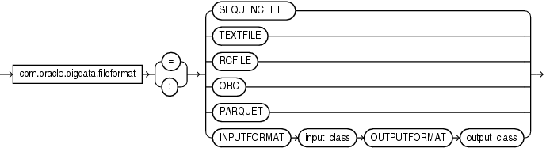

## 17 ORACLE\_BIGDATA Access Driver

With the `ORACLE_BIGDATA` access driver, you can access data stored in object stores as if that data was stored in tables in an Oracle Database.

`ORACLE_BIGDATA` currently supports access to Oracle Object Store, Amazon S3, and Azure Blob Storage. You can also use this driver to query local data, which is useful for testing and smaller data sets.

- Using the ORACLE\_BIGDATA Access Driver  
	You can use the `ORACLE_BIGDATA` driver to access data located in external object stores.
- How to Create a Credential for Object Stores  
	Credential objects enable you to access an external object store.
- Object Store Access Parameters  
	You can use these access parameters to specify properties about the files residing in object stores.

**Parent topic:** [External Tables](oracle-external-tables.md)

### 17.1 Using the ORACLE\_BIGDATA Access Driver

You can use the `ORACLE_BIGDATA` driver to access data located in external object stores.

There are two steps required to access data in an object store:

- Create a credential object (not required for public buckets).
	A **credential object** stores object store credentials in an encrypted format. The identity specified by the credential must have access to the underlying data in the object store.
- In-line external tables are supported. These external tables are simply expressed as part of a query.
	Create an external table or query using an in-line external table. The access driver type must be `ORACLE_BIGDATA`. The `CREATE TABLE` statement must reference the credential object, which provides authentication to access the object store. The table you create also requires a `LOCATION` clause, which provides the URI to the files within the object store.
	For public buckets, the `CREDENTIAL` is not required.

**Parent topic:** ORACLE\_BIGDATA Access Driver

### 17.2 How to Create a Credential for Object Stores

Credential objects enable you to access an external object store.

To create your credential object, use either the `DBMS_CREDENTIAL.CREATE_CREDENTIAL` or `DBMS_CLOUD.CREATE_CREDENTIAL`. This object contains the username and password information needed to access the object store. This credential password must match the authentication token (**auth token**) created for the username in your cloud service.

Note:

You must have the `DBMS_CLOUD` package installed.

- Creating the Credential Object with DBMS\_CREDENTIAL.CREATE\_CREDENTIAL  
	The `DBMS_CLOUD` subprogram `DBMS_CREDENTIAL.CREATE_CREDENTIAL` enables you to authenticate access to an external object store.
- Creating the Credential Object with DBMS\_CLOUD.CREATE\_CREDENTIAL  
	The `DBMS_CLOUD` subprogram `DBMS_CLOUD.CREATE_CREDENTIAL` enables you to authenticate access to an external object store.
- How to Define the Location Clause for Object Storage  
	Use these examples to see how you can specify the object store URI, depending on its source.
- Understanding ORACLE\_BIGDATA Access Parameters  
	To use `ORACLE_BIGDATA`, you provide information in an access parameter to indicate how to access and parse the data.

**Parent topic:** ORACLE\_BIGDATA Access Driver

#### 17.2.1 Creating the Credential Object with DBMS\_CREDENTIAL.CREATE\_CREDENTIAL

The `DBMS_CLOUD` subprogram `DBMS_CREDENTIAL.CREATE_CREDENTIAL` enables you to authenticate access to an external object store.

These examples show how to use `DBMS_CREDENTIAL.CREATE_CREDENTIAL`.

Example 17-1 Cloud Service Credentials

In the following example, `my_credential` is the Oracle Cloud Infrastructure user name, `username` is the account username, `password` is the Oracle Cloud Infrastructure auth token:

```
execute dbms_credential.create_credential( 
   credential_name => 'my_credential', 
   username        => 'username', 
   password        => 'password'
);
```

Example 17-2 Native Oracle Cloud Infrastructure Credentials

In the following example, `my_credential` is the Oracle Cloud Infrastructure user name, `user_ocid` is the Oracle Cloud Identifier (OCID), `tenancy_ocid` is the Oracle Cloud tenancy identifier, `private_key` is the SSH private key, and `fingerprint` is the public key fingerprint:

```
execute dbms_credential.create_credential(
   credential_name => 'my_credential',
   username => 'user_ocid',
   password => '',
   key => '{"tenancy_ocid":"tenancy_ocid","private_key":"private_key","fingerprint":"fingerprint"}');
```

After you create the credential, specify the credential object name in the parameter com.oracle.bigdata.credential.name, At the time of this release, the credential must be in the same schema as the table

#### 17.2.2 Creating the Credential Object with DBMS\_CLOUD.CREATE\_CREDENTIAL

The `DBMS_CLOUD` subprogram `DBMS_CLOUD.CREATE_CREDENTIAL` enables you to authenticate access to an external object store.

These examples show how to use `DBMS_CLOUD.CREATE_CREDENTIAL`.

Note:

The credential parameter cannot be an OCI resource principal, Azure service principal, Amazon Resource Name (ARN), or a Google service account.

Example 17-3 Native Oracle Cloud Infrastructure Credentials

In the following example, `my_credential` is the Oracle Cloud Infrastructure user name, `password` is the Oracle Cloud Infrastructure auth token, `user_ocid` is the Oracle Cloud Identifier (OCID), `tenancy_ocid` is the Oracle Cloud tenancy identifier, `private_key` is the SSH private key, and `fingerprint` is the public key fingerprint:

```
execute dbms_cloud.create_credential DBMS_CLOUD.CREATE_CREDENTIAL(
    credential_name => 'my_credential',
    username => 'user_ocid@example.com',
    password => 'password'
    key => '{"tenancy_ocid":"tenancy_ocid","private_key":"private_key","fingerprint":"fingerprint"}');
```

After you create the credential, specify the credential object name in the parameter com.oracle.bigdata.credential.name. At the time of this release, the credential must be in the same schema as the table.

#### 17.2.3 How to Define the Location Clause for Object Storage

Use these examples to see how you can specify the object store URI, depending on its source.

`LOCATION` is a URI pointing to data in the object store. Currently supported object stores are Oracle Object Store, Amazon S3 and Azure Blob Storage.

In the examples, the following variables are used:

- `region` – tenancy region
- `host` – a server host name
- `port` – a port number assigned to the service, listening on a host
- `container` – name of a container resource
- `namespace` – namespace in a region
- `bucket` – a globally unique name for a resource
- `objectname` – a unique identifier for an object in a bucket
- `filename` – object store filename

Note the following prerequisites for defining the location:

- The credential object is required for private object store access. If the credential parameter is omitted, then the object must be in a public bucket.
	The user ID associated with this credential must have access to read the data from object storage.
- If you are testing access for data in object storage using local storage, then you must specify an Oracle directory object in the location, similar to what you do for `ORACLE_LOADER` data sources.

Example 17-4 Native Oracle Cloud Infrastructure Object Storage

```
location ('https://objectstorage.region.oraclecloud.com/n/namespace/b/bucket/o/objectname')
```

Example 17-5 Oracle Cloud Infrastructure Object Storage

```
location ('https://swiftobjectstorage.region.oraclecloud.com/v1/namespace/bucket/filename'
```

Example 17-6 Hosted-Style URI format

```
location ('https://bucket.host/objectname')
```

Example 17-7 Path-style URI Format

```
location ('https://host/bucket/objectname')
```

For example, an Amazon path style URI can take the following format:

```
location ('https://s3-us-west-2.amazonaws.com/adwc/filename')
```

Example 17-8 Azure BLOB Storage Location Format

```
location ('https://host:port/container/blob')
```

For example, an Azure path style URI can take the following format:

```
location ('https://exampleacount.blob.core.windows.net/examplecontainer/exampleblob')
```

**Parent topic:** How to Create a Credential for Object Stores

#### 17.2.4 Understanding ORACLE\_BIGDATA Access Parameters

To use `ORACLE_BIGDATA`, you provide information in an access parameter to indicate how to access and parse the data.

To access the external object store, you define the file format type in the access parameter com.oracle.bigdata.fileformat, using one of the following values: `csv`, `textfile`, `avro`, `parquet`, or `orc`:
```
com.oracle.bigdata.fileformat=[csv|textfile|avro|parquet|orc]
```

You can also use `ORACLE_BIGDATA` to access local files for testing, or for simple querying. In this case, the `LOCATION` field value is the same as what you would use for `ORACLE_LOADER`. You can use an Oracle directory object followed by the name of the file in the `LOCATION` field. For local files, a credential object is not required. However, you must have privileges over on the directory object in order to access the file.

### 17.3 Object Store Access Parameters

You can use these access parameters to specify properties about the files residing in object stores.

- Syntax Rules for Specifying Properties  
	The properties are set using keyword-value pairs in the SQL `CREATE TABLE` `ACCESS PARAMETERS` clause and in the configuration files.
- com.oracle.bigdata.fileformat  
	Describes the row format of the data source, based on the `ROW             FORMAT` clause for a Hive table generated by `ORACLE_HDFS`.
- ORACLE\_BIGDATA Access Parameters  
	There is a set of access parameters that are common to all file formats. There are also parameters that are unique to a specific file format.
- GATHER\_EXTERNAL\_TABLE\_STATS  
	This is the PL/SQL interface for manually gathering statistics on external tables (`ORACLE_HDFS`, `ORACLE_HIVE`, `ORACLE_BIGDATA`).

**Parent topic:** ORACLE\_BIGDATA Access Driver

#### 17.3.1 Syntax Rules for Specifying Properties

The properties are set using keyword-value pairs in the SQL `CREATE TABLE` `ACCESS PARAMETERS` clause and in the configuration files.

The syntax must obey these rules:

- The format of each keyword-value pair is a **keyword**, a colon or equal sign, and a **value**. The following are valid keyword-value pairs:
	```
	keyword=value
	keyword:value
	```
	The value is everything from the first non-whitespace character after the separator to the end of the line. Whitespace between the separator and the value is ignored. Trailing whitespace for the value is retained.
- A property definition can be on one line or multiple lines.
- A line terminator is a line feed, a carriage return, or a carriage return followed by line feeds.
- When a property definition spans multiple lines, then precede the line terminators with a backslash (escape character), except on the last line. In this example, the value of the `Keyword1` property is `Value part 1 Value part 2 Value part 3`.
	```
	Keyword1=  Value part 1 \
	           Value part 2 \
	           Value part 3
	```
- You can create a **logical line** by stripping each physical line of leading whitespace and concatenating the lines. The parser extracts the property names and values from the logical line.
- You can embed special characters in a property name or property value by preceding a character with a backslash (escape character), indicating the substitution. The following table describes the special characters.

Table 17-1 Special Characters in Properties

| Escape Sequence | Character |
| --- | --- |
| `\b` | Backspace (`\u0008`) |
| `\t` | Horizontal tab (`\u0009`) |
| `\n` | Line feed (`\u000a)` |
| `\f` | Form feed (`\u000c`) |
| `\r` | Carriage return (`\u000d`) |
| `\"` | Double quote (`\u0022`) |
| `\'` | Single quote (`\u0027`) |
| `\\` | Backslash (`\u005c`)  When multiple backslashes are at the end of the line, the parser continues the value to the next line only for an odd number of backslashes. |
| `\u` `xxxx` | 2-byte, big-endian, Unicode code point.  When a character requires two code points (4 bytes), the parser expects `\u` for the second code point. |

**Parent topic:** Object Store Access Parameters

#### 17.3.2 com.oracle.bigdata.fileformat

Describes the row format of the data source, based on the `ROW             FORMAT` clause for a Hive table generated by `ORACLE_HDFS`.

Default Value

`TEXTFILE`

Syntax

A JSON document with the keyword-value pairs is shown in the following diagram.

`fileformat::=`



> fileformat::=
>
> com.oracle.bigdata.fileformat \[ = |: \]
>
> {SEQUENCEFILE |
>
> TEXTFILE |
>
> RCFILE |
>
> ORC |
>
> PARQUET |
>
> INPUTFORMAT input\_class OUTPUTFORMAT output\_class}
>
> [  
> Copyright © 2002, 2026, Oracle and/or its affiliates.](https://docs.oracle.com/en/database/oracle/oracle-database/dcommon/html/cpyr.htm)


Semantics

`ORC`

Optimized row columnar file format

`PARQUET`

Column-oriented, binary file format

`RCFILE`

Record columnar file format

`SEQUENCEFILE`

Compressed file format

`TEXTFILE`

Plain text file format

`INPUTFORMAT`

Identifies a Java class that can extract records from the data file.

`OUTPUTFORMAT`

Identifies a Java class that can format the output records in the desired format

**Parent topic:** Object Store Access Parameters

#### 17.3.3 ORACLE\_BIGDATA Access Parameters

There is a set of access parameters that are common to all file formats. There are also parameters that are unique to a specific file format.

Common Access Parameters

The following table lists parameters that are common to all file formats accessed through `ORACLE_BIGDATA`. The first column identifies each access parameter common to all data file types. The second column describes each parameter.

Table 17-2 Common Access Parameters

| Common Access Parameter | Description |
| --- | --- |
| `com.oracle.bigdata.credential.name` | Specifies the credential object to use when accessing data files in an object store.  This access parameter is required for object store access. It is not needed for access to files through a directory object or for data stored in public buckets.  The name specified for the credential must be the name of a credential object in the same schema as the owner of the table. Granting a user `SELECT` or `READ` access to this table means that credential will be used to access the table.  Use `DBMS_CREDENTIAL.CREATE_CREDENTIAL` in the `DBMS_CREDENTIAL PL/SQL` package to create the credential object: ``` exec dbms_credential.create_credential(credential_name => 'MY_CRED',username =>'<username>', password => '<password>'); ```  In the `CREATE TABLE` statement, set the value of the credential parameter to the name of the credential object.  ``` com.oracle.bigdata.credential.name=MY_CRED ``` |
| `com.oracle.bigdata.fileformat` | Specifies the format of the file. The value of this parameter identifies the reader that will process the file. Each reader can support additional access parameters that may or may not be supported by other readers.  Valid values: `parquet`, `orc`, `textfile`, `avro`, `csv`  Default: `PARQUET` |
| `com.oracle.bigdata.log.opt` | Specifies whether log messages should be written to a log file. When `none` is specified, then no log file is created. If the value is `normal`, then log file is created when the file reader decides to write a message. It is up to the file reader to decide what is written to the log file.  Valid values: `normal`, `none`  Default: `none`. |
| `com.oracle.bigdata.log.qc` | Specifies the name of the log file created by the parallel query coordinator. This parameter is used only when `com.oracle.bigdata.log.opt` is set to `normal`. The valid values are the same as specified for `com.oracle.bigdata.log.qc` in `ORACLE_HIVE` and `ORACLE_HDFS`. |
| `com.oracle.bigdata.log.exec` | Specifies the name of the log file created during query execution. This value is used (and is required) only when `com.oracle.bigdata.log.exec` is set to normal. The valid values are the same as specified for in `ORACLE_HIVE` and `ORACLE_HDFS`.  Valid values: `normal`, `none`  Default: `none`. |

Avro-Specific Access Parameters

In addition to common access parameters, there are some that are only valid for the Avro file format. The first column in this table identifies the access parameters specific to the Avro file format and the second column describes the parameter. There is only one Avro-specific parameter at this time.

Table 17-3 Avro-Specific Access Parameters

| Avro-Specific Parameter | Description |
| --- | --- |
| `com.oracle.bigdata.avro.decimaltpe` | Specifies the representation of a decimal stored in the byte array.  Valid values: `int`, `integer`, `str`, `string`  Default: If this parameter is not used, an Avro decimal column is read assuming byte arrays store the numerical representation of the values (that is default to `int`) as the Avro specification defines. |

Parquet-Specific Access Parameters

Some access parameters are only valid for the Parquet file format. The first column in this table identifies the access parameters specific to the Parquet file format and the second column describes the parameter.

Table 17-4 Parquet-Specific Access Parameters

| Parquet-Specific Access Parameter | Description |
| --- | --- |
| `com.oracle.bigdata.prq.binary_as_string` | This is a Boolean property that specifies if the binary is stored as a string.  Valid values: `true`, `t`, `yes`, `y`, `l`, `false`, `f`, `no`, `n`, `0`  Default: `true` |
| `com.oracle.bigdata.prq.int96_as_timestamp` | This is a Boolean property that specifies if `int96` represents a timestamp.  Valid values: `true`, `t`, `yes`, `y`, `l`, `false`, `f`, `no`, `n`, `0`  Default: `true` |

Textfile and CSV-Specific Access Parameters

The text file and comma-separated value (`csv`) file formats are similar to the hive text file format. It reads text and `csv` data from delimited files. `ORACLE_BIGDATA` automatically detects the line terminator (either `\n`, `\r`, or `\r\n`). By default, it assumes the fields in the file are separated by commas, and the order of the fields in the file match the order of the columns in the external table.

Example 17-9 CSV Data File

This is a simple `csv` example. The data file has comma-separated values, with optional enclosing quotes.

```
–----Source csv data in t.dat
t.dat:     

1,"abc",     
2,xyx,
```
```
–---------Create an external table over the csv source data in t.dat
CREATE TABLE t     
( 
 c0 number,       
 c1 varchar2(20)
) 
ORGANIZATION external     
( 
 TYPE oracle_bigdata
 DEFAULT DIRECTORY DMPDIR
 ACCESS PARAMETERS      
 (         
  com.oracle.bigdata.fileformat=csv
 )
 location
 (         
  't.dat'       
 )     
)REJECT LIMIT 1
;
```
```
–------Select data from external table
select c0, c1 from t;  

 C0    C1     
----  -----
 1     abc
 2     xyz
```

Example 17-10 CSV Data File

This example shows how to create an external table over a `csv` data source, which has ' `|` ' as the field separator, the data file compressed with `gzip`, blanks as null, and a date format.

```
–----The source csv data in t.dat
t.dat:     

 1|  |     
 2|Apr-99-30|
```
```
–------Create an external table over the csv data source in t.dat
CREATE TABLE t(       
 c0 number,       
 c1 date     
)     
ORGANIZATION external     
(       
 TYPE oracle_bigdata       
 DEFAULT DIRECTORY DMPDIR       
 ACCESS PARAMETERS      
 (         
  com.oracle.bigdata.fileformat=textfile        
  com.oracle.bigdata.compressiontype=gzip        
  com.oracle.bigdata.csv.rowformat.separatorcharacter='|'        
  com.oracle.bigdata.blankasnull=true         
  com.oracle.bigdata.dateformat="MON-RR-DD HH:MI:SS"
 )       
 location       
 (         
  't.dat.gz'
  )     
 )REJECT LIMIT 1     
;
```
```
--Select csv data from external table
QL> select c0, c1 from t;    
         
 C0       C1    
------ ---------             
  1              
  2    30-APR-99
```

Example 17-11 JSON Data File

This is a JSON file where each row is a JSON document. The external table reaches each row. Queries use Oracle SQL JSON functions to parse the data.
```
{"id":"72","name":"George","lat":40.76727216,"lon":-73.99392888,"segments":["wealthy","middle-aged"],"age":45}
{"id":"79","name":"Lucy","lat":40.71911552,"lon":-74.00666661,"segments":["married","yes"],"age":33}
```

```
— Create the external table over Json source 
CREATE TABLE people (
 doc varchar2(4000)         
)    
ORGANIZATION EXTERNAL ( 
  TYPE ORACLE_BIGDATA      
  DEFAULT DIRECTORY DEFAULT_DIR 
  ACCESS PARAMETERS(    
    com.oracle.bigdata.credential.name=MY_CRED    
    com.oracle.bigdata.fileformat=textfile    
    com.oracle.bigdata.csv.rowformat.fields.terminator='\n’    <— notice the
      delimiter is a new line (that is, not a comma).  So, it will read to the end of the line and get
      the whole document.        
    )      
  LOCATION ('https://swftobjectstorage.us-phoenix-1.oraclecloud.com/v1/mybucket/people.json')   
)
REJECT LIMIT UNLIMITED;
```
```
–---Select data from external table
select s.doc.id,
  s.doc.name,
  s.doc.segments[0] –--notice we’re getting the first item in the array of possible individuals 
from the table people;

id     Name     segments[0]
–---   –----    –-----------------------------------
  72   George   wealthy
  79   Lucy     married
```

Textfile and CSV-Specific Access Parameters

Table 17-5 Textfile and CSV-Specific Access Parameters

| Textfile-Specific Access Parameter | Description |
| --- | --- |
| `com.oracle.bigdata.buffersize ` | Specifies the size of the input/output (I/O) buffer used for reading the file. The value is the size of the buffer in kilobytes. Note that the buffer size is also the largest size that a record can be. If a format reader encounters a record larger than this value, then it will return an error.  Default: `1024` |
| `com.oracle.bigdata.blankasnull` | When set to `true`, loads fields consisting of spaces as null.  Valid values: `true`, `false`  Default: `false`  Example: `com.oracle.bigdata.blankasnull=true` |
| `com.oracle.bigdata.characterset` | Specifies the character set of source files.  Valid values: `UTF-8`  Default: `UTF-8`  Example: `com.oracle.bigdata.characterset=UTF-8` |
| `com.oracle.bigdata.compressiontype` | If this parameter is specified, then the code tries to decompress the data according to the compression scheme specified.  Valid values: `gzip`, `bzip2`, `zlib`, `detect`  Default: no compression  If `detect` is specified, then the format reader tries to determine which of the supported compression methods was used to compress the file. |
| `com.oracle.bigdata.conversionerrors` | `If a row has data type conversion errors,                                     then the related columns are stored as null, or the row is                                     rejected. `  Valid values: `reject_record`, `store_null`  Default: `store_null`  Example: `com.oracle.bigdata.conversionerrors=reject_record` |
| `com.oracle.bigdata.csv.rowformat.nulldefinedas` | Specifies the character used to indicate the value of a field is `NULL`. If the parameter is not specified, then there is no value. |
| `com.oracle.bigdata.csv.rowformat.fields.terminator` | Specifies the character used to separate the field values. The character value must be wrapped in single-quotes. Example: `'\|'`.  Default: `','` |
| `com.oracle.bigdata.csv.rowformat.fields.escapedby` | Specifies the character used to escape any embedded field terminators or line terminators in the value for fields. The character value must be wrapped in single quotes. Example: `'\'`. |
| `com.oracle.bigdata.dateformat` | Specifies the date format in the source file. The format option `Auto` checks for the following formats:  `J``, MM-DD-YYYYBC`, `MM-DD-YYYY`, `YYYYMMDD                                         HHMISS`, `YYMMDD HHMISS,` `YYYY.DDD`, `YYYY-MM-DD`  Default: `yyyy-mm-dd                                         hh24:mi:ss`  Example: `com.oracle.bigdata.dateformat=                                         "MON-RR-DDHH:MI:SS"` |
| `com.oracle.bigdata.fields` | Specifies the order of fields in the data file. The values are the same as for `com.oracle.bigdata.fields` in `ORACLE_HDFS`, with one exception – in this case, the data type is optional. Because the data file is text, the text file reader ignores the data types for the fields, and assumes all fields are text. Because the data type is optional, this parameter can be a list of field names. |
| `com.oracle.bigdata.ignoreblanklines` | Blank lines are ignored when set to true.  Valid values: `true`, `false`  Default: `false`  Example: `com.oracle.bigdata.ignoreblanklines=true` |
| `com.oracle.bigdata.ignoremissingcolumns` | Missing columns are stored as null.  Valid values: `true`  Default: `true`  Example: `com.oracle.bigdata.ignoremissingcolumns=true` |
| `com.oracle.bigdata.quote` | Specifies the quote character for the fields. The quote characters are removed during loading when specified.  Valid values: character  Default: Null, meaning no quote  Example: `com.oracle.bigdata.csv.rowformat.quotecharacter='"'` |
| `com.oracle.bigdata.rejectlimit` | The operation errors out after specified number of rows are rejected. This only applies when rejecting records due to conversion errors.  Valid values: number  Default: `0`  Example:`                                         com.oracle.bigdata.rejectlimit=2` |
| `com.oracle.bigdata.removequotes` | Removes any quotes that are around any field in the source file.  Valid values: `true`, `false`  Default: `false`  Example:`com.oracle.bigdata.removequotes=true` |
| `com.oracle.bigdata.csv.skip.header` | Specifies how many rows should be skipped from the start of the files.  Valid values: number  Default: `0`, if not specified  Example: `com.oracle.bigdata.csv.skip.header=1` |
| `com.oracle.bigdata.timestampformat` | Specifies the timestamp format in the source file. The format option `AUTO` checks for the following formats:  `YYYY-MM-DD HH:MI:SS.FF`, `YYYY-MM-DD HH:MI:SS.FF3`, `MM/DD/YYYY                                         HH:MI:SS.FF3`  Valid values: `auto`  Default: `yyyy-mm-dd                                         hh24:mi:ss.ff`  Example: `com.oracle.bigdata.timestamptzformat="auto"` |
| `com.oracle.bigdata.timestampltzformat` | Specifies the timestamp with local timezone format in the source file. The format option `AUTO` checks for the following formats:  `DD Mon YYYY HH:MI:SS.FF TZR`, `MM/DD/YYYY HH:MI:SS.FF TZR`, `YYYY-MM-DD HH:MI:SS+/-TZR`, `YYYY-MM-DD HH:MI:SS.FF3`, `DD.MM.YYYY                                         HH:MI:SS TZR`  Valid values: `auto`  Default: `yyyy-mm-dd                                         hh24:mi:ss.ff`  Example: `com.oracle.bigdata.timestampltzformat="auto"` |
| `com.oracle.bigdata.timestamptzformat` | Specifies the timestamp with timezone format in the source file. The format option `AUTO` checks for the following formats:  `DD Mon YYYY HH:MI:SS.FF TZR`, `MM/DD/YYYY HH:MI:SS.FF TZR`, `YYYY-MM-DD HH:MI:SS+/-TZR`, `YYYY-MM-DD HH:MI:SS.FF3`, `DD.MM.YYYY                                         HH:MI:SS TZR`  Valid values: `auto`  Default: `yyy-mm-dd                                         hh24:mi:ss.ff`  Example: `com.oracle.bigdata.timestamptzformat="auto"` |
| `com.oracle.bigdata.trimspaces` | Specifies how the leading and trailing spaces of the fields are trimmed.  Valid values: `rtrim`, `ltrim`, `notrim`, `ltrim`, `ldrtrim`  Default: `notrim`  Example: `com.oracle.bigdata.trimspaces=rtrim` |
| `com.oracle.bigdata.truncatecol` | If the data in the file is too long for a field, then this option truncates the value of the field rather than rejecting the row or setting the field to NULL.  Valid values: `true`, `false`  Default: `false`  Example: `com.oracle.bigdata.truncatecol=true` |

**Parent topic:** Object Store Access Parameters

#### 17.3.4 GATHER\_EXTERNAL\_TABLE\_STATS

This is the PL/SQL interface for manually gathering statistics on external tables (`ORACLE_HDFS`, `ORACLE_HIVE`, `ORACLE_BIGDATA`).

The behavior and parameters are identical to that of `dbms_stats.gather_table_stats`, with the exception that the owner of the table must be the session user running the procedure, and the stats gathered using this procedure persist after a restart. This procedure cannot be used on external tables that are automatically synced from Hive.

See [GATHER\_TABLE\_STATS Procedure](https://docs.oracle.com/pls/topic/lookup?ctx=en/database/oracle/oracle-database/21/sutil&id=ARPLS-GUID-CA6A56B9-0540-45E9-B1D7-D78769B7714C)

Syntax

`PROCEDURE gather_external_table_stats( tabname varchar2, partname                                         varchar2 default null, estimate_percent number default                                         dbms_stats.DEFAULT_ESTIMATE_PERCENT, block_sample boolean                                         default FALSE, method_opt varchar2 default                                         dbms_stats.DEFAULT_METHOD_OPT, degree number default                                         dbms_stats.DEFAULT_DEGREE_VALUE, granularity varchar2                                         default dbms_stats.DEFAULT_GRANULARITY, cascade boolean                                         default dbms_stats.DEFAULT_CASCADE, stattab varchar2 default                                         null, statid varchar2 default null, statown varchar2 default                                         null, no_invalidate boolean default                                         dbms_stats.to_no_invalidate_type(dbms_stats.get_param('NO_INVALIDATE')),                                         stattype varchar2 default 'DATA', force boolean default                                         FALSE, options varchar2 default dbms_stats.DEFAULT_OPTIONS                                         )`

```
PROCEDURE gather_external_table_stats(
    tabname varchar2,
    partname varchar2 default null,
    estimate_percent number default dbms_stats.DEFAULT_ESTIMATE_PERCENT,
    block_sample boolean default FALSE,
    method_opt varchar2 default dbms_stats.DEFAULT_METHOD_OPT,
    degree number default dbms_stats.DEFAULT_DEGREE_VALUE,
    granularity varchar2 default dbms_stats.DEFAULT_GRANULARITY,
    cascade boolean default dbms_stats.DEFAULT_CASCADE,
    stattab varchar2 default null,
    statid varchar2 default null,
    statown varchar2 default null,
    no_invalidate boolean default dbms_stats.to_no_invalidate_type(dbms_stats.get_param('NO_INVALIDATE')),
    stattype varchar2 default 'DATA',
    force boolean default FALSE,
    options varchar2 default dbms_stats.DEFAULT_OPTIONS
  )
```

**Parent topic:** Object Store Access Parameters