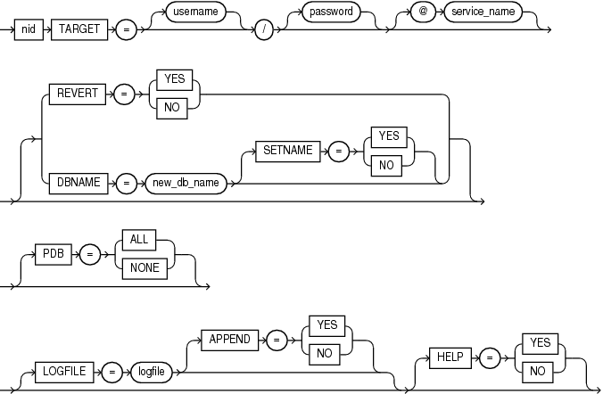

## 22 DBNEWID Utility

`DBNEWID` is a database utility that can change the internal database identifier (`DBID`) and the database name (`DBNAME`) for an operational database.

- What Is the DBNEWID Utility?  
	The `DBNEWID` utility enables you to change only the `DBID`, `DBNAME`, or both the `DBID` and `DBNAME` of a database.
- Ramifications of Changing the DBID and DBNAME  
	Before you change the `DBID` and `DBNAME` of a database with the DBNEWID utility, review these guidelines.
- Considerations for Global Database Names  
	The DBNEWID (`nid`) utility can be used to change database identifiers (IDs) and global database names. Review guidelines and best practices.
- Global Database Name Guidelines for Distributed Databases  
	With distributed databases, you must change a global database name using the SQL `ALTER DATABASE` command.
- Changing Both CDB and PDB DBIDs Using DBNEWID  
	The DBNEWID parameter `PDB` enables you to change the `DBID` on pluggable databases (PDBs).
- Changing the DBID and DBNAME of a Database  
	To change either `DBID` or `DBNAME`, or both the `DBID` and `DBNAME` of your database, select the DBNEWID procedure that you need.
- DBNEWID Syntax  
	To change only the `DBID`, `DBNAME`, or both the `DBID` and `DBNAME` of a database, use `DBNEWID`.

**Parent topic:** [Other Utilities](other-oracle-utilities.md)

### 22.1 What Is the DBNEWID Utility?

The `DBNEWID` utility enables you to change only the `DBID`, `DBNAME`, or both the `DBID` and `DBNAME` of a database.

Before the introduction of the DBNEWID utility, you could manually create a copy of a database and give it a new database name (`DBNAME`) by recreating the control file. However, you could not give the database a new identifier (`DBID`). The `DBID` is an internal, unique identifier for a database. Because Recovery Manager (RMAN) distinguishes databases by `DBID`, you could not register a seed database and a manually copied database together in the same RMAN repository. The DBNEWID utility solves this problem by enabling you to change any of the following:

- Only the `DBID` of a database
- Only the `DBNAME` of a database
- Both the `DBNAME` and `DBID` of a database

**Parent topic:** DBNEWID Utility

### 22.2 Ramifications of Changing the DBID and DBNAME

Before you change the `DBID` and `DBNAME` of a database with the DBNEWID utility, review these guidelines.

Caution:

Before you change the `DBID`, Oracle strongly recommends that you make a backup of the whole database. After you change the DBID, again back up the database immediately. When the DBID of a database is changed, all previous backups and archived logs of the database become unusable. After you change the global database name, that process cannot be reversed.

Changing the `DBID` is similar to creating a database, except that the data is already in the data files. After you change the `DBID`, backups and archive logs that were created before the `DBID` change can no longer be used, because they still have the original `DBID`, which does not match the current `DBID`. You must open the database with the `RESETLOGS` option, which recreates the online redo logs, and resets the redo log sequence to 1.

When you change `DBNAME` and do not change `DBID`, you must change the `DBNAME` initialization parameter, and follow additional guidelines.

Changing the `DBNAME` without changing the `DBID` does not require you to open with the `RESETLOGS` option, so database backups and archived logs are not invalidated. However, changing the `DBNAME` does have consequences. You must change the `DB_NAME` initialization parameter after a database name change to reflect the new name. Also, you may have to recreate the Oracle password file. If you restore an old backup of the control file (before the name change), then you should use the initialization parameter file and password file from before the database name change.

Caution:

If you are using a capture process to capture changes to the database, then do not change the `DBID` or `DBNAME` of a database.

For Oracle RAC environments only, you must first detach the database from the cluster before you can run the DBNEWID utility. Use SQL\*Plus to enter the following commands to set the initialization parameter value for `CLUSTER_DATABASE` to `FALSE`

1. ```
	ALTER SYSTEM SET CLUSTER_DATABASE=FALSE SCOPE=SPFILE;
	```
	Restart the database after changing the `CLUSTER_DATABASE` parameter.
2. Shut down the database.
	```
	SHUTDOWN IMMEDIATE
	```

You can then run `STARTUP MOUNT EXCLUSIVE`, and change the global database name. If you attempt to use the DBNEWID utility while `CLUSTER_DATABASE=TRUE`, then the command fails with `NID-00120: Database should be mounted exclusively`.

Additional Guidelines and best practices

- Single-Instance Only: Run `nid` against a single-instance database, not directly on an Oracle RAC (Real Application Clusters) database instance. When working with Oracle RAC, follow the Oracle RAC documentation for procedures.
- Database State: Open the database in `MOUNT` mode (not open) for `nid` to work.
- Script All Steps: Oracle recommends that you document and script steps, especially if the process must be repeated or applied to multiple environments.
- Update Clients and Services: After a database name change, update any `TNSNAMES.ORA`, services, Oracle Data Guard configurations, and applications pointing to the old name.
- Update SPFILE: The DBNEWID utility does not change the server parameter file (SPFILE). Therefore, if you use SPFILE to start your Oracle database, then you must recreate the initialization parameter file from the server parameter file, remove the server parameter file, change the DB\_NAME in the initialization parameter file, and then recreate the server parameter file.

Security and Compliance Reminder

Changing a database name or DBID is a significant operation. Before you begin, confirm that planned name changes conform with change management and security guidelines.
- DBAs and compliance teams should review name change plans.
- Ensure that the name change is tracked for your organization’s audit trail, and that the name change is consistent with internal change management policies.
- Always consult the latest documentation relevant to your database release; recommended steps can be different for releases.

### 22.3 Considerations for Global Database Names

The DBNEWID (`nid`) utility can be used to change database identifiers (IDs) and global database names. Review guidelines and best practices.

Automatic Update of GLOBAL\_NAME When Using DBNEWID (`nid`)

- The DBNEWID (`nid`) utility can be used to change a database’s name (`DBNAME`) and database identifier (`DBID`). When running with `SETNAME=Y`, `nid` updates the global database name (`GLOBAL_NAME`) automatically, using the new database name and preserving the current domain.
- Always verify the value of `GLOBAL_NAME` after running `nid` to confirm it reflects the intended changes. In rare cases or with older Oracle releases, you may need to use `ALTER DATABASE RENAME                                                 GLOBAL_NAME` manually.

Restrictions

- You cannot use `nid` to change the name of a CDB seed in a Multitenant environment.
- You cannot use `nid` on Standby databases. If you are using Oracle Data Guard, review the Oracle Data Guard documentation.

Distributed Database Guidelines

If you want to update a database name in a distributed database system, then each database should have a unique global database name. You can only change a global database name with the SQL `ALTER DATABASE` statement, for which the syntax is as follows:

```
ALTER DATABASE RENAME GLOBAL_NAME TO newname.domain;
```

The global database name is made up of a database name and a domain, which are determined by the `DB_NAME` and `DB_DOMAIN` initialization parameters when the database is first created.

For example, suppose you use DBNEWID (`nid`) to change a database name to `sales`. To ensure that you also change the global database name to `sales` in the domain `example.com`, you should use `ALTER DATABASE RENAME` as follows:

```
ALTER DATABASE RENAME GLOBAL_NAME TO sales.example.com
```

See Also:

Oracle Database Administrator’s Guide for more information about global database names, and My Oracle Support "How to Change the DBID, DBNAME Using NID Utility (Doc ID 863800.1)"

**Parent topic:** DBNEWID Utility

### 22.4 Global Database Name Guidelines for Distributed Databases

With distributed databases, you must change a global database name using the SQL `ALTER DATABASE` command.

If you want to update a database name in a distributed database system, then each database should have a unique global database name. You can only change a global database name with the SQL `ALTER                                 DATABASE` statement, for which the syntax is as follows:

```
ALTER DATABASE RENAME GLOBAL_NAME TO newname.domain;
```

The global database name is made up of a database name and a domain, which are determined by the `DB_NAME` and `DB_DOMAIN` initialization parameters when the database is first created.

For example, suppose you use DBNEWID (`nid`) to change a database name to `sales`. To ensure that you also change the global database name to `sales` in the domain `example.com`, you should use `ALTER DATABASE                                 RENAME` as follows:

```
ALTER DATABASE RENAME GLOBAL_NAME TO sales.example.com
```

See Also:

Oracle Database Administrator’s Guide for more information about global database names, and My Oracle Support "How to Change the DBID, DBNAME Using NID Utility (Doc ID 863800.1)"

**Parent topic:** DBNEWID Utility

### 22.5 Changing Both CDB and PDB DBIDs Using DBNEWID

The DBNEWID parameter `PDB` enables you to change the `DBID` on pluggable databases (PDBs).

By default, when you run the DBNEWID utility on a container database (CDB), the utility only changes the `DBID` of the CDB. The `DBID` values for each of the pluggable databases (PDBs) plugged into the CDB remain the same. In some cases, you can find that this default behavior causes problems with duplicate DBID values for PDBs. For example, you can encounter this issue when a CDB is cloned.

With Oracle Database 12c Release 2 (12.2) and later releases, you can use the DBNEWID utility PDB parameter in multitenant databases to change the DBID values for PDBs. You cannot specify a particular PDB; either all of them or none of them are assigned new `DBID` values. The `PDB` parameter has the following format:

```
PDB=[ALL | NONE]
```
- If you specify `ALL`, then in addition to the `DBID` for the CDB changing, the `DBID` values for all PDBs plugged into the CDB are also changed.
- Specifying `NONE` (the default) leaves the PDB `DBID` s the same, even if the CDB `DBID` is changed.

Oracle recommends that you use `PDB=ALL`. For backward compatibility, the default is `PDB=NONE`.

**Parent topic:** DBNEWID Utility

### 22.6 Changing the DBID and DBNAME of a Database

To change either `DBID` or `DBNAME`, or both the `DBID` and `DBNAME` of your database, select the DBNEWID procedure that you need.

- Changing the DBID and Database Name  
	To change the `DBID` of a database, or both the `DBID` and `DBNAME` of a database with `DBNEWID`, use this procedure.
- Changing Only the Database ID  
	To change the database ID (`DBID`) without changing the database name, use this DBNEWID procedure.
- Changing Only the Database Name  
	To change the database name (`DBNAME`) without changing the `DBID`, use this DBNEWID procedure.
- Troubleshooting DBNEWID  
	If you encounter an error when using DBNEWID to change a database ID, then refer to these troubleshooting hints.

**Parent topic:** DBNEWID Utility

#### 22.6.1 Changing the DBID and Database Name

To change the `DBID` of a database, or both the `DBID` and `DBNAME` of a database with `DBNEWID`, use this procedure.

Caution:

Changing the `DBID` invalidates all existing backups and archived redo logs. Perform a whole database backup before proceeding. You must open the database with `RESETLOGS` after running `DBNEWID`. If you change the `DBNAME`, then create a new password file and update all references in scripts, TNS aliases, and OEM configurations.

The following steps describe how to change the `DBID` of a database. In these steps, we use the example of changing the ID and name for the database `PROD` to `TEST_DB`.

1. Perform a complete database backup. Use a full RMAN backup if possible.
2. Shut down the database cleanly. Ensure that the target database is shut down consistently.
	```
	SHUTDOWN IMMEDIATE
	```
	Do not use `SHUTDOWN ABORT`. If you do, then open the database again and shut it down using `IMMEDIATE` or `NORMAL`.
3. Start the database in MOUNT mode. Ensure that the target database is mounted but not open.
	```
	STARTUP MOUNT
	```
	Doing this ensures that all files are consistent and ready for `DBNEWID` processing.
4. From an operating system prompt on the database server, run the `nid` utility. Use operating system authentication (`                         / as sysdba`) when possible. For example:
	To change only the `DBID`:
	```
	nid TARGET=/
	```
	To change both the `DBID` and `DBNAME` (example: `PROD` to `TEST_DB`):
	```
	nid TARGET=/ DBNAME=TEST_DB
	```
	You will be prompted for confirmation:
	```
	Change database ID and database name PROD to TEST_DB? (Y/[N]) => Y
	```
	The DBNEWID utility performs validations in the headers of the data files and control files before attempting to modify the files. If validation is successful, then DBNEWID prompts you to confirm the operation (unless you specify a log file, in which case it does not prompt), changes the `DBID` (and the `DBNAME`, if specified, as in this example) for each data file, including offline normal and read-only data files, shuts down the database, and then exits.
	The following is an example of what the output for this would look like:
	```
	...
	Connected to database PROD (DBID=86997811)
	...
	Control Files in database:
	/oracle/TEST_DB/data/cf1.dbf
	/oracle/TEST_DB/data/cf2.dbf
	...
	Changing database ID from 86997811 to 1250654267
	Changing database name from PROD to TEST_DB
	Control File /oracle/TEST_DB/data/cf1.dbf - modified
	...
	Instance shut down
	Database name changed to TEST_DB.
	Modify parameter file and generate a new password file before restarting.
	Database ID for database TEST_DB changed to 1250654267.
	All previous backups and archived redo logs for this database are unusable.
	Database has been shutdown, open database with RESETLOGS option.
	Successfully changed database name and ID.
	DBNEWID - Completed successfully.
	```
	If validation is not successful because of a problem (for example, "offline immediate" data files), then DBNEWID terminates, and leaves the target database intact, as shown in the following example output.
	```
	NID-00150: Connected to database PROD (DBID=86997811)
	Control Files in database:
	/oracle/TEST_DB/data/cf1.dbf
	/oracle/TEST_DB/data/cf2.dbf
	The following datafiles are offline clean:
	/oracle/TEST_DB/data/tbs_61.dbf (23)
	/oracle/TEST_DB/data/tbs_62.dbf (24)
	/oracle/TEST_DB/data/temp3.dbf (3)
	These files must be writable by this utility.
	The following datafiles are read-only:
	/oracle/TEST_DB/data/tbs_51.dbf (15)
	/oracle/TEST_DB/data/tbs_52.dbf (16)
	/oracle/TEST_DB/data/tbs_53.dbf (22)
	These files must be writable by this utility.
	The following datafiles are offline immediate:
	/oracle/TEST_DB/data/tbs_71.dbf (25)
	/oracle/TEST_DB/data/tbs_72.dbf (26)
	NID-00122: Database should have no offline immediate datafiles
	Change of database name failed during validation - database is intact.
	DBNEWID - Completed with validation errors.
	```
	If a validation error occurs, then review the output and resolve all listed issues, such as recovering or dropping problematic datafiles. After resolving the issues, repeat the `DBNEWID` step.
5. If you changed the database name, then create a new password file.
	For example:
	```
	orapwd file=$ORACLE_HOME/dbs/orapwTEST_DB password=your_sys_password
	```
6. Edit the Initialization Parameter File. Update `DB_NAME` and any affected parameters if using a `PFILE`. For `SPFILE`, you can amend parameters by using `ALTER                         SYSTEM`.
7. Start and open the database with the `RESETLOGS` option to resume normal operations.
	For example:
	```
	STARTUP MOUNT
	ALTER DATABASE OPEN RESETLOGS;
	```
8. Perform a Full Backup.
	After the operation, all previous backups and archived logs are obsolete. Perform a new full backup of the database immediately.

**Related Topics**

- [When to Create New Control Files in Oracle Database Concepts](https://docs.oracle.com/pls/topic/lookup?ctx=en/database/oracle/oracle-database/21/sutil&id=CNCPT-GUID-553F209C-EE30-4637-8344-BB26FE3AA088)
- [How to Change the DBID, DBNAME Using NID Utility KB135723/Document ID: 863800.1](https://support.oracle.com/support/?kmContentId=863800&page=sptemplate&sptemplate=km-article)

**Parent topic:** Changing the DBID and DBNAME of a Database

#### 22.6.2 Changing Only the Database ID

To change the database ID (`DBID`) without changing the database name, use this DBNEWID procedure.

Follow the steps in Changing the DBID and Database Name, but in Step 4 do not specify the optional database name (`DBNAME`). The following is an example of the type of output that is generated when only the database ID is changed.

```
.
.
.
Connected to database PROD (DBID=86997811)
.
.
.  
Control Files in database:
    /oracle/TEST_DB/data/cf1.dbf
    /oracle/TEST_DB/data/cf2.dbf
 
The following datafiles are offline clean:
    /oracle/TEST_DB/data/tbs_61.dbf (23)
    /oracle/TEST_DB/data/tbs_62.dbf (24)
    /oracle/TEST_DB/data/temp3.dbf (3)
These files must be writable by this utility.
 
The following datafiles are read-only:
    /oracle/TEST_DB/data/tbs_51.dbf (15)
    /oracle/TEST_DB/data/tbs_52.dbf (16)
    /oracle/TEST_DB/data/tbs_53.dbf (22)
These files must be writable by this utility.
 
Changing database ID from 86997811 to 4004383693
    Control File /oracle/TEST_DB/data/cf1.dbf - modified
    Control File /oracle/TEST_DB/data/cf2.dbf - modified
    Datafile /oracle/TEST_DB/data/tbs_01.dbf - dbid changed
    Datafile /oracle/TEST_DB/data/tbs_ax1.dbf - dbid changed
    Datafile /oracle/TEST_DB/data/tbs_02.dbf - dbid changed
    Datafile /oracle/TEST_DB/data/tbs_11.dbf - dbid changed
    Datafile /oracle/TEST_DB/data/tbs_12.dbf - dbid changed
    Datafile /oracle/TEST_DB/data/temp1.dbf - dbid changed
    Control File /oracle/TEST_DB/data/cf1.dbf - dbid changed
    Control File /oracle/TEST_DB/data/cf2.dbf - dbid changed
    Instance shut down
 
Database ID for database TEST_DB changed to 4004383693.
All previous backups and archived redo logs for this database are unusable.
Database has been shutdown, open database with RESETLOGS option.
Succesfully changed database ID.
DBNEWID - Completed succesfully.
```

**Parent topic:** Changing the DBID and DBNAME of a Database

#### 22.6.3 Changing Only the Database Name

To change the database name (`DBNAME`) without changing the `DBID`, use this DBNEWID procedure.

Complete the following steps:

1. Ensure that you have a recoverable whole database backup.
2. Ensure that the target database is mounted but not open, and that it was shut down consistently before mounting. For example:
	```
	SHUTDOWN IMMEDIATE
	STARTUP MOUNT
	```
3. Start the utility on the command line, specifying a valid user with the `SYSDBA` privilege (you will be prompted for a password). You must specify both the `DBNAME` and `SETNAME` parameters. This example changes the name to `test_db`:
	```
	% nid TARGET=SYS DBNAME=test_db SETNAME=YES
	```
	DBNEWID performs validations in the headers of the control files (not the data files) before attempting I/O to the files. If validation is successful, then DBNEWID prompts for confirmation, changes the database name in the control files, shuts down the database and exits. The following is an example of what the output for this would look like:
	```
	.
	.
	.
	Control Files in database:
	    /oracle/TEST_DB/data/cf1.dbf
	    /oracle/TEST_DB/data/cf2.dbf
	The following datafiles are offline clean:
	    /oracle/TEST_DB/data/tbs_61.dbf (23)
	    /oracle/TEST_DB/data/tbs_62.dbf (24)
	    /oracle/TEST_DB/data/temp3.dbf (3)
	These files must be writable by this utility.
	The following datafiles are read-only:
	    /oracle/TEST_DB/data/tbs_51.dbf (15)
	    /oracle/TEST_DB/data/tbs_52.dbf (16)
	    /oracle/TEST_DB/data/tbs_53.dbf (22)
	These files must be writable by this utility.
	Changing database name from PROD to TEST_DB
	    Control File /oracle/TEST_DB/data/cf1.dbf - modified
	    Control File /oracle/TEST_DB/data/cf2.dbf - modified
	    Datafile /oracle/TEST_DB/data/tbs_01.dbf - wrote new name
	    Datafile /oracle/TEST_DB/data/tbs_ax1.dbf - wrote new name
	    Datafile /oracle/TEST_DB/data/tbs_02.dbf - wrote new name
	    Datafile /oracle/TEST_DB/data/tbs_11.dbf - wrote new name
	    Datafile /oracle/TEST_DB/data/tbs_12.dbf - wrote new name
	    Datafile /oracle/TEST_DB/data/temp1.dbf - wrote new name
	    Control File /oracle/TEST_DB/data/cf1.dbf - wrote new name
	    Control File /oracle/TEST_DB/data/cf2.dbf - wrote new name
	    Instance shut down
	Database name changed to TEST_DB.
	Modify parameter file and generate a new password file before restarting.
	Successfully changed database name.
	DBNEWID - Completed successfully.
	```
	If validation is not successful, then DBNEWID terminates and leaves the target database intact. You can open the database, fix the error, and then either resume the DBNEWID operation or continue using the database without changing the database name. (For an example of what the output looks like for an unsuccessful validation, see Step 3 in Changing the DBID and Database Name.)
4. Set the `DB_NAME` initialization parameter in the initialization parameter file (PFILE) to the new database name.
	Note:
	The DBNEWID utility does not change the server parameter file (`SPFILE`). Therefore, if you use `SPFILE` to start your Oracle database, then you must re-create the initialization parameter file from the server parameter file, remove the server parameter file, change the `DB_NAME` in the initialization parameter file, and then re-create the server parameter file.
5. Create a new password file.
6. Start up the database and resume normal use. For example:
	```
	STARTUP
	```
	Because you have changed only the database name, and not the database ID, it is not necessary to use the `RESETLOGS` option when you open the database. All previous backups are still usable.

**Parent topic:** Changing the DBID and DBNAME of a Database

#### 22.6.4 Troubleshooting DBNEWID

If you encounter an error when using DBNEWID to change a database ID, then refer to these troubleshooting hints.

If the DBNEWID utility succeeds in its validation stage, but detects an error while performing the requested change, then the utility stops and leaves the database in the middle of the change. In this case, you cannot open the database until the DBNEWID operation is either completed, or it is reverted. DBNEWID displays messages indicating the status of the operation.

Before continuing or reverting, fix the underlying cause of the error. Sometimes the only solution is to restore the whole database from a recent backup and perform recovery to the point in time before DBNEWID was started. This scenario underscores the importance of having a recent backup available before you DBNEWID.

If you choose to continue with the change, then rerun your original command. The DBNEWID utility resumes, and attempts to continue the change until all data files and control files have the new value or values. At this point, the database is shut down. You should mount it before opening it with the `RESETLOGS` option.

If you choose to revert a DBNEWID operation, and if the reversion succeeds, then DBNEWID reverts all performed changes and leaves the database in a mounted state.

If DBNEWID is run against Oracle Database 10g Release 1 (10.1) or a later release Oracle Database, then a summary of the operation is written to the alert file.

Example 22-1 Alert Files for a Database Name and Database ID Change

Suppose you start up the database in MOUNT, and changed a database name and database ID, as described in "Changing the DBID and Database Name":

```
% nid TARGET=SYS DBNAME=TEST_DB
```

. In the alert file, you see something similar to the following:

```
*** DBNEWID utility started ***
DBID will be changed from 86997811 to new DBID of 1250452230 for
database PROD
DBNAME will be changed from PROD to new DBNAME of TEST_DB
Starting datafile conversion
Setting recovery target incarnation to 1
Datafile conversion complete
Database name changed to TEST_DB.
Modify parameter file and generate a new password file before restarting.
Database ID for database TEST_DB changed to 1250452230.
All previous backups and archived redo logs for this database are unusable.
Database has been shutdown, open with RESETLOGS option.
Successfully changed database name and ID.
*** DBNEWID utility finished successfully ***
```

For a change of just the database name, the alert file might show something similar to the following:

```
*** DBNEWID utility started ***
DBNAME will be changed from PROD to new DBNAME of TEST_DB
Starting datafile conversion
Datafile conversion complete
Database name changed to TEST_DB.
Modify parameter file and generate a new password file before restarting.
Successfully changed database name.
*** DBNEWID utility finished successfully ***
 
In case of failure during DBNEWID the alert will also log the failure:
*** DBNEWID utility started ***
DBID will be changed from 86997811 to new DBID of 86966847 for database
AV3
Change of database ID failed.
Must finish change or REVERT changes before attempting any database
operation.
*** DBNEWID utility finished with errors ***
```

### 22.7 DBNEWID Syntax

To change only the `DBID`, `DBNAME`, or both the `DBID` and `DBNAME` of a database, use `DBNEWID`.

The following diagrams show the syntax for the `DBNEWID` utility.



> ```
> nid ::=
>  
> nid TARGET = [username] / [password] [@service_name]
>  
> [REVERT = { YES | NO }
> |DBNAME = new_db_name [SETNAME = { YES | NO }]]
>
> [PDF = { ALL | NONE }]
>  
> [LOGFILE = logfile [APPEND = { YES | NO }] [HELP = { YES | NO }]]
>  
> End of description.
> ```


- DBNEWID Parameters  
	Learn about the parameters you can use with the DBNEWID utility.
- Restrictions and Usage Notes  
	Understand the limitations and requirements for changing a database identifier (DBID) using the DBNEWID utility.
- Additional Restrictions for Releases Earlier Than Oracle Database 10g  
	Describes additional restrictions if the DBNEWID utility is run against an Oracle Database release earlier than 10.1.

**Parent topic:** DBNEWID Utility

#### 22.7.1 DBNEWID Parameters

Learn about the parameters you can use with the DBNEWID utility.

The DBNEWID utility supports several parameters that determine how you identify the database, select operations, and manage output. Understanding these parameters helps you use the utility effectively and securely.

Table 22-1 Parameters for the DBNEWID Utility

| Parameter | Description |
| --- | --- |
| `TARGET` | Specifies the username and password used to connect to the database. The user must have the `SYSDBA` privilege. If you are using operating system authentication, then you can connect with the slash (`/`). If the `$ORACLE_HOME` and `$ORACLE_SID` variables are not set correctly in the environment, then you can specify a secure (IPC or BEQ) service to connect to the target database. You must specify a target database each time you run the DBNEWID utility. |
| `REVERT` | Specify `YES` to indicate that a failed change of DBID should be reverted (default is `NO`). The utility signals an error if no change DBID operation is in progress on the target database. A successfully completed change of DBID cannot be reverted. `REVERT=YES` is valid only when a DBID change failed. |
| `DBNAME=new_db_name` | Changes the database name of the database. You can change the DBID and the DBNAME of a database at the same time. To change only the DBNAME, also specify the `SETNAME` parameter. |
| `SETNAME` | Specify `YES` to indicate that DBNEWID should change the database name of the database but should not change the DBID (default is `NO`). When you specify `SETNAME=YES`, the utility writes only to the target database control files. |
| `PDB` | Changes the DBID on either all or none of the pluggable databases (PDBs) in a multitenant container database (CDB). By default, when you run the DBNEWID utility on a container database (CDB) it changes the DBID of only the CDB; the DBIDs of the pluggable databases (PDBs) comprising the CDB remain the same. The `PDB` parameter is applicable only in a multitenant environment. |
| `LOGFILE=logfile` | Specifies that DBNEWID should write its messages to the specified file. By default the utility overwrites the previous log. If you specify a log file, then DBNEWID does not prompt for confirmation. |
| `APPEND` | Specify `YES` to append log output to the existing log file (default is `NO`). |
| `HELP` | Specify `YES` to print a list of the DBNEWID syntax options (default is `NO`). |

**Parent topic:** DBNEWID Syntax

#### 22.7.2 Restrictions and Usage Notes

Understand the limitations and requirements for changing a database identifier (DBID) using the DBNEWID utility.

The following restrictions apply.

- To change the DBID of a database, the database must be mounted and shut down consistently before mounting. For an Oracle Real Application Clusters database, you must mount the database in `NOPARALLEL` mode.
- You must open the database with the `RESETLOGS` option after changing the DBID. However, you do not need to use `RESETLOGS` after changing only the database name.
- No other process must be running against the database when `DBNEWID` is being run. If another session shuts down and starts the database, then `DBNEWID` terminates.
- All online data files must be consistent and must not require recovery.
- Offline data files must be accessible and writable. If a file is not accessible or writable, then you must drop it before using the `DBNEWID` utility.
- You must make all read-only tablespaces accessible and writable at the operating system level before starting DBNEWID. If you cannot make these tablespaces writable (for example, if they are on a CD-ROM), then unplug the tablespaces using the transportable tablespace feature. Plug them back into the database before starting the DBNEWID utility.
- The DBNEWID utility does not change global database names. For more information, see:
	Considerations for Global Database Names.

**Parent topic:** DBNEWID Syntax

#### 22.7.3 Additional Restrictions for Releases Earlier Than Oracle Database 10g

Describes additional restrictions if the DBNEWID utility is run against an Oracle Database release earlier than 10.1.

For example:

- The `nid` executable file should be owned and run by the Oracle owner because it needs direct access to the data files and control files. If another user runs the utility, then set the user ID to the owner of the data files and control files.
- The DBNEWID utility must access the data files of the database directly through a local connection. Although DBNEWID can accept a net service name, it cannot change the DBID of a nonlocal database.

**Parent topic:** DBNEWID Syntax