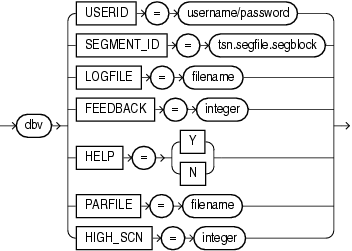

## 21 DBVERIFY: Offline Database Verification Utility

DBVERIFY is an external command-line utility that performs a physical data structure integrity check.

DBVERIFY can be used on offline or online databases, as well on backup files. You use DBVERIFY primarily when you need to ensure that a backup database (or data file) is valid before it is restored, or as a diagnostic aid when you have encountered data corruption problems. Because DBVERIFY can be run against an offline database, integrity checks are significantly faster.

DBVERIFY checks are limited to cache-managed blocks (that is, data blocks). Because DBVERIFY is only for use with data files, it does not work against control files or redo logs.

There are two command-line interfaces to DBVERIFY. With the first interface, you specify disk blocks of a single data file for checking. With the second interface, you specify a segment for checking. Both interfaces are started with the `dbv` command. The following sections provide descriptions of these interfaces:

- Using DBVERIFY to Validate Disk Blocks of a Single Data File  
	In this mode, DBVERIFY scans one or more disk blocks of a single data file and performs page checks.
- Using DBVERIFY to Validate a Segment  
	In this mode, DBVERIFY enables you to specify a table segment or index segment for verification.

**Parent topic:** [Other Utilities](other-oracle-utilities.md)

### 21.1 Using DBVERIFY to Validate Disk Blocks of a Single Data File

In this mode, DBVERIFY scans one or more disk blocks of a single data file and performs page checks.

If the file you are verifying is an Oracle Automatic Storage Management (Oracle ASM) file, then you must supply a `USERID`. This is because DBVERIFY needs to connect to an Oracle instance to access Oracle ASM files.

- DBVERIFY Syntax When Validating Blocks of a Single File  
	See the syntax for using `DBVERIFY` to validate blocks of a single file.
- DBVERIFY Parameters When Validating Blocks of a Single File  
	See the `DBVERIFY` parameters that you can use to validate blocks of a single file.
- Example DBVERIFY Output For a Single Data File  
	See an example of verification for a single data file, and how you can interpret it.

**Parent topic:** DBVERIFY: Offline Database Verification Utility

#### 21.1.1 DBVERIFY Syntax When Validating Blocks of a Single File

See the syntax for using `DBVERIFY` to validate blocks of a single file.

The syntax for `DBVERIFY` when you want to validate disk blocks of a single data file is as follows:


> ```
> dbverify ::= 
>  
>   dbv [ USERID=username/password ]
>     FILE = filename
>   | { START = block_address | END = block_address }
>   | BLOCKSIZE = integer
>   | HIGH_SCN = integer
>   | LOGFILE = filename
>   | FEEDBACK = integer
>   | HELP  = { Y | N } 
>   | PARFILE = filename
>   
> End of description.
> ```


**Parent topic:** Using DBVERIFY to Validate Disk Blocks of a Single Data File

#### 21.1.2 DBVERIFY Parameters When Validating Blocks of a Single File

See the `DBVERIFY` parameters that you can use to validate blocks of a single file.

| Parameter | Description |
| --- | --- |
| `USERID` | Specifies your username and password.  This parameter is only necessary when the files being verified are Oracle ASM files.  If you do specify this parameter, then you must enter both a username and a password; otherwise, a `DBV-00112:                                     USERID incorrectly specified` error is returned. |
| `FILE` | The name of the database file that you want to verify. |
| `START` | The starting block address that you want to verify. Specify block addresses in Oracle blocks (as opposed to operating system blocks). If you do not specify `START`, then `DBVERIFY` defaults to the first block in the file. |
| `END` | The ending block address that you want to verify. If you do not specify `END`, then `DBVERIFY` defaults to the last block in the file. |
| `BLOCKSIZE` | `BLOCKSIZE` is required only if the file that you want to be verified does not have a block size of 2 KB. If the file does not have block size of 2 KB, and you do not specify `BLOCKSIZE`, then you will receive the error DBV-00103. |
| `HIGH_SCN` | When a value is specified for `HIGH_SCN`, `DBVERIFY` writes diagnostic messages for each block whose block-level system change number (SCN) exceeds the value specified.  This parameter is optional. There is no default. |
| `LOGFILE` | Specifies the log file name and path to which logging information should be written. The default sends output to the terminal display. |
| `FEEDBACK` | Causes `DBVERIFY` to send a progress display to the terminal in the form of a single period (.) for `n` number of pages verified during the `DBVERIFY` run. If `n` = 0, then there is no progress display. |
| `HELP` | Provides online help. For help on command line parameters in a given version of `DBVERIFY`, type `dbv                                     help=y` at the command line. |
| `PARFILE` | Specifies the name of the parameter file to use. You can store various values for `DBVERIFY` parameters in flat files. Doing this enables you to customize parameter files to handle different types of data files, and to perform specific types of integrity checks on data files. |

**Related Topics**

- [DBVERIFY - Database file Verification Utility (Doc ID 35512.1)](https://support.oracle.com/rs?type=doc&id=35512.1)

**Parent topic:** Using DBVERIFY to Validate Disk Blocks of a Single Data File

#### 21.1.3 Example DBVERIFY Output For a Single Data File

See an example of verification for a single data file, and how you can interpret it.

The following is an example verification of the file `t_db1.dbf`. The feedback parameter has been given the value 100 to display one period (.) for every 100 pages processed.

```
% dbv FILE=t_db1.dbf FEEDBACK=100
```

Output example

The output of this command is as follows:

```
.
.
.
DBVERIFY - Verification starting : FILE = t_db1.f
DBVERIFY - Verification complete

Total Pages Examined : 120424
Total Pages Processed (Data) : 79507
Total Pages Failing (Data) : 0
Total Pages Processed (Index): 15236
Total Pages Failing (Index): 0
Total Pages Processed (Other): 5626
Total Pages Processed (Seg) : 1
Total Pages Failing (Seg) : 0
Total Pages Empty : 20055
Total Pages Marked Corrupt : 0
Total Pages Influx : 0
Total Pages Encrypted : 0
Highest block SCN : 25565681 (0.25565681)
```

Notes

- Pages = Blocks
- Total Pages Examined = number of blocks in the file.
- Total Pages Processed (Data) = number of blocks that were verified (formatted blocks).
- Total Pages Processed (Other) = metadata blocks. These blocks are not being verified, so there is no output for "Total Pages Failing (Other)."
- Total Pages Processed (Seg) = number of segment header blocks.
- Total Pages Failing (Data) = number of blocks that failed the data block checking routine.
- Total Pages Failing (Index) = number of blocks that failed the index block checking routine.
- Total Pages Marked Corrupt = number of blocks for which the cache header is invalid, thereby making it impossible for `DBVERIFY` to identify the block type.
- Total Pages Influx = number of blocks that are being read and written to at the same time. If the database is open when `DBVERIFY` is run, then `DBVERIFY` reads blocks multiple times to obtain a consistent image. But because the database is open, there can be blocks that are being read and written to at the same time (`INFLUX`). In that event, `DBVERIFY` cannot obtain a consistent image of pages that are in flux.
- Total Pages Encrypted = all blocks (Data, Index, Other, Seg), not only Data or Index. When "Total Pages Encrypted" is different than zero, DBVERIFY outputs the message "DBVerify cannot perform logical check against encrypted blocks, RMAN should be used."

**Parent topic:** Using DBVERIFY to Validate Disk Blocks of a Single Data File

### 21.2 Using DBVERIFY to Validate a Segment

In this mode, DBVERIFY enables you to specify a table segment or index segment for verification.

It checks to ensure that a row chain pointer is within the segment being verified.

This mode requires that you specify a segment (data or index) to be validated. It also requires that you log on to the database with `SYSDBA` privileges, because information about the segment must be retrieved from the database.

During this mode, the segment is locked. If the specified segment is an index, then the parent table is locked. Note that some indexes, such as IOTs, do not have parent tables.

- DBVERIFY Syntax When Validating a Segment  
	See the syntax for using `DBVERIFY` to validate a segment.
- DBVERIFY Parameters When Validating a Single Segment  
	See the `DBVERIFY` parameters that you can use to validate a single segment.
- Example DBVERIFY Output For a Validated Segment  
	See an example of a verification for a validated segment.

**Parent topic:** DBVERIFY: Offline Database Verification Utility

#### 21.2.1 DBVERIFY Syntax When Validating a Segment

See the syntax for using `DBVERIFY` to validate a segment.

The syntax for `DBVERIFY` when you want to validate a segment is as follows:



> ```
> dbverify_seg ::= 
>  
>   dbv USERID = username/password 
>   | SEGMENT_ID = tsn.segfile.segblock
>   | LOGFILE = filename
>   | FEEDBACK = integer
>   | HELP  = { Y | N }
>   | PARFILE = filename 
>   | HIGH_SCN = integer 
>  
> End of description.
> ```
>
> [  
> Copyright © 2002, 2026, Oracle and/or its affiliates.](https://docs.oracle.com/en/database/oracle/oracle-database/dcommon/html/cpyr.htm)


**Parent topic:** Using DBVERIFY to Validate a Segment

#### 21.2.2 DBVERIFY Parameters When Validating a Single Segment

See the `DBVERIFY` parameters that you can use to validate a single segment.

| Parameter | Description |
| --- | --- |
| `USERID` | Specifies your username and password. If you do not enter both a username and a password, then the error `DBV-00112: USERID incorrectly                                     specified` is returned.  If you are connecting to a container database (CDB), then you would enter username@cdbname/password. |
| `SEGMENT_ID` | Specifies the segment that you want to verify. A segment identifier is composed of the tablespace ID number (`tsn`), segment header file number (`segfile`), and segment header block number (`segblock`). You can obtain this information from `SYS_USER_SEGS`. The relevant columns are `TABLESPACE_ID`, `HEADER_FILE`, and `HEADER_BLOCK`. To query `SYS_USER_SEGS`, you must have `SYSDBA` privileges.  For example, if the tablespace number (`TS#)` is 2, the segment header file number (`HEADER_FILE)` is 5, and the segment header block number (`HEADER_BLOCK)` is 37767, then check that segment using `SEGMENT_ID=2.5.37767` |
| `HIGH_SCN` | When a value is specified for `HIGH_SCN`, `DBVERIFY` writes diagnostic messages for each block whose block-level SCN exceeds the value specified.  This parameter is optional. There is no default. |
| `LOGFILE` | Specifies the file to which logging information should be written. The default sends output to the terminal display. |
| `FEEDBACK` | Causes `DBVERIFY` to send a progress display to the terminal in the form of a single period (.) for `n` number of pages verified during the DBVERIFY run. If `n` = 0, then there is no progress display. |
| `HELP` | Provides online help. |
| `PARFILE` | Specifies the name of the parameter file that you want to use. You can store various values for `DBVERIFY` parameters in flat files. Doing this enables you to customize parameter files to handle different types of data files, and to perform specific types of integrity checks on data files. |

**Parent topic:** Using DBVERIFY to Validate a Segment

#### 21.2.3 Example DBVERIFY Output For a Validated Segment

See an example of a verification for a validated segment.

The following is an example of using the `DBVERIFY` command with a tablespace segment, and the output produced by a `DBVERIFY` operation.

```
% dbv userid=system/ SEGMENT_ID=2.5.37767
```

The output of this command is as follows:

```
DBVERIFY - Verification starting : SEGMENT_ID = 2.5.37767

DBVERIFY - Verification complete

Total Pages Examined : 640
Total Pages Processed (Data) : 0 
Total Pages Failing (Data) : 0
Total Pages Processed (Index): 0 
Total Pages Failing (Index): 0
Total Pages Processed (Other): 591
Total Pages Processed (Seg) : 8
Total Pages Failing (Seg) : 0
Total Pages Empty : 13
Total Pages Marked Corrupt : 0
Total Pages Influx : 0
Total Pages Encrypted : 28 
Highest block SCN : 7877587 (0.7877587)
```

**Related Topics**

- [DBVERIFY enhancement - How to scan an object/segment (Doc ID 139962.1)](https://support.oracle.com/rs?type=doc&id=139962.1)

**Parent topic:** Using DBVERIFY to Validate a Segment