## 9 SQL\*Loader Control File Reference

The SQL\*Loader control file is a text file that contains data definition language (DDL) instructions for a SQL\*Loader job.

Note:

You can also use SQL\*Loader without a control file; this is known as SQL\*Loader express mode. See SQL\*Loader Express for more information.

- Control File Contents  
	The SQL\*Loader control file is a text file that contains data definition language (DDL) instructions.
- Comments in the Control File  
	Comments can appear anywhere in the parameter section of the file, but they should not appear within the data.
- Specifying Command-Line Parameters in the Control File  
	You can specify command-line parameters in the SQL\*Loader control file using the `OPTIONS` clause.
- Specifying File Names and Object Names  
	In general, SQL\*Loader follows the SQL standard for specifying object names (for example, table and column names).
- Identifying XMLType Tables  
	You can identify and select XML type tables to load by using the `XMLTYPE` clause in a SQL\*Loader control file.
- Specifying Field Order  
	You can use the `FIELD` `NAMES` clause in the SQL\*Loader control file to specify field order.
- Specifying Data Files  
	Learn how you can use the SQL\*Loader control file to specify how data files are loaded.
- Specifying CSV Format Files  
	To direct SQL\*Loader to access the data files as comma-separated-values format files, use the `CSV` clause.
- Identifying Data in the Control File with BEGINDATA  
	Specify the `BEGINDATA` statement before the first data record.
- Specifying Data File Format and Buffering  
	You can specify an operating system-dependent file processing specifications string option using `os_file_proc_clause`.
- Specifying the Bad File  
	Learn what SQL\*Loader bad files are, and how to specify them.
- Specifying the Discard File  
	Learn what SQL\*Loader discard files are, what they contain, and how to specify them.
- Specifying a NULLIF Clause At the Table Level  
	To load a table character field as NULL when it contains certain character strings or hex strings, you can use a `NULLIF` clause at the table level with SQL\*Loader.
- Specifying Datetime Formats At the Table Level  
	You can specify certain datetime formats in a SQL\*Loader control file at the table level, or override a table level format by specifying a mask at the field level.
- Handling Different Character Encoding Schemes  
	SQL\*Loader supports different character encoding schemes (called character sets, or code pages).
- Interrupted SQL\*Loader Loads  
	Learn about common scenarios in which SQL\*Loader loads are interrupted or discontinued, and what you can do to correct these issues.
- Assembling Logical Records from Physical Records  
	This section describes assembling logical records from physical records.
- Loading Logical Records into Tables  
	Learn about the different methods and available to you to load logical records into tables with SQL\*Loader.
- Index Options  
	To control how SQL\*Loader creates index entries, you can set `SORTED             INDEXES` and ` SINGLEROW` clauses.
- Benefits of Using Multiple INTO TABLE Clauses  
	Learn from examples how you can use multiple `INTO TABLE` clauses for specific SQL\*Loader use cases
- Bind Arrays and Conventional Path Loads  
	With the SQL\*Loader array-interface option, multiple table rows are read at one time, and stored in a bind array.

**Parent topic:** [SQL\*Loader](oracle-sql-loader.md)

### 9.1 Control File Contents

The SQL\*Loader control file is a text file that contains data definition language (DDL) instructions.

DDL is used to control the following aspects of a SQL\*Loader session:

- Where SQL\*Loader will find the data to load
- How SQL\*Loader expects that data to be formatted
- How SQL\*Loader will be configured (memory management, rejecting records, interrupted load handling, and so on) as it loads the data
- How SQL\*Loader will manipulate the data being loaded

See [SQL\*Loader Syntax Diagrams](oracle-sql-loader-syntax-diagrams.md) for syntax diagrams of the SQL\*Loader DDL.

To create the SQL\*Loader control file, use a text editor, such as `vi` or `xemacs`.

In general, the control file has three main sections, in the following order:

- Session-wide information
- Table and field-list information
- Input data (optional section)

The following is an example of a control file.

Example 9-1 Control File

```
1    -- This is an example control file
2    LOAD DATA
3    INFILE 'sample.dat'
4    BADFILE 'sample.bad'
5    DISCARDFILE 'sample.dsc'
6    APPEND
7    INTO TABLE emp
8    WHEN (57) = '.'
9    TRAILING NULLCOLS
10  (hiredate SYSDATE,
      deptno POSITION(1:2)  INTEGER EXTERNAL(2)
              NULLIF deptno=BLANKS,
       job    POSITION(7:14)  CHAR  TERMINATED BY WHITESPACE
              NULLIF job=BLANKS  "UPPER(:job)",
       mgr    POSITION(28:31) INTEGER EXTERNAL 
              TERMINATED BY WHITESPACE, NULLIF mgr=BLANKS,
       ename  POSITION(34:41) CHAR 
              TERMINATED BY WHITESPACE  "UPPER(:ename)",
       empno  POSITION(45) INTEGER EXTERNAL 
              TERMINATED BY WHITESPACE,
       sal    POSITION(51) CHAR  TERMINATED BY WHITESPACE
              "TO_NUMBER(:sal,'$99,999.99')",
       comm   INTEGER EXTERNAL  ENCLOSED BY '(' AND '%'
              ":comm * 100"
    )
```

The numbers that appear to the left in this In this control file example would not appear in a real control file. They are keyed in this sample to the explanatory notes in the following list:

1. This comment prefacing the entries in the control file is an example of how to enter comments in a control file. See Comments in the Control File.
2. The `LOAD DATA` statement tells SQL\*Loader that this is the beginning of a new data load. See [SQL\*Loader Syntax Diagrams](oracle-sql-loader-syntax-diagrams.md) for syntax information.
3. The `INFILE` clause specifies the name of a data file containing the data you want to load. See Specifying Data Files.
4. The `BADFILE` clause specifies the name of a file into which rejected records are placed. See Specifying the Bad File.
5. The `DISCARDFILE` clause specifies the name of a file into which discarded records are placed. See Specifying the Discard File.
6. The `APPEND` clause is one of the options that you can use when loading data into a table that is not empty. See Loading Data into Nonempty Tables.
	To load data into a table that is empty, use the `INSERT` clause. See Loading Data into Empty Tables.
7. The `INTO TABLE` clause enables you to identify tables, fields, and data types. It defines the relationship between records in the data file, and tables in the database. See Specifying Table Names.
8. The `WHEN` clause specifies one or more field conditions. SQL\*Loader decides whether to load the data based on these field conditions. See Loading Records Based on a Condition.
9. The `TRAILING NULLCOLS` clause tells SQL\*Loader to treat any relatively positioned columns that are not present in the record as null columns. See Handling Short Records with Missing Data.
10. The remainder of the control file contains the field list, which provides information about column formats in the table being loaded. See [SQL\*Loader Field List Reference](oracle-sql-loader-field-list-contents.md) for information about that section of the control file.

**Parent topic:** SQL\*Loader Control File Reference

### 9.2 Comments in the Control File

Comments can appear anywhere in the parameter section of the file, but they should not appear within the data.

Precede any comment with two hyphens, for example:

```
--This is a comment
```

All text to the right of the double hyphen is ignored, until the end of the line.

**Parent topic:** SQL\*Loader Control File Reference

### 9.3 Specifying Command-Line Parameters in the Control File

You can specify command-line parameters in the SQL\*Loader control file using the `OPTIONS` clause.

This can be useful if you often use a control file with the same set of options. The `OPTIONS` clause precedes the `LOAD` `DATA` statement.

- OPTIONS Clause  
	The following command-line parameters can be specified using the `OPTIONS` clause.
- Specifying the Number of Default Expressions to Be Evaluated At One Time  
	Use the SQL\*Loader `DEFAULT EXPRESSION CACHE n` clause to specify how many default expressions are evaluated at a time by the direct path load. The default value is 100.

**Parent topic:** SQL\*Loader Control File Reference

#### 9.3.1 OPTIONS Clause

The following command-line parameters can be specified using the `OPTIONS` clause.

These parameters are described in greater detail in [SQL\*Loader Command-Line Reference](oracle-sql-loader-commands.md).

```
BINDSIZE = n
COLUMNARRAYROWS = n
DATE_CACHE = n
DEGREE_OF_PARALLELISM= {degree-num|DEFAULT|AUTO|NONE}
DIRECT = {TRUE | FALSE} 
EMPTY_LOBS_ARE_NULL = {TRUE | FALSE}
ERRORS = n
EXTERNAL_TABLE = {NOT_USED | GENERATE_ONLY | EXECUTE}
FILE = tablespace file 
LOAD = n 
MULTITHREADING = {TRUE | FALSE}
PARALLEL = {TRUE | FALSE}
READSIZE = n
RESUMABLE = {TRUE | FALSE}
RESUMABLE_NAME = 'text string'
RESUMABLE_TIMEOUT = n
ROWS = n 
SDF_PREFIX = string
SILENT = {HEADER | FEEDBACK | ERRORS | DISCARDS | PARTITIONS | ALL} 
SKIP = n   
SKIP_INDEX_MAINTENANCE = {TRUE | FALSE}
SKIP_UNUSABLE_INDEXES = {TRUE | FALSE}
STREAMSIZE = n
TRIM= {LRTRIM|NOTRIM|LTRIM|RTRIM|LDRTRIM}
```

The following is an example use of the `OPTIONS` clause that you could use in a SQL\*Loader control file:

```
OPTIONS (BINDSIZE=100000, SILENT=(ERRORS, FEEDBACK) )
```

Note:

Parameter values specified on the command line override parameter values specified in the control file `OPTIONS` clause.

**Parent topic:** Specifying Command-Line Parameters in the Control File

#### 9.3.2 Specifying the Number of Default Expressions to Be Evaluated At One Time

Use the SQL\*Loader `DEFAULT EXPRESSION CACHE n` clause to specify how many default expressions are evaluated at a time by the direct path load. The default value is 100.

Using the `DEFAULT EXPRESSION CACHE` clause can significantly improve performance when default column expressions that include sequences are evaluated.

At the end of the load there may be sequence numbers left in the cache that never get used. This can happen when the number of rows to load is not a multiple of `n`. If you require no loss of sequence numbers, then specify a value of 1 for this clause.

**Parent topic:** Specifying Command-Line Parameters in the Control File

### 9.4 Specifying File Names and Object Names

In general, SQL\*Loader follows the SQL standard for specifying object names (for example, table and column names).

**Parent topic:** SQL\*Loader Control File Reference

#### 9.4.1 File Names That Conflict with SQL and SQL\*Loader Reserved Words

SQL and SQL\*Loader reserved words, and words with special characters or case-sensitivity, must be enclosed in quotation marks.

SQL and SQL\*Loader reserved words must be specified within double quotation marks.

The only SQL\*Loader reserved word is `CONSTANT`.

You must use double quotation marks if the object name contains special characters other than those recognized by SQL ($, #, \_), or if the name is case-sensitive.

#### 9.4.2 Specifying SQL Strings in the SQL\*Loader Control File

When you apply SQL operators to field data with the SQL string, you must specify SQL strings within double quotation marks.

See Also:

[Applying SQL Operators to Fields](oracle-sql-loader-field-list-contents.md)

**Parent topic:** Specifying File Names and Object Names

#### 9.4.3 Operating Systems and SQL Loader Control File Characters

The characters that you use in control files are affected by operating system reserved characters, escape characters, and special characters.

Learn how the the operating system that you are using affects the characters you can use in your SQL\*Loader Control file.

- Specifying a Complete Path  
	Specifying the path name within single quotation marks prevents errors.
- Backslash Escape Character  
	In DDL syntax, you can place a double quotation mark inside a string delimited by double quotation marks by preceding it with the backslash escape character (\\), if the escape character is allowed on your operating system.
- Nonportable Strings  
	There are two kinds of character strings in a SQL\*Loader control file that are not portable between operating systems: filename and file processing option strings.
- Using the Backslash as an Escape Character  
	To separate directories in a path name, use the backslash character if both your operating system and database implements the backslash escape character.
- Escape Character Is Sometimes Disallowed  
	Your operating system can disallow the use of escape characters for nonportable strings in Oracle Database.

**Parent topic:** Specifying File Names and Object Names

##### 9.4.3.1 Specifying a Complete Path

Specifying the path name within single quotation marks prevents errors.

If you encounter problems when trying to specify a complete path name, it may be due to an operating system-specific incompatibility caused by special characters in the specification.

**Parent topic:** Operating Systems and SQL Loader Control File Characters

##### 9.4.3.2 Backslash Escape Character

In DDL syntax, you can place a double quotation mark inside a string delimited by double quotation marks by preceding it with the backslash escape character (\\), if the escape character is allowed on your operating system.

The same rule applies when single quotation marks are required in a string delimited by single quotation marks.

For example, `homedir\data"norm\mydata` contains a double quotation mark. Preceding the double quotation mark with a backslash indicates that the double quotation mark is to be taken literally:

```
INFILE 'homedir\data\"norm\mydata'
```

You can also put the escape character itself into a string by entering it twice.

For example:

```
"so'\"far"     or  'so\'"far'     is parsed as   so'"far 
"'so\\far'"    or  '\'so\\far\''  is parsed as  'so\far' 
"so\\\\far"    or  'so\\\\far'    is parsed as   so\\far
```

Note:

A double quotation mark in the initial position cannot be preceded by an escape character. Therefore, you should avoid creating strings with an initial quotation mark.

**Parent topic:** Operating Systems and SQL Loader Control File Characters

##### 9.4.3.3 Nonportable Strings

There are two kinds of character strings in a SQL\*Loader control file that are not portable between operating systems: filename and file processing option strings.

When you convert to a different operating system, you will probably need to modify these strings. All other strings in a SQL\*Loader control file should be portable between operating systems.

**Parent topic:** Operating Systems and SQL Loader Control File Characters

##### 9.4.3.4 Using the Backslash as an Escape Character

To separate directories in a path name, use the backslash character if both your operating system and database implements the backslash escape character.

If your operating system uses the backslash character to separate directories in a path name, and if the Oracle Database release running on your operating system implements the backslash escape character for file names and other nonportable strings, then you must specify double backslashes in your path names, and use single quotation marks.

**Parent topic:** Operating Systems and SQL Loader Control File Characters

##### 9.4.3.5 Escape Character Is Sometimes Disallowed

Your operating system can disallow the use of escape characters for nonportable strings in Oracle Database.

When the operating sytem disallows the use of the backslash character (`\`) as an escape character, a backslash is treated as a normal character, rather than as an escape character. The backslash character is still usable in all other strings. As a result of this operating system restriction, path names such as the following can be specified normally:

```
INFILE 'topdir\mydir\myfile'
```

Double backslashes are not needed.

Because the backslash is not recognized as an escape character, strings within single quotation marks cannot be embedded inside another string delimited by single quotation marks. This rule also applies to the use of double quotation marks. A string within double quotation marks cannot be embedded inside another string delimited by double quotation marks.

**Parent topic:** Operating Systems and SQL Loader Control File Characters

### 9.5 Identifying XMLType Tables

You can identify and select XML type tables to load by using the `XMLTYPE` clause in a SQL\*Loader control file.

As of Oracle Database 10g, the `XMLTYPE` clause is available for use in a SQL\*Loader control file. This clause is of the format `XMLTYPE(field         name)`. You can use this clause to identify `XMLType` tables, so that the correct SQL statement can be constructed. You can use the `XMLTYPE` clause in a SQL\*Loader control file to load data into a schema-based `XMLType` table.

Example 9-2 Identifying XMLType Tables in the SQL\*Loader Control File

The XML schema definition is as follows. It registers the XML schema, `xdb_user.xsd`, in the Oracle XML DB, and then creates the table, `xdb_tab5`.

```
begin dbms_xmlschema.registerSchema('xdb_user.xsd',
'<xs:schema xmlns:xs="http://www.w3.org/2001/XMLSchema"
            xmlns:xdb="http://xmlns.oracle.com/xdb">
 <xs:element name = "Employee"
        xdb:defaultTable="EMP31B_TAB">
   <xs:complexType>
    <xs:sequence>
      <xs:element name = "EmployeeId" type = "xs:positiveInteger"/>
      <xs:element name = "Name" type = "xs:string"/>
      <xs:element name = "Salary" type = "xs:positiveInteger"/>
      <xs:element name = "DeptId" type = "xs:positiveInteger"
             xdb:SQLName="DEPTID"/>
    </xs:sequence>
   </xs:complexType>
 </xs:element>
</xs:schema>',
TRUE, TRUE, FALSE); end;
/
```

The table is defined as follows:

```
CREATE TABLE xdb_tab5 OF XMLTYPE XMLSCHEMA "xdb_user.xsd" ELEMENT "Employee";
```

In this next example, the control file used to load data into the table, `xdb_tab5`, loads `XMLType` data by using the registered XML schema, `xdb_user.xsd`. The `XMLTYPE` clause is used to identify this table as an `XMLType` table. To load the data into the table, you can use either direct path mode, or conventional mode.

```
LOAD DATA
INFILE *
INTO TABLE xdb_tab5 TRUNCATE
xmltype(xmldata)
(
  xmldata   char(4000)
)
BEGINDATA
<Employee>  <EmployeeId>111</EmployeeId>  <Name>Ravi</Name>  <Salary>100000</Sal
ary>  <DeptId>12</DeptId></Employee>
<Employee>  <EmployeeId>112</EmployeeId>  <Name>John</Name>  <Salary>150000</Sal
ary>  <DeptId>12</DeptId></Employee>
<Employee>  <EmployeeId>113</EmployeeId>  <Name>Michael</Name>  <Salary>75000</S
alary>  <DeptId>12</DeptId></Employee>
<Employee>  <EmployeeId>114</EmployeeId>  <Name>Mark</Name>  <Salary>125000</Sal
ary>  <DeptId>16</DeptId></Employee>
<Employee>  <EmployeeId>115</EmployeeId>  <Name>Aaron</Name>  <Salary>600000</Sa
lary>  <DeptId>16</DeptId></Employee>
```

### 9.6 Specifying Field Order

You can use the `FIELD` `NAMES` clause in the SQL\*Loader control file to specify field order.

The syntax is as follows:

```
FIELD NAMES {FIRST FILE|FIRST FILE IGNORE|ALL FILES|ALL FILES IGNORE|NONE}
```

The `FIELD` `NAMES` options are:

- `FIRST` `FILE`: Indicates that the first data file contains a list of field names for the data in the first record. This list uses the same delimiter as the data in the data file. The record is read for setting up the mapping between the fields in the data file and the columns in the target table. The record is skipped when the data is processed. This can be useful if the order of the fields in the data file is different from the order of the columns in the table, or if the number of fields in the data file is different from the number of columns in the target table
- `FIRST` `FILE` `IGNORE`: Indicates that the first data file contains a list of field names for the data in the first record, but that the information should be ignored. The record will be skipped when the data is processed, but it will not be used for setting up the fields.
- `ALL` `FILES`: Indicates that all data files contain a list of field names for the data in the first record. The first record is skipped in each data file when the data is processed. The fields can be in a different order in each data file. SQL\*Loader sets up the load based on the order of the fields in each data file.
- `ALL` `FILES` `IGNORE`: Indicates that all data files contain a list of field names for the data in the first record, but that the information should be ignored. The record is skipped when the data is processed in every data file, but it will not be used for setting up the fields.
- `NONE`: Indicates that the data file contains normal data in the first record. This is the default.

The `FIELD` `NAMES` clause cannot be used for complex column types such as column objects, nested tables, or VARRAYs.

**Parent topic:** SQL\*Loader Control File Reference

### 9.7 Specifying Data Files

Learn how you can use the SQL\*Loader control file to specify how data files are loaded.

- Understanding How to Specify Data Files  
	To load data files with SQL\*Loader, you can specify data files in the control file using the `INFILE` keyword.
- Examples of INFILE Syntax  
	The following list shows different ways you can specify `INFILE` syntax.
- Specifying Multiple Data Files  
	To load data from multiple data files in one SQL\*Loader run, use an `INFILE` clause for each data file.

**Parent topic:** SQL\*Loader Control File Reference

#### 9.7.1 Understanding How to Specify Data Files

To load data files with SQL\*Loader, you can specify data files in the control file using the `INFILE` keyword.

To specify a data file that contains the data that you want to load, use the `INFILE` keyword, followed by the file name, and the optional file processing options string.

You can specify multiple single files by using multiple `INFILE` keywords. You can also use wildcards in the file names (an asterisk (\*) for multiple characters and a question mark (?) for a single character).

Note:

You can also specify the data file from the command line by using the `DATA` parameter. Refer to the available command-line parameters for SQL\*Loader. A file name specified on the command line overrides the first `INFILE` clause in the control file.

If no file name is specified, then the file name defaults to the control file name with an extension or file type of.`dat`.

If the control file itself contains the data that you want loaded, then specify an asterisk (\*). This specification is described in the topic "Identifying Data in the Control File with BEGINDATA..

Note:

The information in this section applies only to primary data files. It does not apply to LOBFILEs or SDFs.

The syntax for `INFILE` is as follows:

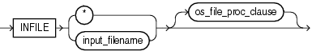

> ```
> infile ::= 
>  
>   INFILE { * | input_filename } [os_file_proc_clause]
> ```
>
> [  
> Copyright © 2002, 2026, Oracle and/or its affiliates.](https://docs.oracle.com/en/database/oracle/oracle-database/dcommon/html/cpyr.htm)


The following table describes the parameters for the `INFILE` keyword.

Table 9-1 Parameters for the INFILE Keyword

| Parameter | Description |
| --- | --- |
| `INFILE` | Specifies that a data file specification follows. |
| `input_filename` | Name of the file containing the data. The file name can contain wildcards. An asterisk (\*) represents multiple characters, and a question mark (?) represents a single character. For example:  ``` INFILE 'emp*.dat' INFILE 'm?emp.dat' ```  Any spaces or punctuation marks in the file name must be enclosed within single quotation marks. |
| `*` | If your data is in the control file itself, then use an asterisk instead of the file name. If you have data in the control file and in data files, then for the data to be read, you must specify the asterisk first. |
| `os_file_proc_clause` | This is the file-processing options string. It specifies the data file format. It also optimizes data file reads. The syntax used for this string is specific to your operating system. |

#### 9.7.2 Examples of INFILE Syntax

The following list shows different ways you can specify `INFILE` syntax.

- Data contained in the control file itself:
	```
	INFILE  *
	```
- Data contained in a file named `sample` with a default extension of.`dat:`
	```
	INFILE  sample
	```
- Data contained in a file named `datafile`.`dat` with a full path specified:
	```
	INFILE 'c:/topdir/subdir/datafile.dat'
	```
	Note:
	File names that include spaces or punctuation marks must be enclosed in single quotation marks.
- Data contained in any file of type `.dat` whose name begins with `emp`:
	```
	INFILE 'emp*.dat'
	```
- Data contained in any file of type.dat whose name begins with m, followed by any other single character, and ending in emp. For example, a file named myemp.dat would be included in the following:
	```
	INFILE 'm?emp.dat'
	```

**Parent topic:** Specifying Data Files

#### 9.7.3 Specifying Multiple Data Files

To load data from multiple data files in one SQL\*Loader run, use an `INFILE` clause for each data file.

Data files need not have the same file processing options, although the layout of the records must be identical. For example, two files could be specified with completely different file processing options strings, and a third could consist of data in the control file.

You can also specify a separate discard file and bad file for each data file. In such a case, the separate bad files and discard files must be declared immediately after each data file name. For example, the following excerpt from a control file specifies four data files with separate bad and discard files:

```
INFILE  mydat1.dat  BADFILE  mydat1.bad  DISCARDFILE mydat1.dis 
INFILE  mydat2.dat 
INFILE  mydat3.dat  DISCARDFILE  mydat3.dis 
INFILE  mydat4.dat  DISCARDMAX  10 0
```
- For `mydat1.dat,` both a bad file and discard file are explicitly specified. Therefore both files are created, as needed.
- For `mydat2.dat,` neither a bad file nor a discard file is specified. Therefore, only the bad file is created, as needed. If created, the bad file has the default file name and extension `mydat2.bad`. The discard file is not created, even if rows are discarded.
- For `mydat3.dat,` the default bad file is created, if needed. A discard file with the specified name (`mydat3.dis`) is created, as needed.
- For `mydat4.dat,` the default bad file is created, if needed. Because the `DISCARDMAX` option is used, SQL\*Loader assumes that a discard file is required and creates it with the default name `mydat4.dsc`.

**Parent topic:** Specifying Data Files

### 9.8 Specifying CSV Format Files

To direct SQL\*Loader to access the data files as comma-separated-values format files, use the `CSV` clause.

This assumes that the file is a stream record format file with the normal carriage return string (for example, `\n` on UNIX or Linux operating systems and either `\n` or `\r\n` on Windows operating systems). Record terminators can be included (embedded) in data values. The syntax for the `CSV` clause is as follows:

```
FIELDS CSV [WITH EMBEDDED|WITHOUT EMBEDDED] [FIELDS TERMINATED BY ','] [OPTIONALLY ENCLOSED BY '"']
```

The following are key points regarding the `FIELDS` `CSV` clause:

- The SQL\*Loader default is to not use the `FIELDS` `CSV` clause.
- The `WITH` `EMBEDDED` and `WITHOUT` `EMBEDDED` options specify whether record terminators are included (embedded) within any fields in the data.
- If `WITH` `EMBEDDED` is used, then embedded record terminators must be enclosed, and intra-datafile parallelism is disabled for external table loads.
- The `TERMINATED BY ','` and `OPTIONALLY ENCLOSED BY '"'` options are the defaults and do not have to be specified. You can override them with different termination and enclosure characters.
- When the `CSV` clause is used, only delimitable data types are allowed as control file fields. Delimitable data types include `CHAR`, datetime, interval, and numeric `EXTERNAL`.
- The `TERMINATED` `BY` and `ENCLOSED` `BY` clauses cannot be used at the field level when the CSV clause is specified.
- When the `CSV` clause is specified, normal SQL\*Loader blank trimming is done by default. You can specify `PRESERVE` `BLANKS` to avoid trimming of spaces. Or, you can use the SQL functions `LTRIM` and `RTRIM` in the field specification to remove left and/or right spaces.
- When the `CSV` clause is specified, the `INFILE *` clause in not allowed. This means that there cannot be any data included in the SQL\*Loader control file.

The following sample SQL\*Loader control file uses the `FIELDS` `CSV` clause with the default delimiters:

```
LOAD DATA
INFILE "mydata.dat"
TRUNCATE
INTO TABLE mytable
FIELDS CSV WITH EMBEDDED
TRAILING NULLCOLS
(
  c0 char,
  c1 char,
  c2 char,
)
```

**Parent topic:** SQL\*Loader Control File Reference

### 9.9 Identifying Data in the Control File with BEGINDATA

Specify the `BEGINDATA` statement before the first data record.

If the data is included in the control file itself, then the `INFILE` clause is followed by an asterisk rather than a file name. The actual data is placed in the control file after the load configuration specifications.

The syntax is:

```
BEGINDATA 
first_data_record
```

Keep the following points in mind when using the `BEGINDATA` statement:

- If you omit the `BEGINDATA` statement but include data in the control file, then SQL\*Loader tries to interpret your data as control information and issues an error message. If your data is in a separate file, then do not use the `BEGINDATA` statement.
- Do not use spaces or other characters on the same line as the `BEGINDATA` statement, or the line containing `BEGINDATA` will be interpreted as the first line of data.
- Do not put comments after `BEGINDATA`, or they will also be interpreted as data.

### 9.10 Specifying Data File Format and Buffering

You can specify an operating system-dependent file processing specifications string option using `os_file_proc_clause`.

When configuring SQL\*Loader, you can specify an operating system-dependent file processing options string (`os_file_proc_clause`) in the control file to specify file format and buffering.

For example, suppose that your operating system has the following option-string syntax:

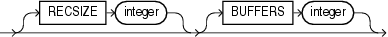

> ```
> recsize_spec ::=
>  
>  [RECSIZE integer] [BUFFERS integer]
> ```
>
> [  
> Copyright © 2002, 2026, Oracle and/or its affiliates.](https://docs.oracle.com/en/database/oracle/oracle-database/dcommon/html/cpyr.htm)


In this syntax, `RECSIZE` is the size of a fixed-length record, and `BUFFERS` is the number of buffers to use for asynchronous I/O.

To declare a file named `mydata.dat` as a file that contains 80-byte records and instruct SQL\*Loader to use 8 I/O buffers, you would use the following control file entry:

```
INFILE 'mydata.dat' "RECSIZE 80 BUFFERS 8"
```

Note:

This example uses the recommended convention of single quotation marks for file names, and double quotation marks for everything else.

### 9.11 Specifying the Bad File

Learn what SQL\*Loader bad files are, and how to specify them.

- Understanding and Specifying the Bad File  
	When SQL\*Loader executes, it can create a file called a bad file, or reject file, in which it places records that were rejected because of formatting errors or because they caused Oracle errors.
- Examples of Specifying a Bad File Name  
	See how you can specify a bad file in a SQL\*Loader control file by file name, file name and extension, or by directory.
- How Bad Files Are Handled with LOBFILEs and SDFs  
	SQL\*Loader manages errors differently for LOBFILE and SDF data.
- Criteria for Rejected Records  
	Learn about the criteria SQL\*Loader applies for rejecting records in conventional path loads and direct path loads.

**Parent topic:** SQL\*Loader Control File Reference

#### 9.11.1 Understanding and Specifying the Bad File

When SQL\*Loader executes, it can create a file called a bad file, or reject file, in which it places records that were rejected because of formatting errors or because they caused Oracle errors.

If you have specified that you want a bad file to be created, then the following processes occur:

- If one or more records are rejected, then the bad file is created and the rejected records are logged.
- If no records are rejected, then the bad file is not created.
- If the bad file is created, then it overwrites any existing file with the same name; ensure that you do not overwrite a file you want to retain.
	Note:
	On some systems, a new version of the file can be created if a file with the same name already exists.

To specify the name of the bad file, use the `BADFILE` clause. You can also specify the bad file from the command line by using the `BAD` parameter.

A file name specified on the command line is associated with the first `INFILE` clause in the control file. If present, then this association overrides any bad file previously specified as part of that clause.

The bad file is created in the same record and file format as the data file, so that you can reload the data after you correct it. For data files in stream record format, the record terminator that is found in the data file is also used in the bad file.

The syntax for the `BADFILE` clause is as follows:

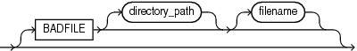

> ```
> badfile ::= 
>  
>   [BADFILE  [[directory_path]  [filename]]
> ```
>
> [  
> Copyright © 2002, 2026, Oracle and/or its affiliates.](https://docs.oracle.com/en/database/oracle/oracle-database/dcommon/html/cpyr.htm)


The `BADFILE` clause specifies that a directory path or file name, or both, for the bad file follows. If you specify `BADFILE`, then you must supply either a directory path or a file name, or both.

The `directory` parameter specifies a directory path to which the bad file will be written.

The `filename` parameter specifies a valid file name specification for your platform. Any spaces or punctuation marks in the file name must be enclosed in single quotation marks. If you do not specify a name for the bad file, then the name defaults to the name of the data file with an extension or file type of `.bad`.

#### 9.11.2 Examples of Specifying a Bad File Name

See how you can specify a bad file in a SQL\*Loader control file by file name, file name and extension, or by directory.

To specify a bad file with file name `sample` and default file extension or file type of `.bad,` enter the following in the control file:

```
BADFILE sample
```

To specify only a directory name, enter the following in the control file:

```
BADFILE '/mydisk/bad_dir/'
```

To specify a bad file with file name `bad0001` and file extension or file type of.`rej`, enter either of the following lines in the control file:

```
BADFILE bad0001.rej
BADFILE '/REJECT_DIR/bad0001.rej'
```

**Parent topic:** Specifying the Bad File

#### 9.11.3 How Bad Files Are Handled with LOBFILEs and SDFs

SQL\*Loader manages errors differently for LOBFILE and SDF data.

When there are rejected rows, SQL\*Loader does not write LOBFILE and SDF data to a bad file.

If SQL\*Loader encounters an error loading a large object (LOB), then the row is not rejected. Instead, the LOB column is left empty (not null with a length of zero (0) bytes). However, when the LOBFILE is being used to load an `XML` column, and there is an error loading this LOB data, then the `XML` column is left as null.

**Parent topic:** Specifying the Bad File

#### 9.11.4 Criteria for Rejected Records

Learn about the criteria SQL\*Loader applies for rejecting records in conventional path loads and direct path loads.

SQL\*Loader can reject a record for the following reasons:

1. Upon insertion, the record causes an Oracle error (such as invalid data for a given data type).
2. The record is formatted incorrectly, so that SQL\*Loader cannot find field boundaries.
3. The record violates a constraint, or tries to make a unique index non-unique.

If the data can be evaluated according to the `WHEN` clause criteria (even with unbalanced delimiters), then it is either inserted or rejected.

Neither a conventional path nor a direct path load will write a row to any table if it is rejected because of reason number 2 in the list of reasons.

A conventional path load will not write a row to any tables if reason number 1 or 3 in the previous list is violated for any one table. The row is rejected for that table and written to the reject file.

In a conventional path load, if the data file has a record that is being loaded into multiple tables and that record is rejected from at least one of the tables, then that record is not loaded into any of the tables.

The log file indicates the Oracle error for each rejected record. Case study 4 in "SQL\*Loader Case Studies" demonstrates rejected records.

### 9.12 Specifying the Discard File

Learn what SQL\*Loader discard files are, what they contain, and how to specify them.

- Understanding and Specifying the Discard File  
	During processing of records, SQL\*Loader can create a discard file for records that do not meet any of the loading criteria.
- Specifying the Discard File in the Control File  
	To specify the name of the file, use the `DISCARDFILE` clause, followed by a directory path and/or file name.
- Limiting the Number of Discard Records  
	To limit the number of records that are discarded for each data file, specify an integer value for either the `DISCARDS` or `DISCARDMAX` parameter.
- Examples of Specifying a Discard File Name  
	The list shows different ways that you can specify a name for the discard file from within the control file.
- Criteria for Discarded Records  
	If there is no `INTO TABLE` clause specified for a record, then the record is discarded.
- How Discard Files Are Handled with LOBFILEs and SDFs  
	When there are discarded rows, SQL\*Loader does not write data from large objects (LOB) data LOBFILEs and Secondary Data File (SDF) files to a discard file.
- Specifying the Discard File from the Command Line  
	To specify a discard file at the time you run SQL\*Loader from the command line, use the `DISCARD` command-line parameter for SQL\*Loader

**Parent topic:** SQL\*Loader Control File Reference

#### 9.12.1 Understanding and Specifying the Discard File

During processing of records, SQL\*Loader can create a discard file for records that do not meet any of the loading criteria.

The records that are contained in the discard file are called discarded records. Discarded records do not satisfy any of the `WHEN` clauses specified in the control file. These records differ from rejected records. Discarded records do not necessarily have any bad data. No insert is attempted on a discarded record.

A discard file is created according to the following rules:

- You have specified a discard file name and one or more records fail to satisfy all of the `WHEN` clauses specified in the control file. (Be aware that if the discard file is created, then it overwrites any existing file with the same name.)
- If no records are discarded, then a discard file is not created.

You can specify the discard file from within the control file either by specifying its directory, or name, or both, or by specifying the maximum number of discards. Any of the following clauses result in a discard file being created, if necessary:

- `DISCARDFILE=[[directory/][filename]]`
- `DISCARDS`
- `DISCARDMAX`

The discard file is created in the same record and file format as the data file. For data files in stream record format, the same record terminator that is found in the data file is also used in the discard file.

You can also create a discard file from the command line by specifying either the `DISCARD` or `DISCARDMAX` parameter.

If no discard clauses are included in the control file or on the command line, then a discard file is not created even if there are discarded records (that is, records that fail to satisfy all of the `WHEN` clauses specified in the control file).

#### 9.12.2 Specifying the Discard File in the Control File

To specify the name of the file, use the `DISCARDFILE` clause, followed by a directory path and/or file name.

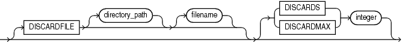

> ```
> discard ::= 
>  
>   [DISCARDFILE [directory_path] [filename] [{ DISCARDS | DISCARDMAX } integer]
> ```
>
> [  
> Copyright © 2002, 2026, Oracle and/or its affiliates.](https://docs.oracle.com/en/database/oracle/oracle-database/dcommon/html/cpyr.htm)


The `DISCARDFILE` clause specifies that a discard directory path and/or file name follows. Neither the `directory_path` nor the `filename` is required. However, you must specify at least one.

The `directory` parameter specifies a directory to which the discard file will be written.

The `filename` parameter specifies a valid file name specification for your platform. Any spaces or punctuation marks in the file name must be enclosed in single quotation marks.

The default file name is the name of the data file, and the default file extension or file type is.`dsc`. A discard file name specified on the command line overrides one specified in the control file. If a discard file with that name already exists, then it is either overwritten or a new version is created, depending on your operating system.

**Parent topic:** Specifying the Discard File

#### 9.12.3 Limiting the Number of Discard Records

To limit the number of records that are discarded for each data file, specify an integer value for either the `DISCARDS` or `DISCARDMAX` parameter.

The integer that you specify for either the `DISCARDS` or `DISCARDMAX` keyword is the numerical maximum number of discard records. If you do not specify a maximum number discard records, then SQL\*Loader will continue to discard records. Otherwise, when the discard limit is reached, processing of the data file terminates, and continues with the next data file, if one exists.

You can choose to specify a different number of discards for each data file. Or, if you specify the number of discards only once, then the maximum number of discards specified applies to all files.

If you specify a maximum number of discards, but no discard file name, then SQL\*Loader creates a discard file with the default file name (named after the process that creates it), and the default file extension or file type (`dsc`). For example, The file is named after the process that creates it. For example: `finance.dsc`.

The following example allows 25 records to be discarded during the load before it is terminated.

```
DISCARDMAX=25
```

**Parent topic:** Specifying the Discard File

#### 9.12.4 Examples of Specifying a Discard File Name

The list shows different ways that you can specify a name for the discard file from within the control file.

- To specify a discard file with file name `circular` and default file extension or file type of.`dsc`:
	```
	DISCARDFILE  circular
	```
- To specify a discard file named `notappl` with the file extension or file type of.`may`:
	```
	DISCARDFILE notappl.may
	```
- To specify a full path to the discard file `forget`.`me`:
	```
	DISCARDFILE  '/discard_dir/forget.me'
	```

**Parent topic:** Specifying the Discard File

#### 9.12.5 Criteria for Discarded Records

If there is no `INTO TABLE` clause specified for a record, then the record is discarded.

This situation occurs when every `INTO TABLE` clause in the SQL\*Loader control file has a `WHEN` clause and, either the record fails to match any of them, or all fields are null.

No records are discarded if an `INTO TABLE` clause is specified without a `WHEN` clause. An attempt is made to insert every record into such a table. Therefore, records may be rejected, but none are discarded.

Case study 7, Extracting Data from a Formatted Report, provides an example of using a discard file. (See [SQL\*Loader Case Studies](oracle-sql-loader-concepts.md) for information on how to access case studies.)

**Parent topic:** Specifying the Discard File

#### 9.12.6 How Discard Files Are Handled with LOBFILEs and SDFs

When there are discarded rows, SQL\*Loader does not write data from large objects (LOB) data LOBFILEs and Secondary Data File (SDF) files to a discard file.

**Parent topic:** Specifying the Discard File

#### 9.12.7 Specifying the Discard File from the Command Line

To specify a discard file at the time you run SQL\*Loader from the command line, use the `DISCARD` command-line parameter for SQL\*Loader

The `DISCARD` parameter gives you the option to provide a specification at the command line to identify a discard file where you can store records that are neither inserted into a table nor rejected.

When you specify a file name on the command line, this specification overrides any discard file name that you may have specified in the control file.

### 9.13 Specifying a NULLIF Clause At the Table Level

To load a table character field as NULL when it contains certain character strings or hex strings, you can use a `NULLIF` clause at the table level with SQL\*Loader.

The `NULLIF` syntax in the SQL\*Loader control file is as follows:

```
NULLIF {=|!=}{"char_string"|x'hex_string'|BLANKS}
```

The `char_string` and `hex_string` values must be enclosed in either single quotation marks or double quotation marks.

This specification is used for each mapped character field unless a `NULLIF` clause is specified at the field level. A `NULLIF` clause specified at the field level overrides a `NULLIF` clause specified at the table level.

SQL\*Loader checks the specified value against the value of the field in the record. If there is a match using the equal or not equal specification, then the field is set to `NULL` for that row. Any field that has a length of 0 after blank trimming is also set to `NULL`.

If you do not want the default `NULLIF` or any other `NULLIF` clause applied to a field, then you can specify `NO` `NULLIF` at the field level.

### 9.14 Specifying Datetime Formats At the Table Level

You can specify certain datetime formats in a SQL\*Loader control file at the table level, or override a table level format by specifying a mask at the field level.

You can specify certain datetime data type (**datetime**) formats at the table level in a SQL\*Loader control file.

The syntax for each datetime format that you can specify at the table level is as follows:

```
DATE FORMAT mask
TIMESTAMP FORMAT mask
TIMESTAMP WITH TIME ZONE mask
TIMESTAMP WITH LOCAL TIME ZONE mask
```

This datetime specification is used for every date or timestamp field, unless a different mask is specified at the field level. A mask specified at the field level overrides a mask specified at the table level.

The following is an example of using the `DATE FORMAT` clause in a SQL\*Loader control file. The `DATE FORMAT` clause is overridden by `DATE` at the field level for the `hiredate` and `entrydate` fields:

```
LOAD DATA 
     INFILE myfile.dat
     APPEND
     INTO TABLE EMP
     FIELDS TERMINATED BY ","
     DATE FORMAT "DD-Month-YYYY"
     (empno,
      ename,
      job, 
      mgr,
      hiredate DATE,
      sal,
      comm,
      deptno,
      entrydate DATE)
```

### 9.15 Handling Different Character Encoding Schemes

SQL\*Loader supports different character encoding schemes (called character sets, or code pages).

SQL\*Loader uses features of Oracle's globalization support technology to handle the various single-byte and multibyte character encoding schemes available today.

See Also:

[Oracle Database Globalization Support Guide](https://docs.oracle.com/pls/topic/lookup?ctx=en/database/oracle/oracle-database/21/sutil&id=NLSPG157)

The following sections provide a brief introduction to some of the supported character encoding schemes.

- Multibyte (Asian) Character Sets  
	Multibyte character sets support Asian languages.
- Unicode Character Sets  
	SQL\*Loader supports loading data that is in a Unicode character set.
- Database Character Sets  
	The character sets that you can use with Oracle Database to store data in SQL must meet specific specifications.
- Data File Character Sets  
	By default, the data file is in the character set defined by the `NLS_LANG ` parameter.
- Input Character Conversion with SQL\*Loader  
	When you import data files, you can use the default character set, or you can change the character set.
- Shift-sensitive Character Data  
	In general, loading shift-sensitive character data can be much slower than loading simple ASCII or EBCDIC data.

**Parent topic:** SQL\*Loader Control File Reference

#### 9.15.1 Multibyte (Asian) Character Sets

Multibyte character sets support Asian languages.

Data can be loaded in multibyte format, and database object names (fields, tables, and so on) can be specified with multibyte characters. In the control file, comments and object names can also use multibyte characters.

**Parent topic:** Handling Different Character Encoding Schemes

#### 9.15.2 Unicode Character Sets

SQL\*Loader supports loading data that is in a Unicode character set.

Unicode is a universal encoded character set that supports storage of information from most languages in a single character set. Unicode provides a unique code value for every character, regardless of the platform, program, or language. There are two different encodings for Unicode, UTF-16 and UTF-8.

Note:

- In this manual, you will see the terms UTF-16 and UTF16 both used. The term UTF-16 is a general reference to UTF-16 encoding for Unicode. The term UTF16 (no hyphen) is the specific name of the character set and is what you should specify for the `CHARACTERSET` parameter when you want to use UTF-16 encoding. This also applies to UTF-8 and UTF8.
	The UTF-16 Unicode encoding is a fixed-width multibyte encoding in which the character codes 0x0000 through 0x007F have the same meaning as the single-byte ASCII codes 0x00 through 0x7F.
	The UTF-8 Unicode encoding is a variable-width multibyte encoding in which the character codes 0x00 through 0x7F have the same meaning as ASCII. A character in UTF-8 can be 1 byte, 2 bytes, or 3 bytes long.
- Oracle recommends using AL32UTF8 as the database character set. AL32UTF8 is the proper implementation of the Unicode encoding UTF-8. Starting with Oracle Database 12c Release 2, AL32UTF8 is used as the default database character set while creating a database using Oracle Universal Installer (OUI) as well as Oracle Database Configuration Assistant (DBCA).
- Do not use UTF8 as the database character set as it is not a proper implementation of the Unicode encoding UTF-8. If the UTF8 character set is used where UTF-8 processing is expected, then data loss and security issues may occur. This is especially true for Web related data, such as XML and URL addresses.
- AL32UTF8 and UTF8 character sets are not compatible with each other as they have different maximum character widths (four versus three bytes per character).

See Also:

- Case study 11, Loading Data in the Unicode Character Set (see [SQL\*Loader Case Studies](oracle-sql-loader-concepts.md) for information on how to access case studies)
- [Oracle Database Globalization Support Guide](https://docs.oracle.com/pls/topic/lookup?ctx=en/database/oracle/oracle-database/21/sutil&id=NLSPG006) for more information about Unicode encoding

**Parent topic:** Handling Different Character Encoding Schemes

#### 9.15.3 Database Character Sets

The character sets that you can use with Oracle Database to store data in SQL must meet specific specifications.

Oracle Database uses the database character set for data stored in SQL `CHAR` data types (`CHAR,` `VARCHAR2,` `CLOB,` and `LONG`), for identifiers such as table names, and for SQL statements and PL/SQL source code.

Only single-byte character sets and varying-width character sets that include either ASCII or EBCDIC characters are supported as database character sets. Multibyte fixed-width character sets (for example, AL16UTF16) are not supported as the database character set.

An alternative character set can be used in the database for data stored in SQL `NCHAR` data types (`NCHAR,` `NVARCHAR2,` and `NCLOB`). This alternative character set is called the database national character set. Only Unicode character sets are supported as the database national character set.

**Parent topic:** Handling Different Character Encoding Schemes

#### 9.15.4 Data File Character Sets

By default, the data file is in the character set defined by the `NLS_LANG ` parameter.

The data file character sets supported with `NLS_LANG` are the same as those supported as database character sets. SQL\*Loader supports all Oracle-supported character sets in the data file (even those not supported as database character sets).

For example, SQL\*Loader supports multibyte fixed-width character sets (such as AL16UTF16 and JA16EUCFIXED) in the data file. SQL\*Loader also supports UTF-16 encoding with little-endian byte ordering. However, the Oracle database supports only UTF-16 encoding with big-endian byte ordering (AL16UTF16) and only as a database national character set, not as a database character set.

The character set of the data file can be set up by using the `NLS_LANG` parameter or by specifying a SQL\*Loader `CHARACTERSET` parameter.

**Parent topic:** Handling Different Character Encoding Schemes

#### 9.15.5 Input Character Conversion with SQL\*Loader

When you import data files, you can use the default character set, or you can change the character set.

- Options for Converting Character Sets Using SQL\*Loader  
	When you load data into another database with SQL\*Loader, you can change the data character set.
- Considerations When Loading Data into VARRAYs or Primary-Key-Based REFs  
	If you load data into `VARRAY` or into a primary-key-based `REF`, then issues can occur when the data uses a different character set than the database.
- CHARACTERSET Parameter  
	Specifying the `CHARACTERSET` parameter tells SQL\*Loader the character set of the input data file.
- Control File Character Set  
	The SQL\*Loader control file itself is assumed to be in the character set specified for your session by the `NLS_LANG` parameter.
- Character-Length Semantics  
	Byte-length semantics are the default for all data files except those that use the UTF16 character set (which uses character-length semantics by default).

**Parent topic:** Handling Different Character Encoding Schemes

##### 9.15.5.1 Options for Converting Character Sets Using SQL\*Loader

When you load data into another database with SQL\*Loader, you can change the data character set.

If you don't specify a character set using the `CHARACTERSET` parameter, then the default character set for all data files is the session character set defined by the NLS\_LANG parameter. However, you can chose to change the character set used in input data files by specifying the `CHARACTERSET` parameter.

If the input data file character set is different from the data file character set and the database character set or the database national character set, then SQL\*Loader can automatically convert the data file character set.

When you require data character set conversion, the target character set should be a superset of the source data file character set. Otherwise, characters that have no equivalent in the target character set are converted to replacement characters, often a default character such as a question mark (?). This conversion to replacement characters causes loss of data.

You can specify sizes of the database character types `CHAR` and `VARCHAR2`, either in bytes (byte-length semantics), or in characters (character-length semantics). If they are specified in bytes, and data character set conversion is required, then the converted values can require more bytes than the source values if the target character set uses more bytes than the source character set for any character that is converted. This conversion results in the following error message being reported if the larger target value exceeds the size of the database column:

```
ORA-01401: inserted value too large for column
```

You can avoid this problem by specifying the database column size in characters, and also by using character sizes in the control file to describe the data. Another way to avoid this problem is to ensure that the maximum column size is large enough, in bytes, to hold the converted value.

##### 9.15.5.2 Considerations When Loading Data into VARRAYs or Primary-Key-Based REFs

If you load data into `VARRAY` or into a primary-key-based `REF`, then issues can occur when the data uses a different character set than the database.

If you use SQL\*Loader conventional path or the Oracle Call Interface (OCI) to load data into `VARRAY` s or into primary-key-based `REF` s, and the data being loaded is in a different character set than the database character set, then problems such as the following might occur:

- Rows can be rejected because a field is too large for the database column, but in reality the field is not too large.
- A load can be terminated atypically, without any rows being loaded, when only the field that really was too large should have been rejected.
- Rows can be reported as loaded correctly, but the primary-key-based `REF` columns are returned as blank when they are selected with SQL\*Plus.

To avoid these problems, set the client character set (using the `NLS_LANG` environment variable) to the database character set before you load the data.

**Parent topic:** Input Character Conversion with SQL\*Loader

##### 9.15.5.3 CHARACTERSET Parameter

Specifying the `CHARACTERSET` parameter tells SQL\*Loader the character set of the input data file.

The default character set for all data files, if the `CHARACTERSET` parameter is not specified, is the session character set defined by the `NLS_LANG` parameter. Only character data (fields in the SQL\*Loader data types `CHAR,` `VARCHAR,` `VARCHARC,` numeric `EXTERNAL`, and the datetime and interval data types) is affected by the character set of the data file.

The `CHARACTERSET` syntax is as follows:

```
CHARACTERSET char_set_name
```

The `char_set_name` variable specifies the character set name. Normally, the specified name must be the name of an Oracle-supported character set.

For UTF-16 Unicode encoding, use the name UTF16 rather than AL16UTF16. AL16UTF16, which is the supported Oracle character set name for UTF-16 encoded data, is only for UTF-16 data that is in big-endian byte order. However, because you are allowed to set up data using the byte order of the system where you create the data file, the data in the data file can be either big-endian or little-endian. Therefore, a different character set name (UTF16) is used. The character set name AL16UTF16 is also supported. But if you specify AL16UTF16 for a data file that has little-endian byte order, then SQL\*Loader issues a warning message and processes the data file as little-endian.

The `CHARACTERSET` parameter can be specified for primary data files and also for LOBFILEs and SDFs. All primary data files are assumed to be in the same character set. A `CHARACTERSET` parameter specified before the `INFILE` parameter applies to the entire list of primary data files. If the `CHARACTERSET` parameter is specified for primary data files, then the specified value will also be used as the default for LOBFILEs and SDFs. This default setting can be overridden by specifying the `CHARACTERSET` parameter with the LOBFILE or SDF specification.

The character set specified with the `CHARACTERSET` parameter does not apply to data specified with the `INFILE` clause in the control file. The control file is always processed using the character set specified for your session by the `NLS_LANG` parameter. Therefore, to load data in a character set other than the one specified for your session by the `NLS_LANG` parameter, you must place the data in a separate data file.

See Also:

- [Byte Ordering](oracle-sql-loader-field-list-contents.md)
- [Oracle Database Globalization Support Guide](https://docs.oracle.com/pls/topic/lookup?ctx=en/database/oracle/oracle-database/21/sutil&id=NLSPG002) for more information about the names of the supported character sets
- Control File Character Set
- Case study 11, Loading Data in the Unicode Character Set, for an example of loading a data file that contains little-endian UTF-16 encoded data. (See [SQL\*Loader Case Studies](oracle-sql-loader-concepts.md) for information on how to access case studies.)

**Parent topic:** Input Character Conversion with SQL\*Loader

##### 9.15.5.4 Control File Character Set

The SQL\*Loader control file itself is assumed to be in the character set specified for your session by the `NLS_LANG` parameter.

If the control file character set is different from the data file character set, then keep the following issue in mind. Delimiters and comparison clause values specified in the SQL\*Loader control file as character strings are converted from the control file character set to the data file character set before any comparisons are made. To ensure that the specifications are correct, you may prefer to specify hexadecimal strings, rather than character string values.

If hexadecimal strings are used with a data file in the UTF-16 Unicode encoding, then the byte order is different on a big-endian versus a little-endian system. For example, "," (comma) in UTF-16 on a big-endian system is X'002c'. On a little-endian system it is X'2c00'. SQL\*Loader requires that you always specify hexadecimal strings in big-endian format. If necessary, SQL\*Loader swaps the bytes before making comparisons. This allows the same syntax to be used in the control file on both a big-endian and a little-endian system.

Record terminators for data files that are in stream format in the UTF-16 Unicode encoding default to "\\n" in UTF-16 (that is, 0x000A on a big-endian system and 0x0A00 on a little-endian system). You can override these default settings by using the `"STR '` `char_str` `'"` or the `"STR ` `x'hex_str'` `"` specification on the `INFILE` line. For example, you could use either of the following to specify that `'ab'` is to be used as the record terminator, instead of `'\n'`.

```
INFILE myfile.dat "STR 'ab'"

INFILE myfile.dat "STR x'00410042'"
```

Any data included after the `BEGINDATA` statement is also assumed to be in the character set specified for your session by the `NLS_LANG` parameter.

For the SQL\*Loader data types `(CHAR,` `VARCHAR,` `VARCHARC,` `DATE,` and `EXTERNAL` numerics), SQL\*Loader supports lengths of character fields that are specified in either bytes (byte-length semantics) or characters (character-length semantics). For example, the specification `CHAR(10)` in the control file can mean 10 bytes or 10 characters. These are equivalent if the data file uses a single-byte character set. However, they are often different if the data file uses a multibyte character set.

To avoid insertion errors caused by expansion of character strings during character set conversion, use character-length semantics in both the data file and the target database columns.

**Parent topic:** Input Character Conversion with SQL\*Loader

##### 9.15.5.5 Character-Length Semantics

Byte-length semantics are the default for all data files except those that use the UTF16 character set (which uses character-length semantics by default).

To override the default you can specify `CHAR` or `CHARACTER`, as shown in the following syntax:

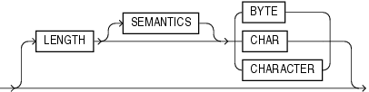

> ```
> char_length ::=
>  
>   [LENGTH [SEMANTICS] {BYTE | CHAR | CHARACTER}]
> ```
>
> [  
> Copyright © 2002, 2026, Oracle and/or its affiliates.](https://docs.oracle.com/en/database/oracle/oracle-database/dcommon/html/cpyr.htm)


The `LENGTH` parameter is placed after the `CHARACTERSET` parameter in the SQL\*Loader control file. The `LENGTH` parameter applies to the syntax specification for primary data files and also to LOBFILEs and secondary data files (SDFs). A `LENGTH` specification before the `INFILE` parameters applies to the entire list of primary data files. The `LENGTH` specification specified for the primary data file is used as the default for LOBFILEs and SDFs. You can override that default by specifying `LENGTH` with the LOBFILE or SDF specification. Unlike the `CHARACTERSET` parameter, the `LENGTH` parameter can also apply to data contained within the control file itself (that is, `INFILE *` syntax).

You can specify `CHARACTER` instead of `CHAR` for the `LENGTH` parameter.

If character-length semantics are being used for a SQL\*Loader data file, then the following SQL\*Loader data types will use character-length semantics:

- `CHAR`
- `VARCHAR`
- `VARCHARC`
- `DATE`
- `EXTERNAL ` numerics (`INTEGER`, `FLOAT`, `DECIMAL`, and `ZONED`)

For the `VARCHAR` data type, the length subfield is still a binary `SMALLINT` length subfield, but its value indicates the length of the character string in characters.

The following data types use byte-length semantics even if character-length semantics are being used for the data file, because the data is binary, or is in a special binary-encoded form in the case of `ZONED` and `DECIMAL`:

- `INTEGER`
- `SMALLINT`
- `FLOAT`
- `DOUBLE`
- `BYTEINT`
- `ZONED`
- `DECIMAL`
- `RAW`
- `VARRAW`
- `VARRAWC`
- `GRAPHIC`
- `GRAPHIC EXTERNAL`
- `VARGRAPHIC`

The start and end arguments to the `POSITION` parameter are interpreted in bytes, even if character-length semantics are in use in a data file. This is necessary to handle data files that have a mix of data of different data types, some of which use character-length semantics, and some of which use byte-length semantics. It is also needed to handle position with the `VARCHAR` data type, which has a `SMALLINT` length field and then the character data. The `SMALLINT` length field takes up a certain number of bytes depending on the system (usually 2 bytes), but its value indicates the length of the character string in characters.

Character-length semantics in the data file can be used independent of whether character-length semantics are used for the database columns. Therefore, the data file and the database columns can use either the same or different length semantics.

**Parent topic:** Input Character Conversion with SQL\*Loader

#### 9.15.6 Shift-sensitive Character Data

In general, loading shift-sensitive character data can be much slower than loading simple ASCII or EBCDIC data.

The fastest way to load shift-sensitive character data is to use fixed-position fields without delimiters. To improve performance, remember the following points:

- The field data must have an equal number of shift-out/shift-in bytes.
- The field must start and end in single-byte mode.
- It is acceptable for the first byte to be shift-out and the last byte to be shift-in.
- The first and last characters cannot be multibyte.
- If blanks are not preserved and multibyte-blank-checking is required, then a slower path is used. This can happen when the shift-in byte is the last byte of a field after single-byte blank stripping is performed.

**Parent topic:** Handling Different Character Encoding Schemes

### 9.16 Interrupted SQL\*Loader Loads

Learn about common scenarios in which SQL\*Loader loads are interrupted or discontinued, and what you can do to correct these issues.

- Understanding Causes of Interrupted SQL\*Loader Loads  
	A load can be interrupted due to space errors, or other errors related to loading data into the target Oracle Database.
- Discontinued Conventional Path Loads  
	In conventional path loads, if only part of the data is loaded before the data is discontinued, then only data processed up to the time of the last commit is loaded.
- Discontinued Direct Path Loads  
	In a direct path load, the behavior of a discontinued load varies depending on the reason the load was discontinued.
- Status of Tables and Indexes After an Interrupted Load  
	When a load is discontinued, any data already loaded remains in the tables, and the tables are left in a valid state.
- Using the Log File to Determine Load Status  
	The SQL\*Loader log file tells you the state of the tables and indexes and the number of logical records already read from the input data file.
- Continuing Single-Table Loads  
	To continue a discontinued SQL\*Loader load, you can use the `SKIP` parameter.

**Parent topic:** SQL\*Loader Control File Reference

#### 9.16.1 Understanding Causes of Interrupted SQL\*Loader Loads

A load can be interrupted due to space errors, or other errors related to loading data into the target Oracle Database.

Space errors are a primary reason for database load errors. In space errors, SQL\*Loader runs out of space for data rows or index entries. A load also can be discontinued because the maximum number of errors was exceeded, an unexpected error was returned to SQL\*Loader from the server, a record was too long in the data file, or a Ctrl+C was executed.

The behavior of SQL\*Loader when a load is discontinued varies depending on whether it is a conventional path load or a direct path load, and on the reason the load was interrupted. Additionally, when an interrupted load is continued, the use and value of the `SKIP` parameter can vary depending on the particular case.

#### 9.16.2 Discontinued Conventional Path Loads

In conventional path loads, if only part of the data is loaded before the data is discontinued, then only data processed up to the time of the last commit is loaded.

In a conventional path load, data is committed after all data in the bind array is loaded into all tables.

If the load is discontinued, then only the rows that were processed up to the time of the last commit operation are loaded. There is no partial commit of data.

**Parent topic:** Interrupted SQL\*Loader Loads

#### 9.16.3 Discontinued Direct Path Loads

In a direct path load, the behavior of a discontinued load varies depending on the reason the load was discontinued.

These sections describe the reasons why a load was discontinued:

- Load Discontinued Because of Space Errors  
	If a load is discontinued because of space errors, then the behavior of SQL\*Loader depends on whether you are loading data into multiple subpartitions.
- Load Discontinued Because Maximum Number of Errors Exceeded  
	If the maximum number of errors is exceeded, then SQL\*Loader stops loading records into any table and the work done to that point is committed.
- Load Discontinued Because of Fatal Errors  
	If a fatal error is encountered, then the load is stopped and no data is saved unless `ROWS` was specified at the beginning of the load.
- Load Discontinued Because a Ctrl+C Was Issued  
	If SQL\*Loader is in the middle of saving data when a Ctrl+C is issued, then it continues to do the save and then stops the load after the save completes.

**Parent topic:** Interrupted SQL\*Loader Loads

##### 9.16.3.1 Load Discontinued Because of Space Errors

If a load is discontinued because of space errors, then the behavior of SQL\*Loader depends on whether you are loading data into multiple subpartitions.

- Space errors when loading data into multiple subpartitions (that is, loading into a partitioned table, a composite partitioned table, or one partition of a composite partitioned table):
	If space errors occur when loading into multiple subpartitions, then the load is discontinued and no data is saved unless `ROWS` has been specified (in which case, all data that was previously committed will be saved). The reason for this behavior is that it is possible rows might be loaded out of order. This is because each row is assigned (not necessarily in order) to a partition and each partition is loaded separately. If the load discontinues before all rows assigned to partitions are loaded, then the row for record "n" may have been loaded, but not the row for record "n-1". Therefore, the load cannot be continued by simply using `SKIP=N`.
- Space errors when loading data into an unpartitioned table, one partition of a partitioned table, or one subpartition of a composite partitioned table:
	If there is one `INTO TABLE` statement in the control file, then SQL\*Loader commits as many rows as were loaded before the error occurred.
	If there are multiple `INTO TABLE` statements in the control file, then SQL\*Loader loads data already read from the data file into other tables and then commits the data.
	In either case, this behavior is independent of whether the `ROWS` parameter was specified. When you continue the load, you can use the `SKIP` parameter to skip rows that have already been loaded. In the case of multiple `INTO TABLE` statements, a different number of rows could have been loaded into each table, so to continue the load you would need to specify a different value for the `SKIP` parameter for every table. SQL\*Loader only reports the value for the `SKIP` parameter if it is the same for all tables.

**Parent topic:** Discontinued Direct Path Loads

##### 9.16.3.2 Load Discontinued Because Maximum Number of Errors Exceeded

If the maximum number of errors is exceeded, then SQL\*Loader stops loading records into any table and the work done to that point is committed.

This means that when you continue the load, the value you specify for the `SKIP` parameter may be different for different tables. SQL\*Loader reports the value for the `SKIP` parameter only if it is the same for all tables.

**Parent topic:** Discontinued Direct Path Loads

##### 9.16.3.3 Load Discontinued Because of Fatal Errors

If a fatal error is encountered, then the load is stopped and no data is saved unless `ROWS` was specified at the beginning of the load.

In that case, all data that was previously committed is saved. SQL\*Loader reports the value for the `SKIP` parameter only if it is the same for all tables.

**Parent topic:** Discontinued Direct Path Loads

##### 9.16.3.4 Load Discontinued Because a Ctrl+C Was Issued

If SQL\*Loader is in the middle of saving data when a Ctrl+C is issued, then it continues to do the save and then stops the load after the save completes.

Otherwise, SQL\*Loader stops the load without committing any work that was not committed already. This means that the value of the `SKIP` parameter will be the same for all tables.

**Parent topic:** Discontinued Direct Path Loads

#### 9.16.4 Status of Tables and Indexes After an Interrupted Load

When a load is discontinued, any data already loaded remains in the tables, and the tables are left in a valid state.

If the conventional path is used, then all indexes are left in a valid state.

If the direct path load method is used, then any indexes on the table are left in an unusable state. You can either rebuild or re-create the indexes before continuing, or after the load is restarted and completes.

Other indexes are valid if no other errors occurred. See [Indexes Left in an Unusable State](oracle-sql-loader-conventional-and-direct-loads.md) for other reasons why an index might be left in an unusable state.

**Parent topic:** Interrupted SQL\*Loader Loads

#### 9.16.5 Using the Log File to Determine Load Status

The SQL\*Loader log file tells you the state of the tables and indexes and the number of logical records already read from the input data file.

Use this information to resume the load where it left off.

**Parent topic:** Interrupted SQL\*Loader Loads

#### 9.16.6 Continuing Single-Table Loads

To continue a discontinued SQL\*Loader load, you can use the `SKIP` parameter.

When SQL\*Loader must discontinue a direct path or conventional path load before it is finished, some rows probably already are committed, or marked with savepoints.

To continue the discontinued load, use the `SKIP` parameter to specify the number of logical records that have already been processed by the previous load. At the time the load is discontinued, the value for `SKIP` is written to the log file in a message similar to the following:

```
Specify SKIP=1001 when continuing the load.
```

This message specifying the value of the `SKIP` parameter is preceded by a message indicating why the load was discontinued.

Note that for multiple-table loads, the value of the `SKIP` parameter is displayed only if it is the same for all tables.

### 9.17 Assembling Logical Records from Physical Records

This section describes assembling logical records from physical records.

To combine multiple physical records into one logical record, you can use one of the following clauses, depending on your data:

- `CONCATENATE`
- `CONTINUEIF`

- Using CONCATENATE to Assemble Logical Records  
	Use `CONCATENATE` when you want SQL\*Loader to always combine the same number of physical records to form one logical record.
- Using CONTINUEIF to Assemble Logical Records  
	Use `CONTINUEIF` if the number of physical records to be combined varies.

**Parent topic:** SQL\*Loader Control File Reference

#### 9.17.1 Using CONCATENATE to Assemble Logical Records

Use `CONCATENATE` when you want SQL\*Loader to always combine the same number of physical records to form one logical record.

In the following example, `integer` specifies the number of physical records to combine.

```
CONCATENATE  integer
```

The `integer` value specified for `CONCATENATE` determines the number of physical record structures that SQL\*Loader allocates for each row in the column array. In direct path loads, the default value for `COLUMNARRAYROWS` is large, so if you also specify a large value for `CONCATENATE`, then excessive memory allocation can occur. If this happens, you can improve performance by reducing the value of the `COLUMNARRAYROWS` parameter to lower the number of rows in a column array.

See Also:

- [COLUMNARRAYROWS](oracle-sql-loader-commands.md)
- [Specifying the Number of Column Array Rows and Size of Stream Buffers](oracle-sql-loader-conventional-and-direct-loads.md)

**Parent topic:** Assembling Logical Records from Physical Records

#### 9.17.2 Using CONTINUEIF to Assemble Logical Records

Use `CONTINUEIF` if the number of physical records to be combined varies.

The `CONTINUEIF ` clause is followed by a condition that is evaluated for each physical record, as it is read. For example, two records might be combined if a pound sign (#) were in byte position 80 of the first record. If any other character were there, then the second record would not be added to the first.

The full syntax for `CONTINUEIF` adds even more flexibility:

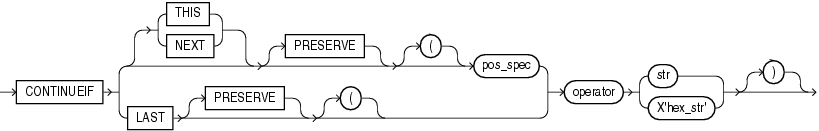

> ```
> continueif ::= 
>  
>   CONTINUEIF { [THIS | NEXT] [PRESERVE]  [(]  pos_spec | LAST [PRESERVE] [(] }  
>              operator { str | X'hex_str' } [)]
> ```
>
> [  
> Copyright © 2002, 2026, Oracle and/or its affiliates.](https://docs.oracle.com/en/database/oracle/oracle-database/dcommon/html/cpyr.htm)


Table 9-2 describes the parameters for the `CONTINUEIF` clause.

Table 9-2 Parameters for the CONTINUEIF Clause

| Parameter | Description |
| --- | --- |
| `THIS` | If the condition is true in the current record, then the next physical record is read and concatenated to the current physical record, continuing until the condition is false. If the condition is false, then the current physical record becomes the last physical record of the current logical record. `THIS` is the default. |
| `NEXT` | If the condition is true in the next record, then the current physical record is concatenated to the current logical record, continuing until the condition is false. |
| `operator` | The supported operators are equal (=) and not equal (!= or <>).  For the equal operator, the field and comparison string must match exactly for the condition to be true. For the not equal operator, they can differ in any character. |
| `LAST` | This test is similar to `THIS,` but the test is always against the last nonblank character. If the last nonblank character in the current physical record meets the test, then the next physical record is read and concatenated to the current physical record, continuing until the condition is false. If the condition is false in the current record, then the current physical record is the last physical record of the current logical record.  `LAST` allows only a single character-continuation field (as opposed to `THIS` and `NEXT,` which allow multiple character-continuation fields). |
| `pos_spec` | Specifies the starting and ending column numbers in the physical record.  Column numbers start with 1. Either a hyphen or a colon is acceptable (`start-end` or `start:end`).  If you omit `end`, then the length of the continuation field is the length of the byte string or character string. If you use `end`, and the length of the resulting continuation field is not the same as that of the byte string or the character string, then the shorter one is padded. Character strings are padded with blanks, hexadecimal strings with zeros. |
| `str` | A string of characters to be compared to the continuation field defined by start and end, according to the operator. The string must be enclosed in double or single quotation marks. The comparison is made character by character, blank padding on the right if necessary. |
| `X'hex-str'` | A string of bytes in hexadecimal format used in the same way as `str.X'1FB033'` would represent the three bytes with values 1F, B0, and 33 (hexadecimal). |
| `PRESERVE` | Includes ' `char_string` ' or `X` ' `hex_string` ' in the logical record. The default is to exclude them. |

The positions in the `CONTINUEIF` clause refer to positions in each physical record. This is the only time you refer to positions in physical records. All other references are to logical records.

For `CONTINUEIF` `THIS` and `CONTINUEIF` `LAST`, if the `PRESERVE` parameter is not specified, then the continuation field is removed from all physical records when the logical record is assembled. That is, data values are allowed to span the records with no extra characters (continuation characters) in the middle. For example, if `CONTINUEIF` `THIS(3:5)='***'` is specified, then positions `3` through `5` are removed from all records. This means that the continuation characters are removed if they are in positions `3` through `5` of the record. It also means that the characters in positions `3` through `5` are removed from the record even if the continuation characters are not in positions `3` through `5`.

For `CONTINUEIF` `THIS` and `CONTINUEIF` `LAST`, if the `PRESERVE` parameter is used, then the continuation field is kept in all physical records when the logical record is assembled.

`CONTINUEIF` `LAST` differs from `CONTINUEIF` `THIS` and `CONTINUEIF` `NEXT`. For `CONTINUEIF` `LAST`, where the positions of the continuation field vary from record to record, the continuation field is never removed, even if `PRESERVE` is not specified.

Example 9-3 through Example 9-6 show the use of `CONTINUEIF THIS` and `CONTINUEIF NEXT,` with and without the `PRESERVE` parameter.

Example 9-3 CONTINUEIF THIS Without the PRESERVE Parameter

Assume that you have physical records 14 bytes long and that a period represents a space:

```
%%aaaaaaaa....
%%bbbbbbbb....
..cccccccc....
%%dddddddddd..
%%eeeeeeeeee..
..ffffffffff..
```

In this example, the `CONTINUEIF THIS` clause does not use the `PRESERVE` parameter:

```
CONTINUEIF THIS (1:2) = '%%'
```

Therefore, the logical records are assembled as follows:

```
aaaaaaaa....bbbbbbbb....cccccccc....
dddddddddd..eeeeeeeeee..ffffffffff..
```

Note that columns 1 and 2 (for example, %% in physical record 1) are removed from the physical records when the logical records are assembled.

Example 9-4 CONTINUEIF THIS with the PRESERVE Parameter

Assume that you have the same physical records as in Example 9-3.

In this example, the `CONTINUEIF THIS` clause uses the `PRESERVE` parameter:

```
CONTINUEIF THIS PRESERVE (1:2) = '%%'
```

Therefore, the logical records are assembled as follows:

```
%%aaaaaaaa....%%bbbbbbbb......cccccccc....
%%dddddddddd..%%eeeeeeeeee....ffffffffff..
```

Note that columns 1 and 2 are not removed from the physical records when the logical records are assembled.

Example 9-5 CONTINUEIF NEXT Without the PRESERVE Parameter

Assume that you have physical records 14 bytes long and that a period represents a space:

```
..aaaaaaaa....
%%bbbbbbbb....
%%cccccccc....
..dddddddddd..
%%eeeeeeeeee..
%%ffffffffff..
```

In this example, the `CONTINUEIF NEXT` clause does not use the `PRESERVE` parameter:

```
CONTINUEIF NEXT (1:2) = '%%'
```

Therefore, the logical records are assembled as follows (the same results as for Example 9-3).

```
aaaaaaaa....bbbbbbbb....cccccccc....
dddddddddd..eeeeeeeeee..ffffffffff..
```

Example 9-6 CONTINUEIF NEXT with the PRESERVE Parameter

Assume that you have the same physical records as in Example 9-5.

In this example, the `CONTINUEIF NEXT` clause uses the `PRESERVE` parameter:

```
CONTINUEIF NEXT PRESERVE (1:2) = '%%'
```

Therefore, the logical records are assembled as follows:

```
..aaaaaaaa....%%bbbbbbbb....%%cccccccc....
..dddddddddd..%%eeeeeeeeee..%%ffffffffff..
```

See Also:

Case study 4, Loading Combined Physical Records, for an example of the `CONTINUEIF` clause. (See [SQL\*Loader Case Studies](oracle-sql-loader-concepts.md) for information on how to access case studies.)

**Parent topic:** Assembling Logical Records from Physical Records

### 9.18 Loading Logical Records into Tables

Learn about the different methods and available to you to load logical records into tables with SQL\*Loader.

You can use SQL\*Loader options to choose from a variety of methods to control:

- Which tables you want to load
- Which records you want to load into tables
- What are the default data delimiters for records
- What options you can use to handle short records with missing data

- Specifying Table Names  
	The `INTO` `TABLE` clause of the `LOAD` `DATA` statement enables you to identify tables, fields, and data types.
- INTO TABLE Clause  
	Among its many functions, the SQL\*Loader `INTO TABLE` clause enables you to specify the table into which you load data.
- Table-Specific Loading Method  
	When you are loading a table, you can use the `INTO` `TABLE` clause to specify a table-specific loading method (`INSERT`, `APPEND`, `REPLACE`, or `TRUNCATE`) that applies only to that table.
- Loading Data into Empty Tables with INSERT  
	To load data into empty tables, use the `INSERT` option.
- Loading Data into Nonempty Tables  
	When you use SQL\*Loader to load data into nonempty tables, you can append to, replace, or truncate the existing table.
- Table-Specific OPTIONS Parameter  
	The `OPTIONS` parameter can be specified for individual tables in a parallel load. (It is valid only for a parallel load.)
- Loading Records Based on a Condition  
	You can choose to load or discard a logical record by using the `WHEN` clause to test a condition in the record.
- Using the WHEN Clause with LOBFILEs and SDFs  
	See how to use the `WHEN` clause with `LOBFILE` s and `SDF` s.
- Specifying Default Data Delimiters  
	If all data fields are terminated similarly in the data file, then you can use the `FIELDS` clause to indicate the default termination and enclosure delimiters.
- Handling Records with Missing Specified Fields  
	When records are loaded that are missing fields specified in the SQL\*Loader control file, SQL\*Loader can either specify those fields as null, or report an error.

**Parent topic:** SQL\*Loader Control File Reference

#### 9.18.1 Specifying Table Names

The `INTO` `TABLE` clause of the `LOAD` `DATA` statement enables you to identify tables, fields, and data types.

It defines the relationship between records in the data file and tables in the database. The specification of fields and data types is described in later sections.

**Parent topic:** Loading Logical Records into Tables

#### 9.18.2 INTO TABLE Clause

Among its many functions, the SQL\*Loader `INTO TABLE` clause enables you to specify the table into which you load data.

Purpose

Specifies the table into which you load data, and controls how that data is loaded.

To load multiple tables, you include one `INTO TABLE` clause for each table you want to load.

To begin an `INTO TABLE` clause, use the keywords `INTO TABLE` followed by the name of the Oracle Database table that you want to receive the data.

Syntax

The syntax is as follows:

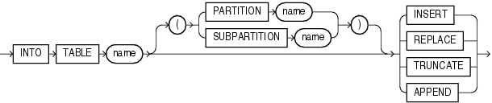

> ```
> into_table1 ::= 
>  
>   INTO TABLE name [ ( { PARTITION name | SUBPARTITION name } ) ] 
>   { INSERT | REPLACE | TRUNCATE | APPEND }
> ```
>
> [  
> Copyright © 2002, 2026, Oracle and/or its affiliates.](https://docs.oracle.com/en/database/oracle/oracle-database/dcommon/html/cpyr.htm)


Usage Notes

If data already exists in the table, then SQL\*Loader appends the new rows to it. If data does not already exist, then the new rows are simply loaded.

To use the `APPEND` option, you must have the `SELECT` privilege.

`INSERT` is the default method for SQL\*Loader to load data into tables. To use this method, the table must be empty before loading. If you run SQL\*Loader to load a table for which you have the `INSERT` privilege, but for which you do not have the `SELECT` privilege, then `INSERT` mode fails with the error `ORA-1031:                     Insufficient Privileges While Connecting As SYSDBA`. However, using `APPEND` mode will succeed..

Restrictions

The table that you specify as the table into which you want to load data must already exist. If the table name is the same as any SQL or SQL\*Loader reserved keyword, or if it contains any special characters, or if it is case sensitive, then you should enclose the table name in double quotation marks. For example:

```
INTO TABLE scott."CONSTANT"
INTO TABLE scott."Constant" 
INTO TABLE scott."-CONSTANT"
```

The user must have `INSERT` privileges for the table being loaded. If the table is not in the user's schema, then the user must either use a synonym to reference the table, or include the schema name as part of the table name (for example, `scott.emp` refers to the table `emp` in the `scott` schema).

Note:

SQL\*Loader considers the default schema to be whatever schema is current after your connection to the database is complete. This means that if there are logon triggers present that are run during connection to a database, then the default schema to which you are connected is not necessarily the schema that you specified in the connect string.

If you have a logon trigger that changes your current schema to a different one when you connect to a certain database, then SQL\*Loader uses that new schema as the default.

**Parent topic:** Loading Logical Records into Tables

#### 9.18.3 Table-Specific Loading Method

When you are loading a table, you can use the `INTO` `TABLE` clause to specify a table-specific loading method (`INSERT`, `APPEND`, `REPLACE`, or `TRUNCATE`) that applies only to that table.

That method overrides the global table-loading method. The global table-loading method is `INSERT`, by default, unless a different method was specified before any `INTO` `TABLE` clauses. The following sections discuss using these options to load data into empty and nonempty tables.

**Parent topic:** Loading Logical Records into Tables

#### 9.18.4 Loading Data into Empty Tables with INSERT

To load data into empty tables, use the `INSERT` option.

If the tables you are loading into are empty, then use the `INSERT` option. The `INSERT` option is the default method for SQL\*Loader. To use `INSERT`, the table into which you want to load data must be empty before you load it. If the table into which you attempt to load data contains rows, then SQL\*Loader terminates with an error. Case study 1, Loading Variable-Length Data, provides an example. (See SQL\*Loader Case Studies for information on how to access case studies.)

SQL\*Loader checks the table into which you insert data to ensure that it is empty. For this reason, the user with which you run `INSERT` must be granted both the `SELECT` and the `INSERT` privilege.

#### 9.18.5 Loading Data into Nonempty Tables

When you use SQL\*Loader to load data into nonempty tables, you can append to, replace, or truncate the existing table.

- Options for Loading Data Into Nonempty Tables  
	To load data into nonempty tables with SQL\*Loader, you must select how that data is loaded
- APPEND
- REPLACE
- Updating Existing Rows
- TRUNCATE

**Parent topic:** Loading Logical Records into Tables

##### 9.18.5.1 Options for Loading Data Into Nonempty Tables

To load data into nonempty tables with SQL\*Loader, you must select how that data is loaded

If the tables you are loading into already contain data, then you have three options:

- `APPEND`
- `REPLACE`
- `TRUNCATE`
	Caution:
	When you specify `REPLACE` or `TRUNCATE`, the entire table is replaced, not just individual rows. After the rows are successfully deleted, a `COMMIT` statement is issued. You cannot recover the data that was in the table before the load, unless it was saved with Export, or a comparable utility.

**Parent topic:** Loading Data into Nonempty Tables

##### 9.18.5.2 APPEND

If data already exists in the table, then SQL\*Loader appends the new rows to it. If data does not already exist, then the new rows are simply loaded. You must have `SELECT` privilege to use the `APPEND` option. Case study 3, Loading a Delimited Free-Format File, provides an example. (See [SQL\*Loader Case Studies](oracle-sql-loader-concepts.md) for information on how to access case studies.)

**Parent topic:** Loading Data into Nonempty Tables

##### 9.18.5.3 REPLACE

The `REPLACE` option executes a SQL `DELETE FROM TABLE` statement. All rows in the table are deleted and the new data is loaded. The table must be in your schema, or you must have `DELETE` privilege on the table. Case study 4, Loading Combined Physical Records, provides an example. (See [SQL\*Loader Case Studies](oracle-sql-loader-concepts.md) for information on how to access case studies.)

The row deletes cause any delete triggers defined on the table to fire. If `DELETE CASCADE` has been specified for the table, then the cascaded deletes are carried out. For more information about cascaded deletes, see [Oracle Database Concepts.](https://docs.oracle.com/pls/topic/lookup?ctx=en/database/oracle/oracle-database/21/sutil&id=CNCPT33336)

**Parent topic:** Loading Data into Nonempty Tables

##### 9.18.5.4 Updating Existing Rows

The `REPLACE` method is a table replacement, not a replacement of individual rows. SQL\*Loader does not update existing records, even if they have null columns. To update existing rows, use the following procedure:

1. Load your data into a work table.
2. Use the SQL `UPDATE` statement with correlated subqueries.
3. Drop the work table.

**Parent topic:** Loading Data into Nonempty Tables

##### 9.18.5.5 TRUNCATE

The `TRUNCATE` option executes a SQL `TRUNCATE TABLE` `table_name` `REUSE STORAGE` statement, which means that the table's extents will be reused. The `TRUNCATE` option quickly and efficiently deletes all rows from a table or cluster, to achieve the best possible performance. For the `TRUNCATE` statement to operate, the table's referential integrity constraints must first be disabled. If they have not been disabled, then SQL\*Loader returns an error.

Once the integrity constraints have been disabled, `DELETE CASCADE` is no longer defined for the table. If the `DELETE CASCADE` functionality is needed, then the contents of the table must be manually deleted before the load begins.

The table must be in your schema, or you must have the `DROP ANY TABLE` privilege.

**Parent topic:** Loading Data into Nonempty Tables

#### 9.18.6 Table-Specific OPTIONS Parameter

The `OPTIONS` parameter can be specified for individual tables in a parallel load. (It is valid only for a parallel load.)

The syntax for the `OPTIONS` parameter is as follows:

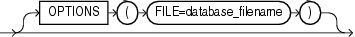

> ```
> into_table3 ::=
>  
>   [OPTIONS (FILE=database_filename)]
> ```
>
> [  
> Copyright © 2002, 2026, Oracle and/or its affiliates.](https://docs.oracle.com/en/database/oracle/oracle-database/dcommon/html/cpyr.htm)


See Also:

[Parameters for Parallel Direct Path Loads](oracle-sql-loader-conventional-and-direct-loads.md)

**Parent topic:** Loading Logical Records into Tables

#### 9.18.7 Loading Records Based on a Condition

You can choose to load or discard a logical record by using the `WHEN` clause to test a condition in the record.

The `WHEN` clause appears after the table name and is followed by one or more field conditions. The syntax for `field_condition` is as follows:

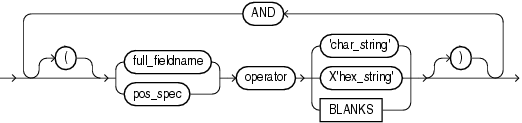

> ```
> fld_cond  ::= 
>  
>   [(] 
>   {full_fieldname | pos_spec } operator { 'char_string' | X'hex_string' | BLANKS} 
>   [)] AND
>   [(]
>   {full_fieldname | pos_spec } operator { 'char_string' | X'hex_string' | BLANKS}
>   [)]...
> ```
>
> [  
> Copyright © 2002, 2026, Oracle and/or its affiliates.](https://docs.oracle.com/en/database/oracle/oracle-database/dcommon/html/cpyr.htm)


For example, the following clause indicates that any record with the value "q" in the fifth column position should be loaded:

```
WHEN (5) = 'q'
```

A `WHEN` clause can contain several comparisons, provided each is preceded by ` AND`. Parentheses are optional, but should be used for clarity with multiple comparisons joined by `AND`. For example:

```
WHEN (deptno = '10') AND (job = 'SALES')
```

See Also:

- [Using the WHEN\_ NULLIF\_ and DEFAULTIF Clauses](oracle-sql-loader-field-list-contents.md) for information about how SQL\*Loader evaluates `WHEN` clauses, as opposed to `NULLIF` and `DEFAULTIF` clauses
- Case study 5, Loading Data into Multiple Tables, for an example of using the `WHEN` clause (see " [SQL\*Loader Case Studies](oracle-sql-loader-concepts.md) " for information on how to access case studies)

**Parent topic:** Loading Logical Records into Tables

#### 9.18.8 Using the WHEN Clause with LOBFILEs and SDFs

See how to use the `WHEN` clause with `LOBFILE` s and `SDF` s.

If a record with a `LOBFILE` or `SDF` is discarded, then SQL\*Loader does not skip the corresponding data in that `LOBFILE` or `SDF`.

**Parent topic:** Loading Logical Records into Tables

#### 9.18.9 Specifying Default Data Delimiters

If all data fields are terminated similarly in the data file, then you can use the `FIELDS` clause to indicate the default termination and enclosure delimiters.

- fields\_spec  
	Use `fields_spec` to specify fields for default termination and enclosure delimiters.
- termination\_spec  
	Use `termination_spec` to specify default termination and enclosure delimiters.
- enclosure\_spec  
	Use `enclosure_spec` to specify default enclosure delimiters.

**Parent topic:** Loading Logical Records into Tables

##### 9.18.9.1 fields\_spec

Use `fields_spec` to specify fields for default termination and enclosure delimiters.

`fields_spec` Syntax

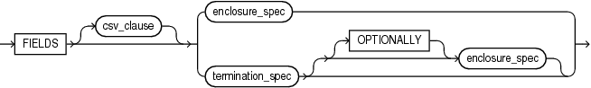

> fields\_spec::= FIELDS \[csv\_clause\] { enclosure\_spec | termination\_spec \[ \[OPTIONALLY\] enclosure\_spec \] }
>
> [  
> Copyright © 2002, 2026, Oracle and/or its affiliates.](https://docs.oracle.com/en/database/oracle/oracle-database/dcommon/html/cpyr.htm)


##### 9.18.9.2 termination\_spec

Use `termination_spec` to specify default termination and enclosure delimiters.

`termination_spec` Syntax


> ```
> terminat ::= 
>  
>   TERMINATED [BY] { WHITESPACE | X'hexstr' | 'string' | EOF }
> ```
>
> [  
> Copyright © 2002, 2026, Oracle and/or its affiliates.](https://docs.oracle.com/en/database/oracle/oracle-database/dcommon/html/cpyr.htm)


Note:

Terminator strings can contain one or more characters. Also, `TERMINATED BY EOF` applies only to loading LOBs from a LOBFILE.

**Parent topic:** Specifying Default Data Delimiters

##### 9.18.9.3 enclosure\_spec

Use `enclosure_spec` to specify default enclosure delimiters.

`enclosure_spec` Syntax


> ```
> enclose ::= 
>  
>   ENCLOSED [BY] [ 'string' | X'hexstr' ] [AND] [ 'string' | X'hexstr' ]
> ```
>
> [  
> Copyright © 2002, 2026, Oracle and/or its affiliates.](https://docs.oracle.com/en/database/oracle/oracle-database/dcommon/html/cpyr.htm)


Note:

Enclosure strings can contain one or more characters.

You can override the delimiter for any given column by specifying it after the column name. You can see an example of this usage in Case study 3, Loading a Delimited Free-Format File. See the topic See "SQL\*Loader Case Studies" for information about how to load and use case studies.

#### 9.18.10 Handling Records with Missing Specified Fields

When records are loaded that are missing fields specified in the SQL\*Loader control file, SQL\*Loader can either specify those fields as null, or report an error.

- SQL\*Loader Management of Short Records with Missing Data  
	Learn how SQL\*Loader handles cases where the control file defines more fields for a record than are present in the record.
- TRAILING NULLCOLS Clause  
	You can use the `TRAILING NULLCOLS` clause to configure SQL\*Loader to treat missing columns as null columns.

**Parent topic:** Loading Logical Records into Tables

##### 9.18.10.1 SQL\*Loader Management of Short Records with Missing Data

Learn how SQL\*Loader handles cases where the control file defines more fields for a record than are present in the record.

When the control file definition specifies more fields for a record than are present in the record, SQL\*Loader must determine if the remaining (specified) columns should be considered null, or if it should generate an error.

If the control file definition explicitly states that a field's starting position is beyond the end of the logical record, then SQL\*Loader always defines the field as null. If a field is defined with a relative position (such as `dname` and `loc` in the following example), and the record ends before the field is found, then SQL\*Loader can either treat the field as null, or generate an error. SQL\*Loader uses the presence or absence of the `TRAILING NULLCOLS` clause (shown in the following syntax diagram) to determine the course of action.

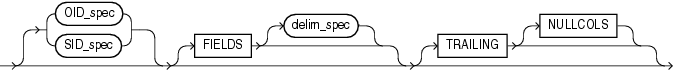

> into\_table6::= \[ OID\_spec | SID\_spec \] \[FIELDS \[delim\_spec\]\] \[TRAILING \[NULLCOLS\]\]
>
> [  
> Copyright © 2002, 2026, Oracle and/or its affiliates.](https://docs.oracle.com/en/database/oracle/oracle-database/dcommon/html/cpyr.htm)


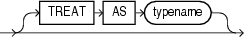

> into\_table7::= \[TREAT AS typename\]
>
> [  
> Copyright © 2002, 2026, Oracle and/or its affiliates.](https://docs.oracle.com/en/database/oracle/oracle-database/dcommon/html/cpyr.htm)


**Parent topic:** Handling Records with Missing Specified Fields

##### 9.18.10.2 TRAILING NULLCOLS Clause

You can use the `TRAILING NULLCOLS` clause to configure SQL\*Loader to treat missing columns as null columns.

The `TRAILING NULLCOLS` clause tells SQL\*Loader to treat any relatively positioned columns that are not present in the record as null columns.

For example, consider the following data:

```
10 Accounting
```

Assume that the preceding data is read with the following control file and the record ends after `dname:`

```
INTO TABLE dept 
    TRAILING NULLCOLS 
( deptno CHAR TERMINATED BY " ", 
  dname  CHAR TERMINATED BY WHITESPACE, 
  loc    CHAR TERMINATED BY WHITESPACE 
)
```

In this case, the remaining `loc` field is set to null. Without the `TRAILING NULLCOLS` clause, an error would be generated due to missing data.

See Also:

Case study 7, Extracting Data from a Formatted Report, for an example of using `TRAILING NULLCOLS` (see [SQL\*Loader Case Studies](oracle-sql-loader-concepts.md) for information on how to access case studies)

**Parent topic:** Handling Records with Missing Specified Fields

### 9.19 Index Options

To control how SQL\*Loader creates index entries, you can set `SORTED             INDEXES` and ` SINGLEROW` clauses.

- Understanding the SORTED INDEXES Parameter  
	To optimize performance with SQL\*Loader direct path loads, consider using the SORTED INDEX control file parameter.
- Understanding the SINGLEROW Parameter  
	When using SQL\*Loader for direct path loads for small loads, or on systems with limited memory, consider using the `SINGLEROW` control file parameter.

**Parent topic:** SQL\*Loader Control File Reference

#### 9.19.1 Understanding the SORTED INDEXES Parameter

To optimize performance with SQL\*Loader direct path loads, consider using the SORTED INDEX control file parameter.

The `SORTED INDEX` clause applies to direct path loads. It tells SQL\*Loader that the incoming data has already been sorted on the specified indexes. Specifying sorted indexes enables SQL\*Loader to optimize performance.

#### 9.19.2 Understanding the SINGLEROW Parameter

When using SQL\*Loader for direct path loads for small loads, or on systems with limited memory, consider using the `SINGLEROW` control file parameter.

The `SINGLEROW` option is intended for use during a direct path load with `APPEND` on systems with limited memory, or when loading a small number of records into a large table. This option inserts each index entry directly into the index, one record at a time.

By default, SQL\*Loader does not use `SINGLEROW` to append records to a table. Instead, index entries are put into a separate, temporary storage area, and merged with the original index at the end of the load. This method achieves better performance and produces an optimal index, but it requires extra storage space. During the merge operation, the original index, the new index, and the space for new entries all simultaneously occupy storage space.

With the `SINGLEROW` option, storage space is not required for new index entries or for a new index. It is possible that the index that results is not as optimal as a freshly sorted one. However, this index takes less space to produce. It also takes more time to produce, because additional `UNDO` information is generated for each index insert. Oracle recommends that you consider using this option when either of the following situations exists:

- Available storage is limited.
- The number of records that you want to load is small compared to the size of the table. Oracle recommends this option when the number of records compared to the size of the table is a ratio of 1:20 or less.

**Parent topic:** Index Options

### 9.20 Benefits of Using Multiple INTO TABLE Clauses

Learn from examples how you can use multiple `INTO TABLE` clauses for specific SQL\*Loader use cases

- Understanding the SQL\*Loader INTO TABLE Clause  
	Among other uses, the `INTO TABLE` control file parameter is useful for loading multiple tables, loading data into more than one table, and extracting multiple logical records.
- Distinguishing Different Input Record Formats  
	If you have a variety of formats of data in a single data file, you can use the SQL\*Loader INTO TABLE clause to distinguish between formats.
- Relative Positioning Based on the POSITION Parameter  
	If you have a variety of formats of data in a single data file, you can use the SQL\*Loader `POSITION` parameter with the `INTO TABLE` clause to load the records as delimited data.
- Distinguishing Different Input Row Object Subtypes  
	A single data file may contain records made up of row objects inherited from the same base row object type.
- Loading Data into Multiple Tables  
	By using the `POSITION` parameter with multiple `INTO TABLE` clauses, data from a single record can be loaded into multiple normalized tables.
- Summary of Using Multiple INTO TABLE Clauses  
	Multiple `INTO TABLE` clauses allow you to extract multiple logical records from a single input record and recognize different record formats in the same file.
- Extracting Multiple Logical Records  
	When the data records are short, you can use SQL\*Loader INTO TABLE claus to store more than one data record in a single, physical record to use the storage space efficiently.

**Parent topic:** SQL\*Loader Control File Reference

#### 9.20.1 Understanding the SQL\*Loader INTO TABLE Clause

Among other uses, the `INTO TABLE` control file parameter is useful for loading multiple tables, loading data into more than one table, and extracting multiple logical records.

Multiple `INTO TABLE` clauses enable you to:

- Load data into different tables
- Extract multiple logical records from a single input record
- Distinguish different input record formats
- Distinguish different input row object subtypes

In the first case, it is common for the `INTO TABLE` clauses to refer to the same table. To learn about the different ways that you can use multiple `INTO TABLE ` clauses, and how to use the `POSITION` parameter, refer to the examples.

Note:

A key point when using multiple `INTO TABLE` clauses is that field scanning continues from where it left off when a new `INTO                     TABLE` clause is processed. Refer to the examples to understand some of the details about how you can to make use of this behavior. Also learn how you can use alternative ways of using fixed field locations, or the `POSITION` parameter.

**Parent topic:** Benefits of Using Multiple INTO TABLE Clauses

#### 9.20.2 Distinguishing Different Input Record Formats

If you have a variety of formats of data in a single data file, you can use the SQL\*Loader INTO TABLE clause to distinguish between formats.

Consider the following data, in which `emp` and `dept` records are intermixed:

```
1 50   Manufacturing       — DEPT record 
2 1119 Smith      50       — EMP record 
2 1120 Snyder     50 
1 60   Shipping 
2 1121 Stevens    60
```

A record ID field distinguishes between the two formats. Department records have a `1` in the first column, while employee records have a `2`. The following control file uses exact positioning to load this data:

```
INTO TABLE dept 
   WHEN recid = 1 
   (recid  FILLER POSITION(1:1)  INTEGER EXTERNAL,
    deptno POSITION(3:4)  INTEGER EXTERNAL, 
    dname  POSITION(8:21) CHAR) 
INTO TABLE emp 
   WHEN recid <> 1 
   (recid  FILLER POSITION(1:1)   INTEGER EXTERNAL,
    empno  POSITION(3:6)   INTEGER EXTERNAL, 
    ename  POSITION(8:17)  CHAR, 
    deptno POSITION(19:20) INTEGER EXTERNAL)
```

**Parent topic:** Benefits of Using Multiple INTO TABLE Clauses

#### 9.20.3 Relative Positioning Based on the POSITION Parameter

If you have a variety of formats of data in a single data file, you can use the SQL\*Loader `POSITION` parameter with the `INTO TABLE` clause to load the records as delimited data.

Again, consider data, in which `emp` and `dept` records are intermixed. In this case, however, we can use the `POSITION` parameter to load the data into delimited records, as shown in this control file example:

```
INTO TABLE dept 
   WHEN recid = 1 
   (recid  FILLER INTEGER EXTERNAL TERMINATED BY WHITESPACE, 
    deptno INTEGER EXTERNAL TERMINATED BY WHITESPACE, 
    dname  CHAR TERMINATED BY WHITESPACE) 
INTO TABLE emp 
   WHEN recid <> 1 
   (recid  FILLER POSITION(1) INTEGER EXTERNAL TERMINATED BY ' ', 
    empno  INTEGER EXTERNAL TERMINATED BY ' ' 
    ename  CHAR TERMINATED BY WHITESPACE, 
    deptno INTEGER EXTERNAL TERMINATED BY ' ')
```

To load this data correctly, the `POSITION` parameter in the second `INTO TABLE` clause is necessary. It causes field scanning to start over at column 1 when checking for data that matches the second format. Without the POSITION parameter, SQL\*Loader would look for the `recid` field after `dname`.

**Parent topic:** Benefits of Using Multiple INTO TABLE Clauses

#### 9.20.4 Distinguishing Different Input Row Object Subtypes

A single data file may contain records made up of row objects inherited from the same base row object type.

For example, consider the following simple object type and object table definitions, in which a nonfinal base object type is defined along with two object subtypes that inherit their row objects from the base type:

```
CREATE TYPE person_t AS OBJECT 
 (name    VARCHAR2(30), 
  age     NUMBER(3)) not final; 

CREATE TYPE employee_t UNDER person_t 
 (empid   NUMBER(5), 
  deptno  NUMBER(4), 
  dept    VARCHAR2(30)) not final; 

CREATE TYPE student_t UNDER person_t 
 (stdid   NUMBER(5), 
  major   VARCHAR2(20)) not final; 

CREATE TABLE persons OF person_t;
```

The following input data file contains a mixture of these row objects subtypes. A type ID field distinguishes between the three subtypes. `person_t` objects have a `P` in the first column, `employee_t` objects have an `E`, and `student_t` objects have an `S`.

```
P,James,31, 
P,Thomas,22, 
E,Pat,38,93645,1122,Engineering, 
P,Bill,19, 
P,Scott,55, 
S,Judy,45,27316,English, 
S,Karen,34,80356,History, 
E,Karen,61,90056,1323,Manufacturing, 
S,Pat,29,98625,Spanish, 
S,Cody,22,99743,Math, 
P,Ted,43, 
E,Judy,44,87616,1544,Accounting, 
E,Bob,50,63421,1314,Shipping, 
S,Bob,32,67420,Psychology, 
E,Cody,33,25143,1002,Human Resources,
```

The following control file uses relative positioning based on the `POSITION` parameter to load this data. Note the use of the `TREAT` `AS` clause with a specific object type name. This informs SQL\*Loader that all input row objects for the object table will conform to the definition of the named object type.

Note:

Multiple subtypes cannot be loaded with the same `INTO` `TABLE` statement. Instead, you must use multiple `INTO` `TABLE` statements and have each one load a different subtype.

```
INTO TABLE persons 
REPLACE 
WHEN typid = 'P' TREAT AS person_t 
FIELDS TERMINATED BY "," 
 (typid   FILLER  POSITION(1) CHAR, 
  name            CHAR, 
  age             CHAR) 

INTO TABLE persons 
REPLACE 
WHEN typid = 'E' TREAT AS employee_t 
FIELDS TERMINATED BY "," 
 (typid   FILLER  POSITION(1) CHAR, 
  name            CHAR, 
  age             CHAR, 
  empid           CHAR, 
  deptno          CHAR, 
  dept            CHAR) 

INTO TABLE persons 
REPLACE 
WHEN typid = 'S' TREAT AS student_t 
FIELDS TERMINATED BY "," 
 (typid   FILLER  POSITION(1) CHAR, 
  name            CHAR, 
  age             CHAR, 
  stdid           CHAR, 
  major           CHAR)
```

See Also:

[Loading Column Objects](loading-objects-oracle-sql-loader.md) for more information about loading object types

**Parent topic:** Benefits of Using Multiple INTO TABLE Clauses

#### 9.20.5 Loading Data into Multiple Tables

By using the `POSITION` parameter with multiple `INTO TABLE` clauses, data from a single record can be loaded into multiple normalized tables.

See case study 5, Loading Data into Multiple Tables, for an example. (See [SQL\*Loader Case Studies](oracle-sql-loader-concepts.md) for information about how to access case studies.).

**Parent topic:** Benefits of Using Multiple INTO TABLE Clauses

#### 9.20.6 Summary of Using Multiple INTO TABLE Clauses

Multiple `INTO TABLE` clauses allow you to extract multiple logical records from a single input record and recognize different record formats in the same file.

For delimited data, proper use of the `POSITION` parameter is essential for achieving the expected results.

When the `POSITION` parameter is not used, multiple `INTO TABLE` clauses process different parts of the same (delimited data) input record, allowing multiple tables to be loaded from one record. When the `POSITION` parameter is used, multiple `INTO TABLE` clauses can process the same record in different ways, allowing multiple formats to be recognized in one input file.

**Parent topic:** Benefits of Using Multiple INTO TABLE Clauses

#### 9.20.7 Extracting Multiple Logical Records

When the data records are short, you can use SQL\*Loader INTO TABLE claus to store more than one data record in a single, physical record to use the storage space efficiently.

- Example of Extracting Multiple Logical Records From a Physical Record  
	In this example, you create two logical records from a single physical record using the SQL\*Loader INTO TABLE clause in the control file.
- Example of Relative Positioning Based on Delimiters  
	In this example, you load the same record using relative positioning with the SQL\*Loader `INTO TABLE` clause in the control file.

**Parent topic:** Benefits of Using Multiple INTO TABLE Clauses

##### 9.20.7.1 Example of Extracting Multiple Logical Records From a Physical Record

In this example, you create two logical records from a single physical record using the SQL\*Loader INTO TABLE clause in the control file.

Some data storage and transfer media have fixed-length physical records.

In this example, SQL\*Loader treats a single physical record in the input file as two logical records and uses two `INTO TABLE` clauses to load the data into the `emp` table. For example, assume the data is as follows:

```
1119 Smith      1120 Yvonne 
1121 Albert     1130 Thomas
```

The following control file extracts the logical records:

```
INTO TABLE emp 
     (empno POSITION(1:4)  INTEGER EXTERNAL, 
      ename POSITION(6:15) CHAR) 
INTO TABLE emp 
     (empno POSITION(17:20) INTEGER EXTERNAL, 
      ename POSITION(21:30) CHAR)
```

**Parent topic:** Extracting Multiple Logical Records

##### 9.20.7.2 Example of Relative Positioning Based on Delimiters

In this example, you load the same record using relative positioning with the SQL\*Loader `INTO TABLE` clause in the control file.

The following control file uses relative positioning instead of fixed positioning. It specifies that each field is delimited by a single blank (" ") or with an undetermined number of blanks and tabs (`WHITESPACE`):

```
INTO TABLE emp 
     (empno INTEGER EXTERNAL TERMINATED BY " ", 
      ename CHAR             TERMINATED BY WHITESPACE) 
INTO TABLE emp 
     (empno INTEGER EXTERNAL TERMINATED BY " ", 
      ename CHAR)            TERMINATED BY WHITESPACE)
```

The important point in this example is that the second `empno` field is found immediately after the first `ename`, although it is in a separate `INTO TABLE` clause. Field scanning does not start over from the beginning of the record for a new `INTO TABLE` clause. Instead, scanning continues where it left off.

To force record scanning to start in a specific location, you use the `POSITION` parameter.

### 9.21 Bind Arrays and Conventional Path Loads

With the SQL\*Loader array-interface option, multiple table rows are read at one time, and stored in a bind array.

- Differences Between Bind Arrays and Conventional Path Loads  
	With bind arrays, you can use SQL\*Loader to load an entire array of records in one operation.
- Size Requirements for Bind Arrays  
	When you use a bind array with SQL\*Loader, the bind array must be large enough to contain a single row.
- Performance Implications of Bind Arrays  
	Large bind arrays minimize the number of calls to the Oracle database and maximize performance.
- Specifying Number of Rows Versus Size of Bind Array  
	When you specify a bind array size using the command-line parameter `BINDSIZE` or the `OPTIONS` clause in the control file, you impose an upper limit on the bind array.
- Setting Up SQL\*Loader Bind Arrays  
	To set up bind arrays, you calculate the array size you need, determine the size of the length indicator, and calculate the size of the field buffers.
- Minimizing Memory Requirements for Bind Arrays  
	Pay particular attention to the default sizes allocated for `VARCHAR`, `VARGRAPHIC`, and the delimited forms of `CHAR`, `DATE`, and numeric `EXTERNAL` fields.
- Calculating Bind Array Size for Multiple INTO TABLE Clauses  
	When calculating a bind array size for a control file that has multiple `INTO` `TABLE` clauses, calculate as if the `INTO` `TABLE` clauses were not present.

**Parent topic:** SQL\*Loader Control File Reference

#### 9.21.1 Differences Between Bind Arrays and Conventional Path Loads

With bind arrays, you can use SQL\*Loader to load an entire array of records in one operation.

When you use bind arrays, SQL\*Loader uses the SQL array-interface option to transfer data to the database. When SQL\*Loader sends the Oracle database an `INSERT` command, the entire array is inserted at one time. After the rows in the bind array are inserted, a `COMMIT` statement is issued.

The determination of bind array size pertains to SQL\*Loader's conventional path option. In general, it does not apply to the direct path load method, because a direct path load uses the direct path API. However, the bind array can be used for special cases of direct path load where data conversion is necessary. Refer to "Direct Path Load Interface" for more information about how direct path loading operates.

#### 9.21.2 Size Requirements for Bind Arrays

When you use a bind array with SQL\*Loader, the bind array must be large enough to contain a single row.

If the maximum row length exceeds the size of the bind array, as specified by the `BINDSIZE` parameter, then SQL\*Loader generates an error. Otherwise, the bind array contains as many rows as can fit within it, up to the limit set by the value of the `ROWS` parameter. (The maximum value for `ROWS` in a conventional path load is 65534.)

Although the entire bind array need not be in contiguous memory, the buffer for each field in the bind array must occupy contiguous memory. If the operating system cannot supply enough contiguous memory to store a field, then SQL\*Loader generates an error.

#### 9.21.3 Performance Implications of Bind Arrays

Large bind arrays minimize the number of calls to the Oracle database and maximize performance.

In general, you gain large improvements in performance with each increase in the bind array size up to 100 rows. Increasing the bind array size to be greater than 100 rows generally delivers more modest improvements in performance. The size (in bytes) of 100 rows is typically a good value to use.

In general, any reasonably large size permits SQL\*Loader to operate effectively. It is not usually necessary to perform the detailed calculations described in this section. Read this section when you need maximum performance or an explanation of memory usage.

**Parent topic:** Bind Arrays and Conventional Path Loads

#### 9.21.4 Specifying Number of Rows Versus Size of Bind Array

When you specify a bind array size using the command-line parameter `BINDSIZE` or the `OPTIONS` clause in the control file, you impose an upper limit on the bind array.

The bind array never exceeds that maximum.

As part of its initialization, SQL\*Loader determines the size in bytes required to load a single row. If that size is too large to fit within the specified maximum, then the load terminates with an error.

SQL\*Loader then multiplies that size by the number of rows for the load, whether that value was specified with the command-line parameter `ROWS` or the `OPTIONS` clause in the control file.

If that size fits within the bind array maximum, then the load continues - SQL\*Loader does not try to expand the number of rows to reach the maximum bind array size. If the number of rows and the maximum bind array size are both specified, then SQL\*Loader always uses the smaller value for the bind array.

If the maximum bind array size is too small to accommodate the initial number of rows, then SQL\*Loader uses a smaller number of rows that fits within the maximum.

**Parent topic:** Bind Arrays and Conventional Path Loads

#### 9.21.5 Setting Up SQL\*Loader Bind Arrays

To set up bind arrays, you calculate the array size you need, determine the size of the length indicator, and calculate the size of the field buffers.

- Calculations to Determine Bind Array Size  
	The bind array's size is equivalent to the number of rows it contains times the maximum length of each row.
- Determining the Size of the Length Indicator  
	When you set up a bind array, use the SQL\*Loader control file to determine the size of the length indicator.
- Calculating the Size of Field Buffers  
	Use these tables to determine the field size buffers for each SQL\*Loader data type, from fixed-length fields, nongraphic fields and graphic fields, through variable length fields.

**Parent topic:** Bind Arrays and Conventional Path Loads

##### 9.21.5.1 Calculations to Determine Bind Array Size

The bind array's size is equivalent to the number of rows it contains times the maximum length of each row.

To determine the size of a bind array, the maximum length of a row equals the sum of the maximum field lengths, plus overhead.

Example 9-7 Determining Bind Array Size

```
bind array size =
    (number of rows) * (  SUM(fixed field lengths)
                        + SUM(maximum varying field lengths)
                        + ( (number of varying length fields)
                             * (size of length indicator) )
                       )
```

Example 9-8 Differences Between Fixed Length and Variable Fields

Many fields do not vary in size. These fixed-length fields are the same for each loaded row. For these fields, the maximum length of the field is the field size, in bytes. There is no overhead for these fields.

The fields that can vary in size from row to row are:

- `CHAR`
- `DATE`
- `INTERVAL DAY TO SECOND`
- `INTERVAL DAY TO YEAR`
- `LONG VARRAW`
- numeric `EXTERNAL`
- `TIME`
- `TIMESTAMP`
- `TIME WITH TIME ZONE`
- `TIMESTAMP WITH TIME ZONE`
- `VARCHAR`
- `VARCHARC`
- `VARGRAPHIC`
- `VARRAW`
- `VARRAWC`

The maximum lengths of variable data types describe the number of bytes that the fields can occupy in the input data record. That length also describes the amount of storage that each field occupies in the bind array, but the bind array includes additional overhead for fields that can vary in size.

When the character data types (`CHAR`, `DATE`, and numeric `EXTERNAL`) are specified with delimiters, any lengths specified for these fields are maximum lengths. When specified without delimiters, the size in the record is fixed, but the size of the inserted field may still vary, due to whitespace trimming. So internally, these data types are always treated as varying-length fields—even when they are fixed-length fields.

A length indicator is included for each of these fields in the bind array. The space reserved for the field in the bind array is large enough to hold the longest possible value of the field. The length indicator gives the actual length of the field for each row.

Note:

In conventional path loads, LOBFILEs are not included when allocating the size of a bind array.

For information about both fixed and variable data types, refere to "SQL\*Loader Data Types."

##### 9.21.5.2 Determining the Size of the Length Indicator

When you set up a bind array, use the SQL\*Loader control file to determine the size of the length indicator.

On most systems, the size of the length indicator is 2 bytes. On a few systems, it is 3 bytes.

Example 9-9 Determining the Length Indicator Size

The following example shows how to determine a length indicator size with a SQL\*Loader control file:

```
OPTIONS (ROWS=1) 
LOAD DATA 
INFILE * 
APPEND 
INTO TABLE DEPT 
(deptno POSITION(1:1) CHAR(1)) 
BEGINDATA 
a
```

This control file loads a 1-byte `CHAR` using a 1-row bind array. In this example, no data is actually loaded, because a conversion error occurs when the character `a` is loaded into a numeric column (`deptno`). The bind array size shown in the log file, minus one (the length of the character field) is the value of the length indicator.

Note:

You can use a similar technique to determine bind array size without doing any calculations. To determine the memory requirements for a single row of data, run your control file without any data, and with `ROWS=1`. Then determine the bind array size by multiplying by the number of rows that you want in the bind array.

**Parent topic:** Setting Up SQL\*Loader Bind Arrays

##### 9.21.5.3 Calculating the Size of Field Buffers

Use these tables to determine the field size buffers for each SQL\*Loader data type, from fixed-length fields, nongraphic fields and graphic fields, through variable length fields.

How to Use These Tables

Each table summarizes the memory requirements for each data type. "L" is the length specified in the control file. "P" is precision. "S" is the size of the length indicator. For more information about these values, refer to "SQL\*Loader Data Types."

Table 9-3 Fixed-Length Fields

| Data Type | Size in Bytes (Operating System-Dependent) |
| --- | --- |
| `INTEGER` | The size of the `INT` data type, in C |
| `INTEGER(``N``)` | `N` bytes |
| `SMALLINT` | The size of `SHORT INT` data type, in C |
| `FLOAT` | The size of the `FLOAT` data type, in C |
| `DOUBLE` | The size of the `DOUBLE` data type, in C |
| `BYTEINT` | The size of `UNSIGNED CHAR`, in C |
| `VARRAW` | The size of `UNSIGNED SHORT`, plus 4096 bytes or whatever is specified as `max_length` |
| `LONG VARRAW` | The size of `UNSIGNED INT`, plus 4096 bytes or whatever is specified as `max_length` |
| `VARCHARC` | Composed of 2 numbers. The first specifies length, and the second (which is optional) specifies `max_length` (default is 4096 bytes). |
| `VARRAWC` | This data type is for `RAW` data. It is composed of 2 numbers. The first specifies length, and the second (which is optional) specifies `max_length` (default is 4096 bytes). |

Table 9-4 Nongraphic Fields

| Data Type | Default Size | Specified Size |
| --- | --- | --- |
| (packed) `DECIMAL` | None | (N+1)/2, rounded up |
| `ZONED` | None | P |
| `RAW` | None | L |
| `CHAR` (no delimiters) | 1 | L + S |
| datetime and interval (no delimiters) | None | L + S |
| numeric `EXTERNAL` (no delimiters) | None | L + S |

Table 9-5 Graphic Fields

| Data Type | Default Size | Length Specified with POSITION | Length Specified with DATA TYPE |
| --- | --- | --- | --- |
| `GRAPHIC` | None | L | 2\*L |
| `GRAPHIC EXTERNAL` | None | L - 2 | 2\*(L-2) |
| `VARGRAPHIC` | 4KB\*2 | L+S | (2\*L)+S |

Table 9-6 Variable-Length Fields

| Data Type | Default Size | Maximum Length Specified (L) |
| --- | --- | --- |
| `VARCHAR` | 4 KB | L+S |
| `CHAR` (delimited) | 255 | L+S |
| datetime and interval (delimited) | 255 | L+S |
| numeric `EXTERNAL` (delimited) | 255 | L+S |

#### 9.21.6 Minimizing Memory Requirements for Bind Arrays

Pay particular attention to the default sizes allocated for `VARCHAR`, `VARGRAPHIC`, and the delimited forms of `CHAR`, `DATE`, and numeric `EXTERNAL` fields.

They can consume enormous amounts of memory - especially when multiplied by the number of rows in the bind array. It is best to specify the smallest possible maximum length for these fields. Consider the following example:

```
CHAR(10) TERMINATED BY ","
```

With byte-length semantics, this example uses (10 + 2) \* 64 = 768 bytes in the bind array, assuming that the length indicator is 2 bytes long and that 64 rows are loaded at a time.

With character-length semantics, the same example uses ((10 \* s) + 2) \* 64 bytes in the bind array, where "s" is the maximum size in bytes of a character in the data file character set.

Now consider the following example:

```
CHAR TERMINATED BY ","
```

Regardless of whether byte-length semantics or character-length semantics are used, this example uses (255 + 2) \* 64 = 16,448 bytes, because the default maximum size for a delimited field is 255 bytes. This can make a considerable difference in the number of rows that fit into the bind array.

**Parent topic:** Bind Arrays and Conventional Path Loads

#### 9.21.7 Calculating Bind Array Size for Multiple INTO TABLE Clauses

When calculating a bind array size for a control file that has multiple `INTO` `TABLE` clauses, calculate as if the `INTO` `TABLE` clauses were not present.

Imagine all of the fields listed in the control file as one, long data structure—that is, the format of a single row in the bind array.

If the same field in the data record is mentioned in multiple `INTO` `TABLE` clauses, then additional space in the bind array is required each time it is mentioned. It is especially important to minimize the buffer allocations for such fields.

Note:

Generated data is produced by the SQL\*Loader functions `CONSTANT`, `EXPRESSION`, `RECNUM`, `SYSDATE`, and `SEQUENCE`. Such generated data does not require any space in the bind array.

**Parent topic:** Bind Arrays and Conventional Path Loads