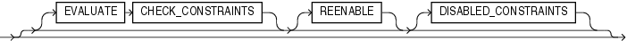
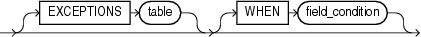
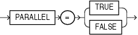

## 12 Conventional and Direct Path Loads

SQL\*Loader provides the option to load data using a conventional path load method, and a direct path load method.

- Data Loading Methods  
	SQL\*Loader can load data by using either a convention path load, or a direct path load.
- Loading ROWID Columns  
	In both conventional path and direct path, you can specify a text value for a `ROWID` column.
- Conventional Path Loads  
	Learn what a SQL\*Loader conventional path load is, when and how to use it to pass data, and what restrictions apply to this feature.
- Direct Path Loads  
	Learn what a SQL\*Loader direct path load is, when and how to use it to pass data, and what restrictions apply to this feature.
- Using Direct Path Load  
	Learn how you can use the SQL\*Loader direct path load method for loading data.
- Optimizing Performance of Direct Path Loads  
	Learn how to enable your SQL\*Loader direct path loads to run faster, and to use less space.
- Optimizing Direct Path Loads on Multiple-CPU Systems  
	If you are performing direct path loads on a multiple-CPU system, then SQL\*Loader uses multithreading by default. A multiple-CPU system in this case is defined as a single system that has two or more CPUs.
- Avoiding Index Maintenance  
	For both the conventional path and the direct path, SQL\*Loader maintains all existing indexes for a table.
- Direct Path Loads, Integrity Constraints, and Triggers  
	There can be differences between how you set triggers with direct path loads, compared to conventional path loads
- Optimizing Performance of Direct Path Loads  
	Learn how to enable your SQL\*Loader direct path loads to run faster, and to use less space.
- General Performance Improvement Hints  
	Learn how to enable general performance improvements when using SQL\*Loader with parallel data loading.

**Parent topic:** [SQL\*Loader](oracle-sql-loader.md)

### 12.1 Data Loading Methods

SQL\*Loader can load data by using either a convention path load, or a direct path load.

A conventional path load runs SQL `INSERT` statements to populate tables in Oracle Database. A direct path load eliminates much of the Oracle Database overhead by formatting Oracle data blocks, and then writing the data blocks directly to the database files. A direct load does not compete with other users for database resources, so it can usually load data at near disk speed.

The tables that you want to be loaded must already exist in the database. SQL\*Loader never creates tables. It loads existing tables that either already contain data, or that are empty.

The following privileges are required for a load:

- You must have `INSERT` privileges on the table to be loaded.
- You must have `DELETE` privileges on the table that you want to be loaded, when using the `REPLACE` or `TRUNCATE` option to empty old data from the table before loading the new data in its place.

### 12.2 Loading ROWID Columns

In both conventional path and direct path, you can specify a text value for a `ROWID` column.

This is the same text you get when you perform a `SELECT` `ROWID` `FROM` `table_name` operation. The character string interpretation of the `ROWID` is converted into the `ROWID` type for a column in a table.

**Parent topic:** Conventional and Direct Path Loads

### 12.3 Conventional Path Loads

Learn what a SQL\*Loader conventional path load is, when and how to use it to pass data, and what restrictions apply to this feature.

- Conventional Path Load  
	With conventional path load (the default), SQL\*Loader uses the SQL `INSERT` statement and a bind array buffer to load data into database tables.
- When to Use a Conventional Path Load  
	To determine when you should use conventional path load instead of direct path load, review the options for your use case scenario.
- Conventional Path Load of a Single Partition  
	SQL\*Loader uses the partition-extended syntax of the `INSERT` statement.

**Parent topic:** Conventional and Direct Path Loads

#### 12.3.1 Conventional Path Load

With conventional path load (the default), SQL\*Loader uses the SQL `INSERT` statement and a bind array buffer to load data into database tables.

When SQL\*Loader performs a conventional path load, it competes equally with all other processes for buffer resources. Using this method can slow the load significantly. Extra overhead is added as SQL statements are generated, passed to Oracle Database, and executed.

Oracle Database looks for partially filled blocks and attempts to fill them on each insert. Although appropriate during normal use, this method can slow bulk loads dramatically.

#### 12.3.2 When to Use a Conventional Path Load

To determine when you should use conventional path load instead of direct path load, review the options for your use case scenario.

If load speed is most important to you, then you should use direct path load because it is faster than conventional path load. However, certain restrictions on direct path loads can require you to use a conventional path load. You should use a conventional path load in the following situations:

- When accessing an indexed table concurrently with the load, or when applying inserts or updates to a nonindexed table concurrently with the load
	Note: To use a direct path load (except for parallel loads), SQL\*Loader must have exclusive write access to the table and exclusive read/write access to any indexes.
- When loading data into a clustered table
	Reason: A direct path load does not support loading of clustered tables.
- When loading a relatively small number of rows into a large indexed table
	Reason: During a direct path load, the existing index is copied when it is merged with the new index keys. If the existing index is very large and the number of new keys is very small, then the index copy time can offset the time saved by a direct path load.
- When loading a relatively small number of rows into a large table with referential and column-check integrity constraints
	Reason: Because these constraints cannot be applied to rows loaded on the direct path, they are disabled for the duration of the load. Then they are applied to the whole table when the load completes. The costs could outweigh the savings for a very large table and a small number of new rows.
- When loading records, and you want to ensure that a record is rejected under any of the following circumstances:
	- If the record causes an Oracle error upon insertion
		- If the record is formatted incorrectly, so that SQL\*Loader cannot find field boundaries
		- If the record violates a constraint, or a record tries to make a unique index non-unique

**Parent topic:** Conventional Path Loads

#### 12.3.3 Conventional Path Load of a Single Partition

SQL\*Loader uses the partition-extended syntax of the `INSERT` statement.

By definition, a conventional path load uses SQL `INSERT` statements. During a conventional path load of a single partition, SQL\*Loader uses the partition-extended syntax of the `INSERT` statement, which has the following form:

```
INSERT INTO TABLE T PARTITION (P) VALUES ...
```

The SQL layer of the Oracle kernel determines if the row being inserted maps to the specified partition. If the row does not map to the partition, then the row is rejected, and the SQL\*Loader log file records an appropriate error message.

**Parent topic:** Conventional Path Loads

### 12.4 Direct Path Loads

Learn what a SQL\*Loader direct path load is, when and how to use it to pass data, and what restrictions apply to this feature.

- About SQL\*Loader Direct Path Load  
	The SQL\*Loader direct path load option uses the direct path API to pass the data to be loaded to the load engine in the server.
- Loading into Synonyms  
	You can use SQL\*Loader to load data into a synonym for a table during a direct path load, but the synonym must point directly either to a table, or to a view on a simple table.
- Field Defaults on the Direct Path  
	Default column specifications defined in the database are not available when you use direct path loading.
- Integrity Constraints  
	All integrity constraints are enforced during direct path loads, although not necessarily at the same time.
- When to Use a Direct Path Load  
	Learn under what circumstances you should run SQL\*Loader with direct path load.
- Restrictions on a Direct Path Load of a Single Partition  
	When you want to use a direct path load of a single partition, the partition that you specify for direct path load must meet additional requirements.
- Restrictions on Using Direct Path Loads  
	To use the direct path load method, your tables and segments must meet certain requirements. Some features are not available with Direct Path Loads.
- Advantages of a Direct Path Load  
	Direct path loads typically are faster than using conventional path loads.
- Direct Path Load of a Single Partition or Subpartition  
	During a direct path load of a single partition, SQL\*Loader uses the partition-extended syntax of the `LOAD` statement.
- Direct Path Load of a Partitioned or Subpartitioned Table  
	When loading a partitioned or subpartitioned table, SQL\*Loader partitions the rows and maintains indexes (which can also be partitioned).
- Data Conversion During Direct Path Loads  
	During a SQL\*Loader direct path load, data conversion occurs on the client side, rather than on the server side.

**Parent topic:** Conventional and Direct Path Loads

#### 12.4.1 About SQL\*Loader Direct Path Load

The SQL\*Loader direct path load option uses the direct path API to pass the data to be loaded to the load engine in the server.

When you use the direct path load feature of SQL\*Loader, then istead of filling a bind array buffer and passing it to the Oracle database with a SQL `INSERT` statement, a direct path load uses the direct path API to pass the data to be loaded to the load engine in the server. The load engine builds a column array structure from the data passed to it.

The direct path load engine uses the column array structure to format Oracle Database data blocks, and to build index keys. The newly formatted database blocks are written directly to the database (multiple blocks per I/O request using asynchronous writes if the host platform supports asynchronous I/O).

Internally, multiple buffers are used for the formatted blocks. While one buffer is being filled, one or more buffers are being written if asynchronous I/O is available on the host platform. Overlapping computation with I/O increases load performance.

#### 12.4.2 Loading into Synonyms

You can use SQL\*Loader to load data into a synonym for a table during a direct path load, but the synonym must point directly either to a table, or to a view on a simple table.

Note the following restrictions:

- Direct path mode cannot be used if the view is on a table that has either user-defined types, or XML data.
- In direct path mode, a view cannot be loaded using a SQL\*Loader control file that contains SQL expressions.

**Parent topic:** Direct Path Loads

#### 12.4.3 Field Defaults on the Direct Path

Default column specifications defined in the database are not available when you use direct path loading.

Fields for which default values are desired must be specified with the `DEFAULTIF` clause. If a `DEFAULTIF` clause is not specified and the field is `NULL`, then a null value is inserted into the database.

**Parent topic:** Direct Path Loads

#### 12.4.4 Integrity Constraints

All integrity constraints are enforced during direct path loads, although not necessarily at the same time.

`NOT NULL` constraints are enforced during the SQL\*Loader load. Records that fail these constraints are rejected.

`UNIQUE` constraints are enforced both during and after the load. A record that violates a `UNIQUE` constraint is not rejected (the record is not available in memory when the constraint violation is detected).

Integrity constraints that depend on other rows or tables, such as referential constraints, are disabled before the direct path load and must be reenabled afterwards. If `REENABLE` is specified, then SQL\*Loader can reenable them automatically at the end of the load. When the constraints are reenabled, the entire table is checked. Any rows that fail this check are reported in the specified error log.

#### 12.4.5 When to Use a Direct Path Load

Learn under what circumstances you should run SQL\*Loader with direct path load.

If you are not restricted by views, field defaults, or integrity constraints, then then you should use a direct path load in the following circumstances:

- You have a large amount of data to load quickly. A direct path load can quickly load and index large amounts of data. It can also load data into either an empty or nonempty table.
- You want to load data in parallel for maximum performance.

**Parent topic:** Direct Path Loads

#### 12.4.6 Restrictions on a Direct Path Load of a Single Partition

When you want to use a direct path load of a single partition, the partition that you specify for direct path load must meet additional requirements.

In addition to the previously listed restrictions, loading a single partition has the following restrictions:

- The table that the partition is a member of cannot have any global indexes defined on it.
- Enabled referential and check constraints on the table that the partition is a member of are not allowed.
- Enabled triggers are not allowed.

**Parent topic:** Direct Path Loads

#### 12.4.7 Restrictions on Using Direct Path Loads

To use the direct path load method, your tables and segments must meet certain requirements. Some features are not available with Direct Path Loads.

The following conditions must be satisfied for you to use the direct path load method:

- Tables that you want to load cannot be clustered.
- Tables that you want to load cannot have Oracle Virtual Private Database (VPD) policies active on `INSERT`.
- Segments that you want to load cannot have any active transactions pending.
	To check for active transactions, use the Oracle Enterprise Manager command `MONITOR TABLE` to find the object ID for the tables that you want to load. Then use the command `MONITOR LOCK` to see if there are any locks on the tables.
- For Oracle Database releases earlier than Oracle9i, you can perform a SQL\*Loader direct path load only when the client and server are the same release. This restriction also means that you cannot perform a direct path load of Oracle9i data into an earlier Oracle Database release. For example, you cannot use direct path load to load data from Oracle Database 9i Release 1 (9.0.1) into an Oracle 8i (8.1.7) Oracle Database.
	Beginning with Oracle Database 9i, you can perform a SQL\*Loader direct path load when the client and server are different releases. However, both releases must be at least Oracle Database 9i Release 1 (9.0.1), and the client release must be the same as or lower than the server release. For example, you can perform a direct path load from an Oracle Database 9i Release 1 (9.0.1) database into Oracle Database 9i Release 2 (9.2). However, you cannot use direct path load to load data from Oracle Database 10g into an Oracle Database 9i release.

The following features are not available with direct path load:

- Loading `BFILE` columns
- Use of `CREATE SEQUENCE` during the load. This is because in direct path loads there is no SQL being generated to fetch the next value, because direct path does not generate `INSERT` statements.

**Parent topic:** Direct Path Loads

#### 12.4.8 Advantages of a Direct Path Load

Direct path loads typically are faster than using conventional path loads.

A direct path load is faster than the conventional path for the following reasons:

- Partial blocks are not used, so no reads are needed to find them, and fewer writes are performed.
- SQL\*Loader does not need to run any SQL `INSERT` statements; therefore, the processing load on Oracle Database is reduced.
- A direct path load calls on Oracle Database to lock tables and indexes at the start of the load, and release those locks when the load is finished. A conventional path load issues an Oracle Database call once for each array of rows to process a SQL `INSERT` statement.
- A direct path load uses multiblock asynchronous I/O for writes to the database files.
- During a direct path load, processes perform their own write I/O, instead of using the Oracle Database buffer cache. This process method minimizes contention with other Oracle Database users.
- The sorted indexes option available during direct path loads enables you to presort data using high-performance sort routines that are native to your system or installation.
- When a table that you specify to load is empty, the presorting option eliminates the sort and merge phases of index-building. The index is filled in as data arrives.
- Protection against instance failure does not require redo log file entries during direct path loads. Therefore, no time is required to log the load when:
	- Oracle Database has the SQL `NOARCHIVELOG` parameter enabled
		- The SQL\*Loader `UNRECOVERABLE` clause is enabled
		- The object being loaded has the SQL `NOLOGGING` parameter set

#### 12.4.9 Direct Path Load of a Single Partition or Subpartition

During a direct path load of a single partition, SQL\*Loader uses the partition-extended syntax of the `LOAD` statement.

When loading a single partition of a partitioned or subpartitioned table, SQL\*Loader partitions the rows, and rejects any rows that do not map to the partition or subpartition specified in the SQL\*Loader control file. Local index partitions that correspond to the data partition or subpartition being loaded are maintained by SQL\*Loader. Global indexes are not maintained on single partition or subpartition direct path loads. During a direct path load of a single partition, SQL\*Loader uses the partition-extended syntax of the `LOAD` statement, which has either of the following forms:

```
LOAD INTO TABLE T PARTITION (P) VALUES ... 

LOAD INTO TABLE T SUBPARTITION (P) VALUES ...
```

While you are loading a partition of a partitioned or subpartitioned table, you are also allowed to perform DML operations on, and direct path loads of, other partitions in the table.

Although a direct path load minimizes database processing, to initialize and then finish the load, several calls to Oracle Database are required at the beginning and end of the load. Also, certain DML locks are required during load initialization. When the load completes, these DML locks are released. The following operations occur during the load:

- Index keys are built and put into a sort
- Space management routines are used to obtain new extents, when needed, and to adjust the upper boundary (high-water mark) for a data savepoint.

For more information about protecting data, see "Using Data Saves to Protect Against Data Loss.

#### 12.4.10 Direct Path Load of a Partitioned or Subpartitioned Table

When loading a partitioned or subpartitioned table, SQL\*Loader partitions the rows and maintains indexes (which can also be partitioned).

Note that a direct path load of a partitioned or subpartitioned table can be quite resource-intensive for tables with many partitions or subpartitions.

Note:

If you are performing a direct path load into multiple partitions and a space error occurs, then the load is rolled back to the last commit point. If there was no commit point, then the entire load is rolled back. This ensures that no data encountered after the space error is written out to a different partition.

You can use the `ROWS` parameter to specify the frequency of the commit points. If the `ROWS` parameter is not specified, then the entire load is rolled back.

**Parent topic:** Direct Path Loads

#### 12.4.11 Data Conversion During Direct Path Loads

During a SQL\*Loader direct path load, data conversion occurs on the client side, rather than on the server side.

As an implication of client side data conversion, this means that NLS parameters in the database initialization parameter file (server-side language handle) will not be used. To override this behavior, you can specify a format mask in the SQL\*Loader control file that is equivalent to the setting of the NLS parameter in the initialization parameter file, or you can set the appropriate environment variable. For example, to specify a date format for a field, you can either set the date format in the SQL\*Loader control file, as shown in "Setting the Date Format in the SQL\*Loader Control File"), or you can set an `NLS_DATE_FORMAT` environment variable, as shown in "Setting an `NLS_DATE_FORMAT` Environment Variable.".

Example 12-1 Setting the Date Format in the SQL\*Loader Control File

```
LOAD DATA
INFILE 'data.dat'
INSERT INTO TABLE emp
FIELDS TERMINATED BY "|"
(
EMPNO NUMBER(4) NOT NULL,
ENAME CHAR(10),
JOB CHAR(9),
MGR NUMBER(4),
HIREDATE DATE 'YYYYMMDD',
SAL NUMBER(7,2),
COMM NUMBER(7,2),
DEPTNO NUMBER(2)
)
```

Example 12-2 Setting an `NLS_DATE_FORMAT` Environment Variable

On Unix Bourne or Korn shell:

```
% NLS_DATE_FORMAT='YYYYMMDD'
% export NLS_DATE_FORMAT
```

On Unix C shell (`csh`):

```
%setenv NLS_DATE_FORMAT='YYYYMMDD'
```

**Parent topic:** Direct Path Loads

### 12.5 Using Direct Path Load

Learn how you can use the SQL\*Loader direct path load method for loading data.

- Setting Up for Direct Path Loads  
	To create the necessary views required to prepare the database for direct path loads, you must run the setup script `catldr.sql`.
- Specifying a Direct Path Load  
	To start SQL\*Loader in direct path load mode, set the `DIRECT` parameter to `TRUE` on the command line, or in the parameter file.
- Building Indexes  
	You can improve performance of direct path loads by using temporary storage. After each block is formatted, the new index keys are put in a sort (temporary) segment.
- Indexes Left in an Unusable State  
	SQL\*Loader leaves indexes in an Index Unusable state when the data segment being loaded becomes more up-to-date than the index segments that index it.
- Preventing Data Loss with Data Saves  
	You can use data saves to protect against loss of data due to instance failure.
- Data Recovery During Direct Path Loads  
	SQL\*Loader provides full support for data recovery when using the direct path load method.
- Loading Long Data Fields  
	You can load data that is longer than SQL\*Loader's maximum buffer size can load on the direct path by using large object types (LOBs).
- Loading Data As PIECED  
	The `PIECED` parameter can be used to load data in sections, if the data is in the last column of the logical record.
- Auditing SQL\*Loader Operations That Use Direct Path Mode  
	You can perform auditing on SQL\*Loader direct path loads to monitor and record selected user database actions.

**Parent topic:** Conventional and Direct Path Loads

#### 12.5.1 Setting Up for Direct Path Loads

To create the necessary views required to prepare the database for direct path loads, you must run the setup script `catldr.sql`.

You only need to run `catldr.sql` once for each database to which you plan to run direct loads. You can run this script during database installation if you know then that you will be doing direct loads.

**Parent topic:** Using Direct Path Load

#### 12.5.2 Specifying a Direct Path Load

To start SQL\*Loader in direct path load mode, set the `DIRECT` parameter to `TRUE` on the command line, or in the parameter file.

For example, to configure the parameter file to start SQL\*Loader in direct path load mode, include the following line in the parameter file:

```
DIRECT=TRUE
```

#### 12.5.3 Building Indexes

You can improve performance of direct path loads by using temporary storage. After each block is formatted, the new index keys are put in a sort (temporary) segment.

The old index and the new keys are merged at load finish time to create the new index. The old index, sort (temporary) segment, and new index segment all require storage until the merge is complete. Then the old index and temporary segment are removed.

During a conventional path load, every time a row is inserted the index is updated. This method does not require temporary storage space, but it does add processing time.

- Improving Performance  
	To improve performance of SQL\*Loader direct loads on systems with limited memory, use the `SINGLEROW` parameter.
- Calculating Temporary Segment Storage Requirements  
	To estimate the amount of temporary segment space needed during direct path loads for storing new index keys, use this formula.

**Parent topic:** Using Direct Path Load

##### 12.5.3.1 Improving Performance

To improve performance of SQL\*Loader direct loads on systems with limited memory, use the `SINGLEROW` parameter.

Note:

If, during a direct load, you have specified that you want the data to be presorted, and the existing index is empty, then a temporary segment is not required, and no merge occurs—the keys are put directly into the index.

See Optimizing Performance of Direct Path Loads

When multiple indexes are built, the temporary segments corresponding to each index exist simultaneously, in addition to the old indexes. The new keys are then merged with the old indexes, one index at a time. As each new index is created, the old index and the corresponding temporary segment are removed.

##### 12.5.3.2 Calculating Temporary Segment Storage Requirements

To estimate the amount of temporary segment space needed during direct path loads for storing new index keys, use this formula.

To estimate the amount of temporary segment space needed for storing the new index keys (in bytes), use the following formula:

```
1.3 * key_storage
```

In this formula, key storage is defined as follows, where `number_rows` is the number of rows, `sum_of_column_sizes` is the sum of the column sizes, and `number_of_columns` is the number of columns in the index:

```
key_storage = (number_rows) *  
( 10 + sum_of_column_sizes + number_of_columns )
```

The columns included in this formula are the columns in the index. There is one length byte per column, and 10 bytes per row are used for a `ROWID`, and additional overhead.

The constant, 1.3, reflects the average amount of extra space needed for sorting. This value is appropriate for most randomly ordered data. If the data arrives in exactly opposite order, then twice the key-storage space is required for sorting, and the value of this constant would be 2.0. That is the worst case.

If the data is fully sorted, then only enough space to store the index entries is required, and the value of this constant would be 1.0.

#### 12.5.4 Indexes Left in an Unusable State

SQL\*Loader leaves indexes in an Index Unusable state when the data segment being loaded becomes more up-to-date than the index segments that index it.

Any SQL statement that tries to use an index that is in an Index Unusable state returns an error. The following conditions cause a direct path load to leave an index or a partition of a partitioned index in an Index Unusable state:

- SQL\*Loader runs out of space for the index and cannot update the index.
- The data is not in the order specified by the `SORTED` `INDEXES` clause.
- There is an instance failure, or the Oracle shadow process fails while building the index.
- There are duplicate keys in a unique index.
- Data savepoints are being used, and the load fails or is terminated by a keyboard interrupt after a data savepoint occurred.

To determine if an index is in an Index Unusable state, you can execute a simple query:

```
SELECT INDEX_NAME, STATUS
   FROM USER_INDEXES 
   WHERE TABLE_NAME = 'tablename';
```

If you are not the owner of the table, then search `ALL_INDEXES` or `DBA_INDEXES` instead of `USER_INDEXES`.

To determine if an index partition is in an unusable state, you can execute the following query:

```
SELECT INDEX_NAME, 
       PARTITION_NAME,
       STATUS FROM USER_IND_PARTITIONS
       WHERE STATUS != 'VALID';
```

If you are not the owner of the table, then search `ALL_IND_PARTITIONS` and `DBA_IND_PARTITIONS` instead of `USER_IND_PARTITIONS`.

**Parent topic:** Using Direct Path Load

#### 12.5.5 Preventing Data Loss with Data Saves

You can use data saves to protect against loss of data due to instance failure.

- Using Data Saves to Protect Against Data Loss  
	When you have a savepoint, if you encounter an instance failure during a SQL\*Loader load, then use the `SKIP` parameter to continue the load.
- Using the ROWS Parameter  
	The `ROWS` parameter determines when data saves occur during a direct path load.
- Data Save Versus Commit  
	In a conventional load, `ROWS` is the number of rows to read before a commit operation. A direct load data save is similar to a conventional load commit, but it is not identical.

**Parent topic:** Using Direct Path Load

##### 12.5.5.1 Using Data Saves to Protect Against Data Loss

When you have a savepoint, if you encounter an instance failure during a SQL\*Loader load, then use the `SKIP` parameter to continue the load.

All data loaded up to the last savepoint is protected against instance failure.

To continue the load after an instance failure, determine how many rows from the input file were processed before the failure, then use the `SKIP` parameter to skip those processed rows.

If there are any indexes on the table, then before you continue the load, drop those indexes, and then recreate them after the load. See "Data Recovery During Direct Path Loads" for more information about media and instance recovery.

Note:

Indexes are not protected by a data save, because SQL\*Loader does not build indexes until after data loading completes. (The only time indexes are built during the load is when presorted data is loaded into an empty table, but these indexes are also unprotected.)

##### 12.5.5.2 Using the ROWS Parameter

The `ROWS` parameter determines when data saves occur during a direct path load.

The value you specify for `ROWS` is the number of rows you want SQL\*Loader to read from the input file before saving inserts in the database.

A data save is an expensive operation. The value for `ROWS` should be set high enough so that a data save occurs once every 15 minutes or longer. The intent is to provide an upper boundary (high-water mark) on the amount of work that is lost when an instance failure occurs during a long-running direct path load. Setting the value of `ROWS` to a small number adversely affects performance and data block space utilization.

**Parent topic:** Preventing Data Loss with Data Saves

##### 12.5.5.3 Data Save Versus Commit

In a conventional load, `ROWS` is the number of rows to read before a commit operation. A direct load data save is similar to a conventional load commit, but it is not identical.

The similarities are as follows:

- A data save will make the rows visible to other users.
- Rows cannot be rolled back after a data save.

The major difference is that in a direct path load data save, the indexes will be unusable (in Index Unusable state) until the load completes.

**Parent topic:** Preventing Data Loss with Data Saves

#### 12.5.6 Data Recovery During Direct Path Loads

SQL\*Loader provides full support for data recovery when using the direct path load method.

There are two main types of recovery:

- Media - recovery from the loss of a database file. You must be operating in `ARCHIVELOG` mode to recover after you lose a database file.
- Instance - recovery from a system failure in which in-memory data was changed but lost due to the failure before it was written to disk. The Oracle database can always recover from instance failures, even when redo logs are not archived.

- Media Recovery and Direct Path Loads  
	If redo log file archiving is enabled (you are operating in `ARCHIVELOG` mode), then SQL\*Loader logs loaded data when using the direct path, making media recovery possible.
- Instance Recovery and Direct Path Loads  
	Because SQL\*Loader writes directly to the database files, all rows inserted up to the last data save will automatically be present in the database files if the instance is restarted.

**Parent topic:** Using Direct Path Load

##### 12.5.6.1 Media Recovery and Direct Path Loads

If redo log file archiving is enabled (you are operating in `ARCHIVELOG` mode), then SQL\*Loader logs loaded data when using the direct path, making media recovery possible.

If redo log archiving is not enabled (you are operating in `NOARCHIVELOG` mode), then media recovery is not possible.

To recover a database file that was lost while it was being loaded, use the same method that you use to recover data loaded with the conventional path:

1. Restore the most recent backup of the affected database file.
2. Recover the tablespace using the RMAN `RECOVER` command.

##### 12.5.6.2 Instance Recovery and Direct Path Loads

Because SQL\*Loader writes directly to the database files, all rows inserted up to the last data save will automatically be present in the database files if the instance is restarted.

Changes do not need to be recorded in the redo log file to make instance recovery possible.

If an instance failure occurs, then the indexes being built may be left in an Index Unusable state. Indexes that are Unusable must be rebuilt before you can use the table or partition. See "Indexes Left in an Unusable State" for information about how to determine if an index has been left in Index Unusable state.

#### 12.5.7 Loading Long Data Fields

You can load data that is longer than SQL\*Loader's maximum buffer size can load on the direct path by using large object types (LOBs).

In considering how to load long data fields, note the following:

- To improve performance for loading long data fields as LOBs, Oracle recommends that you use a large `STREAMSIZE` value.
- As an alternative to LOBs, you can also load data that is longer than the maximum buffer size by using the `PIECED` parameter. However, for this scenario, Oracle highly recommends that you use LOBs instad of `PIECED`.

#### 12.5.8 Loading Data As PIECED

The `PIECED` parameter can be used to load data in sections, if the data is in the last column of the logical record.

Declaring a column as `PIECED` informs the direct path loader that a `LONG` field might be split across multiple physical records (pieces). In such cases, SQL\*Loader processes each piece of the `LONG` field as it is found in the physical record. All the pieces are read before the record is processed. SQL\*Loader makes no attempt to materialize the `LONG` field before storing it; however, all the pieces are read before the record is processed.

The following restrictions apply when you declare a column as `PIECED`:

- This option is only valid on the direct path.
- Only one field per table may be `PIECED`.
- The `PIECED` field must be the last field in the logical record.
- The `PIECED` field may not be used in any `WHEN`, `NULLIF`, or `DEFAULTIF` clauses.
- The `PIECED` field's region in the logical record must not overlap with any other field's region.
- The `PIECED` corresponding database column may not be part of the index.
- It may not be possible to load a rejected record from the bad file if it contains a `PIECED` field.
	For example, a `PIECED` field could span three records. SQL\*Loader loads the piece from the first record and then reuses the buffer for the second buffer. After loading the second piece, the buffer is reused for the third record. If an error is discovered, then only the third record is placed in the bad file because the first two records no longer exist in the buffer. As a result, the record in the bad file would not be valid.

**Parent topic:** Using Direct Path Load

#### 12.5.9 Auditing SQL\*Loader Operations That Use Direct Path Mode

You can perform auditing on SQL\*Loader direct path loads to monitor and record selected user database actions.

SQL\*Loader uses unified auditing, in which all audit records are centralized in one place.

To set up unified auditing you create a unified audit policy, or alter an existing policy. An audit policy is a named group of audit settings that enable you to audit a particular aspect of user behavior in the database. To create the policy, use the SQL `CREATE AUDIT POLICY` statement.

After creating the audit policy, use the `AUDIT` and `NOAUDIT` SQL statements to, respectively, enable and disable the policy.

### 12.6 Optimizing Performance of Direct Path Loads

Learn how to enable your SQL\*Loader direct path loads to run faster, and to use less space.

- Minimizing Time and Space Required for Direct Path Loads  
	You can control the time and temporary storage used during direct path loads.
- Preallocating Storage for Faster Loading  
	SQL\*Loader automatically adds extents to the table if necessary, but this process takes time. For faster loads into a new table, allocate the required extents when the table is created.
- Presorting Data for Faster Indexing  
	You can improve the performance of SQL\*Loader direct path loads by presorting your data on indexed columns.
- Infrequent Data Saves  
	Frequent data saves resulting from a small `ROWS` value adversely affect the performance of a direct path load.
- Minimizing Use of the Redo Log  
	One way to speed a direct load dramatically is to minimize use of the redo log.
- Specifying the Number of Column Array Rows and Size of Stream Buffers  
	The number of column array rows determines the number of rows loaded before the stream buffer is built. T
- Specifying a Value for DATE\_CACHE  
	To improve performance where the same date or timestamp is used many times during a direct path load, you can use the SQL\*Loader date cache.

**Parent topic:** Conventional and Direct Path Loads

#### 12.6.1 Minimizing Time and Space Required for Direct Path Loads

You can control the time and temporary storage used during direct path loads.

To minimize time:

- Preallocate storage space
- Presort the data
- Perform infrequent data saves
- Minimize use of the redo log
- Specify the number of column array rows and the size of the stream buffer
- Specify a date cache value
- Set `DB_UNRECOVERABLE_SCN_TRACKING=FALSE`. Unrecoverable (nologging) direct writes are tracked in the control file by periodically storing the SCN and Time of the last direct write. If these updates to the control file are adversely affecting performance, then setting the `DB_UNRECOVERABLE_SCN_TRACKING` parameter to `FALSE` may improve performance.

To minimize space:

- When sorting data before the load, sort data on the index that requires the most temporary storage space
- Avoid index maintenance during the load

**Parent topic:** Optimizing Performance of Direct Path Loads

#### 12.6.2 Preallocating Storage for Faster Loading

SQL\*Loader automatically adds extents to the table if necessary, but this process takes time. For faster loads into a new table, allocate the required extents when the table is created.

To calculate the space required by a table, see the information about managing database files in the [Oracle Database Administrator's Guide.](https://docs.oracle.com/pls/topic/lookup?ctx=en/database/oracle/oracle-database/21/sutil&id=ADMIN11631) Then use the `INITIAL` or `MINEXTENTS` clause in the SQL `CREATE` `TABLE` statement to allocate the required space.

Another approach is to size extents large enough so that extent allocation is infrequent.

**Parent topic:** Optimizing Performance of Direct Path Loads

#### 12.6.3 Presorting Data for Faster Indexing

You can improve the performance of SQL\*Loader direct path loads by presorting your data on indexed columns.

- Advantages of Presorting Data  
	Learn about how presorting enables you to increase load performance with SQL\*Loader
- SORTED INDEXES Clause  
	The `SORTED` `INDEXES` clause identifies the indexes on which the data is presorted.
- Unsorted Data  
	If you specify an index in the `SORTED` `INDEXES` clause, and the data is not sorted for that index, then the index is left in an Index Unusable state at the end of the load.
- Multiple-Column Indexes  
	If you specify a multiple-column index in the `SORTED` `INDEXES` clause, then the data should be sorted so that it is ordered first on the first column in the index, next on the second column in the index, and so on.
- Choosing the Best Sort Order  
	For the best overall performance of direct path loads, you should presort the data based on the index that requires the most temporary segment space.

**Parent topic:** Optimizing Performance of Direct Path Loads

##### 12.6.3.1 Advantages of Presorting Data

Learn about how presorting enables you to increase load performance with SQL\*Loader

Presorting minimizes temporary storage requirements during the load. Presorting also enables you to take advantage of high-performance sorting routines that are optimized for your operating system or application.

If the data is presorted, and the existing index is not empty, then presorting minimizes the amount of temporary segment space needed for the new keys. The sort routine appends each new key to the key list. Instead of requiring extra space for sorting, only space for the keys is needed. To calculate the amount of storage needed, use a sort factor of 1.0 instead of 1.3. For more information about estimating storage requirements, refer to "Temporary Segment Storage Requirements."

If presorting is specified, and the existing index is empty, then maximum efficiency is achieved. The new keys are simply inserted into the index. Instead of having a temporary segment and new index existing simultaneously with the empty, old index, only the new index exists. As a result, temporary storage is not required during the load, and time is saved.

##### 12.6.3.2 SORTED INDEXES Clause

The `SORTED` `INDEXES` clause identifies the indexes on which the data is presorted.

This clause is allowed only for direct path loads. See case study 6, Loading Data Using the Direct Path Load Method, for an example. (See [SQL\*Loader Case Studies](oracle-sql-loader-concepts.md) for information on how to access case studies.)

Generally, you specify only one index in the `SORTED` `INDEXES` clause, because data that is sorted for one index is not usually in the right order for another index. When the data is in the same order for multiple indexes, however, all indexes can be specified at once.

All indexes listed in the `SORTED` `INDEXES` clause must be created before you start the direct path load.

**Parent topic:** Presorting Data for Faster Indexing

##### 12.6.3.3 Unsorted Data

If you specify an index in the `SORTED` `INDEXES` clause, and the data is not sorted for that index, then the index is left in an Index Unusable state at the end of the load.

The data is present, but any attempt to use the index results in an error. Any index that is left in an Index Unusable state must be rebuilt after the load.

**Parent topic:** Presorting Data for Faster Indexing

##### 12.6.3.4 Multiple-Column Indexes

If you specify a multiple-column index in the `SORTED` `INDEXES` clause, then the data should be sorted so that it is ordered first on the first column in the index, next on the second column in the index, and so on.

For example, if the first column of the index is city, and the second column is last name; then the data should be ordered by name within each city, as in the following list:

```
Albuquerque      Adams
Albuquerque      Hartstein
Albuquerque      Klein
...         ...
Boston           Andrews
Boston           Bobrowski
Boston           Heigham
...              ...
```

**Parent topic:** Presorting Data for Faster Indexing

##### 12.6.3.5 Choosing the Best Sort Order

For the best overall performance of direct path loads, you should presort the data based on the index that requires the most temporary segment space.

For example, if the primary key is one numeric column, and the secondary key consists of three text columns, then you can minimize both sort time and storage requirements by presorting on the secondary key.

To determine the index that requires the most storage space, use the following procedure:

1. For each index, add up the widths of all columns in that index.
2. For a single-table load, pick the index with the largest overall width.
3. For each table in a multiple-table load, identify the index with the largest overall width. If the same number of rows are to be loaded into each table, then again pick the index with the largest overall width. Usually, the same number of rows are loaded into each table.
4. If a different number of rows are to be loaded into the indexed tables in a multiple-table load, then multiply the width of each index identified in Step 3 by the number of rows that are to be loaded into that index, and pick the index with the largest result.

**Parent topic:** Presorting Data for Faster Indexing

#### 12.6.4 Infrequent Data Saves

Frequent data saves resulting from a small `ROWS` value adversely affect the performance of a direct path load.

A small `ROWS` value can also result in wasted data block space because the last data block is not written to after a save, even if the data block is not full.

Because direct path loads can be many times faster than conventional loads, the value of `ROWS` should be considerably higher for a direct load than it would be for a conventional load.

During a data save, loading stops until all of SQL\*Loader's buffers are successfully written. You should select the largest value for `ROWS` that is consistent with safety. It is a good idea to determine the average time to load a row by loading a few thousand rows. Then you can use that value to select a good value for `ROWS`.

For example, if you can load 20,000 rows per minute, and you do not want to repeat more than 10 minutes of work after an interruption, then set `ROWS` to be 200,000 (20,000 rows/minute \* 10 minutes).

**Parent topic:** Optimizing Performance of Direct Path Loads

#### 12.6.5 Minimizing Use of the Redo Log

One way to speed a direct load dramatically is to minimize use of the redo log.

There are three ways to do this. You can disable archiving, you can specify that the load is unrecoverable, or you can set the SQL `NOLOGGING` parameter for the objects being loaded. This section discusses all methods.

- Disabling Archiving  
	If archiving is disabled, then direct path loads do not generate full image redo.
- Specifying the SQL\*Loader UNRECOVERABLE Clause  
	To save time and space in the redo log file, use the SQL\*Loader `UNRECOVERABLE` clause in the control file when you load data.
- Setting the SQL NOLOGGING Parameter  
	If a data or index segment has the SQL `NOLOGGING` parameter set, then full image redo logging is disabled for that segment (invalidation redo is generated).

**Parent topic:** Optimizing Performance of Direct Path Loads

##### 12.6.5.1 Disabling Archiving

If archiving is disabled, then direct path loads do not generate full image redo.

Use the SQL `ARCHIVELOG` and `NOARCHIVELOG` parameters to set the archiving mode.

##### 12.6.5.2 Specifying the SQL\*Loader UNRECOVERABLE Clause

To save time and space in the redo log file, use the SQL\*Loader `UNRECOVERABLE` clause in the control file when you load data.

An unrecoverable load does not record loaded data in the redo log file; instead, it generates invalidation redo.

The `UNRECOVERABLE` clause applies to all objects loaded during the load session (both data and index segments). Therefore, media recovery is disabled for the loaded table, although database changes by other users may continue to be logged.

Note:

Because the data load is not logged, you may want to make a backup of the data after loading.

If media recovery becomes necessary on data that was loaded with the `UNRECOVERABLE` clause, then the data blocks that were loaded are marked as logically corrupted.

To recover the data, drop and re-create the data. It is a good idea to do backups immediately after the load to preserve the otherwise unrecoverable data.

By default, a direct path load is `RECOVERABLE`.

The following is an example of specifying the `UNRECOVERABLE` clause in the control file:

```
UNRECOVERABLE
LOAD DATA
INFILE 'sample.dat'
INTO TABLE emp
(ename VARCHAR2(10), empno NUMBER(4));
```

**Parent topic:** Minimizing Use of the Redo Log

##### 12.6.5.3 Setting the SQL NOLOGGING Parameter

If a data or index segment has the SQL `NOLOGGING` parameter set, then full image redo logging is disabled for that segment (invalidation redo is generated).

Use of the `NOLOGGING` parameter allows a finer degree of control over the objects that are not logged.

**Parent topic:** Minimizing Use of the Redo Log

#### 12.6.6 Specifying the Number of Column Array Rows and Size of Stream Buffers

The number of column array rows determines the number of rows loaded before the stream buffer is built. T

he `STREAMSIZE` parameter specifies the size (in bytes) of the data stream sent from the client to the server.

Use the `COLUMNARRAYROWS` parameter to specify a value for the number of column array rows. Note that when `VARRAY` s are loaded using direct path, the `COLUMNARRAYROWS` parameter defaults to 100 to avoid client object cache thrashing.

Use the `STREAMSIZE` parameter to specify the size for direct path stream buffers.

The optimal values for these parameters vary, depending on the system, input data types, and Oracle column data types used. When you are using optimal values for your particular configuration, the elapsed time in the SQL\*Loader log file should go down.

Note:

You should monitor process paging activity, because if paging becomes excessive, then performance can be significantly degraded. You may need to lower the values for `READSIZE`, `STREAMSIZE`, and `COLUMNARRAYROWS` to avoid excessive paging.

It can be particularly useful to specify the number of column array rows and size of the stream buffer when you perform direct path loads on multiple-CPU systems.

#### 12.6.7 Specifying a Value for DATE\_CACHE

To improve performance where the same date or timestamp is used many times during a direct path load, you can use the SQL\*Loader date cache.

If you are performing a direct path load in which the same date or timestamp values are loaded many times, then a large percentage of total load time can end up being used for converting date and timestamp data. This is especially true if multiple date columns are being loaded. In such a case, it may be possible to improve performance by using the SQL\*Loader date cache.

The date cache reduces the number of date conversions done when many duplicate values are present in the input data. It enables you to specify the number of unique dates anticipated during the load.

The date cache is enabled by default. To completely disable the date cache, set it to 0.

The default date cache size is 1000 elements. If the default is used and the number of unique input values loaded exceeds 1000, then the date cache is automatically disabled for that table. This prevents excessive and unnecessary lookup times that could affect performance. However, if instead of using the default, you specify a nonzero value for the date cache and it is exceeded, then the date cache is not disabled. Instead, any input data that exceeded the maximum is explicitly converted using the appropriate conversion routines.

The date cache can be associated with only one table. No date cache sharing can take place across tables. A date cache is created for a table only if all of the following conditions are true:

- The `DATE_CACHE` parameter is not set to 0
- One or more date values, timestamp values, or both are being loaded that require data type conversion in order to be stored in the table
- The load is a direct path load

Date cache statistics are written to the log file. You can use those statistics to improve direct path load performance as follows:

- If the number of cache entries is less than the cache size and there are no cache misses, then the cache size could safely be set to a smaller value.
- If the number of cache hits (entries for which there are duplicate values) is small and the number of cache misses is large, then the cache size should be increased. Be aware that if the cache size is increased too much, then it may cause other problems, such as excessive paging or too much memory usage.
- If most of the input date values are unique, then the date cache will not enhance performance and therefore should not be used.
	Note:
	Date cache statistics are not written to the SQL\*Loader log file if the cache was active by default and disabled because the maximum was exceeded.

If increasing the cache size does not improve performance, then revert to the default behavior or set the cache size to 0. The overall performance improvement also depends on the data types of the other columns being loaded. Improvement will be greater for cases in which the total number of date columns loaded is large compared to other types of data loaded.

### 12.7 Optimizing Direct Path Loads on Multiple-CPU Systems

If you are performing direct path loads on a multiple-CPU system, then SQL\*Loader uses multithreading by default. A multiple-CPU system in this case is defined as a single system that has two or more CPUs.

Multithreaded loading means that, when possible, conversion of the column arrays to stream buffers and stream buffer loading are performed in parallel. This optimization works best when:

- Column arrays are large enough to generate multiple direct path stream buffers for loads
- Data conversions are required from input field data types to Oracle column data types
	The conversions are performed in parallel with stream buffer loading.

The status of this process is recorded in the SQL\*Loader log file, as shown in the following sample portion of a log:

```
Total stream buffers loaded by SQL*Loader main thread:         47
Total stream buffers loaded by SQL*Loader load thread:        180
Column array rows:                                           1000
Stream buffer bytes:                                       256000
```

In this example, the SQL\*Loader load thread has offloaded the SQL\*Loader main thread, allowing the main thread to build the next stream buffer while the load thread loads the current stream on the server.

The goal is to have the load thread perform as many stream buffer loads as possible. This can be accomplished by increasing the number of column array rows, decreasing the stream buffer size, or both. You can monitor the elapsed time in the SQL\*Loader log file to determine whether your changes are having the desired effect. See Specifying the Number of Column Array Rows and Size of Stream Buffers for more information.

On single-CPU systems, optimization is turned off by default. When the server is on another system, performance may improve if you manually turn on multithreading.

To turn the multithreading option on or off, use the `MULTITHREADING` parameter at the SQL\*Loader command line or specify it in your SQL\*Loader control file.

See Also:

[Oracle Call Interface Programmer's Guide](https://docs.oracle.com/pls/topic/lookup?ctx=en/database/oracle/oracle-database/21/sutil&id=LNOCI16907) for more information about the concepts of direct path loading

**Parent topic:** Conventional and Direct Path Loads

### 12.8 Avoiding Index Maintenance

For both the conventional path and the direct path, SQL\*Loader maintains all existing indexes for a table.

To avoid index maintenance, use one of the following methods:

- Drop the indexes before beginning of the load.
- Mark selected indexes or index partitions as Index Unusable before beginning the load and use the `SKIP_UNUSABLE_INDEXES` parameter.
- Use the `SKIP_INDEX_MAINTENANCE` parameter (direct path only, use with caution).

By avoiding index maintenance, you minimize the amount of space required during a direct path load, in the following ways:

- You can build indexes one at a time, reducing the amount of sort (temporary) segment space that would otherwise be needed for each index.
- Only one index segment exists when an index is built, instead of the three segments that temporarily exist when the new keys are merged into the old index to make the new index.

Avoiding index maintenance is quite reasonable when the number of rows to be loaded is large compared to the size of the table. But if relatively few rows are added to a large table, then the time required to resort the indexes may be excessive. In such cases, it is usually better to use the conventional path load method, or to use the `SINGLEROW` parameter of SQL\*Loader. For more information, see [SINGLEROW Option](oracle-sql-loader-control-file-contents.md).

**Parent topic:** Conventional and Direct Path Loads

### 12.9 Direct Path Loads, Integrity Constraints, and Triggers

There can be differences between how you set triggers with direct path loads, compared to conventional path loads

With the conventional path load method, arrays of rows are inserted with standard SQL `INSERT` statements; integrity constraints and insert triggers are automatically applied. But when you load data with the direct path, SQL\*Loader disables some integrity constraints and all database triggers.

- Integrity Constraints  
	During a direct path load with SQL\*Loader, some integrity constraints are automatically disabled, while others are not.
- Database Insert Triggers  
	Table insert triggers are also disabled when a direct path load begins.
- Permanently Disabled Triggers and Constraints  
	SQL\*Loader needs to acquire several locks on the table to be loaded to disable triggers and constraints.
- Increasing Performance with Concurrent Conventional Path Loads  
	If triggers or integrity constraints pose a problem, but you want faster loading, then you should consider using concurrent conventional path loads.

**Parent topic:** Conventional and Direct Path Loads

#### 12.9.1 Integrity Constraints

During a direct path load with SQL\*Loader, some integrity constraints are automatically disabled, while others are not.

To better understand the concepts behind how integrity constraints enforce the business rules associated with a database, and to understand the different techniques you can use to prevent the entry of invalid information into tables, refer to "Data Integrity."

- Enabled Constraints  
	During direct path load, some constraints remain enabled.
- Disabled Constraints  
	During a direct path load, some constraints are disabled.
- Reenable Constraints  
	When a SQL\*Loader load completes, the integrity constraints will be reenabled automatically if the `REENABLE` clause is specified.

**Parent topic:** Direct Path Loads, Integrity Constraints, and Triggers

##### 12.9.1.1 Enabled Constraints

During direct path load, some constraints remain enabled.

During a direct path load, the constraints that remain enabled are as follows:

- `NOT` `NULL`
- `UNIQUE`
- `PRIMARY` `KEY` (unique-constraints on not-null columns)

`NOT` `NULL` constraints are checked at column array build time. Any row that violates the `NOT` `NULL` constraint is rejected.

Even though `UNIQUE` constraints remain enabled during direct path loads, any rows that violate those constraints are loaded anyway (this is different than in conventional path in which such rows would be rejected). When indexes are rebuilt at the end of the direct path load, `UNIQUE` constraints are verified and if a violation is detected, then the index will be left in an Index Unusable state. See Indexes Left in an Unusable State.

**Parent topic:** Integrity Constraints

##### 12.9.1.2 Disabled Constraints

During a direct path load, some constraints are disabled.

During a direct path load, the following constraints are automatically disabled by default:

- `CHECK` constraints
- Referential constraints (`FOREIGN` `KEY`)

You can override the automatic disabling of `CHECK` constraints by specifying the `EVALUATE CHECK_CONSTRAINTS` clause. SQL\*Loader will then evaluate `CHECK` constraints during a direct path load. Any row that violates the `CHECK` constraint is rejected. The following example shows the use of the `EVALUATE` `CHECK_CONSTRAINTS` clause in a SQL\*Loader control file:

```
LOAD DATA 
INFILE * 
APPEND 
INTO TABLE emp 
EVALUATE CHECK_CONSTRAINTS 
FIELDS TERMINATED BY ',' OPTIONALLY ENCLOSED BY '"' 
(c1 CHAR(10) ,c2) 
BEGINDATA 
Jones,10
Smith,20 
Brown,30
Taylor,40
```

**Parent topic:** Integrity Constraints

##### 12.9.1.3 Reenable Constraints

When a SQL\*Loader load completes, the integrity constraints will be reenabled automatically if the `REENABLE` clause is specified.

The syntax for the `REENABLE` clause is as follows:



> ```
> into_table4 ::= 
>  
>   [ [EVALUATE CHECK_CONSTRAINTS] [REENABLE] [DISABLED_CONSTRAINTS] ]
> ```
>
> [  
> Copyright © 2002, 2026, Oracle and/or its affiliates.](https://docs.oracle.com/en/database/oracle/oracle-database/dcommon/html/cpyr.htm)




> ```
> into_table5 ::= 
>  
>   [EXCEPTIONS table] [WHEN field_condition]
> ```
>
> [  
> Copyright © 2002, 2026, Oracle and/or its affiliates.](https://docs.oracle.com/en/database/oracle/oracle-database/dcommon/html/cpyr.htm)


The optional parameter `DISABLED_CONSTRAINTS` is provided for readability. If the `EXCEPTIONS` clause is included, then the exceptions table (default name: `EXCEPTIONS`) must already exist, and you must be able to insert into it. This table contains the `ROWID` values for all rows that violated one of the integrity constraints. It also contains the name of the constraint that was violated.

For instructions on how to create the exceptions table, see `exceptions_clause` under `constraint` in Oracle Database SQL Language Reference.

The SQL\*Loader log file describes the constraints that were disabled, the ones that were reenabled, and what error, if any, prevented reenabling or validating of each constraint. It also contains the name of the exceptions table specified for each loaded table.

If the `REENABLE` clause is not used, then the constraints must be reenabled manually, at which time all rows in the table are verified. If the Oracle database finds any errors in the new data, then error messages are produced. The names of violated constraints and the ROWIDs of the bad data are placed in an exceptions table, if one is specified.

If the `REENABLE` clause is used, then SQL\*Loader automatically reenables the constraint and verifies all new rows. If no errors are found in the new data, then SQL\*Loader automatically marks the constraint as validated. If any errors are found in the new data, then error messages are written to the log file and SQL\*Loader marks the status of the constraint as `ENABLE NOVALIDATE`. The names of violated constraints and the ROWIDs of the bad data are placed in an exceptions table, if one is specified.

Note:

Normally, when a table constraint is left in an `ENABLE NOVALIDATE` state, new data can be inserted into the table but no new invalid data may be inserted. However, SQL\*Loader direct path load does not enforce this rule. Thus, if subsequent direct path loads are performed with invalid data, then the invalid data will be inserted but the same error reporting and exception table processing as described previously will take place. In this scenario the exception table may contain duplicate entries if it is not cleared out before each load. Duplicate entries can easily be filtered out by performing a query such as the following:

```
SELECT UNIQUE * FROM exceptions_table;
```

Note:

Because referential integrity must be reverified for the entire table, performance may be improved by using the conventional path, instead of the direct path, when a small number of rows are to be loaded into a very large table.

#### 12.9.2 Database Insert Triggers

Table insert triggers are also disabled when a direct path load begins.

After the rows are loaded and indexes rebuilt, any triggers that were disabled are automatically reenabled. The log file lists all triggers that were disabled for the load. There should not be any errors reenabling triggers.

Unlike integrity constraints, insert triggers are not reapplied to the whole table when they are enabled. As a result, insert triggers do not fire for any rows loaded on the direct path. When using the direct path, the application must ensure that any behavior associated with insert triggers is carried out for the new rows.

- Replacing Insert Triggers with Integrity Constraints  
	Applications commonly use insert triggers to implement integrity constraints.
- When Automatic Constraints Cannot Be Used  
	Sometimes an insert trigger cannot be replaced with Oracle's automatic integrity constraints.
- Preparation of Database Triggers  
	Before you can use either the insert triggers or automatic constraints method, you must prepare the Oracle Database table
- Using an Update Trigger  
	Generally, you can use a database update trigger to duplicate the effects of an insert trigger.
- Duplicating the Effects of Exception Conditions  
	If the insert trigger can raise an exception, then more work is required to duplicate its effects.
- Using a Stored Procedure  
	If using an insert trigger raises exceptions, then consider using a stored procedure to duplicate the effects of an insert trigger.

**Parent topic:** Direct Path Loads, Integrity Constraints, and Triggers

##### 12.9.2.1 Replacing Insert Triggers with Integrity Constraints

Applications commonly use insert triggers to implement integrity constraints.

Most of the triggers that these application insert are simple enough that they can be replaced with Oracle's automatic integrity constraints.

**Parent topic:** Database Insert Triggers

##### 12.9.2.2 When Automatic Constraints Cannot Be Used

Sometimes an insert trigger cannot be replaced with Oracle's automatic integrity constraints.

For example, if an integrity check is implemented with a table lookup in an insert trigger, then automatic check constraints cannot be used, because the automatic constraints can only reference constants and columns in the current row. This section describes two methods for duplicating the effects of such a trigger.

**Parent topic:** Database Insert Triggers

##### 12.9.2.3 Preparation of Database Triggers

Before you can use either the insert triggers or automatic constraints method, you must prepare the Oracle Database table

Use the following general guidelines to prepare the table:

1. Before the load, add a 1-byte or 1-character column to the table that marks rows as "old data" or "new data."
2. Let the value of null for this column signify "old data" because null columns do not take up space.
3. When loading, flag all loaded rows as "new data" with SQL\*Loader's `CONSTANT` parameter.

After following this procedure, all newly loaded rows are identified, making it possible to operate on the new data without affecting the old rows.

**Parent topic:** Database Insert Triggers

##### 12.9.2.4 Using an Update Trigger

Generally, you can use a database update trigger to duplicate the effects of an insert trigger.

This method is the simplest. It can be used whenever the insert trigger does not raise any exceptions.

1. Create an update trigger that duplicates the effects of the insert trigger.
	Copy the trigger. Change all occurrences of `"` `new``.column_name"` to `"` `old``.column_name"`.
2. Replace the current update trigger, if it exists, with the new one.
3. Update the table, changing the "new data" flag to null, thereby firing the update trigger.
4. Restore the original update trigger, if there was one.

Depending on the behavior of the trigger, it may be necessary to have exclusive update access to the table during this operation, so that other users do not inadvertently apply the trigger to rows they modify.

**Parent topic:** Database Insert Triggers

##### 12.9.2.5 Duplicating the Effects of Exception Conditions

If the insert trigger can raise an exception, then more work is required to duplicate its effects.

Raising an exception would prevent the row from being inserted into the table. To duplicate that effect with an update trigger, it is necessary to mark the loaded row for deletion.

The "new data" column cannot be used as a delete flag, because an update trigger cannot modify the columns that caused it to fire. So another column must be added to the table. This column marks the row for deletion. A null value means the row is valid. Whenever the insert trigger would raise an exception, the update trigger can mark the row as invalid by setting a flag in the additional column.

In summary, when an insert trigger can raise an exception condition, its effects can be duplicated by an update trigger, provided:

- Two columns (which are usually null) are added to the table
- The table can be updated exclusively (if necessary)

**Parent topic:** Database Insert Triggers

##### 12.9.2.6 Using a Stored Procedure

If using an insert trigger raises exceptions, then consider using a stored procedure to duplicate the effects of an insert trigger.

The following procedure always works, but it is more complex to implement. It can be used when the insert trigger raises exceptions. It does not require a second additional column; and, because it does not replace the update trigger, it can be used without exclusive access to the table.

1. Create a stored procedure that duplicates the effects of the insert trigger:
	1. Declare a cursor for the table, selecting all new rows.
		2. Open the cursor and fetch rows, one at a time, in a processing loop.
		3. Perform the operations contained in the insert trigger.
		4. If the operations succeed, then change the "new data" flag to null.
		5. If the operations fail, then change the "new data" flag to "bad data."
2. Run the stored procedure using an administration tool, such as SQL\*Plus.
3. After running the procedure, check the table for any rows marked "bad data."
4. Update or remove the bad rows.
5. Reenable the insert trigger.

**Parent topic:** Database Insert Triggers

#### 12.9.3 Permanently Disabled Triggers and Constraints

SQL\*Loader needs to acquire several locks on the table to be loaded to disable triggers and constraints.

If a competing process is enabling triggers or constraints at the same time that SQL\*Loader is trying to disable them for that table, then SQL\*Loader may not be able to acquire exclusive access to the table.

SQL\*Loader attempts to handle this situation as gracefully as possible. It attempts to reenable disabled triggers and constraints before exiting. However, the same table-locking problem that made it impossible for SQL\*Loader to continue may also have made it impossible for SQL\*Loader to finish enabling triggers and constraints. In such cases, triggers and constraints will remain disabled until they are manually enabled.

Although such a situation is unlikely, it is possible. The best way to prevent it is to ensure that no applications are running that could enable triggers or constraints for the table while the direct load is in progress.

If a direct load is terminated due to failure to acquire the proper locks, then carefully check the log. It will show every trigger and constraint that was disabled, and each attempt to reenable them. Any triggers or constraints that were not reenabled by SQL\*Loader should be manually enabled with the `ENABLE` clause of the `ALTER` `TABLE` statement described in [Oracle Database SQL Language Reference](https://docs.oracle.com/pls/topic/lookup?ctx=en/database/oracle/oracle-database/21/sutil&id=SQLRF53523).

**Parent topic:** Direct Path Loads, Integrity Constraints, and Triggers

#### 12.9.4 Increasing Performance with Concurrent Conventional Path Loads

If triggers or integrity constraints pose a problem, but you want faster loading, then you should consider using concurrent conventional path loads.

That is, use multiple load sessions executing concurrently on a multiple-CPU system. Split the input data files into separate files on logical record boundaries, and then load each such input data file with a conventional path load session. The resulting load has the following attributes:

- It is faster than a single conventional load on a multiple-CPU system, but probably not as fast as a direct load.
- Triggers fire, integrity constraints are applied to the loaded rows, and indexes are maintained using the standard DML execution logic.

**Parent topic:** Direct Path Loads, Integrity Constraints, and Triggers

### 12.10 Optimizing Performance of Direct Path Loads

Learn how to enable your SQL\*Loader direct path loads to run faster, and to use less space.

- About SQL\*Loader Parallel Data Loading Models  
	There are three basic models of concurrency that you can use to minimize the elapsed time required for data loading.
- Concurrent Conventional Path Loads  
	This topic describes using concurrent conventional path loads.
- Intersegment Concurrency with Direct Path  
	Intersegment concurrency can be used for concurrent loading of different objects.
- Intrasegment Concurrency with Direct Path  
	SQL\*Loader permits multiple, concurrent sessions to perform a direct path load into the same table, or into the same partition of a partitioned table.
- Restrictions on Parallel Direct Path Loads  
	Restrictions are enforced on parallel direct path loads.
- Initiating Multiple SQL\*Loader Sessions  
	Each SQL\*Loader session takes a different data file as input. In all sessions executing a direct load on the same table, you must set `PARALLEL` to `TRUE`.
- Parameters for Parallel Direct Path Loads  
	When you perform parallel direct path loads, there are options available for specifying attributes of the temporary segment to be allocated by the loader.
- Enabling Constraints After a Parallel Direct Path Load  
	Constraints and triggers must be enabled manually after all data loading is complete.
- PRIMARY KEY and UNIQUE KEY Constraints  
	This topic describes using the PRIMARY KEY and UNIQUE KEY constraints.

**Parent topic:** Conventional and Direct Path Loads

#### 12.10.1 About SQL\*Loader Parallel Data Loading Models

There are three basic models of concurrency that you can use to minimize the elapsed time required for data loading.

The concurrency models are:

- Concurrent conventional path loads
- Intersegment concurrency with the direct path load method
- Intrasegment concurrency with the direct path load method

**Parent topic:** Optimizing Performance of Direct Path Loads

#### 12.10.2 Concurrent Conventional Path Loads

This topic describes using concurrent conventional path loads.

Using multiple conventional path load sessions executing concurrently is discussed in Increasing Performance with Concurrent Conventional Path Loads, you can use this technique to load the same or different objects concurrently with no restrictions.

**Parent topic:** Optimizing Performance of Direct Path Loads

#### 12.10.3 Intersegment Concurrency with Direct Path

Intersegment concurrency can be used for concurrent loading of different objects.

You can apply this technique to concurrent direct path loading of different tables, or to concurrent direct path loading of different partitions of the same table.

When you direct path load a single partition, consider the following items:

- Local indexes can be maintained by the load.
- Global indexes cannot be maintained by the load.
- Referential integrity and `CHECK` constraints must be disabled.
- Triggers must be disabled.
- The input data should be partitioned (otherwise many records will be rejected, which adversely affects performance).

**Parent topic:** Optimizing Performance of Direct Path Loads

#### 12.10.4 Intrasegment Concurrency with Direct Path

SQL\*Loader permits multiple, concurrent sessions to perform a direct path load into the same table, or into the same partition of a partitioned table.

Multiple SQL\*Loader sessions improve the performance of a direct path load given the available resources on your system.

This method of data loading is enabled by setting both the `DIRECT` and the `PARALLEL` parameters to `TRUE`, and is often referred to as a parallel direct path load.

It is important to realize that parallelism is user managed. Setting the `PARALLEL` parameter to `TRUE` only allows multiple concurrent direct path load sessions.

**Parent topic:** Optimizing Performance of Direct Path Loads

#### 12.10.5 Restrictions on Parallel Direct Path Loads

Restrictions are enforced on parallel direct path loads.

The following restrictions are enforced on parallel direct path loads:

- Neither local nor global indexes can be maintained by the load.
- Rows can only be appended. `REPLACE`, `TRUNCATE`, and `INSERT` cannot be used (this is due to the individual loads not being coordinated). If you must truncate a table before a parallel load, then you must do it manually.

Additionally, the following objects must be disabled on parallel direct path loads. You do not have to take any action to disable them. SQL\*Loader disables them before the load begins and re-enables them after the load completes:

- Referential integrity constraints
- Triggers
- CHECK constraints, unless the `ENABLE_CHECK_CONSTRAINTS` control file option is used

If a parallel direct path load is being applied to a single partition, then you should partition the data first (otherwise, the overhead of record rejection due to a partition mismatch slows down the load).

**Parent topic:** Optimizing Performance of Direct Path Loads

#### 12.10.6 Initiating Multiple SQL\*Loader Sessions

Each SQL\*Loader session takes a different data file as input. In all sessions executing a direct load on the same table, you must set `PARALLEL` to `TRUE`.

The syntax is:



> ```
> parallel ::=
>  
> PARALLEL = { true | false }
> ```
>
> [  
> Copyright © 2002, 2026, Oracle and/or its affiliates.](https://docs.oracle.com/en/database/oracle/oracle-database/dcommon/html/cpyr.htm)


`PARALLEL` can be specified on the command line or in a parameter file. It can also be specified in the control file with the `OPTIONS` clause.

For example, to start three SQL\*Loader direct path load sessions on the same table, you would execute each of the following commands at the operating system prompt. After entering each command, you will be prompted for a password.

```
sqlldr USERID=scott CONTROL=load1.ctl DIRECT=TRUE PARALLEL=TRUE
sqlldr USERID=scott CONTROL=load2.ctl DIRECT=TRUE PARALLEL=TRUE
sqlldr USERID=scott CONTROL=load3.ctl DIRECT=TRUE PARALLEL=TRUE
```

The previous commands must be executed in separate sessions, or if permitted on your operating system, as separate background jobs. Note the use of multiple control files. This enables you to be flexible in specifying the files to use for the direct path load.

Note:

Indexes are not maintained during a parallel load. Any indexes must be created or re-created manually after the load completes. You can use the parallel index creation or parallel index rebuild feature to speed the building of large indexes after a parallel load.

When you perform a parallel load, SQL\*Loader creates temporary segments for each concurrent session and then merges the segments upon completion. The segment created from the merge is then added to the existing segment in the database above the segment's high-water mark. The last extent used of each segment for each loader session is trimmed of any free space before being combined with the other extents of the SQL\*Loader session.

**Parent topic:** Optimizing Performance of Direct Path Loads

#### 12.10.7 Parameters for Parallel Direct Path Loads

When you perform parallel direct path loads, there are options available for specifying attributes of the temporary segment to be allocated by the loader.

These options are specified with the `FILE` and `STORAGE` parameters. These parameters are valid only for parallel loads.

- Using the FILE Parameter to Specify Temporary Segments  
	To allow for maximum I/O throughput, Oracle recommends that each concurrent direct path load session use files located on different disks.

**Parent topic:** Optimizing Performance of Direct Path Loads

##### 12.10.7.1 Using the FILE Parameter to Specify Temporary Segments

To allow for maximum I/O throughput, Oracle recommends that each concurrent direct path load session use files located on different disks.

In the SQL\*Loader control file, use the `FILE` parameter of the `OPTIONS` clause to specify the file name of any valid data file in the tablespace of the object (table or partition) being loaded.

For example:

```
LOAD DATA
INFILE 'load1.dat'
INSERT INTO TABLE emp
OPTIONS(FILE='/dat/data1.dat')
(empno POSITION(01:04) INTEGER EXTERNAL NULLIF empno=BLANKS
...
```

You could also specify the `FILE` parameter on the command line of each concurrent SQL\*Loader session, but then it would apply globally to all objects being loaded with that session.

- Using the FILE Parameter  
	This topic describes using the FILE parameter.
- Using the STORAGE Parameter  
	You can use the `STORAGE` parameter to specify the storage attributes of the temporary segments allocated for a parallel direct path load.

**Parent topic:** Parameters for Parallel Direct Path Loads

###### 12.10.7.1.1 Using the FILE Parameter

This topic describes using the FILE parameter.

The `FILE` parameter in the Oracle database has the following restrictions for parallel direct path loads:

- For nonpartitioned tables: The specified file must be in the tablespace of the table being loaded.
- For partitioned tables, single-partition load: The specified file must be in the tablespace of the partition being loaded.
- For partitioned tables, full-table load: The specified file must be in the tablespace of all partitions being loaded; that is, all partitions must be in the same tablespace.

**Parent topic:** Using the FILE Parameter to Specify Temporary Segments

###### 12.10.7.1.2 Using the STORAGE Parameter

You can use the `STORAGE` parameter to specify the storage attributes of the temporary segments allocated for a parallel direct path load.

If the `STORAGE` parameter is not used, then the storage attributes of the segment containing the object (table, partition) being loaded are used. Also, when the `STORAGE` parameter is not specified, SQL\*Loader uses a default of 2 KB for `EXTENTS`.

For example, the following `OPTIONS` clause could be used to specify `STORAGE` parameters:

```
OPTIONS (STORAGE=(INITIAL 100M NEXT 100M PCTINCREASE 0))
```

You can use the `STORAGE` parameter only in the SQL\*Loader control file, and not on the command line. Use of the `STORAGE` parameter to specify anything other than `PCTINCREASE` of 0, and `INITIAL` or `NEXT` values is strongly discouraged and may be silently ignored.

**Parent topic:** Using the FILE Parameter to Specify Temporary Segments

#### 12.10.8 Enabling Constraints After a Parallel Direct Path Load

Constraints and triggers must be enabled manually after all data loading is complete.

Because each SQL\*Loader session can attempt to reenable constraints on a table after a direct path load, there is a danger that one session may attempt to reenable a constraint before another session is finished loading data. In this case, the first session to complete the load will be unable to enable the constraint because the remaining sessions possess share locks on the table.

Because there is a danger that some constraints might not be reenabled after a direct path load, you should check the status of the constraint after completing the load to ensure that it was enabled properly.

**Parent topic:** Optimizing Performance of Direct Path Loads

#### 12.10.9 PRIMARY KEY and UNIQUE KEY Constraints

This topic describes using the PRIMARY KEY and UNIQUE KEY constraints.

`PRIMARY` `KEY` and `UNIQUE` `KEY` constraints create indexes on a table when they are enabled, and subsequently can take a significantly long time to enable after a direct path loading session if the table is very large. You should consider enabling these constraints manually after a load (and not specifying the automatic enable feature). This enables you to manually create the required indexes in parallel to save time before enabling the constraint.

**Parent topic:** Optimizing Performance of Direct Path Loads

### 12.11 General Performance Improvement Hints

Learn how to enable general performance improvements when using SQL\*Loader with parallel data loading.

If you have control over the format of the data to be loaded, then you can use the following hints to improve load performance:

- Make logical record processing efficient.
	- Use one-to-one mapping of physical records to logical records (avoid using `CONTINUEIF` and `CONCATENATE`).
		- Make it easy for the software to identify physical record boundaries. Use the file processing option string `"FIX                                 nnn"` or `"VAR"`. If you use the default (stream mode), then on most platforms (for example, UNIX and NT) the loader must scan each physical record for the record terminator (newline character).
- Make field setting efficient.
	Field setting is the process of mapping fields in the data file to their corresponding columns in the table being loaded. The mapping function is controlled by the description of the fields in the control file. Field setting (along with data conversion) is the biggest consumer of CPU cycles for most loads.
	- Avoid delimited fields; use positional fields. If you use delimited fields, then the loader must scan the input data to find the delimiters. If you use positional fields, then field setting becomes simple pointer arithmetic (very fast).
		- Do not trim whitespace if you do not need to (use `PRESERVE` `BLANKS`).
- Make conversions efficient.
	SQL\*Loader performs character set conversion and data type conversion for you. Of course, the quickest conversion is no conversion.
	- Use single-byte character sets if you can.
		- Avoid character set conversions if you can. SQL\*Loader supports four character sets:
		- Client character set (`NLS_LANG` of the client `sqlldr` process)
				- Data file character set (usually the same as the client character set)
				- Database character set
				- Database national character set
		Performance is optimized if all character sets are the same. For direct path loads, it is best if the data file character set and the database character set are the same. If the character sets are the same, then character set conversion buffers are not allocated.
- Use direct path loads.
- Use the `SORTED INDEXES` clause.
- Avoid unnecessary `NULLIF` and `DEFAULTIF` clauses. Each clause must be evaluated on each column that has a clause associated with it for every row loaded.
- Use parallel direct path loads and parallel index creation when you can.
- Be aware of the effect on performance when you have large values for both the `CONCATENATE` clause and the `COLUMNARRAYROWS` clause.