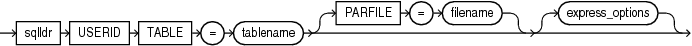
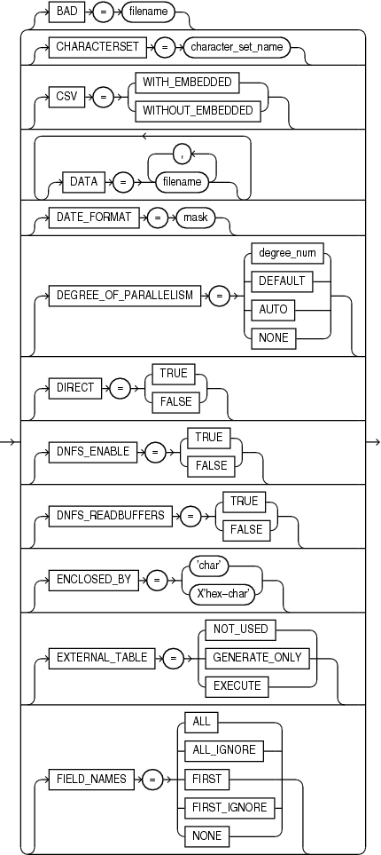
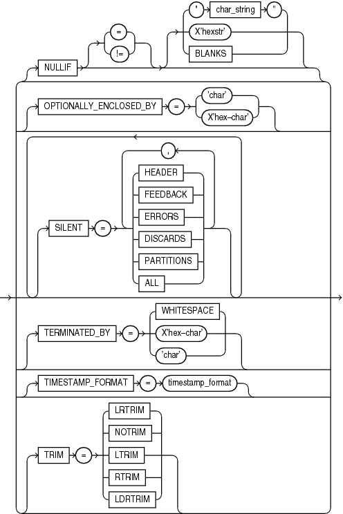

## 13 SQL\*Loader Express

SQL\*Loader express mode allows you to quickly and easily use SQL\*Loader to load simple data types.

**Parent topic:** [SQL\*Loader](oracle-sql-loader.md)

### 13.1 What is SQL\*Loader Express Mode?

SQL\*Loader express mode lets you quickly perform a load by specifying only a table name when the table columns are all character, number, or datetime data types, and the input data files contain only delimited character data.

In express mode, a SQL\*Loader control file is not used. Instead, SQL\*Loader uses the table column definitions found in the `ALL_TAB_COLUMNS` view to determine the input field order and data types. For most other settings, it assumes default values which you can override with command-line parameters.

Note:

The only valid parameters for use with SQL\*Loader express mode are those described in this chapter. Any other parameters will be ignored or may result in an error.

**Parent topic:** SQL\*Loader Express

### 13.2 Using SQL\*Loader Express Mode

Learn how to start and manage SQL\*Loader using the express mode feature.

- Starting SQL\*Loader in Express Mode  
	To activate SQL\*Loader express mode, you can simply specify your user name and a table name.
- Default Values Used by SQL\*Loader Express Mode  
	Learn how SQL\*Loader express loads tables, what defaults it uses, and under what conditions the defaults are changed.
- How SQL\*Loader Express Mode Handles Byte Order  
	The type of character set used with your data file affects the byte order used with SQL\*Loader express.

**Parent topic:** SQL\*Loader Express

#### 13.2.1 Starting SQL\*Loader in Express Mode

To activate SQL\*Loader express mode, you can simply specify your user name and a table name.

SQL\*Loader prompts you for a password. For example:

Example 13-1 Starting SQL Loader in Express Mode

```
> sqlldr username TABLE=employees
Password:
.
.
. 
 
SQL*Loader: Release 21.0.0.0.0 - Production on Mon Oct 16 127:19:39 2020
Version 21.0.0.0.0

Copyright (c) 1982, 2020, Oracle and/or its affiliates.  All rights reserved.
 
Express Mode Load, Table: EMPLOYEES
.
.
.
```

If you activate SQL\*Loader express mode by specifying only the `TABLE` parameter, then SQL\*Loader uses default settings for a number of other parameters. You can override most of the default values by specifying additional parameters on the command line.

SQL\*Loader express mode generates a log file that includes a SQL\*Loader control file. The log file also contains SQL scripts for creating the external table and performing the load using a SQL `INSERT AS SELECT` statement. Neither the control file nor the SQL scripts are used by SQL\*Loader express mode. They are made available to you in case you want to use them as a starting point to perform operations using regular SQL\*Loader or standalone external tables; the control file is for use with SQL\*Loader, whereas the SQL scripts are for use with standalone external tables operations.

#### 13.2.2 Default Values Used by SQL\*Loader Express Mode

Learn how SQL\*Loader express loads tables, what defaults it uses, and under what conditions the defaults are changed.

By default, a load done using SQL\*Loader express mode assumes the following, unless you specify otherwise:

- If no data file is specified, then it looks for a file named `table-name.dat` in the current directory.
- By default, SQL\*Loader express uses the external tables load method. However, for some errors, SQL\*Loader express mode automatically switches from the default external tables load method to direct path load. An example of when this can occur is if a privilege violation caused the `CREATE DIRECTORY` SQL command to fail.
- SQL\*Loader express fields are set up as follows:
	- Names, from table column names (the order of the fields matches the table column order)
		- Types, based on table column types
		- Newline, as the record delimiter
		- Commas, as field delimiters
		- No enclosure
		- Left-right trimming
- The `DEGREE_OF_PARALLELISM` parameter is set to `AUTO`.
- Date and timestamp format use the NLS settings.
- The NLS client character set is used.
- If a table already has data in it, then new data is appended to the table.
- If you do not specify a data file, then the data, log, and bad files take the following default names (note the `%p` is replaced with the process ID of the Oracle Database child process):
	- `table-name.dat` for the data file
		- `table-name.log` for the SQL\*Loader log file
		- `table-name_%p.log_xt` for Oracle Database log files (for example, `emp_17228.log_xt`)
		- `table-name_%p.bad` for bad files
- If you specify one or more data files, using the `DATA` parameter, then the log and bad files take the following default names (note the `%p` is replaced with the process ID of the server child process.):
	- `table-name.log` for the SQL\*Loader log file
		- `table-name_%p.log_xt` for the Oracle Database log files
		- `first-data-file_%p.bad` for the bad files

#### 13.2.3 How SQL\*Loader Express Mode Handles Byte Order

The type of character set used with your data file affects the byte order used with SQL\*Loader express.

In general, SQL\*Loader express mode handles byte order marks in the same way that a load performed using a SQL\*Loader control file does.

In summary:

- For data files with a Unicode character set, SQL\*Loader express mode checks for a byte order mark at the beginning of the file.
- For a UTF16 data file, if a byte order mark is found, the byte order mark sets the byte order for the data file. If no byte order mark is found, the byte order of the system where SQL\*Loader is executing is used for the data file.
- A UTF16 data file can be loaded regardless of whether or not the byte order (endianness) is the same byte order as the system on which SQL\*Loader express is running.
- For UTF8 data files, any byte order marks found are skipped.
- A load is terminated if multiple data files are involved and they use different byte ordering.

### 13.3 SQL\*Loader Express Mode Parameter Reference

This section provides descriptions of the parameters available in SQL\*Loader express mode.

Some of the parameter names are the same as parameters used by regular SQL\*Loader, but there may be behavior differences. Be sure to read the descriptions so you know what behavior to expect.

Note:

If parameter values include quotation marks, then it is recommended that you specify them in a parameter file. See "Use of Quotation Marks on the Data Pump Command Line” in [Parameters Available in Data Pump Export Command-Line Mode](oracle-data-pump-export-utility.md) - the issues discussed there are also pertinent to SQL\*Loader express mode.

- BAD  
	The SQL\*Loader express mode BAD parameter specifies the location and name of the bad file.
- CHARACTERSET  
	The SQL\*Loader express mode `CHARACTERSET` parameter specifies a character set you want to use for the load.
- CSV  
	The SQL\*Loader express mode `CSV` parameter lets you you specify if CSV format files contain fields with embedded record terminators.
- DATA  
	The SQL\*Loader express mode `DATA` parameter specifies names of data files containing the data that you want to load.
- DATE\_FORMAT  
	The SQL\*Loader express mode `DATE_FORMAT` parameter specifies a date format that overrides the default value for all date fields.
- DEGREE\_OF\_PARALLELISM  
	The SQL\*Loader express mode `DEGREE_OF_PARALLELISM` parameter specifies the degree of parallelism to use for the load.
- DIRECT  
	The SQL\*Loader express mode `DIRECT` parameter specifies the load method to use, either conventional path or direct path.
- DNFS\_ENABLE  
	The SQL\*Loader express mode `DNFS_ENABLE` parameter lets you enable and disable use of the Direct NFS Client on input data files during a SQL\*Loader operation.
- DNFS\_READBUFFERS  
	The SQL\*Loader express mode `DNFS_READBUFFERS` parameter lets you control the number of read buffers used by the Direct NFS Client.
- ENCLOSED\_BY  
	The SQL\*Loader express mode `ENCLOSED_BY` parameter specifies a field enclosure string.
- EXTERNAL\_TABLE  
	The SQL\*Loader express mode `EXTERNAL_TABLE` parameter determines whether to load data using the external tables option.
- FIELD\_NAMES  
	The SQL\*Loader express mode `FIELD_NAMES` parameter overrides the fields being in the order of the columns in the database table.
- LOAD  
	The SQL\*Loader express mode `LOAD` specifies the number of records that you want to be loaded.
- NULLIF  
	The SQL\*Loader express mode `NULLIF` parameter specifies a value that is used to determine whether a field is loaded as a NULL column.
- OPTIONALLY\_ENCLOSED\_BY  
	The SQL\*Loader express mode `OPTIONALLY_ENCLOSED_BY` specifies an optional field enclosure string.
- PARFILE  
	The SQL\*Loader express mode `PARFILE` parameter specifies the name of a file that contains commonly used command-line parameters.
- SILENT  
	The SQL\*Loader express mode `SILENT` parameter suppresses some content that is written to the screen during a SQL\*Loader operation.
- TABLE  
	The SQL\*Loader express mode `TABLE` parameter activates SQL\*Loader express mode.
- TERMINATED\_BY  
	The SQL\*Loader express mode `TERMINATED_BY` specifies a field terminator that overrides the default.
- TIMESTAMP\_FORMAT  
	The `TIMESTAMP_FORMAT` parameter specifies a timestamp format that you want to use for the load.
- TRIM  
	The SQL\*Loader express mode `TRIM` parameter specifies the type of field trimming that you want to use during the load.
- USERID  
	The SQL\*Loader express mode `USERID` enables you to provide provide your Oracle username and password, so that you are not prompted for it.

**Parent topic:** SQL\*Loader Express

#### 13.3.1 BAD

The SQL\*Loader express mode BAD parameter specifies the location and name of the bad file.

Default

The default depends on whether any data files are specified, using the `DATA` parameter.

Purpose

The `BAD` parameter specifies the location and name of the bad file.

Syntax

```
BAD=[directory/][filename]
```

Usage Notes

The bad file stores records that cause errors during insert or that are improperly formatted. If you specify the `BAD` parameter, then you must supply either a directory or file name, or both. If you do not specify the `BAD` parameter, and there are rejected records, then the default file name is used.

The `directory` variable specifies a directory to which the bad file is written. The specification can include the name of a device or a network node.

The `filename` variable specifies a file name recognized as valid on your platform. You must specify only a name (and extension, if you want to use one other than `.bad`). Any spaces or punctuation marks in the file name must be enclosed in single quotation marks.

The values of `directory` and `filename` are determined as follows:

- If you specify the `BAD` parameter with a file name, but no directory, then the directory defaults to the current directory.
- If you specify the `BAD` parameter with a directory, but no file name, then the specified directory is used, and the default is used for the file name and the extension.

The `BAD` parameter applies to all the files that match the specified `DATA` parameter, if you specify the `DATA` parameter. If you do not specify the DATA parameter, then the `BAD` parameter applies to the one data file (`table-name.dat`)

Caution:

- If the file name (either the default or one you specify) already exists, then that file name either is overwritten, or a new version is created, depending on your operating system.
- If multiple data files are being loaded, then Oracle recommends that you either not specify the `BAD` parameter, or that you specify it with only a directory for the bad file.

Example

The following specification creates a bad file named `emp1.bad` in the current directory:

```
> sqlldr hr TABLE=employees BAD=emp1
```

**Parent topic:** SQL\*Loader Express Mode Parameter Reference

#### 13.3.2 CHARACTERSET

The SQL\*Loader express mode `CHARACTERSET` parameter specifies a character set you want to use for the load.

Default

The NLS client character set as specified in the `NLS_LANG` environment variable

Purpose

The `CHARACTERSET` parameter specifies a character set, other than the default, to use for the load.

Syntax

```
CHARACTERSET=character_set_name
```

The `character_set_name` variable specifies the character set name. Normally, the specified name must be the name of a character set that is supported by Oracle Database.

Usage Notes

The `CHARACTERSET` parameter specifies the character set of the SQL\*Loader input data files. If the `CHARACTERSET` parameter is not specified, then the default character set for all data files is the session character set, which is defined by the `NLS_LANG` environment variable. Only character data (fields of the SQL\*Loader data types `CHAR,` `VARCHAR,` `VARCHARC,` numeric `EXTERNAL`, and the datetime and interval data types) is affected by the character set of the data file.

For UTF-16 Unicode encoding, use the name UTF16 rather than AL16UTF16. AL16UTF16, which is the supported character set name for UTF-16 encoded data, is only for UTF-16 data that is in big-endian byte order. However, because you are allowed to set up data using the byte order of the system where you create the data file, the data in the data file can be either big-endian or little-endian. Therefore, a different character set name (UTF16) is used. The character set name AL16UTF16 is also supported. But if you specify AL16UTF16 for a data file that has little-endian byte order, then SQL\*Loader issues a warning message and processes the data file as little-endian.

The `CHARACTERSET` parameter value is assumed to the be same for all data files.

Note:

The term UTF-16 is a general reference to UTF-16 encoding for Unicode. The term UTF16 (no hyphen) is the specific name of the character set and is what you should specify for the `CHARACTERSET` parameter when you want to use UTF-16 encoding. This also applies to UTF-8 and UTF8.

Restrictions

None.

Example

The following example specifies the UTF-8 character set:

```
> sqlldr hr TABLE=employees CHARACTERSETNAME=utf8
```

**Parent topic:** SQL\*Loader Express Mode Parameter Reference

#### 13.3.3 CSV

The SQL\*Loader express mode `CSV` parameter lets you you specify if CSV format files contain fields with embedded record terminators.

Default

If the CSV parameter is not specified on the command line, then SQL\*Loader express assumes that the CSV file being loaded contains data that has no embedded characters and no enclosures.

If `CSV=WITHOUT_EMBEDDED` is specified on the command line, then SQL\*Loader express assumes that the CSV file being loaded contains data that has no embedded characters and that is optionally enclosed by '"'.

Purpose

The `CSV` parameter provides options that let you specify whether the comma-separated value (CSV) format file being loaded contains fields in which record terminators are embedded.

Syntax

```
CSV=[WITH_EMBEDDED | WITHOUT_EMBEDDED]
```
- `WITH_EMBEDDED` — This option means that there can be record terminators included (embedded) in a field in the record. The record terminator is newline. The default delimiters are `TERMINTATED                             by ","` and `OPTIONALLY_ENCLOSED_BY '"'`. Embedded record terminators must be enclosed.
- `WITHOUT_EMBEDDED` — This option means that there are no record terminators included (embedded) in a field in the record. The record terminator is newline. The default delimiters are `TERMINATED                             BY ","` and `OPTIONALLY_ENCLOSED_BY ' " '`.

Usage Notes

If the CSV file contains many embedded record terminators, then it is possible that performance can be adversely affected by this parameter.

Restrictions

- Normally a file can be processed in parallel (split up and processed by more than one execution server at a time). But in the case of CSV format files with embedded record terminators, the file must be processed by only one execution server. Therefore, parallel processing within a data file is disabled when you set the `CSV` parameter to `CSV=WITH_EMBEDDED`.

Example

The following example processes the data files as CSV format files with embedded record terminators.

```
> sqlldr hr TABLE=employees CSV=WITH_EMBEDDED
```

**Parent topic:** SQL\*Loader Express Mode Parameter Reference

#### 13.3.4 DATA

The SQL\*Loader express mode `DATA` parameter specifies names of data files containing the data that you want to load.

Default

The same name as the table name, but with an extension of `.dat`.

Purpose

The `DATA` parameter specifies names of data files containing the data that you want to load.

Syntax

```
DATA=data-file-name
```

If you do not specify a file extension, then the default is `.dat`.

Usage Notes

The file specification can contain wildcards, but only in the file name and file extension, not in a device or directory name. An asterisk (`*`) represents multiple characters. A question mark (`?`) represents a single character. For example:

```
DATA='emp*.dat'

DATA='m?emp.dat'
```

To list multiple data file specifications (each of which can contain wild cards), you must separate the file names by commas.

If the file name contains any special characters (for example, spaces, `*`, or `?`), then the entire name must be enclosed within single quotation marks.

The following are three examples of possible valid uses of the `DATA` parameter (the single quotation marks would only be necessary if the file name contained special characters):

```
DATA='file1','file2','file3','file4','file5','file6'
```
```
DATA='file1','file2'
DATA='file3,'file4','file5'
DATA='file6'
```
```
DATA='file1'
DATA='file2'
DATA='file3'
DATA='file4'
DATA='file5'
DATA='file6'
```

Caution:

If multiple data files are being loaded, and you also specify the `BAD` parameter, then Oracle recommends that you specify only a directory for the bad file, not a file name. If you specify a file name, and a file with that name already exists, then that file either is overwritten, or a new version is created, depending on your operating system.

Example

Assume that the current directory contains data files with the names `emp1.dat`, `emp2.dat`, `m1emp.dat`, and `m2emp.dat` and you issue the following command:

```
> sqlldr hr TABLE=employees DATA='emp*','m1emp'
```

The command loads the `emp1.dat`, `emp2.dat`, and `m1emp.dat` files. The `m2emp.dat` file is not loaded because it did not match any of the wildcard criteria.

**Parent topic:** SQL\*Loader Express Mode Parameter Reference

#### 13.3.5 DATE\_FORMAT

The SQL\*Loader express mode `DATE_FORMAT` parameter specifies a date format that overrides the default value for all date fields.

Default

If the `DATE_FORMAT` parameter is not specified, then the `NLS_DATE_FORMAT`, `NLS_LANGUAGE`, or `NLS_DATE_LANGUAGE` environment variable settings (if defined for the SQL\*Loader session) are used. If the `NLS_DATE_FORMAT` is not defined, then dates are assumed to be in the default format defined by the `NLS_TERRITORY` setting.

Purpose

The `DATE_FORMAT` parameter specifies a date format that overrides the default value for all date fields.

Syntax

```
DATE_FORMAT=mask
```

The mask is a date format mask, which normally is enclosed in double quotation marks.

Example

If the date in the data file was June 25, 2019, then the date format would be specified in the following format:

```
> sqlldr hr TABLE=employees DATE_FORMAT="DD-Month-YYYY"
```

**Parent topic:** SQL\*Loader Express Mode Parameter Reference

#### 13.3.6 DEGREE\_OF\_PARALLELISM

The SQL\*Loader express mode `DEGREE_OF_PARALLELISM` parameter specifies the degree of parallelism to use for the load.

Default

```
AUTO
```

Purpose

The `DEGREE_OF_PARALLELISM` parameter specifies the degree of parallelism to use for the load.

Syntax

```
DEGREE_OF_PARALLELISM=[degree-num|DEFAULT|AUTO|NONE]
```

Options:

- `degree-num` specifies degree of parallelism. It must be a whole number value from 1 to n.
- `DEFAULT` specifies that you want to use the default parallelism of the database (not the default parameter value of `AUTO`).
- `AUTO` specifies that Oracle Database automatically sets the degree of parallelism for the load. If the `DEGREE_OF_PARALLELISM` parameter is not specified,. then this is the default option for parallelism.
- `NONE` specifies that you do not want the load performed in parallel. A value of `NONE` is the same as a value of `1`.

Restrictions

- The `DEGREE_OF_PARALLELISM` parameter is ignored if you force the load method to be conventional or direct path (the `NONE` option is used). Any time you specify the `DEGREE_OF_PARALLELISM` parameter, for any value, you receive a message reminding you of this.
- If the load is a default external tables load and an error occurs that causes SQL\*Loader express mode to use direct path load instead, then the job is not performed in parallel, even if you had specified a degree of parallelism or had accepted the external tables default of `AUTO`. A message is displayed alerting you to this change.

Example

The following example loads the data without using parallelism:

```
> sqlldr hr TABLE=employees DEGREE_OF_PARALLELISM=NONE
```

#### 13.3.7 DIRECT

The SQL\*Loader express mode `DIRECT` parameter specifies the load method to use, either conventional path or direct path.

Default

No default.

Purpose

The `DIRECT` parameter specifies the load method to use, either conventional path or direct path.

Syntax

```
DIRECT=[TRUE|FALSE]
```

A value of `TRUE` specifies a direct path load. A value of `FALSE` specifies a conventional path load.

Usage Notes

This parameter overrides the SQL\*Loader express mode default load method of external tables.

For some errors, SQL\*Loader express mode automatically switches from the default external tables load method to direct path load. An example of when this can occur is if a privilege violation caused the `CREATE DIRECTORY` SQL command to fail.

If you use the `DIRECT` parameter to specify a conventional or direct path load, then the following regular SQL\*Loader parameters are valid to use in express mode:

- `BINDSIZE`
- `COLUMNARRAYROWS` (direct path loads only)
- `DATE_CACHE`
- `ERRORS`
- `MULTITHREADING` (direct path loads only)
- `NO_INDEX_ERRORS` (direct path loads only)
- `RESUMABLE`
- `RESUMABLE_NAME`
- `RESUMABLE_TIMEOUT`
- `ROWS`
- `SKIP`
- `STREAMSIZE`

Example

In the following example, SQL\*Loader uses the direct path load method for the load instead of external tables:

```
> sqlldr hr TABLE=employees DIRECT=TRUE
```

**Parent topic:** SQL\*Loader Express Mode Parameter Reference

#### 13.3.8 DNFS\_ENABLE

The SQL\*Loader express mode `DNFS_ENABLE` parameter lets you enable and disable use of the Direct NFS Client on input data files during a SQL\*Loader operation.

Default

`TRUE`

Purpose

The `DNFS_ENABLE` parameter lets you enable and disable use of the Direct NFS Client on input data files during a SQL\*Loader operation.

The Direct NFS Client is an API that can be implemented by file servers to allow improved performance when Oracle accesses files on those servers.

Syntax

The syntax is as follows:

```
DNFS_ENABLE=[TRUE|FALSE]
```

Usage Notes

SQL\*Loader uses the Direct NFS Client interfaces by default when it reads data files over 1 GB. For smaller files, the operating system's I/O interfaces are used. To use the Direct NFS Client on all input data files, use `DNFS_ENABLE=TRUE`.

To disable use of the Direct NFS Client for all data files, specify `DNFS_ENABLE=FALSE`.

The `DNFS_ENABLE` parameter can be used in conjunction with the `DNFS_READBUFFERS` parameter, which can specify the number of read buffers used by the Direct NFS Client.

**Parent topic:** SQL\*Loader Express Mode Parameter Reference

#### 13.3.9 DNFS\_READBUFFERS

The SQL\*Loader express mode `DNFS_READBUFFERS` parameter lets you control the number of read buffers used by the Direct NFS Client.

Default

4

Purpose

The `DNFS_READBUFFERS` parameter lets you control the number of read buffers used by the Direct NFS Client. The Direct NFS Client is an API that can be implemented by file servers to allow improved performance when Oracle accesses files on those servers.

Syntax

The syntax is as follows:

```
DNFS_READBUFFERS = n
```

Usage Notes

Using values larger than the default can compensate for inconsistent I/O from the Direct NFS Client file server, but using larger values can also result in increased memory usage.

To use this parameter without also specifying the `DNFS_ENABLE` parameter, the input file must be larger than 1 GB.

**Parent topic:** SQL\*Loader Express Mode Parameter Reference

#### 13.3.10 ENCLOSED\_BY

The SQL\*Loader express mode `ENCLOSED_BY` parameter specifies a field enclosure string.

Default

The default is that there is no enclosure character.

Purpose

The `ENCLOSED_BY` parameter specifies a field enclosure string.

Syntax

```
ENCLOSED_BY=['string'|x'hex-string']
```

The enclosure character must be a string or a hexadecimal string.

Usage Notes

The same string must be used to signify both the beginning and the ending of the enclosure.

Example

In the following example, the field data is enclosed by the ' `/` ' character (forward slash).

```
> sqlldr hr TABLE=employees ENCLOSED_BY='/'
```

**Parent topic:** SQL\*Loader Express Mode Parameter Reference

#### 13.3.11 EXTERNAL\_TABLE

The SQL\*Loader express mode `EXTERNAL_TABLE` parameter determines whether to load data using the external tables option.

Default

`EXECUTE`

Purpose

The `EXTERNAL_TABLE` parameter instructs SQL\*Loader whether to load data using the external tables option.

Syntax

```
EXTERNAL_TABLE=[NOT_USED | GENERATE_ONLY | EXECUTE]
```

There are three possible values:

- `NOT_USED` — It means the load is performed using either conventional or direct path mode.
- `GENERATE_ONLY` — places all the SQL statements needed to do the load using external tables in the SQL\*Loader log file. These SQL statements can be edited and customized. The actual load can be done later without the use of SQL\*Loader by executing these statements in SQL\*Plus.
- `EXECUTE` — the default value in SQL\*Loader express mode. Attempts to execute the SQL statements that are needed to do the load using external tables. However, if any of the SQL statements returns an error, then the attempt to load stops. Statements are placed in the log file as they are executed. This means that if a SQL statement returns an error, then the remaining SQL statements required for the load will not be placed in the log file.

Usage Notes

The external table option uses directory objects in the database to indicate where all data files are stored, and to indicate where output files, such as bad files and discard files, are created. You must have `READ` access to the directory objects containing the data files, and you must have `WRITE` access to the directory objects where the output files are created. If there are no existing directory objects for the location of a data file or output file, then SQL\*Loader will generate the SQL statement to create one. Therefore, when the `EXECUTE` option is specified, you must have the `CREATE ANY DIRECTORY` privilege. If you want the directory object to be deleted at the end of the load, then you must also have the `DROP ANY DIRECTORY` privilege.

Note:

The `EXTERNAL_TABLE=EXECUTE` qualifier tells SQL\*Loader to create an external table that can be used to load data, and then execute the `INSERT` statement to load the data. All files in the external table must be identified as being in a directory object. SQL\*Loader attempts to use directory objects that already exist, and that you have privileges to access. However, if SQL\*Loader does not find the matching directory object, then it attempts to create a temporary directory object. If you do not have privileges to create new directory objects, then the operation fails.

To work around this issue, use `EXTERNAL_TABLE=GENERATE_ONLY` to create the SQL statements that SQL\*Loader would try to execute. Extract those SQL statements and change references to directory objects to be the directory object that you have privileges to access. Then, execute those SQL statements.

Example

```
sqlldr hr TABLE=employees EXTERNAL_TABLE=NOT_USED
```

**Parent topic:** SQL\*Loader Express Mode Parameter Reference

#### 13.3.12 FIELD\_NAMES

The SQL\*Loader express mode `FIELD_NAMES` parameter overrides the fields being in the order of the columns in the database table.

Default

`NONE`

Purpose

The `FIELD_NAMES` parameter is used to override the fields being in the order of the columns in the database table. (By default, SQL\*Loader Express uses the table column definitions found in the `ALL_TAB_COLUMNS` view to determine the input field order and data types.)

An example of when this parameter could be useful is when the data in the input file is not in the same order as the columns in the table. In such a case, you can include a field name record (similar to a column header row for a table) in the data file and use the `FIELD_NAMES` parameter to notify SQL\*Loader to process the field names in the first record to determine the order of the fields.

Syntax

```
FIELD_NAMES=[ALL | ALL_IGNORE | FIRST | FIRST_IGNORE | NONE]
```

The valid options for this parameter are as follows:

- `ALL` — The field name record is processed for every data file.
- `ALL_IGNORE` — Ignore the first (field names) record in all the data files and process the data records normally.
- `FIRST` — In the first data file, process the first (field names) record. For all other data files, there is no field names record, so the data file is processed normally.
- `FIRST_IGNORE` — In the first data file, ignore the first (field names) record and use table column order for the field order.
- `NONE` — There are no field names records in any data file, so the data files are processed normally. This is the default.

Usage Notes

- If any field name has mixed case or special characters (for example, spaces), then you must use either the `OPTIONALLY_ENCLOSED_BY` parameter, or the `ENCLOSED_BY` parameter to indicate that case should be preserved, and that special characters should be included as part of the field name.

Example

If you are loading a CSV file that contains column headers into a table, and the fields in each row in the input file are in the same order as the columns in the table, then you could use the following:

```
> sqlldr hr TABLE=employees CSV=WITHOUT_EMBEDDED FIELD_NAMES=FIRST_IGNORE
```

**Parent topic:** SQL\*Loader Express Mode Parameter Reference

#### 13.3.13 LOAD

The SQL\*Loader express mode `LOAD` specifies the number of records that you want to be loaded.

Default

All records are loaded.

Purpose

The `LOAD` parameter specifies the number of records that you want to be loaded.

Syntax

```
LOAD=n
```

Usage Notes

To test that all parameters you have specified for the load are set correctly, use the `LOAD` parameter to specify a limited number of records rather than loading all records. No error occurs if fewer than the maximum number of records are found.

Example

The following example specifies that a maximum of 10 records be loaded:

```
> sqlldr hr TABLE=employees LOAD=10
```

For external tables method loads (the default load method for express mode), only successfully loaded records are counted toward the total. So if there are 15 records in the file and records 2 and 4 are bad, then the following records are loaded into the table, for a total of 10 records - 1, 3, 5, 6, 7, 8, 9, 10, 11, and 12.

For conventional and direct path loads, both successful and unsuccessful load attempts are counted toward the total. So if there are 15 records in the file and records 2 and 4 are bad, then only the following 8 records are actually loaded into the table - 1, 3, 5, 6, 7, 8, 9, and 10.

**Parent topic:** SQL\*Loader Express Mode Parameter Reference

#### 13.3.14 NULLIF

The SQL\*Loader express mode `NULLIF` parameter specifies a value that is used to determine whether a field is loaded as a NULL column.

Default

The default is that no `NULLIF` checking is done.

Syntax

```
NULLIF = "string"
```

Or:

```
NULLIF != "string"
```

Usage Notes

SQL\*Loader checks the specified value against the value of the field in the record. If there is a match using the equal (=) or not equal (!=) specification, then the field is set to `NULL` for that row. Any field that has a length of 0 after blank trimming is also set to `NULL`.

Example

In the following example, if there are any fields whose value is a period, then those fields are set to NULL in their respective rows.

```
> sqlldr hr TABLE=employees NULLIF="."
```

**Parent topic:** SQL\*Loader Express Mode Parameter Reference

#### 13.3.15 OPTIONALLY\_ENCLOSED\_BY

The SQL\*Loader express mode `OPTIONALLY_ENCLOSED_BY` specifies an optional field enclosure string.

Default

The default is that there is no optional field enclosure character.

Purpose

The `OPTIONALLY_ENCLOSED_BY` parameter specifies an optional field enclosure string.

Syntax

```
OPTIONALLY_ENCLOSED_BY=['string'| x'hex-string']
```

The enclosure character is a string or a hexadecimal string.

Usage Notes

You must use the same string to signify both the beginning and the ending of the enclosure.

Examples

The following example specifies the optional enclosure character as a double quotation mark (`"`):

```
> sqlldr hr TABLE=employees OPTIONALLY_ENCLOSED_BY='"'
```

The following example specifies the optional enclosure character in hexadecimal format:

```
> sqlldr hr TABLE=employees OPTIONALLY_ENCLOSED_BY=x'22'
```

**Parent topic:** SQL\*Loader Express Mode Parameter Reference

#### 13.3.16 PARFILE

The SQL\*Loader express mode `PARFILE` parameter specifies the name of a file that contains commonly used command-line parameters.

Default

There is no default

Syntax

```
PARFILE=parameter_file_name
```

Usage Notes

If any parameter values contain quotation marks, then Oracle recommends that you use a parameter file.

Note:

Although it is not usually important, on some systems it can be necessary to have no spaces around the equal sign (`=`) in the parameter specifications.

Restrictions

- For security reasons, Oracle recommends that you do not include your `USERID` password in a parameter file. After you specify the parameter file at the command line, SQL\*Loader prompts you for the password. For example:
	```
	> sqlldr hr TABLE=employees PARFILE=daily_report.par
	Password:
	```

Example

Suppose you have the following parameter file, `test.par`:

```
table=employees
data='mydata*.dat'
enclosed_by='"'
```

When you run the following command, any fields enclosed by double quotation marks, in any data files that match `mydata*.dat`, are loaded into table `employees`:

```
> sqlldr hr PARFILE=test.par
Password:
```

**Parent topic:** SQL\*Loader Express Mode Parameter Reference

#### 13.3.17 SILENT

The SQL\*Loader express mode `SILENT` parameter suppresses some content that is written to the screen during a SQL\*Loader operation.

Default

\\\\If this parameter is not specified, then no content is suppressed.

Purpose

The `SILENT` parameter suppresses some of the content that is written to the screen during a SQL\*Loader operation.

Syntax

The syntax is as follows:

SILENT={HEADER | FEEDBACK | ERRORS | DISCARDS | PARTITIONS | ALL}

Use the appropriate values to suppress one or more of the following (if more than one option is specified, they must be separated by commas):

- `HEADER` — Suppresses the SQL\*Loader header messages that normally appear on the screen. Header messages still appear in the log file.
- `FEEDBACK` — Suppresses the "commit point reached" messages and the status messages for the load that normally appear on the screen.
- `ERRORS` — Suppresses the data error messages in the log file that occur when a record generates an Oracle error that causes it to be written to the bad file. A count of rejected records still appears.
- `DISCARDS` — Suppresses the messages in the log file for each record written to the discard file. This option is ignored in express mode.
- `PARTITIONS` — Disables writing the per-partition statistics to the log file during a direct load of a partitioned table. This option is meaningful only in a forced direct path operation.
- `ALL` — Implements all of the suppression options.

Example

For example, you can suppress the header and feedback messages that normally appear on the screen with the following command-line argument:

```
> sqlldr hr TABLE=employees SILENT=HEADER, FEEDBACK
```

**Parent topic:** SQL\*Loader Express Mode Parameter Reference

#### 13.3.18 TABLE

The SQL\*Loader express mode `TABLE` parameter activates SQL\*Loader express mode.

Default

There is no default.

Syntax

```
TABLE=[schema-name.]table-name
```

Usage Notes

If the schema name or table name includes lower case characters, spaces, or other special characters, then the names must be enclosed in double quotation marks and that entire string enclosed within single quotation marks. For example:

```
TABLE='"hr.Employees"'
```

Restrictions

The `TABLE` parameter is valid only in SQL\*Loader express mode.

Example

The following example loads the table employees in express mode:

```
> sqlldr hr TABLE=employees
```

**Parent topic:** SQL\*Loader Express Mode Parameter Reference

#### 13.3.19 TERMINATED\_BY

The SQL\*Loader express mode `TERMINATED_BY` specifies a field terminator that overrides the default.

Default

By default, comma is the field terminator.

Purpose

The `TERMINATED_BY` parameter specifies a field terminator that overrides the default.

Syntax

```
TERMINATED_BY=['string'| x'hex-string' | WHITESPACE]
```

The field terminator must be a string or a hexadecimal string.

Usage Notes

If you specify `TERMINATED_BY=WHITESPACE`, then data is read until the first occurrence of a whitespace character (spaces, tabs, blanks, line feeds, form feeds, or carriage returns). Then the current position is advanced until no more adjacent whitespace characters are found. This method allows field values to be delimited by varying amounts of whitespace.

If you specify `TERMINATED_BY=WHITESPACE`, then null fields cannot contain just blanks or other whitespace, because the blanks and whitespace are skipped, which can result in an error being reported. With this option, if you have null fields in the data, then consider using another string to indicate the null field, and use the `NULLIF` parameter to indicate the `NULLIF` string. For example, you can use the string `"NoData"` to indicate a null field, and then insert the string `"NoData"` in the data to indicate a null field. Specify `NULLIF="NoData"` to tell SQL\*Loader to set fields with the string `"NoData"` to `NULL`.

Example

In the following example, fields are terminated by the `|` character.

```
> sqlldr hr TABLE=employees TERMINATED_BY="|"
```

**Parent topic:** SQL\*Loader Express Mode Parameter Reference

#### 13.3.20 TIMESTAMP\_FORMAT

The `TIMESTAMP_FORMAT` parameter specifies a timestamp format that you want to use for the load.

Default

The default is taken from the value of the `NLS_TIMESTAMP_FORMAT` environment variable. If `NLS_TIMESTAMP_FORMAT` is not set up, then timestamps use the default format defined in the `NLS_TERRITORY` environment variable, with 6 digits of fractional precision.

Syntax

```
TIMESTAMP_FORMAT="timestamp_format"
```

Example

The following is an example of specifying a timestamp format:

```
> sqlldr hr TABLE=employees TIMESTAMP_FORMAT="MON-DD-YYYY HH:MI:SSXFF AM"
```

**Parent topic:** SQL\*Loader Express Mode Parameter Reference

#### 13.3.21 TRIM

The SQL\*Loader express mode `TRIM` parameter specifies the type of field trimming that you want to use during the load.

Default

The default for conventional and direct path loads is `LDRTRIM`. The default for external tables loads is `LRTRIM`.

Purpose

The `TRIM` parameter specifies the type of field trimming that you want to use during the load. Use `TRIM` to specify that you want spaces trimmed from the beginning of a text field, or the end of a text field, or both. Spaces include blanks and other nonprinting characters, such as tabs, line feeds, and carriage returns.

Syntax

```
TRIM=[LRTRIM | NOTRIM | LTRIM | RTRIM |LDRTRIM]
```

Options:

- `LRTRIM` specifies that you want both leading and trailing spaces trimmed.
- `NOTRIM` specifies that you want no characters trimmed from the field. This setting generally yields the fastest performance.
- `LTRIM` specifies that you want leading spaces trimmed.
- `RTRIM` specifies that you want trailing spaces trimmed.
- `LDRTRIM` is the same as `NOTRIM` unless the field is a delimited field with `OPTIONALLY_ENCLOSED_BY` specified, and the optional enclosures are missing for a particular instance. In that case spaces are trimmed from the left.

Usage Notes

If you specify trimming for a field that is all spaces, then the field is set to `NULL`.

Restrictions

- Only `LDRTRIM` is supported for forced conventional path and forced direct path loads. Any time you specify the `TRIM` parameter, for any value, you receive a message reminding you of this.
- If the load is a default external tables load and an error occurs that causes SQL\*Loader express mode to use direct path load instead, then `LDRTRM` is used as the trimming method, even if you specified a different method or had accepted the external tables default of `LRTRIM`. A message is displayed alerting you to this change.
	To use `NOTRIM`, use a control file with the `PRESERVE BLANKS` clause.

Example

The following example reads the fields, trimming all spaces on the right (trailing spaces).

```
> sqlldr hr TABLE=employees TRIM=RTRIM
```

**Parent topic:** SQL\*Loader Express Mode Parameter Reference

#### 13.3.22 USERID

The SQL\*Loader express mode `USERID` enables you to provide provide your Oracle username and password, so that you are not prompted for it.

Default

None.

Purpose

The `USERID` parameter enables you to to provide your Oracle username and password.

Syntax

```
USERID = [username | / | SYS]
```

Usage Notes

If you do not specify the `USERID` parameter, then you are prompted for it. If only a slash is used, then `USERID` defaults to your operating system login.

If you connect as user `SYS`, then you must also specify `AS SYSDBA` in the connect string.

Restrictions

- Because the string, `AS SYSDBA,` contains a blank, some operating systems can require that you place the entire connect string in quotation marks, or marked as a literal by some other method. Some operating systems also require that you precede quotation marks on the command line using an escape character, such as backslashes.
	Refer to your operating system documentation for information about special and reserved characters on your system.

Example

The following example starts the job for user `hr`:

```
> sqlldr USERID=hr TABLE=employees
  Password:
```

**Parent topic:** SQL\*Loader Express Mode Parameter Reference

### 13.4 SQL\*Loader Express Mode Syntax Diagrams

To understand SQL\*Loader express mode options, refer to these graphic form syntax guides (sometimes called railroad diagrams or DDL diagrams).

Understanding Graphic Syntax Notation

For information about the syntax notation used, see:

[How to Read Syntax Diagrams](https://docs.oracle.com/pls/topic/lookup?ctx=en/database/oracle/oracle-database/21/sutil&id=SQLRF-GUID-6DFBA035-DBCB-4F37-984D-37E9EBC1038B)

express\_init



> sqlldr USERID TABLE=tablename \[PARFILE=filename\] \[express\_options\]
>
> [  
> Copyright © 2002, 2026, Oracle and/or its affiliates.](https://docs.oracle.com/en/database/oracle/oracle-database/dcommon/html/cpyr.htm)


The following syntax diagrams show the parameters included in `express_options` in the previous syntax diagram. SQL\*Loader express mode parameters shown in the following syntax diagrams are all optional and can appear in any order on the SQL\*Loader command line. Therefore, they are presented in simple alphabetical order.

express\_options



> ```
> [BAD=fileanme]
> [CHARACTERSET=character_set_name]
> [CSV={WITH_EMBEDDED | WITHOUT_EMBEDDED}]
> [DATA=filename [, filename]...]
> [DATE_FORMAT=mask]
> [DEGREE_OF_PARALLELISM={degree_num | DEFAULT | AUTO | NONE}]
> [DIRECT={TRUE | FALSE}]
> [DNFS_ENABLE={TRUE | FALSE}]
> [DNFS_READBUFFERS={TRUE | FALSE}]
> [ENCLOSED_BY={'char' | X'hex-char'}]
> [EXTERNAL_TABLE={NOT_USED | GENERATE_ONLY | EXECUTE}]
> [FIELD_NAMES={ALL | IGNORE | FIRST | FIRST_IGNORE | NONE}]
> ```
>
> [  
> Copyright © 2002, 2026, Oracle and/or its affiliates.](https://docs.oracle.com/en/database/oracle/oracle-database/dcommon/html/cpyr.htm)


express\_options\_cont



> ```
> [NULLIF {= | !=} [{"char_string" | X'hexstr' | BLANKS}]]
> [OPTIONALLY_ENCLOSED_BY={'char' | X'hex-char'}]
> [SILENT={HEADER | FEEDBACK | ERRORS | DISCARDS | PARTITIONS | ALL} [,]...]
> [TERMINATED_BY={WHITESPACE | X'hex-char' | 'char'}]
> [TIMESTAMP_FORMAT=timestamp_format]
> [TRIM={LRTRIM | NOTRIM | LTRIM | RTRIM | LDRTRIM}]
> ```
>
> [  
> Copyright © 2002, 2026, Oracle and/or its affiliates.](https://docs.oracle.com/en/database/oracle/oracle-database/dcommon/html/cpyr.htm)


**Parent topic:** SQL\*Loader Express