## 10 SQL\*Loader Field List Reference

The field-list portion of a SQL\*Loader control file provides information about fields being loaded, such as position, data type, conditions, and delimiters.

- Field List Contents  
	The field-list portion of a SQL\*Loader control file provides information about fields being loaded.
- Specifying the Position of a Data Field.  
	Learn how to specify positions in a logical data field by using the SQL\*Loader POSITION clause.
- Specifying Columns and Fields  
	Learn how to specify columns and fields in SQL\*Loader specifications.
- SQL\*Loader Data Types  
	SQL\*Loader data types can be grouped into portable and nonportable data types.
- Specifying Field Conditions  
	A field condition is a statement about a field in a logical record that evaluates as true or false.
- Using the WHEN, NULLIF, and DEFAULTIF Clauses  
	Learn how SQL\*Loader processes the `WHEN`, `NULLIF`, and `DEFAULTIF` clauses with scalar fields.
- Examples of Using the WHEN, NULLIF, and DEFAULTIF Clauses  
	These examples explain results for different situations in which you can use the `WHEN`, `NULLIF,` and `DEFAULTIF` clauses.
- Loading Data Across Different Platforms  
	When a data file created on one platform is to be loaded on a different platform, the data must be written in a form that the target system can read.
- Understanding how SQL\*Loader Manages Byte Ordering  
	SQL\*Loader can load data from a data file that was created on a system whose byte ordering is different from the byte ordering on the system where SQL\*Loader is running, even if the data file contains certain nonportable data types.
- Loading All-Blank Fields  
	Fields that are totally blank cause the record to be rejected. To load one of these fields as `NULL`, use the `NULLIF` clause with the `BLANKS` parameter.
- Trimming Whitespace  
	Blanks, tabs, and other nonprinting characters (such as carriage returns and line feeds) constitute whitespace.
- How the PRESERVE BLANKS Option Affects Whitespace Trimming  
	To prevent whitespace trimming in all `CHAR`, `DATE`, and numeric `EXTERNAL` fields, you specify `PRESERVE` `BLANKS` as part of the `LOAD` statement in the control file.
- [How \[NO\] PRESERVE BLANKS Works with Delimiter Clauses](https://docs.oracle.com/en/database/oracle/oracle-database/21/sutil/oracle-sql-loader-field-list-contents.html#GUID-658D9A9E-41A9-4BD7-BDD6-81B5A2ACC025)  
	The `PRESERVE` `BLANKS` option is affected by the presence of delimiter clauses
- Applying SQL Operators to Fields  
	This section describes applying SQL operators to fields.
- Using SQL\*Loader to Generate Data for Input  
	The parameters described in this section provide the means for SQL\*Loader to generate the data stored in the database record, rather than reading it from a data file.

**Parent topic:** [SQL\*Loader](oracle-sql-loader.md)

### 10.1 Field List Contents

The field-list portion of a SQL\*Loader control file provides information about fields being loaded.

The field-list control file fields are position, data type, conditions, and delimiters.

The following example shows the field list section of the example control file that was introduced in the topic [SQL\*Loader Control File Reference](oracle-sql-loader-control-file-contents.md)

Example 10-1 Field List Section of Sample Control File

```
.
.
.
1  (hiredate  SYSDATE,
2     deptno  POSITION(1:2)  INTEGER EXTERNAL(2)
              NULLIF deptno=BLANKS,
3       job   POSITION(7:14)  CHAR  TERMINATED BY WHITESPACE
              NULLIF job=BLANKS  "UPPER(:job)",
       mgr    POSITION(28:31) INTEGER EXTERNAL 
              TERMINATED BY WHITESPACE, NULLIF mgr=BLANKS,
       ename  POSITION(34:41) CHAR 
              TERMINATED BY WHITESPACE  "UPPER(:ename)",
       empno  POSITION(45) INTEGER EXTERNAL 
              TERMINATED BY WHITESPACE,
       sal    POSITION(51) CHAR  TERMINATED BY WHITESPACE
              "TO_NUMBER(:sal,'$99,999.99')",
4      comm   INTEGER EXTERNAL  ENCLOSED BY '(' AND '%'
              ":comm * 100"
    )
```

In this example control file, the numbers that appear to the left would not appear in a real control file. They are callouts that correspond to the following notes:

1. `SYSDATE` sets the column to the current system date. See Setting a Column to the Current Date .
2. `POSITION` specifies the position of a data field.
	`INTEGER EXTERNAL` is the data type for the field. See Specifying the Data Type of a Data Field and Numeric EXTERNAL.
	The `NULLIF` clause is one of the clauses that you can use to specify field conditions. See Using the WHEN\_ NULLIF\_ and DEFAULTIF Clauses.
	In this sample, the field is being compared to blanks, using the `BLANKS` parameter. See Comparing Fields to BLANKS.
3. The `TERMINATED BY WHITESPACE` clause is one of the delimiters you can specify for a field. See Specifying Delimiters.
4. The `ENCLOSED BY` clause is another possible field delimiter. See Specifying Delimiters.

**Parent topic:** SQL\*Loader Field List Reference

### 10.2 Specifying the Position of a Data Field.

Learn how to specify positions in a logical data field by using the SQL\*Loader POSITION clause.

- POSITION  
	To load data from the data file, SQL\*Loader must know the length and location of the field. The POSITION parametete defines this information.
- Using POSITION with Data Containing Tabs  
	When you are determining field positions, be alert for tabs in the data file.
- Using POSITION with Multiple Table Loads  
	This section describes using POSITION with multiple table loads.
- Examples of Using POSITION in SQL\*Loader Specifications  
	See examples of using `POSITION` with a simple column specification, and with a more complex column specification.

**Parent topic:** SQL\*Loader Field List Reference

#### 10.2.1 POSITION

To load data from the data file, SQL\*Loader must know the length and location of the field. The POSITION parametete defines this information.

Purpose

To specify the position of a field in the logical record, use the `POSITION` clause in the column specification. You cn either state the position explicitly or state it relative to the preceding field. Arguments to `POSITION` must be enclosed in parentheses. The start, end, and integer values are always in bytes, even if character-length semantics are used for a data file.

You can omit `POSITION` entirely. If you do omit `POSITION`, then the position specification for the data field is the same as if `POSITION(*)` had been used.

Syntax

The syntax for the position specification (pos\_spec) clause is as follows:


> ```
> pos_spec ::= 
> ( { start | * [+integer] } [{ : | - } end] )
> ```
>
> [  
> Copyright © 2002, 2026, Oracle and/or its affiliates.](https://docs.oracle.com/en/database/oracle/oracle-database/dcommon/html/cpyr.htm)


Parameters

The following table describes the parameters for the position specification clause.

Table 10-1 Parameters for the Position Specification Clause

| Parameter | Description |
| --- | --- |
| `start` | The starting column of the data field in the logical record. The first byte position in a logical record is 1. |
| `end` | The ending position of the data field in the logical record. Either `start` - `end` or `start:end` is acceptable. If you omit `end`, then the length of the field is derived from the data type in the data file. Note that `CHAR` data specified without start or end, and without a length specification (`CHAR(n)`), is assumed to have a length of 1. If it is impossible to derive a length from the data type, then an error message is issued. |
| `*` | Specifies that the data field follows immediately after the previous field. If you use `*` for the first data field in the control file, then that field is assumed to be at the beginning of the logical record. When you use `*` to specify position, the length of the field is derived from the data type. |
| +i `nteger` | You can use an offset, specified as +i `nteger`, to offset the current field from the next position after the end of the previous field. A number of bytes, as specified by `+integer`, are skipped before reading the value for the current field. |

**Parent topic:** Specifying the Position of a Data Field.

#### 10.2.2 Using POSITION with Data Containing Tabs

When you are determining field positions, be alert for tabs in the data file.

Suppose you use the SQL\*Loader advanced SQL string capabilities to load data from a formatted report. You would probably first look at a printed copy of the report, carefully measure all character positions, and then create your control file. In such a situation, it is highly likely that when you attempt to load the data, the load will fail with multiple "invalid number" and "missing field" errors.

These kinds of errors occur when the data contains tabs. When printed, each tab expands to consume several columns on the paper. In the data file, however, each tab is still only one character. As a result, when SQL\*Loader reads the data file, the `POSITION` specifications are wrong.

To fix the problem, inspect the data file for tabs and adjust the `POSITION` specifications, or else use delimited fields.

#### 10.2.3 Using POSITION with Multiple Table Loads

This section describes using POSITION with multiple table loads.

In a multiple table load, you specify multiple `INTO` `TABLE` clauses. When you specify `POSITION(*)` for the first column of the first table, the position is calculated relative to the beginning of the logical record. When you specify `POSITION(*)` for the first column of subsequent tables, the position is calculated relative to the last column of the last table loaded.

Thus, when a subsequent `INTO` `TABLE` clause begins, the position is not set to the beginning of the logical record automatically. This allows multiple `INTO` `TABLE` clauses to process different parts of the same physical record. For an example, see [Extracting Multiple Logical Records](oracle-sql-loader-control-file-contents.md).

A logical record might contain data for one of two tables, but not both. In this case, you would reset `POSITION`. Instead of omitting the position specification or using `POSITION(*+` `n``)` for the first field in the `INTO TABLE` clause, use `POSITION(1)` or `POSITION(``n``)`.

**Parent topic:** Specifying the Position of a Data Field.

#### 10.2.4 Examples of Using POSITION in SQL\*Loader Specifications

See examples of using `POSITION` with a simple column specification, and with a more complex column specification.

The following example shows two column specifications using `POSITION`:

```
siteid  POSITION (*) SMALLINT 
siteloc POSITION (*) INTEGER
```

Suppose that these are the first two column specifications. In that case, `siteid` begins in column 1, and `siteloc` begins in the column immediately following.

Now, consider these column specifications:

```
ename  POSITION (1:20)  CHAR 
empno  POSITION (22-26) INTEGER EXTERNAL 
allow  POSITION (*+2)   INTEGER EXTERNAL TERMINATED BY "/"
```

Column `ename` is character data in positions 1 through 20, followed by column `empno`, which is presumably numeric data in columns 22 through 26. Column `allow` is offset from the next position (27) after the end of `empno` by +2, so it starts in column 29 and continues until a slash is encountered.

**Parent topic:** Specifying the Position of a Data Field.

### 10.3 Specifying Columns and Fields

Learn how to specify columns and fields in SQL\*Loader specifications.

- Options for Column and Field Specification  
	When you specify columns and fields for SQL\*Loader, be aware of the restrictions and practices to follow.
- Specifying Filler Fields  
	A filler field, specified by `BOUNDFILLER` or `FILLER` is a data file mapped field that does not correspond to a database column.
- Specifying the Data Type of a Data Field  
	The data type specification of a field tells SQL\*Loader how to interpret the data in the field.

**Parent topic:** SQL\*Loader Field List Reference

#### 10.3.1 Options for Column and Field Specification

When you specify columns and fields for SQL\*Loader, be aware of the restrictions and practices to follow.

You can load any number of a table's columns. Columns defined in the database, but not specified in the control file, are assigned null values.

A column specification is the name of the column, followed by a specification for the value to be put in that column. The list of columns is enclosed by parentheses and separated with commas as follows:

```
(columnspec,columnspec, ...)
```

Each column name (unless it is marked `FILLER`) must correspond to a column of the table named in the `INTO TABLE` clause. If a column name uses a SQL or SQL\*Loader reserved word, or contains special characters, or is case-sensitive, then the name must be enclosed in quotation marks.

If SQL\*Loader generates the column value, then the specification includes the `RECNUM`, `SEQUENCE`, or `CONSTANT` parameter. Refer to "Using SQL\*Loader to Generate Data for Input."

If the column's value is read from the data file, then the data field that contains the column's value is specified. In this case, the column specification includes a column name that identifies a column in the database table, and a field specification that describes a field in a data record. The field specification includes position, data type, null restrictions, and defaults.

It is not necessary to specify all attributes when loading column objects. Any missing attributes will be set to `NULL`.

#### 10.3.2 Specifying Filler Fields

A filler field, specified by `BOUNDFILLER` or `FILLER` is a data file mapped field that does not correspond to a database column.

Filler fields are assigned values from the data fields to which they are mapped.

Keep the following in mind regarding filler fields:

- The syntax for a filler field is same as that for a column-based field, except that a filler field's name is followed by `FILLER`.
- Filler fields have names, but they are not loaded into the table.
- Filler fields can be used as arguments to `init_specs` (for example, `NULLIF` and `DEFAULTIF`).
- Filler fields can be used as arguments to directives (for example, `SID`, `OID`, `REF`, and `BFILE`).
	To avoid ambiguity, if a Filler field is referenced in a directive, such as `BFILE`, and that field is declared in the control file inside of a column object, then the field name must be qualified with the name of the column object. This is illustrated in the following example:
	```
	LOAD DATA 
	INFILE * 
	INTO TABLE BFILE1O_TBL REPLACE 
	FIELDS TERMINATED BY ',' 
	( 
	   emp_number char, 
	   emp_info_b column object 
	   ( 
	   bfile_name FILLER char(12), 
	   emp_b BFILE(constant "SQLOP_DIR", emp_info_b.bfile_name) NULLIF 
	  emp_info_b.bfile_name = 'NULL' 
	   ) 
	) 
	BEGINDATA 
	00001,bfile1.dat, 
	00002,bfile2.dat, 
	00003,bfile3.dat,
	```
- Filler fields can be used in field condition specifications in `NULLIF`, `DEFAULTIF`, and `WHEN` clauses. However, they cannot be used in SQL strings.
- Filler field specifications cannot contain a `NULLIF` or `DEFAULTIF` clause.
- Filler fields are initialized to `NULL` if `TRAILING NULLCOLS` is specified and applicable. If another field references a nullified filler field, then an error is generated.
- Filler fields can occur anyplace in the data file, including inside the field list for an object or inside the definition of a `VARRAY`.
- SQL strings cannot be specified as part of a filler field specification, because no space is allocated for fillers in the bind array.
	Note:
	The information in this section also applies to specifying bound fillers by using `BOUNDFILLER`. The only exception is that with bound fillers, SQL strings can be specified as part of the field, because space is allocated for them in the bind array.

Example 10-2 Filler Field Specification

A Filler field specification looks as follows:

```
field_1_count FILLER char,
field_1 varray count(field_1_count)
(
   filler_field1  char(2),
   field_1  column object
   (
     attr1 char(2),
     filler_field2  char(2),
     attr2 char(2),
   )
   filler_field3  char(3),
)
filler_field4 char(6)
```

**Parent topic:** Specifying Columns and Fields

#### 10.3.3 Specifying the Data Type of a Data Field

The data type specification of a field tells SQL\*Loader how to interpret the data in the field.

For example, a data type of `INTEGER` specifies binary data, while `INTEGER EXTERNAL` specifies character data that represents a number. A `CHAR` field can contain any character data.

Only one data type can be specified for each field; if a data type is not specified, then `CHAR` is assumed.

Before you specify the data type, you must specify the position of the field.

To find out how SQL\*Loader data types are converted into Oracle data types, and obtain detailed information about each SQL\*Loader data type, refer to "SQL\*Loader Data Types."

### 10.4 SQL\*Loader Data Types

SQL\*Loader data types can be grouped into portable and nonportable data types.

- Portable and Nonportable Data Type Differences  
	In SQL\*Loader, portable data types are platform-independent. Nonportable data types can have several different dependencies that affect portability.
- Nonportable Data Types  
	Use this reference to understand how to use the nonportable data types with SQL\*Loader.
- Portable Data Types  
	Use this reference to understand how to use the portable data types with SQL\*Loader.
- Data Type Conversions  
	SQL\*Loader can perform most data type conversions automatically, but to avoid errors, you need to understand conversion rules.
- Data Type Conversions for Datetime and Interval Data Types  
	Learn which conversions between Oracle Database data types and SQL\*Loader control file datetime and interval data types are supported, and which are not.
- Specifying Delimiters  
	The boundaries of `CHAR`, datetime, interval, or numeric `EXTERNAL` fields can also be marked by delimiter characters contained in the input data record.
- How Delimited Data Is Processed  
	To specify delimiters, field definitions can use various combinations of the `TERMINATED BY`, `ENCLOSED BY`, and `OPTIONALLY             ENCLOSED BY` clauses.
- Conflicting Field Lengths for Character Data Types  
	A control file can specify multiple lengths for the character-data fields `CHAR`, `DATE`, and numeric `EXTERNAL`.

**Parent topic:** SQL\*Loader Field List Reference

#### 10.4.1 Portable and Nonportable Data Type Differences

In SQL\*Loader, portable data types are platform-independent. Nonportable data types can have several different dependencies that affect portability.

For each SQL\*Loader data tupe, the data types are subgrouped into value data types and length-value data types.

The terms **portable data type** and **nonportable data type** refer to whether the data type is platform-dependent. Platform dependency can exist for several reasons, including differences in the byte ordering schemes of different platforms (big-endian versus little-endian), differences in the number of bits in a platform (16-bit, 32-bit, 64-bit), differences in signed number representation schemes (2's complement versus 1's complement), and so on. In some cases, such as with byte-ordering schemes and platform word length, SQL\*Loader provides mechanisms to help overcome platform dependencies. These mechanisms are discussed in the descriptions of the appropriate data types.

Both portable and nonportable data types can be values or length-values. Value data types assume that a data field has a single part. Length-value data types require that the data field consist of two subfields where the length subfield specifies how long the value subfield can be.

Note:

With Oracle Database 12c Release 1 (12.1) and later releases, the maximum size of the Oracle Database `VARCHAR2`, `NVARCHAR2`, and `RAW` data types is 32 KB. To obtain this size, the `COMPATIBLE` initialization parameter must be set to 12.0 or later, and the `MAX_STRING_SIZE` initialization parameter must be set to `EXTENDED`. SQL\*Loader supports this maximum size.

**Parent topic:** SQL\*Loader Data Types

#### 10.4.2 Nonportable Data Types

Use this reference to understand how to use the nonportable data types with SQL\*Loader.

- Categories of Nonportable Data Types  
	Nonportable data types are grouped into two categories: **value data types**, and **length-value data types**.
- BINARY\_DOUBLE  
	The SQL\*Loader nonportable value data type `BINARY_DOUBLE` is a 64-bit double-precision floating-point binary number data type.
- BINARY\_FLOAT  
	The SQL\*Loader nonportable value data type `BINARY_FLOAT` is a 32-bit single-precision floating-point number data type.
- BYTEINT  
	The SQL\*Loader nonportable value data type `BYTEINT` loads the decimal value of the binary representation of the byte.
- DECIMAL  
	The SQL\*Loader nonportable value data type `DECIMAL` is in packed decimal format.
- DOUBLE  
	The SQL\*Loader nonportable value data type `DOUBLE` is a double-precision floating-point binary number.
- FLOAT  
	The SQL\*Loader nonportable value data type `FLOAT` is a single-precision, floating-point, binary number.
- INTEGER(n)  
	The SQL\*Loader nonportable value data type `INTEGER(n)` is a length-specific integer field.
- LONG VARRAW  
	The SQL\*Loader nonportable length-value data type `LONG VARRAW` is a `VARRAW` with a 4-byte length subfield.
- SMALLINT  
	The SQL\*Loader nonportable value data type `SMALLINT` is a half-word binary integer.
- VARGRAPHIC  
	The SQL\*Loader nonportable length-value data type VARGRAPHIC is a varying-length, double-byte character set (DBCS).
- VARCHAR  
	The SQL\*Loader nonportable length-value data type `VARCHAR` is a binary length subfield followed by a character string of the specified length.
- VARRAW  
	The SQL\*Loader nonportable length-value data type `VARROW` is a 2-byte binary length subfield, and a `RAW` string value subfield.
- ZONED  
	The SQL\*Loader nonportable value data type ZONED is in zoned decimal format.

**Parent topic:** SQL\*Loader Data Types

##### 10.4.2.1 Categories of Nonportable Data Types

Nonportable data types are grouped into two categories: **value data types**, and **length-value data types**.

The nonportable value data types are:

- `BYTEINT`
- `BINARY_DOUBLE`
- `BINARY_FLOAT`
- (packed) `DECIMAL`
- `DOUBLE`
- `FLOAT`
- `INTEGER(n)`
- `SMALLINT`
- `ZONED`

The nonportable length-value data types are:

- `VARGRAPHIC`
- `VARCHAR`
- `VARRAW`
- `LONG VARRAW`

To better understand the syntax for nonportable data types, refer to the syntax diagram for `datatype_spec`.

##### 10.4.2.2 BINARY\_DOUBLE

The SQL\*Loader nonportable value data type `BINARY_DOUBLE` is a 64-bit double-precision floating-point binary number data type.

Definition

In a `NUMBER` column, floating point numbers have decimal precision. In a `BINARY_FLOAT` or `BINARY_DOUBLE` column, floating-point numbers have binary precision. With `BINARY_DOUBLE` data, the length of the field is the length of a double-precision, floating-point number data type on your system. Each `BINARY_DOUBLE` value requires 8 bytes. This length cannot be overridden in the control file. If you specify `end` in the `POSITION` clause, then `end` is ignored.

Usage Notes

You can load `BINARY_DOUBLE` with correct results only between systems where the representation of `BINARY_DOUBLE` is compatible, and of the same length. If the byte order is different between the two systems, then use the appropriate technique to indicate the byte order of the data. The binary floating-point numbers support the special values infinity and NaN (not a number). The maximum positive finite value for `BINARY_FLOAT` is 1.79769313486231E+308, and the minimum positive finite value is 2.22507485850720E-308. If the literal requires more precision than provided by `BINARY_DOUBLE`, then Oracle Database truncates the value. If the range of the literal exceeds the range supported by `BINARY_DOUBLE`, then Oracle Database raises an error.

##### 10.4.2.3 BINARY\_FLOAT

The SQL\*Loader nonportable value data type `BINARY_FLOAT` is a 32-bit single-precision floating-point number data type.

Definition

In a `NUMBER` column, floating point numbers have decimal precision. In a `BINARY_FLOAT` or `BINARY_DOUBLE` column, floating-point numbers have binary precision. With `BINARY_FLOAT` data, the length of the field is the length of a single-precision, floating-point binary number on your system. Each `BINARY_FLOAT` value requires 4 bytes. This length cannot be overridden in the control file. If you specify `end` in the `POSITION` clause, then `end` is ignored.

Usage Notes

You can load `BINARY_FLOAT` with correct results only between systems where the representation of `BINARY_FLOAT` is compatible, and of the same length. If the byte order is different between the two systems, then use the appropriate technique to indicate the byte order of the data. The binary floating-point numbers support the special values infinity and NaN (not a number). The maximum positive finite value for `BINARY_FLOAT` is 3.40282E+38F, and the minimum positive finite value is 1.17549E-38F. If the literal requires more precision than provided by `BINARY_FLOAT`, then Oracle Database truncates the value. If the range of the literal exceeds the range supported by `BINARY_FLOAT`, then Oracle Database raises an error.

##### 10.4.2.4 BYTEINT

The SQL\*Loader nonportable value data type `BYTEINT` loads the decimal value of the binary representation of the byte.

Definition

The decimal value of the binary representation of the byte is loaded. For example, the input character x"1C" is loaded as 28. The length of a `BYTEINT` field is always 1 byte. If you specify `POSITION                         (start:end)` then `end` is ignored. (The data type is `UNSIGNED CHAR` in C.)

Example

An example of the syntax for this data type is:

```
(column1 position(1) BYTEINT, 
column2 BYTEINT, 
... 
)
```

**Parent topic:** Nonportable Data Types

##### 10.4.2.5 DECIMAL

The SQL\*Loader nonportable value data type `DECIMAL` is in packed decimal format.

Definition

`DECIMAL` data is in packed decimal format: two digits per byte, except for the last byte, which contains a digit and sign. `DECIMAL` fields allow the specification of an implied decimal point, so fractional values can be represented.

Syntax

The syntax for the `DECIMAL` data type is as follows:

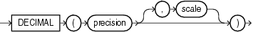

> ```
> decimal ::= 
>  
>   DECIMAL (precision [ , scale ])
> ```
>
> [  
> Copyright © 2002, 2026, Oracle and/or its affiliates.](https://docs.oracle.com/en/database/oracle/oracle-database/dcommon/html/cpyr.htm)


The `precision` parameter is the number of digits in a value. The length of the field in bytes, as computed from digits, is (N+1)/2 rounded up.

The `scale` parameter is the scaling factor, or number of digits to the right of the decimal point. The default is zero (indicating an integer). The scaling factor can be greater than the number of digits but cannot be negative.

Example

The following example loads a number equivalent to +12345.67

```
sal DECIMAL (7,2)
```

In the data record, this field would take up 4 bytes. (The byte length of a `DECIMAL` field is equivalent to (N+1)/2, rounded up, where `N` is the number of digits in the value, and 1 is added for the sign.)

**Parent topic:** Nonportable Data Types

##### 10.4.2.6 DOUBLE

The SQL\*Loader nonportable value data type `DOUBLE` is a double-precision floating-point binary number.

Definition

The length of the `DOUBLE` field is the length of a double-precision, floating-point binary number on your system. (The data type is `DOUBLE` or `LONG FLOAT` in C.) This length cannot be overridden in the control file. If you specify `end` in the `POSITION` clause, then `end` is ignored.

Usage Notes

You can load `DOUBLE` with correct results only between systems where the representation of `DOUBLE` is compatible and of the same length. If the byte order is different between the two systems, then use the appropriate technique to indicate the byte order of the data.

##### 10.4.2.7 FLOAT

The SQL\*Loader nonportable value data type `FLOAT` is a single-precision, floating-point, binary number.

Definition

With `FLOAT` data, the length of the field is the length of a single-precision, floating-point binary number on your system. (The data type is `FLOAT` in C.) This length cannot be overridden in the control file. If you specify `end` in the `POSITION` clause, then `end` is ignored.

Usage Notes

You can load `FLOAT` with correct results only between systems where the representation of `FLOAT` is compatible, and of the same length. If the byte order is different between the two systems, then use the appropriate technique to indicate the byte order of the data.

##### 10.4.2.8 INTEGER(n)

The SQL\*Loader nonportable value data type `INTEGER(n)` is a length-specific integer field.

Definition

The data is a full-word binary integer, where `n` is an optionally supplied length of 1, 2, 4, or 8. If no length specification is given, then the length, in bytes, is based on the size of a `LONG INT` in the C programming language on your particular platform.

Usage Notes

`INTEGER` s are not portable because their byte size, their byte order, and the representation of signed values can be different between systems. However, if the representation of signed values is the same between systems, then it is possible that SQL\*Loader can access `INTEGER` data with correct results. If `INTEGER` is specified with a length specification (`n`), and the appropriate technique is used (if necessary) to indicate the byte order of the data, then SQL\*Loader can access the data with correct results between systems. If `INTEGER` is specified without a length specification, then SQL\*Loader can access the data with correct results only if the size of a `LONG INT` in the C programming language is the same length in bytes on both systems. In that case, the appropriate technique must still be used (if necessary) to indicate the byte order of the data.

Specifying an explicit length for binary integers is useful in situations where the input data was created on a platform whose word length differs from that on which SQL\*Loader is running. For instance, input data containing binary integers might be created on a 64-bit platform and loaded into a database using SQL\*Loader on a 32-bit platform. In this case, use `INTEGER(8)` to instruct SQL\*Loader to process the integers as 8-byte quantities, not as 4-byte quantities.

By default, `INTEGER` is treated as a `SIGNED` quantity. If you want SQL\*Loader to treat it as an unsigned quantity, then specify `UNSIGNED`. To return to the default behavior, specify `SIGNED`.

##### 10.4.2.9 LONG VARRAW

The SQL\*Loader nonportable length-value data type `LONG VARRAW` is a `VARRAW` with a 4-byte length subfield.

Definition

`LONG VARRAW` is a `VARRAW` with a 4-byte length subfield, instead of a 2-byte length subfield.

`LONG VARRAW` results in a `VARRAW` with 4-byte length subfield and a maximum size of 4 KB (that is, the default). `LONG VARRAW(300000)` results in a `VARRAW` with a length subfield of 4 bytes and a maximum size of 300000 bytes.

Usage Notes

Caution:

This feature is deprecated, and can be desupported in a future release.

All forms of `LONG` data types (`LONG`, `LONG RAW`, `LONG VARCHAR`, `LONG VARRAW`) were deprecated in Oracle8i Release 8.1.6. For succeeding releases, the `LONG` data type was provided for backward compatibility with existing applications. In new applications developed with later releases, Oracle strongly recommends that you use `CLOB` and `NCLOB` data types for large amounts of character data.

`LONG VARRAW` fields can be loaded between systems with different byte orders if the appropriate technique is used to indicate the byte order of the length subfield.

##### 10.4.2.10 SMALLINT

The SQL\*Loader nonportable value data type `SMALLINT` is a half-word binary integer.

Definition

The length of a `SMALLINT` field is the length of a half-word integer on your system.

Usage Notes

By default, `SMALLINT` data is treated as a `SIGNED` quantity. If you want SQL\*Loader to treat it as an unsigned quantity, then specify `UNSIGNED`. To return to the default behavior, specify `SIGNED`.

You can load `SMALLINT` data with correct results only between systems where a `SHORT INT` has the same length in bytes. If the byte order is different between the systems, then use the appropriate technique to indicate the byte order of the data.

Note:

This is the `SHORT INT` data type in the C programming language. One way to determine its length is to make a small control file with no data, and look at the resulting log file. This length cannot be overridden in the control file.

##### 10.4.2.11 VARGRAPHIC

The SQL\*Loader nonportable length-value data type VARGRAPHIC is a varying-length, double-byte character set (DBCS).

Definition

VARGRAPHIC data consists of a length subfield followed by a string of double-byte characters. Oracle Database does not support double-byte character sets; however, SQL\*Loader reads them as single bytes, and loads them as `RAW` data. As with `RAW` data, `VARGRAPHIC` fields are stored without modification in whichever column you specify.

Note:

The size of the length subfield is the size of the SQL\*Loader `SMALLINT` data type on your system (C type `SHORT                         INT`).

Syntax

The syntax for the `VARGRAPHIC` data type is:

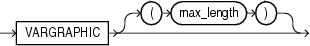

> ```
> vargraphic ::=
>  
>   VARGRAPHIC [ (max_length) ]
> ```
>
> [  
> Copyright © 2002, 2026, Oracle and/or its affiliates.](https://docs.oracle.com/en/database/oracle/oracle-database/dcommon/html/cpyr.htm)


Usage Notes

You can load `VARGRAPHIC` data with correct results only between systems where a `SHORT INT` has the same length in bytes. If the byte order is different between the systems, then use the appropriate technique to indicate the byte order of the length subfield.

The length of the current field is given in the first 2 bytes. A maximum length specified for the `VARGRAPHIC` data type does not include the size of the length subfield. The maximum length specifies the number of graphic (double-byte) characters. It is multiplied by 2 to determine the maximum length of the field in bytes.

The default maximum field length is 2 KB graphic characters, or 4 KB (2 times 2KB). To minimize memory requirements, specify a maximum length for such fields whenever possible.

If a position specification is specified (using `pos_spec`) before the `VARGRAPHIC` statement, then it provides the location of the length subfield, not of the first graphic character. If you specify `pos_spec` `(start:end),` then the end location determines a maximum length for the field. Both `start` and `end` identify single-character (byte) positions in the file. `Start` is subtracted from `(end + 1)` to give the length of the field in bytes. If a maximum length is specified, then it overrides any maximum length calculated from the position specification.

If a `VARGRAPHIC` field is truncated by the end of the logical record before its full length is read, then a warning is issued. Because the length of a `VARGRAPHIC` field is embedded in every occurrence of the input data for that field, it is assumed to be accurate.

`VARGRAPHIC` data cannot be delimited.

##### 10.4.2.12 VARCHAR

The SQL\*Loader nonportable length-value data type `VARCHAR` is a binary length subfield followed by a character string of the specified length.

Definition

A `VARCHAR` field is a length-value data type. It consists of a binary length subfield followed by a character string of the specified length. The length is in bytes unless character-length semantics are used for the data file. In that case, the length is in characters.

Note:

The size of the length subfield is the size of the SQL\*Loader `SMALLINT` data type on your system (C type `SHORT                         INT`).

Syntax

The syntax for the `VARCHAR` data type is:

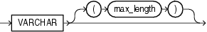

> ```
> varchar ::= 
>  
>   VARCHAR [ (max_length) ]
> ```
>
> [  
> Copyright © 2002, 2026, Oracle and/or its affiliates.](https://docs.oracle.com/en/database/oracle/oracle-database/dcommon/html/cpyr.htm)


Usage Notes

`VARCHAR` fields can be loaded with correct results only between systems where a `SHORT ` data field `INT` has the same length in bytes. If the byte order is different between the systems, or if the `VARCHAR` field contains data in the UTF16 character set, then use the appropriate technique to indicate the byte order of the length subfield and of the data. The byte order of the data is only an issue for the UTF16 character set.

A maximum length specified in the control file does not include the size of the length subfield. If you specify the optional maximum length for a `VARCHAR` data type, then a buffer of that size, in bytes, is allocated for these fields. However, if character-length semantics are used for the data file, then the buffer size in bytes is the `max_length` times the size in bytes of the largest possible character in the character set.

The default maximum size is 4 KB. Specifying the smallest maximum length that is needed to load your data can minimize SQL\*Loader's memory requirements, especially if you have many `VARCHAR` fields.

The `POSITION` clause, if used, gives the location, in bytes, of the length subfield, not of the first text character. If you specify `POSITION(start:end)`, then the end location determines a maximum length for the field. `Start` is subtracted from `(end + 1)` to give the length of the field in bytes. If a maximum length is specified, then it overrides any length calculated from `POSITION`.

If a `VARCHAR` field is truncated by the end of the logical record before its full length is read, then a warning is issued. Because the length of a `VARCHAR` field is embedded in every occurrence of the input data for that field, it is assumed to be accurate.

`VARCHAR` data cannot be delimited.

##### 10.4.2.13 VARRAW

The SQL\*Loader nonportable length-value data type `VARROW` is a 2-byte binary length subfield, and a `RAW` string value subfield.

Definition

`VARRAW` is made up of a 2-byte binary length subfield followed by a `RAW` string value subfield.

`VARRAW` results in a `VARRAW` with a 2-byte length subfield and a maximum size of 4 KB (that is, the default). `VARRAW(65000)` results in a `VARRAW` with a length subfield of 2 bytes and a maximum size of 65000 bytes.

Usage Notes

You can load `VARRAW` fields between systems with different byte orders if the appropriate technique is used to indicate the byte order of the length subfield.

##### 10.4.2.14 ZONED

The SQL\*Loader nonportable value data type ZONED is in zoned decimal format.

Definition

`ZONED` data is in zoned decimal format: a string of decimal digits, one per byte, with the sign included in the last byte. (In COBOL, this is a `SIGN TRAILING` field.) The length of this field equals the precision (number of digits) that you specify.

Syntax

The syntax for the `ZONED` data type is as follows:

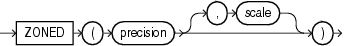

> ```
> zoned ::= 
>  
>   ZONED (precision [, scale])
> ```
>
> [  
> Copyright © 2002, 2026, Oracle and/or its affiliates.](https://docs.oracle.com/en/database/oracle/oracle-database/dcommon/html/cpyr.htm)


In this syntax, `precision` is the number of digits in the number, and `scale` (if given) is the number of digits to the right of the (implied) decimal point.

Example

The following example specifies an 8-digit integer starting at position 32:

```
sal  POSITION(32)  ZONED(8),
```

When the zoned data is generated on an ASCII-based platform, Oracle Database uses the VAX/VMS zoned decimal format. It is also possible to load zoned decimal data that is generated on an EBCDIC-based platform. In this case, Oracle Database uses the IBM format,as specified in the manual ESA/390 Principles of Operations, version 8.1. The format that is used depends on the character set encoding of the input data file.

#### 10.4.3 Portable Data Types

Use this reference to understand how to use the portable data types with SQL\*Loader.

The portable data types are grouped into value data types and length-value data types. The portable value data types are `CHAR`, Datetime and Interval, `GRAPHIC`, `GRAPHIC EXTERNAL`, Numeric `EXTERNAL (INTEGER, FLOAT, DECIMAL, ZONE)`, and `RAW`.

The portable length-value data types are `VARCHARC` and `VARRAWC`.

The syntax for these data types is shown in the diagram for [datatype\_spec](oracle-sql-loader-syntax-diagrams.md).

- Categories of Portable Data Types  
	Portable data types are grouped into **value data types**, **length-value data types**, and **character data types**.
- CHAR  
	The SQL\*Loader portable value data type `CHAR` contains character data.
- Datetime and Interval  
	The SQL\*Loader portable value datatime data types (**datetime**) and interval data types ( intervals) are fields that record dates and time intervals.
- GRAPHIC  
	The SQL\*Loader portable value data type `GRAPHIC` has the data in the form of a double-byte character set (DBCS).
- GRAPHIC EXTERNAL  
	The SQL\*Loader portable value data type `GRAPHIC EXTERNAL` specifies graphic data loaded from external tables.
- Numeric EXTERNAL  
	The SQL\*Loader portable value numeric `EXTERNAL` data types are human-readable, character form data.
- RAW  
	The SQL\*Loader portable value `RAW` specifies a load of raw binary data.
- VARCHARC  
	The portable length-value data type `VARCHARC` specifies character string lengths and sizes
- VARRAWC  
	The portable length-value data type `VARRAWC` consists of a `RAW` string value subfield.
- Conflicting Native Data Type Field Lengths  
	If you are loading different data types, then learn what rules SQL\*Loader follows to manage conflicts in field length specifications.
- Field Lengths for Length-Value Data Types  
	The field lengths for length-value SQL\*Loader portable data types such as `VARCHAR`, `VARCHARC`, `VARGRAPHIC`, `VARRAW`, and `VARRAWC` is in bytes or characters.

**Parent topic:** SQL\*Loader Data Types

##### 10.4.3.1 Categories of Portable Data Types

Portable data types are grouped into **value data types**, **length-value data types**, and **character data types**.

The portable value data types are:

- `CHAR`
- Datetime and Interval
- `GRAPHIC`
- `GRAPHIC EXTERNAL`
- Numeric `EXTERNAL (INTEGER, FLOAT, DECIMAL, ZONE)`
- `RAW`

The portable length-value data types are:

- `VARCHARC`
- `VARRAWC`

The character data types are:

- `CHAR`
- `DATE`
- numeric `EXTERNAL`

These fields can be delimited, and can have lengths (or maximum lengths) specified in the control file.

To better understand the syntax for nonportable data types, refer to the syntax diagram for `datatype_spec`.

##### 10.4.3.2 CHAR

The SQL\*Loader portable value data type `CHAR` contains character data.

Definition

The data field contains character data. The length, which is optional, is a maximum length. Note the following regarding length:

Syntax

The syntax for the `CHAR` data type is:

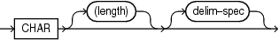

> char::=CHAR \[(length)\] \[delim\_spec\]
>
> [  
> Copyright © 2002, 2026, Oracle and/or its affiliates.](https://docs.oracle.com/en/database/oracle/oracle-database/dcommon/html/cpyr.htm)


Usage Notes

- If you do not specify a `CHAR` field length, then the `CHAR` field length is derived from the `POSITION` specification.
- If you specify a `CHAR` field length, then it overrides the length in the `POSITION` specification.
- If you neither specify a `CHAR` field length, nor have a `POSITION` specification, then `CHAR` data is assumed to have a length of 1, unless the field is delimited:
	- For a delimited `CHAR` field, if a length is specified, then that length is used as a maximum.
		- For a delimited `CHAR` field for which no length is specified, the default is 255 bytes.
		- For a delimited `CHAR` field that is greater than 255 bytes, you must specify a maximum length. Otherwise you will receive an error stating that the field in the data file exceeds maximum length.

##### 10.4.3.3 Datetime and Interval

The SQL\*Loader portable value datatime data types (**datetime**) and interval data types ( intervals) are fields that record dates and time intervals.

- Categories of Datetime and Interval Data Types  
	The SQL\*Loader portable value datetime records date and time fields, and the interval data types record time intervals.
- DATE  
	The SQL\*Loader datetime data type `DATE` field contains character data defining a specified date.
- TIME  
	The SQL\*Loader datetime data type `TIME` stores hour, minute, and second values.
- TIME WITH TIME ZONE  
	The SQL\*Loader datetime data type `TIME WITH TIME ZONE` is a variant of `TIME` that includes a time zone displacement in its value.
- TIMESTAMP  
	The SQL\*Loader datetime data type `TIMESTAMP` is an extension of the `DATE` data type.
- TIMESTAMP WITH TIME ZONE  
	The SQL\*Loader datetime data type `TIMESTAMP WITH TIME ZONE` is a variant of `TIMESTAMP` that includes a time zone displacement in its value.
- TIMESTAMP WITH LOCAL TIME ZONE  
	The SQL\*Loader datetime data type `TIMESTAMP WITH LOCAL TIME             ZONE` is another variant of `TIMESTAMP` that includes a time zone offset in its value.
- INTERVAL YEAR TO MONTH  
	The SQL\*Loader interval data type `INTERVAL YEAR TO MONTH` stores a period of time.
- INTERVAL DAY TO SECOND  
	The SQL\*Loader interval data type `INTERVAL DAY TO SECOND` stores a period of time using the `DAY` and `SECOND` datetime fields.

**Parent topic:** Portable Data Types

###### 10.4.3.3.1 Categories of Datetime and Interval Data Types

The SQL\*Loader portable value datetime records date and time fields, and the interval data types record time intervals.

Definition

Both datetimes and intervals are made up of fields. The values of these fields determine the value of the data type.

The datetime data types are:

- `DATE`
- `TIME`
- `TIME WITH TIME ZONE`
- `TIMESTAMP`
- `TIMESTAMP WITH TIME ZONE`
- `TIMESTAMP WITH LOCAL TIME ZONE`

The interval data types are:

- `INTERVAL YEAR TO MONTH`
- `INTERVAL DAY TO SECOND`

Usage Notes

Values of datetime data types are sometimes called **datetimes**. Except for `DATE`, you are allowed to optionally specify a value for `fractional_second_precision`. The `fractional_second_precision` specifies the number of digits stored in the fractional part of the `SECOND` datetime field. When you create a column of this data type, the value can be a number in the range 0 to 9. The default is 6.

Values of interval data types are sometimes called **intervals**. The `INTERVAL YEAR TO MONTH` data type gives you the option to specify a value for `year_precision`. The `year_precision` value is the number of digits in the `YEAR` datetime field. The default value is 2.

The `INTERVAL DAY TO SECOND` data type gives you the option to specify values for `day_precision` and `fractional_second_precision`. The `day_precision` is the number of digits in the `DAY` datetime field. Accepted values are 0 to 9. The default is 2. The `fractional_second_precision` specifies the number of digits stored in the fractional part of the `SECOND` datetime field. When you create a column of this data type, the value can be a number in the range 0 to 9. The default is 6.

###### 10.4.3.3.2 DATE

The SQL\*Loader datetime data type `DATE` field contains character data defining a specified date.

Syntax

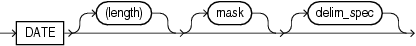

> ```
> date ::=
>  
> DATE [(length)] [mask] [delim_spec]
> ```
>
> [  
> Copyright © 2002, 2026, Oracle and/or its affiliates.](https://docs.oracle.com/en/database/oracle/oracle-database/dcommon/html/cpyr.htm)


Usage Notes

The `DATE` field contains character data that should be converted to an Oracle date using the specified date mask.

The length specification is optional, unless a varying-length date mask is specified. The length is in bytes unless character-length semantics are used for the data file. In that case, the length is in characters.

If an explicit length is not specified, then it can be derived from the `POSITION` clause. Oracle recommends that you specify the length whenever you use a mask, unless you are absolutely sure that the length of the data is less than, or equal to, the length of the mask.

An explicit length specification, if present, overrides the length in the `POSITION` clause. Either of these specifications overrides the length derived from the mask. The mask can be any valid Oracle date mask. If you omit the mask, then the default Oracle date mask of "dd-mon-yy" is used.

The length must be enclosed in parentheses, and the mask in quotation marks.

You can also specify a field of data type `DATE` using delimiters.

Example

```
LOAD DATA 
INTO TABLE dates (col_a POSITION (1:15) DATE "DD-Mon-YYYY") 
BEGINDATA 
1-Jan-2012
1-Apr-2012 28-Feb-2012
```

Unless delimiters are present, whitespace is ignored and dates are parsed from left to right. (A `DATE` field that consists entirely of whitespace is loaded as a `NULL` field.)

In the preceding example, the date mask, `"DD-Mon-YYYY"` contains 11 bytes, with byte-length semantics. Therefore, SQL\*Loader expects a maximum of 11 bytes in the field, so the specification works properly. But, suppose a specification such as the following is given:

```
DATE "Month dd, YYYY"
```

In this case, the date mask contains 14 bytes. If a value with a length longer than 14 bytes is specified, such as `"September 30, 2012"`, then a length must be specified.

Similarly, a length is required for any Julian dates (date mask "J"). A field length is required any time the length of the date string could exceed the length of the mask (that is, the count of bytes in the mask).

###### 10.4.3.3.3 TIME

The SQL\*Loader datetime data type `TIME` stores hour, minute, and second values.

Syntax

```
TIME [(fractional_second_precision)]
```

**Parent topic:** Datetime and Interval

###### 10.4.3.3.4 TIME WITH TIME ZONE

The SQL\*Loader datetime data type `TIME WITH TIME ZONE` is a variant of `TIME` that includes a time zone displacement in its value.

Definition

The time zone displacement is the difference (in hours and minutes) between local time and UTC (coordinated universal time, formerly Greenwich mean time).

Syntax

```
TIME [(fractional_second_precision)] WITH [LOCAL] TIME ZONE
```

If the `LOCAL` option is specified, then data stored in the database is normalized to the database time zone, and time zone displacement is not stored as part of the column data. When the data is retrieved, it is returned in the user's local session time zone.

**Parent topic:** Datetime and Interval

###### 10.4.3.3.5 TIMESTAMP

The SQL\*Loader datetime data type `TIMESTAMP` is an extension of the `DATE` data type.

Definition

It stores the year, month, and day of the `DATE` data type, plus the hour, minute, and second values of the `TIME` data type.

Syntax

```
TIMESTAMP [(fractional_second_precision)]
```

If you specify a date value without a time component, then the default time is 12:00:00 a.m. (midnight).

**Parent topic:** Datetime and Interval

###### 10.4.3.3.6 TIMESTAMP WITH TIME ZONE

The SQL\*Loader datetime data type `TIMESTAMP WITH TIME ZONE` is a variant of `TIMESTAMP` that includes a time zone displacement in its value.

Definition

The time zone displacement is the difference (in hours and minutes) between local time and UTC (coordinated universal time, formerly Greenwich mean time).

Syntax

```
TIMESTAMP [(fractional_second_precision)] WITH TIME ZONE
```

**Parent topic:** Datetime and Interval

###### 10.4.3.3.7 TIMESTAMP WITH LOCAL TIME ZONE

The SQL\*Loader datetime data type `TIMESTAMP WITH LOCAL TIME             ZONE` is another variant of `TIMESTAMP` that includes a time zone offset in its value.

Definition

Data stored in the database is normalized to the database time zone, and time zone displacement is not stored as part of the column data. When the data is retrieved, it is returned in the user's local session time zone.

Syntax

It is specified as follows:

```
TIMESTAMP [(fractional_second_precision)] WITH LOCAL TIME ZONE
```

**Parent topic:** Datetime and Interval

###### 10.4.3.3.8 INTERVAL YEAR TO MONTH

The SQL\*Loader interval data type `INTERVAL YEAR TO MONTH` stores a period of time.

Definintion

`INTERVAL YEAR TO MONTH` stores a period of time by using the `YEAR` and `MONTH` datetime fields.

Syntax

```
INTERVAL YEAR [(year_precision)] TO MONTH
```

**Parent topic:** Datetime and Interval

###### 10.4.3.3.9 INTERVAL DAY TO SECOND

The SQL\*Loader interval data type `INTERVAL DAY TO SECOND` stores a period of time using the `DAY` and `SECOND` datetime fields.

Definition

The `INTERVAL DAY TO SECOND` data type stores a period of time using the `DAY` and `SECOND` datetime fields.

Syntax

```
INTERVAL DAY [(day_precision)] TO SECOND [(fractional_second_precision)]
```

**Parent topic:** Datetime and Interval

##### 10.4.3.4 GRAPHIC

The SQL\*Loader portable value data type `GRAPHIC` has the data in the form of a double-byte character set (DBCS).

Definition

the `GRAPHIC` data type specifies graphic data:

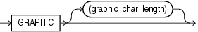

> ```
> graphic ::=
>  
> GRAPHIC [(graphic_char_length)]
> ```
>
> [  
> Copyright © 2002, 2026, Oracle and/or its affiliates.](https://docs.oracle.com/en/database/oracle/oracle-database/dcommon/html/cpyr.htm)


Usage Notes

The data in `GRAPHIC` is in the form of a double-byte character set (DBCS). Oracle Database does not support double-byte character sets; however, SQL\*Loader reads them as single bytes. As with `RAW` data, `GRAPHIC` fields are stored without modification in whichever column you specify.

For `GRAPHIC` and `GRAPHIC EXTERNAL`, specifying `POSITION (start:end)` gives the exact location of the field in the logical record.

If you specify a length for the `GRAPHIC (EXTERNAL)` data type, however, then you give the number of double-byte graphic characters. That value is multiplied by 2 to find the length of the field in bytes. If the number of graphic characters is specified, then any length derived from `POSITION` is ignored. No delimited data field specification is allowed with `GRAPHIC` data type specification.

**Parent topic:** Portable Data Types

##### 10.4.3.5 GRAPHIC EXTERNAL

The SQL\*Loader portable value data type `GRAPHIC EXTERNAL` specifies graphic data loaded from external tables.

Description

`GRAPHIC` indicates that the data is double-byte characters (DBCA). `EXTERNAL` indicates that the first and last characters are ignored.

If the DBCS field is surrounded by shift-in and shift-out characters, then use `GRAPHIC EXTERNAL`. This is identical to `GRAPHIC`, except that the first and last characters (the shift-in and shift-out) are not loaded.

Syntax

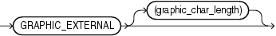

> ```
> graphic_ext ::=
>  
> GRAPHIC EXTERNAL [(graphic_char_length)]
> ```
>
> [  
> Copyright © 2002, 2026, Oracle and/or its affiliates.](https://docs.oracle.com/en/database/oracle/oracle-database/dcommon/html/cpyr.htm)


`GRAPHIC` indicates that the data is double-byte characters. `EXTERNAL` indicates that the first and last characters are ignored. The `graphic_char_length` value specifies the length in DBCS.

Example

To see how GRAPHIC EXTERNAL works, let `[ ]` represent shift-in and shift-out characters, and let `#` represent any double-byte character.

To describe `####`, use `POSITION(1:4)                     GRAPHIC` or `POSITION(1) GRAPHIC(2)`.

To describe `[####]`, use `POSITION(1:6) GRAPHIC                     EXTERNAL` or `POSITION(1) GRAPHIC EXTERNAL(2)`.

##### 10.4.3.6 Numeric EXTERNAL

The SQL\*Loader portable value numeric `EXTERNAL` data types are human-readable, character form data.

Definition

The numeric `EXTERNAL` data types are the numeric data types (`INTEGER, FLOAT,` `DECIMAL,` and `ZONED`) specified as `EXTERNAL`, with optional length and delimiter specifications. The length is in bytes unless character-length semantics are used for the data file. In that case, the length is in characters.

These data types are the human-readable, character form of numeric data. The same rules that apply to `CHAR` data regarding length, position, and delimiters apply to numeric `EXTERNAL` data. Refer to `CHAR` for a complete description of these rules.

The syntax for the numeric `EXTERNAL` data types is shown as part of the `datatype_spec ` SQL\*Loader data syntax.

`FLOAT EXTERNAL` data can be given in either scientific or regular notation. Both "5.33" and "533E-2" are valid representations of the same value.

Note:

The data is a number in character form, not binary representation. Therefore, these data types are identical to `CHAR` and are treated identically, except for the use of `DEFAULTIF`. If you want the default to be null, then use `CHAR`; if you want it to be zero, then use `EXTERNAL`.

##### 10.4.3.7 RAW

The SQL\*Loader portable value `RAW` specifies a load of raw binary data.

Description

When raw, binary data is loaded "as is" into a `RAW` database column, it is not converted when it is place into Oracle Database files.

If the data is loaded into a `CHAR` column, then Oracle Database converts it to hexadecimal. It cannot be loaded into a `DATE` or number column.

Syntax

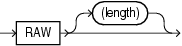

> raw::=RAW \[(length)\]
>
> [  
> Copyright © 2002, 2026, Oracle and/or its affiliates.](https://docs.oracle.com/en/database/oracle/oracle-database/dcommon/html/cpyr.htm)


The length of this field is the number of bytes specified in the control file. This length is limited only by the length of the target column in the database and by memory resources. The length is always in bytes, even if character-length semantics are used for the data file. `RAW` data fields cannot be delimited.

**Parent topic:** Portable Data Types

##### 10.4.3.8 VARCHARC

The portable length-value data type `VARCHARC` specifies character string lengths and sizes

Description

The SQL\*Loader data type `VARCHARC` consists of a character length subfield followed by a character string value-subfield.

Syntax

```
VARCHARC(character_length,character_string)
```

Usage Notes

The declaration for `VARCHARC` specifies the length of the length subfield, optionally followed by the maximum size of any string. If byte-length semantics are in use for the data file, then the length and the maximum size are both in bytes. If character-length semantics are in use for the data file, then the length and maximum size are in characters. If a maximum size is not specified, then 4 KB is the default regardless of whether byte-length semantics or character-length semantics are in use.

For example:

- `VARCHARC` results in an error because you must at least specify a value for the length subfield.
- `VARCHARC(7)` results in a `VARCHARC` whose length subfield is 7 bytes long and whose maximum size is 4 KB (the default) if byte-length semantics are used for the data file. If character-length semantics are used, then it results in a `VARCHARC` with a length subfield that is 7 characters long and a maximum size of 4 KB (the default). Remember that when a maximum size is not specified, the default of 4 KB is always used, regardless of whether byte-length or character-length semantics are in use.
- `VARCHARC(3,500)` results in a `VARCHARC` whose length subfield is 3 bytes long and whose maximum size is 500 bytes if byte-length semantics are used for the data file. If character-length semantics are used, then it results in a `VARCHARC` with a length subfield that is 3 characters long and a maximum size of 500 characters.

Example

```
CREATE TABLE emp_load
             (first_name CHAR(15),
              last_name CHAR(20),
              resume CHAR(2000),
              picture RAW (2000))
  ORGANIZATION EXTERNAL
  (TYPE ORACLE_LOADER
    DEFAULT DIRECTORY ext_tab_dir
    ACCESS PARAMETERS
      (FIELDS (first_name VARCHARC(5,12),
               last_name VARCHARC(2,20),
               resume VARCHARC(4,10000),
               picture VARRAWC(4,100000)))
  LOCATION ('info.dat'));

00007William05Ricca0035Resume for William Ricca is missing0000
```

##### 10.4.3.9 VARRAWC

The portable length-value data type `VARRAWC` consists of a `RAW` string value subfield.

Description

The `VARRAWC` data type has a character count field, followed by binary data.

Syntax

```
VARRAWC(character_length,binary_data)
```

Usage Notes

- `VARRAWC` results in an error.
- `VARRAWC(7)` results in a `VARRAWC` whose length subfield is 7 bytes long and whose maximum size is 4 KB (that is, the default).
- `VARRAWC(3,500)` results in a `VARRAWC` whose length subfield is 3 bytes long and whose maximum size is 500 bytes.

Example

In the following example, `VARRAWC`. The length of the `picture` field is 0, which means the field is set to `NULL`.

```
CREATE TABLE emp_load
             (first_name CHAR(15),
              last_name CHAR(20),
              resume CHAR(2000),
              picture RAW (2000))
  ORGANIZATION EXTERNAL
  (TYPE ORACLE_LOADER
    DEFAULT DIRECTORY ext_tab_dir
    ACCESS PARAMETERS
      (FIELDS (first_name VARCHARC(5,12),
               last_name VARCHARC(2,20),
               resume VARCHARC(4,10000),
               picture VARRAWC(4,100000)))
  LOCATION ('info.dat'));

00007William05Ricca0035Resume for William Ricca is missing0000
```

##### 10.4.3.10 Conflicting Native Data Type Field Lengths

If you are loading different data types, then learn what rules SQL\*Loader follows to manage conflicts in field length specifications.

There are several ways to specify a length for a field. If multiple lengths are specified and they conflict, then one of the lengths takes precedence. A warning is issued when a conflict exists. The following rules determine which field length is used:

1. The size of `SMALLINT`, `FLOAT`, and `DOUBLE` data is fixed, regardless of the number of bytes specified in the `POSITION` clause.
2. If the length (or precision) specified for a `DECIMAL`, `INTEGER`, `ZONED`, `GRAPHIC`, `GRAPHIC EXTERNAL`, or `RAW` field conflicts with the size calculated from a `POSITION(start:end)` specification, then the specified length (or precision) is used.
3. If the maximum size specified for a character or `VARGRAPHIC` field conflicts with the size calculated from a `POSITION(start:end)` specification, then the specified maximum is used.

For example, assume that the native data type `INTEGER` is 4 bytes long and the following field specification is given:

```
column1 POSITION(1:6) INTEGER
```

In this case, a warning is issued, and the proper length (4) is used. The log file shows the actual length used under the heading "Len" in the column table:

```
Column Name             Position   Len  Term Encl Data Type 
----------------------- --------- ----- ---- ---- --------- 
COLUMN1                       1:6     4             INTEGER
```

**Parent topic:** Portable Data Types

##### 10.4.3.11 Field Lengths for Length-Value Data Types

The field lengths for length-value SQL\*Loader portable data types such as `VARCHAR`, `VARCHARC`, `VARGRAPHIC`, `VARRAW`, and `VARRAWC` is in bytes or characters.

A control file can specify a maximum length for the following length-value data types: `VARCHAR`, `VARCHARC`, `VARGRAPHIC`, `VARRAW`, and `VARRAWC`. The specified maximum length is in bytes if byte-length semantics are used for the field, and in characters if character-length semantics are used for the field. If no length is specified, then the maximum length defaults to 4096 bytes. If the length of the field exceeds the maximum length, then the record is rejected with the following error:

```
Variable length field exceed maximum length
```

**Parent topic:** Portable Data Types

#### 10.4.4 Data Type Conversions

SQL\*Loader can perform most data type conversions automatically, but to avoid errors, you need to understand conversion rules.

The data type specifications in the control file tell SQL\*Loader how to interpret the information in the data file. The server defines the data types for the columns in the database. The link between these two is the column name specified in the control file.

SQL\*Loader extracts data from a field in the input file, guided by the data type specification in the control file. SQL\*Loader then sends the field to the server to be stored in the appropriate column (as part of an array of row inserts).

SQL\*Loader or the server does any necessary data conversion to store the data in the proper internal format. This includes converting data from the data file character set to the database character set when they differ.

Note:

When you use SQL\*Loader conventional path to load character data from the data file into a `LONG RAW` column, the character data is interpreted has a HEX string. SQL converts the HEX string into its binary representation. Be aware that any string longer than 4000 bytes exceeds the byte limit for the SQL `HEXTORAW` conversion operator. If a string is longer than the byte limit, then an error is returned. SQL\*Loader rejects the row with an error, and continues loading.

The data type of the data in the file does not need to be the same as the data type of the column in the Oracle Database table. Oracle Database automatically performs conversions. However, you need to ensure that the conversion makes sense, and does not generate errors. For instance, when a data file field with data type `CHAR` is loaded into a database column with data type `NUMBER`, you must ensure that the contents of the character field represent a valid number.

Note:

SQL\*Loader does not contain data type specifications for Oracle internal data types, such as `NUMBER` or `VARCHAR2`. The SQL\*Loader data types describe data that can be produced with text editors (character data types) and with standard programming languages (native data types). However, although SQL\*Loader does not recognize data types such as `NUMBER` and `VARCHAR2`, any data that Oracle Database can convert can be loaded into these or other database columns.

**Parent topic:** SQL\*Loader Data Types

#### 10.4.5 Data Type Conversions for Datetime and Interval Data Types

Learn which conversions between Oracle Database data types and SQL\*Loader control file datetime and interval data types are supported, and which are not.

How to Read the Data Type Conversions for Datetime and Interval Data Types

In the table, the abbreviations for the Oracle Database data types are as follows:

- N = `NUMBER`
- C = `CHAR` or `VARCHAR2`
- D = `DATE`
- T = `TIME` and `TIME WITH TIME ZONE`
- TS = ` TIMESTAMP` and `TIMESTAMP` `WITH` `TIME` `ZONE`
- YM = `INTERVAL YEAR TO MONTH`
- DS = `INTERVAL DAY TO SECOND`

For the SQL\*Loader data types, the definitions for the abbreviations in the table are the same for D, T, TS, YM, and DS. SQL\*Loader does not contain data type specifications for Oracle Database internal data types, such as `NUMBER`, `CHAR`, and `VARCHAR2`. However, any data that Oracle database can convert can be loaded into these or into other database columns.

For an example of how to read this table, look at the row for the SQL\*Loader data type `DATE` (abbreviated as D). Reading across the row, you can see that data type conversion is supported for the Oracle database data types of `CHAR`, `VARCHAR2`, `DATE`, `TIMESTAMP`, and `TIMESTAMP WITH TIME ZONE` data types. However, conversion is not supported for the Oracle Database data types `NUMBER`, `TIME`, `TIME WITH TIME                     ZONE`, `INTERVAL YEAR TO MONTH`, or `INTERVAL DAY                     TO SECOND` data types.

Table 10-2 Data Type Conversions for Datetime and Interval Data Types

| SQL\*Loader Data Type | Oracle Database Data Type (Conversion Support) |
| --- | --- |
| N | N (Yes), C (Yes), D (No), T (No), TS (No), YM (No), DS (No) |
| C | N (Yes), C (Yes), D (Yes), T (Yes), TS (Yes), YM (Yes), DS (Yes) |
| D | N (No), C (Yes), D (Yes), T (No), TS (Yes), YM (No), DS (No) |
| T | N (No), C (Yes), D (No), T (Yes), TS (Yes), YM (No), DS (No) |
| TS | N (No), C (Yes), D (Yes), T (Yes), TS (Yes), YM (No), DS (No) |
| YM | N (No), C (Yes), D (No), T (No), TS (No), YM (Yes), DS (No) |
| DS | N (No), C (Yes), D (No), T (No), TS (No), YM (No), DS (Yes) |

**Parent topic:** SQL\*Loader Data Types

#### 10.4.6 Specifying Delimiters

The boundaries of `CHAR`, datetime, interval, or numeric `EXTERNAL` fields can also be marked by delimiter characters contained in the input data record.

The delimiter characters are specified using various combinations of the `TERMINATED BY`, `ENCLOSED BY`, and `OPTIONALLY ENCLOSED BY` clauses (the `TERMINATED BY` clause, if used, must come first). The delimiter specification comes after the data type specification.

For a description of how data is processed when various combinations of delimiter clauses are used, see How Delimited Data Is Processed.

Note:

The `RAW` data type can also be marked by delimiters, but only if it is in an input LOBFILE, and only if the delimiter is `TERMINATED BY EOF` (end of file).

- Syntax for Termination and Enclosure Specification  
	The syntax for termination and enclosure specifications is described here.
- Delimiter Marks in the Data  
	Sometimes the punctuation mark that is a delimiter must also be included in the data.
- Maximum Length of Delimited Data  
	Delimited fields can require significant amounts of storage for the bind array.
- Loading Trailing Blanks with Delimiters  
	You can load trailing blanks by specifying `PRESERVE BLANKS`, or you can declare data fields with delimiters, and add delimiters to the data files.

**Parent topic:** SQL\*Loader Data Types

##### 10.4.6.1 Syntax for Termination and Enclosure Specification

The syntax for termination and enclosure specifications is described here.

Purpose

Specifying delimiter characters in the input data record.

Syntax

The following diagram shows the syntax for `termination_spec`.


> ```
> terminat ::= 
>  
>   TERMINATED [BY] { WHITESPACE | X'hexstr' | 'string' | EOF }
> ```
>
> [  
> Copyright © 2002, 2026, Oracle and/or its affiliates.](https://docs.oracle.com/en/database/oracle/oracle-database/dcommon/html/cpyr.htm)


The following diagram shows the syntax for `enclosure_spec`.

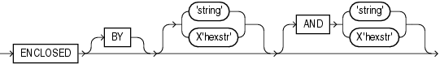

> ```
> enclose ::= 
>  
>   ENCLOSED [BY] [ 'string' | X'hexstr' ] [AND] [ 'string' | X'hexstr' ]
> ```
>
> [  
> Copyright © 2002, 2026, Oracle and/or its affiliates.](https://docs.oracle.com/en/database/oracle/oracle-database/dcommon/html/cpyr.htm)


The following table describes the syntax for the termination and enclosure specifications used to specify delimiters.

Parameters

Table 10-3 Parameters Used for Specifying Delimiters

| Parameter | Description |
| --- | --- |
| `TERMINATED` | Data is read until the first occurrence of a delimiter. |
| `BY` | An optional word to increase readability. |
| `WHITESPACE` | Delimiter is any whitespace character including spaces, tabs, blanks, line feeds, form feeds, or carriage returns. (Only used with `TERMINATED`, not with `ENCLOSED`.) |
| `OPTIONALLY` | Data can be enclosed by the specified character. If SQL\*Loader finds a first occurrence of the character, then it reads the data value until it finds the second occurrence. If the data is not enclosed, then the data is read as a terminated field. If you specify an optional enclosure, then you must specify a `TERMINATED BY` clause (either locally in the field definition or globally in the `FIELDS` clause). |
| `ENCLOSED` | The data is enclosed between two delimiters. |
| `string` | The delimiter is a string. |
| `X'hexstr` ' | The delimiter is a string that has the value specified by `X'hexstr'` in the character encoding scheme, such as X'1F' (equivalent to 31 decimal). "X" can be either lowercase or uppercase. |
| `AND` | Specifies a trailing enclosure delimiter that may be different from the initial enclosure delimiter. If `AND` is not present, then the initial and trailing delimiters are assumed to be the same. |
| `EOF` | Indicates that the entire file has been loaded into the LOB. This is valid only when data is loaded from a LOB file. Fields terminated by `EOF` cannot be enclosed. |

Examples

The following is a set of examples of terminations and enclosures, with examples of the data that they describe:

```
TERMINATED BY ','                      a data string, 
ENCLOSED BY '"'                        "a data string" 
TERMINATED BY ',' ENCLOSED BY '"'      "a data string", 
ENCLOSED BY '(' AND ')'                (a data string)
```

**Parent topic:** Specifying Delimiters

##### 10.4.6.2 Delimiter Marks in the Data

Sometimes the punctuation mark that is a delimiter must also be included in the data.

To make that possible, two adjacent delimiter characters are interpreted as a single occurrence of the character, and this character is included in the data. For example, this data:

```
(The delimiters are left parentheses, (, and right parentheses, )).)
```

with this field specification:

```
ENCLOSED BY "(" AND ")"
```

puts the following string into the database:

```
The delimiters are left parentheses, (, and right parentheses, ).
```

For this reason, problems can arise when adjacent fields use the same delimiters. For example, with the following specification:

```
field1 TERMINATED BY "/" 
field2 ENCLOSED by "/"
```

the following data will be interpreted properly:

```
This is the first string/      /This is the second string/
```

But if `field1` and `field2` were adjacent, then the results would be incorrect, because

```
This is the first string//This is the second string/
```

would be interpreted as a single character string with a "/" in the middle, and that string would belong to `field1`.

**Parent topic:** Specifying Delimiters

##### 10.4.6.3 Maximum Length of Delimited Data

Delimited fields can require significant amounts of storage for the bind array.

The default maximum length of delimited data is 255 bytes. Therefore, delimited fields can require significant amounts of storage for the bind array. A good policy is to specify the smallest possible maximum value if the fields are shorter than 255 bytes. If the fields are longer than 255 bytes, then you must specify a maximum length for the field, either with a length specifier or with the `POSITION` clause.

For example, if you have a string literal that is longer than 255 bytes, then in addition to using `SUBSTR()`, use ` CHAR()` to specify the longest string in any record for the field. An example of how this would look is as follows, assuming that 600 bytes is the longest string in any record for `field1`:

```
field1 CHAR(600) SUBSTR(:field, 1, 240)
```

**Parent topic:** Specifying Delimiters

##### 10.4.6.4 Loading Trailing Blanks with Delimiters

You can load trailing blanks by specifying `PRESERVE BLANKS`, or you can declare data fields with delimiters, and add delimiters to the data files.

By default, trailing blanks in nondelimited data types are not loaded unless you specify `PRESERVE BLANKS` in the control file.

If a data field is 9 characters long, and contains the value `DANIELbbb`, where `bbb` is three blanks, then it is loaded into Oracle Database as `"DANIEL"` " if declared as `CHAR(9)`, without a delimiter.

To include the trailing blanks with a delimiter, declare the data field as `CHAR(9) TERMINATED BY ':'`, and add a colon to the data file, so that the field is `DANIELbbb:`. As a result of this change, the field is loaded as `"DANIEL   "`, with the trailing blanks included. The same results are possible if you specify `PRESERVE BLANKS` without the `TERMINATED BY` clause.

#### 10.4.7 How Delimited Data Is Processed

To specify delimiters, field definitions can use various combinations of the `TERMINATED BY`, `ENCLOSED BY`, and `OPTIONALLY             ENCLOSED BY` clauses.

Review these topics to understand how SQL\*Loader processes each case of these field definitions.

- Fields Using Only TERMINATED BY  
	Data fields that use only `TERMINATED BY` are affected by the location of the delimiter.
- Fields Using ENCLOSED BY Without TERMINATED BY  
	When data fields use `ENCLOSED BY` without `TERMINATED             BY`, there is a sequence of processing that SQL\*Loader uses for those fields.
- Fields Using ENCLOSED BY With TERMINATED BY  
	When data fields use `ENCLOSED BY` with `TERMINATED             BY`, there is a sequence of processing that SQL\*Loader uses for those fields.
- Fields Using OPTIONALLY ENCLOSED BY With TERMINATED BY  
	When data fields use `OPTIONALLY ENCLOSED BY` with `TERMINATED BY`, there is a sequence of processing that SQL\*Loader uses for those fields.

**Parent topic:** SQL\*Loader Data Types

##### 10.4.7.1 Fields Using Only TERMINATED BY

Data fields that use only `TERMINATED BY` are affected by the location of the delimiter.

If `TERMINATED BY` is specified for a field without `ENCLOSED BY`, then the data for the field is read from the starting position of the field up to, but not including, the first occurrence of the `TERMINATED BY` delimiter. If the terminator delimiter is found in the first column position of a field, then the field is null. If the end of the record is found before the `TERMINATED BY` delimiter, then all data up to the end of the record is considered part of the field.

If `TERMINATED BY WHITESPACE` is specified, then data is read until the first occurrence of a whitespace character (spaces, tabs, blanks, line feeds, form feeds, or carriage returns). Then the current position is advanced until no more adjacent whitespace characters are found. This processing behavior enables field values to be delimited by varying amounts of whitespace.

However, unlike non-whitespace terminators, if the first column position of a field is known, and a whitespace terminator is found there, then the field is not treated as null. This processing can result in record rejection, or in fields loaded into incorrect columns.

**Parent topic:** How Delimited Data Is Processed

##### 10.4.7.2 Fields Using ENCLOSED BY Without TERMINATED BY

When data fields use `ENCLOSED BY` without `TERMINATED             BY`, there is a sequence of processing that SQL\*Loader uses for those fields.

The following steps take place when a field uses an `ENCLOSED BY` clause without also using a `TERMINATED BY` clause.

1. Any whitespace at the beginning of the field is skipped.
2. The first non-whitespace character found must be the start of a string that matches the first `ENCLOSED BY` delimiter. If it is not, then the row is rejected.
3. If the first `ENCLOSED BY` delimiter is found, then the search for the second `ENCLOSED BY` delimiter begins.
4. If two of the second `ENCLOSED BY` delimiters are found adjacent to each other, then they are interpreted as a single occurrence of the delimiter, and included as part of the data for the field. The search then continues for another instance of the second `ENCLOSED BY` delimiter.
5. If the end of the record is found before the second `ENCLOSED                     BY` delimiter is found, then the row is rejected.

**Parent topic:** How Delimited Data Is Processed

##### 10.4.7.3 Fields Using ENCLOSED BY With TERMINATED BY

When data fields use `ENCLOSED BY` with `TERMINATED             BY`, there is a sequence of processing that SQL\*Loader uses for those fields.

The following steps take place when a field uses an `ENCLOSED BY` clause and also uses a `TERMINATED BY` clause.

1. Any whitespace at the beginning of the field is skipped.
2. The first non-whitespace character found must be the start of a string that matches the first `ENCLOSED BY` delimiter. If it is not, then the row is rejected.
3. If the first `ENCLOSED BY` delimiter is found, then the search for the second `ENCLOSED BY` delimiter begins.
4. If two of the second `ENCLOSED BY` delimiters are found adjacent to each other, then they are interpreted as a single occurrence of the delimiter and included as part of the data for the field. The search then continues for the second instance of the `ENCLOSED BY` delimiter.
5. If the end of the record is found before the second `ENCLOSED BY` delimiter is found, then the row is rejected.
6. If the second `ENCLOSED BY` delimiter is found, then the parser looks for the `TERMINATED BY` delimiter. If the `TERMINATED BY` delimiter is anything other than `WHITESPACE`, then whitespace found between the end of the second `ENCLOSED BY` delimiter and the `TERMINATED BY` delimiter is skipped over.
	Caution:
	Only `WHITESPACE` is allowed between the second `ENCLOSED BY` delimiter and the `TERMINATED                             BY` delimiter. Any other characters will cause an error.
7. The row is not rejected if the end of the record is found before the `TERMINATED BY` delimiter is found.

**Parent topic:** How Delimited Data Is Processed

##### 10.4.7.4 Fields Using OPTIONALLY ENCLOSED BY With TERMINATED BY

When data fields use `OPTIONALLY ENCLOSED BY` with `TERMINATED BY`, there is a sequence of processing that SQL\*Loader uses for those fields.

The following steps take place when a field uses an `OPTIONALLY ENCLOSED BY` clause and a `TERMINATED BY` clause.

1. Any whitespace at the beginning of the field is skipped.
2. The parser checks to see if the first non-whitespace character found is the start of a string that matches the first `OPTIONALLY ENCLOSED BY` delimiter. If it is not, and the `OPTIONALLY ENCLOSED BY` delimiters are not present in the data, then the data for the field is read from the current position of the field up to, but not including, the first occurrence of the `TERMINATED BY` delimiter. If the `TERMINATED BY` delimiter is found in the first column position, then the field is null. If the end of the record is found before the `TERMINATED BY` delimiter, then all data up to the end of the record is considered part of the field.
3. If the first `OPTIONALLY ENCLOSED BY` delimiter is found, then the search for the second `OPTIONALLY ENCLOSED BY` delimiter begins.
4. If two of the second `OPTIONALLY ENCLOSED BY` delimiters are found adjacent to each other, then they are interpreted as a single occurrence of the delimiter and included as part of the data for the field. The search then continues for the second `OPTIONALLY ENCLOSED BY` delimiter.
5. If the end of the record is found before the second `OPTIONALLY ENCLOSED BY` delimiter is found, then the row is rejected.
6. If the `OPTIONALLY ENCLOSED BY` delimiter is present in the data, then the parser looks for the `TERMINATED BY` delimiter. If the `TERMINATED BY` delimiter is anything other than `WHITESPACE`, then whitespace found between the end of the second `OPTIONALLY ENCLOSED BY` delimiter and the `TERMINATED BY` delimiter is skipped over.
7. The row is not rejected if the end of record is found before the `TERMINATED BY` delimiter is found.

Caution:

Be careful when you specify whitespace characters as the `TERMINATED BY` delimiter and are also using `OPTIONALLY ENCLOSED BY`. SQL\*Loader strips off leading whitespace when looking for an `OPTIONALLY ENCLOSED BY` delimiter. If the data contains two adjacent `TERMINATED BY` delimiters in the middle of a record (usually done to set a field in the record to NULL), then the whitespace for the first `TERMINATED BY` delimiter will be used to terminate a field, but the remaining whitespace will be considered as leading whitespace for the next field rather than the `TERMINATED BY` delimiter for the next field. To load a NULL value, you must include the `ENCLOSED BY` delimiters in the data.

**Parent topic:** How Delimited Data Is Processed

#### 10.4.8 Conflicting Field Lengths for Character Data Types

A control file can specify multiple lengths for the character-data fields `CHAR`, `DATE`, and numeric `EXTERNAL`.

If conflicting lengths are specified, then one of the lengths takes precedence. A warning is also issued when a conflict exists. This section explains which length is used.

- Predetermined Size Fields  
	With predetermined size fields, the lengths of fields are determined by the values you specify. If there is a conflict in specifications, then the field length specification is used.
- Delimited Fields  
	With delimited fields, the lengths of fields are determined by field semantics and position specifications.
- Date Field Masks  
	The length of `DATE` data type fields depends on the format pattern specified in the mask, but can be overridden by position specifications or length specifications.

**Parent topic:** SQL\*Loader Data Types

##### 10.4.8.1 Predetermined Size Fields

With predetermined size fields, the lengths of fields are determined by the values you specify. If there is a conflict in specifications, then the field length specification is used.

If you specify a starting position and ending position for a predetermined field, then the length of the field is determined by the specifications you provide for the data type. If you specify a length as part of the data type, and do not give an ending position, then the field has the given length.

If starting position, ending position, and length are all specified, and the lengths differ, then the length given as part of the data type specification is used for the length of the field. For example:

```
POSITION(1:10) CHAR(15)
```

In this example, the length of the field is 15.

**Parent topic:** Conflicting Field Lengths for Character Data Types

##### 10.4.8.2 Delimited Fields

With delimited fields, the lengths of fields are determined by field semantics and position specifications.

If a delimited field is specified with a length, or if a length can be calculated from the starting and ending positions, then that length is the **maximum** length of the field. The specified maximum length is in bytes if byte-length semantics are used for the field, and in characters if character-length semantics are used for the field. If no length is specified, or the length can be calculated from the start and end positions, then the maximum length defaults to 255 bytes. The actual length can vary up to that maximum, based on the presence of the delimiter.

If delimiters and also starting and ending positions are specified for the field, then only the position specification has any effect. Any enclosure or termination delimiters are ignored.

If the expected delimiter is absent, then the end of record terminates the field. If `TRAILING NULLCOLS` is specified, then SQL\*Loader treats any relatively positioned columns that are not present in the record as null columns, so the remaining fields are null. If either the delimiter or the end of record produces a field that is longer than the maximum, then SQL\*Loader rejects the record and returns an error.

##### 10.4.8.3 Date Field Masks

The length of `DATE` data type fields depends on the format pattern specified in the mask, but can be overridden by position specifications or length specifications.

The length of a date field depends on the mask, if a mask is specified. The mask provides a format pattern, telling SQL\*Loader how to interpret the data in the record. For example, assume the mask is specified as follows:

```
"Month dd, yyyy"
```

Then "May 3, 2012" would occupy 11 bytes in the record (with byte-length semantics), while "January 31, 2012" would occupy 16.

If starting and ending positions are specified, however, then the length calculated from the position specification overrides a length derived from the mask. A specified length such as `DATE(12)` overrides either of those. If the date field is also specified with terminating or enclosing delimiters, then the length specified in the control file is interpreted as a maximum length for the field.

### 10.5 Specifying Field Conditions

A field condition is a statement about a field in a logical record that evaluates as true or false.

- Comparing Fields to BLANKS  
	The `BLANKS` parameter makes it possible to determine if a field of unknown length is blank.
- Comparing Fields to Literals  
	Data fields that are compared to literal strings can have blank padding to the string.

**Parent topic:** SQL\*Loader Field List Reference

#### 10.5.1 Comparing Fields to BLANKS

The `BLANKS` parameter makes it possible to determine if a field of unknown length is blank.

For example, use the following clause to load a blank field as null:

```
full_fieldname ... NULLIF column_name=BLANKS
```

The `BLANKS` parameter recognizes only blanks, not tabs. It can be used in place of a literal string in any field comparison. The condition is true whenever the column is entirely blank.

The `BLANKS` parameter also works for fixed-length fields. Using it is the same as specifying an appropriately sized literal string of blanks. For example, the following specifications are equivalent:

```
fixed_field CHAR(2) NULLIF fixed_field=BLANKS 
fixed_field CHAR(2) NULLIF fixed_field="  "
```

There can be more than one blank in a multibyte character set. It is a good idea to use the `BLANKS` parameter with these character sets instead of specifying a string of blank characters.

The character string will match only a specific sequence of blank characters, while the `BLANKS` parameter will match combinations of different blank characters. For more information about multibyte character sets, see [Multibyte (Asian) Character Sets](oracle-sql-loader-control-file-contents.md).

**Parent topic:** Specifying Field Conditions

#### 10.5.2 Comparing Fields to Literals

Data fields that are compared to literal strings can have blank padding to the string.

When a data field is compared to a literal string that is shorter than the data field, the string is padded. Character strings are padded with blanks. For example:

```
NULLIF (1:4)=" "
```

This example compares the data in position 1:4 with 4 blanks. If position 1:4 contains 4 blanks, then the clause evaluates as true.

Hexadecimal strings are padded with hexadecimal zeros, as in the following clause:

```
NULLIF (1:4)=X'FF'
```

This clause compares position 1:4 to hexadecimal 'FF000000'.

**Parent topic:** Specifying Field Conditions

### 10.6 Using the WHEN, NULLIF, and DEFAULTIF Clauses

Learn how SQL\*Loader processes the `WHEN`, `NULLIF`, and `DEFAULTIF` clauses with scalar fields.

The following information applies to scalar fields. For nonscalar fields (column objects, LOBs, and collections), the `WHEN`, `NULLIF`, and `DEFAULTIF` clauses are processed differently because nonscalar fields are more complex.

The results of a `WHEN`, `NULLIF`, or `DEFAULTIF` clause can be different depending on whether the clause specifies a field name or a position.

- If the `WHEN`, `NULLIF`, or `DEFAULTIF` clause specifies a field name, then SQL\*Loader compares the clause to the evaluated value of the field. The evaluated value takes trimmed whitespace into consideration. For information about trimming blanks and spaces, see:
	Trimming Whitespace
- If the `WHEN`, `NULLIF`, or `DEFAULTIF` clause specifies a position, then SQL\*Loader compares the clause to the original logical record in the data file. No whitespace trimming is done on the logical record in that case.

Different results are more likely if the field has whitespace that is trimmed, or if the `WHEN`, `NULLIF`, or `DEFAULTIF` clause contains blanks or tabs or uses the `BLANKS` parameter. If you require the same results for a field specified by name and for the same field specified by position, then use the `PRESERVE` `BLANKS` option. The `PRESERVE` `BLANKS` option instructs SQL\*Loader not to trim whitespace when it evaluates the values of the fields.

The results of a `WHEN`, `NULLIF`, or `DEFAULTIF` clause are also affected by the order in which SQL\*Loader operates, as described in the following steps. SQL\*Loader performs these steps in order, but it does not always perform all of them. Once a field is set, any remaining steps in the process are ignored. For example, if the field is set in Step 5, then SQL\*Loader does not move on to Step 6.

1. SQL\*Loader evaluates the value of each field for the input record and trims any whitespace that should be trimmed (according to existing guidelines for trimming blanks and tabs).
2. For each record, SQL\*Loader evaluates any `WHEN` clauses for the table.
3. If the record satisfies the `WHEN` clauses for the table, or no `WHEN` clauses are specified, then SQL\*Loader checks each field for a `NULLIF` clause.
4. If a `NULLIF` clause exists, then SQL\*Loader evaluates it.
5. If the `NULLIF` clause is satisfied, then SQL\*Loader sets the field to `NULL`.
6. If the `NULLIF` clause is not satisfied, or if there is no `NULLIF` clause, then SQL\*Loader checks the length of the field from field evaluation. If the field has a length of 0 from field evaluation (for example, it was a null field, or whitespace trimming resulted in a null field), then SQL\*Loader sets the field to `NULL`. In this case, any `DEFAULTIF` clause specified for the field is not evaluated.
7. If any specified `NULLIF` clause is false or there is no `NULLIF` clause, and if the field does not have a length of 0 from field evaluation, then SQL\*Loader checks the field for a `DEFAULTIF` clause.
8. If a `DEFAULTIF` clause exists, then SQL\*Loader evaluates it.
9. If the `DEFAULTIF` clause is satisfied, then the field is set to 0 if the field in the data file is a numeric field. It is set to `NULL` if the field is not a numeric field. The following fields are numeric fields and will be set to 0 if they satisfy the `DEFAULTIF` clause:
	- `BYTEINT`
		- `SMALLINT`
		- `INTEGER`
		- `FLOAT`
		- `DOUBLE`
		- `ZONED`
		- (packed) `DECIMAL`
		- Numeric `EXTERNAL ` (`INTEGER`, `FLOAT`, `DECIMAL`, and `ZONED`)
10. If the `DEFAULTIF` clause is not satisfied, or if there is no `DEFAULTIF` clause, then SQL\*Loader sets the field with the evaluated value from Step 1.

The order in which SQL\*Loader operates could cause results that you do not expect. For example, the `DEFAULTIF` clause may look like it is setting a numeric field to `NULL` rather than to 0.

Note:

As demonstrated in these steps, the presence of `NULLIF` and `DEFAULTIF` clauses results in extra processing that SQL\*Loader must perform. This can affect performance. Note that during Step 1, SQL\*Loader will set a field to `NULL` if its evaluated length is zero. To improve performance, consider whether you can change your data to take advantage of this processing sequence. `NULL` detection as part of Step 1 occurs much more quickly than the processing of a `NULLIF` or `DEFAULTIF` clause.

For example, a `CHAR(5)` will have zero length if it falls off the end of the logical record, or if it contains all blanks, and blank trimming is in effect. A delimited field will have zero length if there are no characters between the start of the field and the terminator.

Also, for character fields, `NULLIF` is usually faster to process than `DEFAULTIF` (the default for character fields is `NULL`).

### 10.7 Examples of Using the WHEN, NULLIF, and DEFAULTIF Clauses

These examples explain results for different situations in which you can use the `WHEN`, `NULLIF,` and `DEFAULTIF` clauses.

In the examples, a blank or space is indicated with a period (.). Assume that `col1` and `col2` are `VARCHAR2(5)` columns in the database.

Example 10-3 DEFAULTIF Clause Is Not Evaluated

The control file specifies:

```
(col1 POSITION (1:5),
 col2 POSITION (6:8) CHAR INTEGER EXTERNAL DEFAULTIF col1 = 'aname')
```

The data file contains:

```
aname...
```

In this example, `col1` for the row evaluates to `aname`. `col2` evaluates to `NULL` with a length of 0 (it is `...` but the trailing blanks are trimmed for a positional field).

When SQL\*Loader determines the final loaded value for `col2`, it finds no `WHEN` clause and no `NULLIF` clause. It then checks the length of the field, which is 0 from field evaluation. Therefore, SQL\*Loader sets the final value for `col2` to `NULL`. The `DEFAULTIF` clause is not evaluated, and the row is loaded as `aname` for `col1` and `NULL` for `col2`.

Example 10-4 DEFAULTIF Clause Is Evaluated

The control file specifies:

```
.
.
.
PRESERVE BLANKS
.
.
.
(col1 POSITION (1:5),
 col2 POSITION (6:8) INTEGER EXTERNAL DEFAULTIF col1 = 'aname'
```

The data file contains:

```
aname...
```

In this example, `col1` for the row again evaluates to `aname`. `col2` evaluates to '`...`' because trailing blanks are not trimmed when `PRESERVE BLANKS` is specified.

When SQL\*Loader determines the final loaded value for `col2`, it finds no `WHEN` clause and no `NULLIF` clause. It then checks the length of the field from field evaluation, which is 3, not 0.

Then SQL\*Loader evaluates the `DEFAULTIF` clause, which evaluates to true because `col1` is `aname`, which is the same as `aname`.

Because `col2` is a numeric field, SQL\*Loader sets the final value for `col2` to `0`. The row is loaded as `aname` for `col1` and as `0` for `col2`.

Example 10-5 DEFAULTIF Clause Specifies a Position

The control file specifies:

```
(col1 POSITION (1:5), 
 col2 POSITION (6:8) INTEGER EXTERNAL DEFAULTIF (1:5) = BLANKS)
```

The data file contains:

```
.....123
```

In this example, `col1` for the row evaluates to `NULL` with a length of 0 (it is ` .....` but the trailing blanks are trimmed). `col2` evaluates to `123`.

When SQL\*Loader sets the final loaded value for `col2`, it finds no `WHEN` clause and no `NULLIF` clause. It then checks the length of the field from field evaluation, which is 3, not 0.

Then SQL\*Loader evaluates the `DEFAULTIF` clause. It compares `(1:5)` which is ` .....` to `BLANKS`, which evaluates to true. Therefore, because `col2` is a numeric field (`integer EXTERNAL` is numeric), SQL\*Loader sets the final value for `col2` to `0`. The row is loaded as `NULL` for `col1` and `0` for `col2`.

Example 10-6 DEFAULTIF Clause Specifies a Field Name

The control file specifies:

```
(col1 POSITION (1:5), 
 col2 POSITION(6:8) INTEGER EXTERNAL DEFAULTIF col1 = BLANKS)
```

The data file contains:

```
.....123
```

In this example, `col1` for the row evaluates to `NULL` with a length of `0` (it is `.....` but the trailing blanks are trimmed). `col2` evaluates to `123`.

When SQL\*Loader determines the final value for `col2`, it finds no `WHEN` clause and no `NULLIF` clause. It then checks the length of the field from field evaluation, which is 3, not 0.

Then SQL\*Loader evaluates the `DEFAULTIF` clause. As part of the evaluation, it checks to see that `col1` is `NULL` from field evaluation. It is `NULL`, so the `DEFAULTIF` clause evaluates to false. Therefore, SQL\*Loader sets the final value for `col2` to `123`, its original value from field evaluation. The row is loaded as `NULL` for `col1` and `123` for `col2`.

**Parent topic:** SQL\*Loader Field List Reference

### 10.8 Loading Data Across Different Platforms

When a data file created on one platform is to be loaded on a different platform, the data must be written in a form that the target system can read.

For example, if the source system has a native, floating-point representation that uses 16 bytes, and the target system's floating-point numbers are 12 bytes, then the target system cannot directly read data generated on the source system.

The best solution is to load data across an Oracle Net database link, taking advantage of the automatic conversion of data types. This is the recommended approach, whenever feasible, and means that SQL\*Loader must be run on the source system.

Problems with interplatform loads typically occur with native data types. In some situations, it is possible to avoid problems by lengthening a field by padding it with zeros, or to read only part of the field to shorten it (for example, when an 8-byte integer is to be read on a system that uses 4-byte integers, or the reverse). Note, however, that incompatible data type implementation may prevent this.

If you cannot use an Oracle Net database link and the data file must be accessed by SQL\*Loader running on the target system, then it is advisable to use only the portable SQL\*Loader data types (for example, `CHAR`, `DATE`, `VARCHARC`, and numeric `EXTERNAL`). Data files written using these data types may be longer than those written with native data types. They may take more time to load, but they transport more readily across platforms.

If you know in advance that the byte ordering schemes or native integer lengths differ between the platform on which the input data will be created and the platform on which SQL\*loader will be run, then investigate the possible use of the appropriate technique to indicate the byte order of the data or the length of the native integer. Possible techniques for indicating the byte order are to use the `BYTEORDER` parameter or to place a byte-order mark (BOM) in the file. Both methods are described in Byte Ordering. It may then be possible to eliminate the incompatibilities and achieve a successful cross-platform data load. If the byte order is different from the SQL\*Loader default, then you must indicate a byte order.

**Parent topic:** SQL\*Loader Field List Reference

### 10.9 Understanding how SQL\*Loader Manages Byte Ordering

SQL\*Loader can load data from a data file that was created on a system whose byte ordering is different from the byte ordering on the system where SQL\*Loader is running, even if the data file contains certain nonportable data types.

By default, SQL\*Loader uses the byte order of the system where it is running as the byte order for all data files. For example, on an Oracle Solaris system, SQL\*Loader uses big-endian byte order. On an Intel or an Intel-compatible PC, SQL\*Loader uses little-endian byte order.

Byte order affects the results when data is written and read an even number of bytes at a time (typically 2 bytes, 4 bytes, or 8 bytes). The following are some examples of this:

- The 2-byte integer value 1 is written as 0x0001 on a big-endian system and as 0x0100 on a little-endian system.
- The 4-byte integer 66051 is written as 0x00010203 on a big-endian system and as 0x03020100 on a little-endian system.

Byte order also affects character data in the UTF16 character set if it is written and read as 2-byte entities. For example, the character 'a' (0x61 in ASCII) is written as 0x0061 in UTF16 on a big-endian system, but as 0x6100 on a little-endian system.

All character sets that Oracle supports, except UTF16, are written one byte at a time. So, even for multibyte character sets such as UTF8, the characters are written and read the same way on all systems, regardless of the byte order of the system. Therefore, data in the UTF16 character set is nonportable, because it is byte-order dependent. Data in all other Oracle-supported character sets is portable.

Byte order in a data file is only an issue if the data file that contains the byte-order-dependent data is created on a system that has a different byte order from the system on which SQL\*Loader is running. If SQL\*Loader can identify the byte order of the data, then it swaps the bytes as necessary to ensure that the data is loaded correctly in the target database. Byte-swapping means that data in big-endian format is converted to little-endian format, or the reverse.

To indicate byte order of the data to SQL\*Loader, you can use the `BYTEORDER` parameter, or you can place a byte-order mark (BOM) in the file. If you do not use one of these techniques, then SQL\*Loader will not correctly load the data into the data file.

- Byte Order Syntax  
	Use the syntax diagrams for `BYTEORDER` to see how to specify byte order of data with SQL\*Loader.
- Using Byte Order Marks (BOMs)  
	This section describes using byte order marks.

See Also:

SQL\*Loader Case Study 11, Loading Data in the Unicode Character Set, for an example of how SQL\*Loader handles byte-swapping.

**Parent topic:** SQL\*Loader Field List Reference

#### 10.9.1 Byte Order Syntax

Use the syntax diagrams for `BYTEORDER` to see how to specify byte order of data with SQL\*Loader.

Purpose

To specify the byte order of data in the input data files

Syntax

use the following syntax in the SQL\*Loader control file:

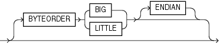

> ```
> byteorder ::=
>  
>   [BYTEORDER  {BIG | LITTLE} [ENDIAN]]
> ```
>
> [  
> Copyright © 2002, 2026, Oracle and/or its affiliates.](https://docs.oracle.com/en/database/oracle/oracle-database/dcommon/html/cpyr.htm)


Usage Notes

The `BYTEORDER` parameter has the following characteristics:

- `BYTEORDER` is placed after the `LENGTH` parameter in the SQL\*Loader control file.
- It is possible to specify a different byte order for different data files. However, the `BYTEORDER` specification before the `INFILE` parameters applies to the entire list of primary data files.
- The `BYTEORDER` specification for the primary data files is also used as the default for `LOBFILE` and `SDF` data. To override this default, specify `BYTEORDER` with the `LOBFILE` or `SDF` specification.
- The `BYTEORDER` parameter is not applicable to data contained within the control file itself.
- The `BYTEORDER` parameter applies to the following:
	- Binary `INTEGER` and `SMALLINT` data
		- Binary lengths in varying-length fields (that is, for the `VARCHAR`, `VARGRAPHIC`, `VARRAW`, and `LONG` `VARRAW` data types)
		- Character data for data files in the UTF16 character set
		- `FLOAT` and `DOUBLE` data types, if the system where the data was written has a compatible floating-point representation with that on the system where SQL\*Loader is running
- The `BYTEORDER` parameter does not apply to any of the following:
	- Raw data types (`RAW`, `VARRAW`, or `VARRAWC`)
		- Graphic data types (`GRAPHIC`, `VARGRAPHIC`, or `GRAPHIC` `EXTERNAL`)
		- Character data for data files in any character set other than UTF16
		- `ZONED` or (packed) `DECIMAL` data types

**Parent topic:** Understanding how SQL\*Loader Manages Byte Ordering

#### 10.9.2 Using Byte Order Marks (BOMs)

This section describes using byte order marks.

Data files that use a Unicode encoding (UTF-16 or UTF-8) may contain a byte-order mark (BOM) in the first few bytes of the file. For a data file that uses the character set UTF16, the values {0xFE,0xFF} in the first two bytes of the file are the BOM indicating that the file contains big-endian data. The values {0xFF,0xFE} are the BOM indicating that the file contains little-endian data.

If the first primary data file uses the UTF16 character set and it also begins with a BOM, then that mark is read and interpreted to determine the byte order for all primary data files. SQL\*Loader reads and interprets the BOM, skips it, and begins processing data with the byte immediately after the BOM. The BOM setting overrides any `BYTEORDER` specification for the first primary data file. BOMs in data files other than the first primary data file are read and used for checking for byte-order conflicts only. They do not change the byte-order setting that SQL\*Loader uses in processing the data file.

In summary, the precedence of the byte-order indicators for the first primary data file is as follows:

- BOM in the first primary data file, if the data file uses a Unicode character set that is byte-order dependent (UTF16) and a BOM is present
- `BYTEORDER` parameter value, if specified before the `INFILE` parameters
- The byte order of the system where SQL\*Loader is running

For a data file that uses a UTF8 character set, a BOM of {0xEF,0xBB,0xBF} in the first 3 bytes indicates that the file contains UTF8 data. It does not indicate the byte order of the data, because data in UTF8 is not byte-order dependent. If SQL\*Loader detects a UTF8 BOM, then it skips it but does not change any byte-order settings for processing the data files.

SQL\*Loader first establishes a byte-order setting for the first primary data file using the precedence order just defined. This byte-order setting is used for all primary data files. If another primary data file uses the character set UTF16 and also contains a BOM, then the BOM value is compared to the byte-order setting established for the first primary data file. If the BOM value matches the byte-order setting of the first primary data file, then SQL\*Loader skips the BOM, and uses that byte-order setting to begin processing data with the byte immediately after the BOM. If the BOM value does not match the byte-order setting established for the first primary data file, then SQL\*Loader issues an error message and stops processing.

If any LOBFILEs or secondary data files are specified in the control file, then SQL\*Loader establishes a byte-order setting for each LOBFILE and secondary data file (SDF) when it is ready to process the file. The default byte-order setting for LOBFILEs and SDFs is the byte-order setting established for the first primary data file. This is overridden if the `BYTEORDER` parameter is specified with a LOBFILE or SDF. In either case, if the LOBFILE or SDF uses the UTF16 character set and contains a BOM, the BOM value is compared to the byte-order setting for the file. If the BOM value matches the byte-order setting for the file, then SQL\*Loader skips the BOM, and uses that byte-order setting to begin processing data with the byte immediately after the BOM. If the BOM value does not match, then SQL\*Loader issues an error message and stops processing.

In summary, the precedence of the byte-order indicators for LOBFILEs and SDFs is as follows:

- `BYTEORDER` parameter value specified with the LOBFILE or SDF
- The byte-order setting established for the first primary data file
	Note:
	If the character set of your data file is a unicode character set and there is a byte-order mark in the first few bytes of the file, then do not use the `SKIP` parameter. If you do, then the byte-order mark will not be read and interpreted as a byte-order mark.

- Suppressing Checks for BOMs  
	This section describes suppressing checks for BOMs.

**Parent topic:** Understanding how SQL\*Loader Manages Byte Ordering

##### 10.9.2.1 Suppressing Checks for BOMs

This section describes suppressing checks for BOMs.

A data file in a Unicode character set may contain binary data that matches the BOM in the first bytes of the file. For example the integer(2) value 0xFEFF = 65279 decimal matches the big-endian BOM in UTF16. In that case, you can tell SQL\*Loader to read the first bytes of the data file as data and not check for a BOM by specifying the `BYTEORDERMARK` parameter with the value `NOCHECK`. The syntax for the `BYTEORDERMARK` parameter is:

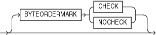

> ```
> byteordermark ::=
>  
>   [BYTEORDERMARK {CHECK | NOCHECK}]
> ```
>
> [  
> Copyright © 2002, 2026, Oracle and/or its affiliates.](https://docs.oracle.com/en/database/oracle/oracle-database/dcommon/html/cpyr.htm)


`BYTEORDERMARK` `NOCHECK` indicates that SQL\*Loader should not check for a BOM and should read all the data in the data file as data.

`BYTEORDERMARK` `CHECK` tells SQL\*Loader to check for a BOM. This is the default behavior for a data file in a Unicode character set. But this specification may be used in the control file for clarification. It is an error to specify `BYTEORDERMARK` `CHECK` for a data file that uses a non-Unicode character set.

The `BYTEORDERMARK` parameter has the following characteristics:

- It is placed after the optional `BYTEORDER` parameter in the SQL\*Loader control file.
- It applies to the syntax specification for primary data files, and also to LOBFILEs and secondary data files (SDFs).
- It is possible to specify a different `BYTEORDERMARK` value for different data files; however, the `BYTEORDERMARK` specification before the `INFILE` parameters applies to the entire list of primary data files.
- The `BYTEORDERMARK` specification for the primary data files is also used as the default for LOBFILEs and SDFs, except that the value `CHECK` is ignored in this case if the LOBFILE or SDF uses a non-Unicode character set. This default setting for LOBFILEs and secondary data files can be overridden by specifying `BYTEORDERMARK` with the LOBFILE or SDF specification.

**Parent topic:** Using Byte Order Marks (BOMs)

### 10.10 Loading All-Blank Fields

Fields that are totally blank cause the record to be rejected. To load one of these fields as `NULL`, use the `NULLIF` clause with the `BLANKS` parameter.

If an all-blank `CHAR` field is surrounded by enclosure delimiters, then the blanks within the enclosures are loaded. Otherwise, the field is loaded as `NULL`.

A `DATE` or numeric field that consists entirely of blanks is loaded as a `NULL` field.

See Also:

Case study 6, Loading Data Using the Direct Path Load Method, for an example of how to load all-blank fields as `NULL` with the `NULLIF` clause, in SQL\*Loader Case Studies

**Parent topic:** SQL\*Loader Field List Reference

### 10.11 Trimming Whitespace

Blanks, tabs, and other nonprinting characters (such as carriage returns and line feeds) constitute whitespace.

Leading whitespace occurs at the beginning of a field. Trailing whitespace occurs at the end of a field. Depending on how the field is specified, whitespace may or may not be included when the field is inserted into the database. This is illustrated in the figure "Example of Field Conversion, where two `CHAR` fields are defined for a data record.

The field specifications are contained in the control file. The control file `CHAR` specification is not the same as the database `CHAR` specification. A data field defined as `CHAR` in the control file simply tells SQL\*Loader how to create the row insert. The data could then be inserted into a `CHAR`, `VARCHAR2`, `NCHAR`, `NVARCHAR2`, or even a `NUMBER` or `DATE` column in the database, with the Oracle database handling any necessary conversions.

By default, SQL\*Loader removes trailing spaces from `CHAR` data before passing it to the database. So, in the figure "Example of Field Conversion,” both Field 1 and Field 2 are passed to the database as 3-byte fields. However, when the data is inserted into the table, there is a difference.

Figure 10-1 Example of Field Conversion

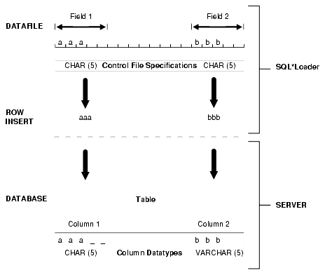

> The figure shows an example of field conversion.
>
> There is a datafile that contains two fields, both defined in the SQL\*Loader control file as CHAR(5). Field 1 contains the letters aaa as data. Field 2 contains the letters bbb as data.
>
> In the database into which the fields are to be inserted, there are two columns. Column 1 is defined as a fixed-length CHAR column of length 5. Therefore, when the data from Field 1 in the datafile is inserted, the data is shown as left-justified in that column, which remains 5 bytes wide. The extra space on the right is padded with blanks.
>
> Column 2 is defined as a varying-length field with a maximum length of 5 bytes. The data from the datafile for Field 2 is left-justified. Therefore, when the data is inserted into column 2 in the database, it is shownas left-justified as well, but the length remains 3 bytes.


Column 1 is defined in the database as a fixed-length `CHAR` column of length `5`. So the data (`aaa`) is left-justified in that column, which remains 5 bytes wide. The extra space on the right is padded with blanks. Column 2, however, is defined as a varying-length field with a maximum length of 5 bytes. The data for that column (`bbb`) is left-justified as well, but the length remains 3 bytes.

The table "Behavior Summary for Trimming Whitespace" summarizes when and how whitespace is removed from input data fields when `PRESERVE` `BLANKS` is not specified. See How the PRESERVE BLANKS Option Affects Whitespace Trimming for details about how to prevent whitespace trimming.

Table 10-4 Behavior Summary for Trimming Whitespace

| Specification | Data | Result | Leading Whitespace Present (When an all-blank field is trimmed, its value is NULL. | Trailing Whitespace Present (When an all-blank field is trimmed, its value is NULL.) |
| --- | --- | --- | --- | --- |
| Predetermined size | \_\_aa\_\_ | \_\_aa | Yes | No |
| Terminated | \_\_aa\_\_, | \_\_aa\_\_ | Yes | Yes, except for fields that are terminated by whitespace. |
| Enclosed | "\_\_aa\_\_" | \_\_aa\_\_ | Yes | Yes |
| Terminated and enclosed | "\_\_aa\_\_", | \_\_aa\_\_ | Yes | Yes |
| Optional enclosure (present) | "\_\_aa\_\_", | \_\_aa\_\_ | Yes | Yes |
| Optional enclosure (absent) | \_\_aa\_\_, | aa\_\_ | No | Yes |
| Previous field terminated by whitespace | \_\_aa\_\_ | aa (Presence of trailing whitespace depends on the current field's specification, as shown by the other entries in the table.) | No | Presence of trailing whitespace depends on the current field's specification, as shown by the other entries in the table. |

The rest of this section discusses the following topics with regard to trimming whitespace:

- Data Types for Which Whitespace Can Be Trimmed  
	The information in this section applies only to fields specified with one of the character-data data types.
- Specifying Field Length for Data Types for Which Whitespace Can Be Trimmed  
	This section describes specifying field length.
- Relative Positioning of Fields  
	This section describes the relative positioning of fields.
- Leading Whitespace  
	This section describes leading whitespace.
- Trimming Trailing Whitespace  
	Trailing whitespace is always trimmed from character-data fields that have a predetermined size.
- Trimming Enclosed Fields  
	This section describes trimming enclosed fields.

**Parent topic:** SQL\*Loader Field List Reference

#### 10.11.1 Data Types for Which Whitespace Can Be Trimmed

The information in this section applies only to fields specified with one of the character-data data types.

- `CHAR` data type
- Datetime and interval data types
- Numeric `EXTERNAL` data types:
	- `INTEGER` `EXTERNAL`
		- `FLOAT` `EXTERNAL`
		- (packed) `DECIMAL` `EXTERNAL`
		- `ZONED` (decimal) `EXTERNAL`
		Note:
		Although `VARCHAR` and `VARCHARC` fields also contain character data, these fields are never trimmed. These fields include all whitespace that is part of the field in the data file.

**Parent topic:** Trimming Whitespace

#### 10.11.2 Specifying Field Length for Data Types for Which Whitespace Can Be Trimmed

This section describes specifying field length.

There are two ways to specify field length. If a field has a constant length that is defined in the control file with a position specification or the data type and length, then it has a predetermined size. If a field's length is not known in advance, but depends on indicators in the record, then the field is delimited, using either enclosure or termination delimiters.

If a position specification with start and end values is defined for a field that also has enclosure or termination delimiters defined, then only the position specification has any effect. The enclosure and termination delimiters are ignored.

- Predetermined Size Fields  
	Fields that have a predetermined size are specified with a starting position and ending position, or with a length.
- Delimited Fields  
	Delimiters are characters that demarcate field boundaries.

**Parent topic:** Trimming Whitespace

##### 10.11.2.1 Predetermined Size Fields

Fields that have a predetermined size are specified with a starting position and ending position, or with a length.

For example:

```
loc POSITION(19:31) 
loc CHAR(14)
```

In the second case, even though the exact position of the field is not specified, the length of the field is predetermined.

**Parent topic:** Specifying Field Length for Data Types for Which Whitespace Can Be Trimmed

##### 10.11.2.2 Delimited Fields

Delimiters are characters that demarcate field boundaries.

Enclosure delimiters surround a field, like the quotation marks in the following example, where "\_\_" represents blanks or tabs:

```
"__aa__"
```

Termination delimiters signal the end of a field, like the comma in the following example:

```
__aa__,
```

Delimiters are specified with the control clauses `TERMINATED` `BY` and `ENCLOSED` `BY`, as shown in the following example:

```
loc TERMINATED BY "." OPTIONALLY ENCLOSED BY '|'
```

**Parent topic:** Specifying Field Length for Data Types for Which Whitespace Can Be Trimmed

#### 10.11.3 Relative Positioning of Fields

This section describes the relative positioning of fields.

SQL\*Loader determines the starting position of a field in the following situations:

- No Start Position Specified for a Field  
	When a starting position is not specified for a field, it begins immediately after the end of the previous field.
- Previous Field Terminated by a Delimiter  
	If the previous field (Field 1) is terminated by a delimiter, then the next field begins immediately after the delimiter.
- Previous Field Has Both Enclosure and Termination Delimiters  
	When a field is specified with both enclosure delimiters and a termination delimiter, then the next field starts after the termination delimiter.

**Parent topic:** Trimming Whitespace

##### 10.11.3.1 No Start Position Specified for a Field

When a starting position is not specified for a field, it begins immediately after the end of the previous field.

The following figure illustrates this situation when the previous field (Field 1) has a predetermined size.

Figure 10-2 Relative Positioning After a Fixed Field

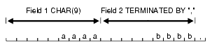

> The figure shows a representation of a CHAR(9) field that contains 5 blanks followed by the letters aaaa.
>
> The next field begins immediately afterwards and contains 5 blanks, the letters bbbb, and is terminated by ','.
>
> [  
> Copyright © 2002, 2026, Oracle and/or its affiliates.](https://docs.oracle.com/en/database/oracle/oracle-database/dcommon/html/cpyr.htm)


**Parent topic:** Relative Positioning of Fields

##### 10.11.3.2 Previous Field Terminated by a Delimiter

If the previous field (Field 1) is terminated by a delimiter, then the next field begins immediately after the delimiter.

For example:Figure 10-3.

Figure 10-3 Relative Positioning After a Delimited Field

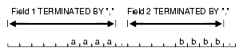

> The figure shows a representation of a field that contains 5 blanks, followed by the letters aaaa, and terminated by ','.
>
> The next field begins immediately after the delimiter. It contains 4 blanks followed by the letters bbbb, and is terminated by ','.
>
> [  
> Copyright © 2002, 2026, Oracle and/or its affiliates.](https://docs.oracle.com/en/database/oracle/oracle-database/dcommon/html/cpyr.htm)


**Parent topic:** Relative Positioning of Fields

##### 10.11.3.3 Previous Field Has Both Enclosure and Termination Delimiters

When a field is specified with both enclosure delimiters and a termination delimiter, then the next field starts after the termination delimiter.

For example:Figure 10-4. If a nonwhitespace character is found after the enclosure delimiter, but before the terminator, then SQL\*Loader generates an error.

Figure 10-4 Relative Positioning After Enclosure Delimiters

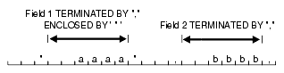

> The figure shows a representation of two fields.
>
> The first field contains two blanks followed by the letters aaaa. The field is terminated by ',' and enclosed by '"'. Before the terminator, there are two blank spaces.
>
> After the terminator, the next field starts. It contains two blanks followed by the letters bbbb and is terminated by ','.


**Parent topic:** Relative Positioning of Fields

#### 10.11.4 Leading Whitespace

This section describes leading whitespace.

In Figure 10-4, both fields are stored with leading whitespace. Fields do not include leading whitespace in the following cases:

- When the previous field is terminated by whitespace, and no starting position is specified for the current field
- When optional enclosure delimiters are specified for the field, and the enclosure delimiters are not present

These cases are illustrated in the following sections.

- Previous Field Terminated by Whitespace  
	If the previous field is `TERMINATED` `BY` `WHITESPACE`, then all whitespace after the field acts as the delimiter.
- Optional Enclosure Delimiters  
	Leading whitespace is also removed from a field when optional enclosure delimiters are specified but not present.

**Parent topic:** Trimming Whitespace

##### 10.11.4.1 Previous Field Terminated by Whitespace

If the previous field is `TERMINATED` `BY` `WHITESPACE`, then all whitespace after the field acts as the delimiter.

The next field starts at the next nonwhitespace character. Figure 10-5 illustrates this case.

Figure 10-5 Fields Terminated by Whitespace

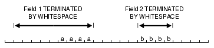

> The figure in shows a representation of two fields terminated by whitespace. Field 1 contains 5 blanks, followed by the letters aaaa. Five blanks follow Field 1.
>
> Field 2 starts at the next nonwhitespace character. It contains the letters bbbb.
>
> [  
> Copyright © 2002, 2026, Oracle and/or its affiliates.](https://docs.oracle.com/en/database/oracle/oracle-database/dcommon/html/cpyr.htm)


This situation occurs when the previous field is explicitly specified with the `TERMINATED` `BY` `WHITESPACE` clause, as shown in the example. It also occurs when you use the global `FIELDS` `TERMINATED` `BY` `WHITESPACE` clause.

**Parent topic:** Leading Whitespace

##### 10.11.4.2 Optional Enclosure Delimiters

Leading whitespace is also removed from a field when optional enclosure delimiters are specified but not present.

Whenever optional enclosure delimiters are specified, SQL\*Loader scans forward, looking for the first enclosure delimiter. If an enclosure delimiter is not found, then SQL\*Loader skips over whitespace, eliminating it from the field. The first nonwhitespace character signals the start of the field. This situation is shown in Field 2 in Figure 10-6. (In Field 1 the whitespace is included because SQL\*Loader found enclosure delimiters for the field.)

Figure 10-6 Fields Terminated by Optional Enclosure Delimiters

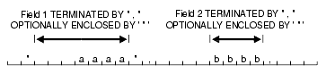

> The figure shows a representation of two fields terminated by ',' and optionally enclosed by '"'. Field 1 is enclosed by '"', begins with three whitespace characters, and then contains the letters aaaa. A nonwhitespace character (in this case, a comma) signals the end of the field.
>
> Field 2 starts after four whitespace characters. It contains the letters bbbb, and is terminated by ','.


Unlike the case when the previous field is `TERMINATED` `BY` `WHITESPACE`, this specification removes leading whitespace even when a starting position is specified for the current field.

Note:

If enclosure delimiters are present, then leading whitespace after the initial enclosure delimiter is kept, but whitespace before this delimiter is discarded. See the first quotation mark in Field 1, Figure 10-6.

**Parent topic:** Leading Whitespace

#### 10.11.5 Trimming Trailing Whitespace

Trailing whitespace is always trimmed from character-data fields that have a predetermined size.

These are the only fields for which trailing whitespace is always trimmed.

**Parent topic:** Trimming Whitespace

#### 10.11.6 Trimming Enclosed Fields

This section describes trimming enclosed fields.

If a field is enclosed, or terminated and enclosed, like the first field shown in Figure 10-6, then any whitespace outside the enclosure delimiters is not part of the field. Any whitespace between the enclosure delimiters belongs to the field, whether it is leading or trailing whitespace.

**Parent topic:** Trimming Whitespace

### 10.12 How the PRESERVE BLANKS Option Affects Whitespace Trimming

To prevent whitespace trimming in all `CHAR`, `DATE`, and numeric `EXTERNAL` fields, you specify `PRESERVE` `BLANKS` as part of the `LOAD` statement in the control file.

However, there may be times when you do not want to preserve blanks for all `CHAR`, `DATE`, and numeric `EXTERNAL` fields. Therefore, SQL\*Loader also enables you to specify `PRESERVE` `BLANKS` as part of the data type specification for individual fields, rather than specifying it globally as part of the `LOAD` statement.

In the following example, assume that `PRESERVE` `BLANKS` has not been specified as part of the `LOAD` statement, but you want the `c1` field to default to zero when blanks are present. You can achieve this by specifying `PRESERVE` `BLANKS` on the individual field. Only that field is affected; blanks will still be removed on other fields.

```
c1 INTEGER EXTERNAL(10) PRESERVE BLANKS DEFAULTIF c1=BLANKS
```

In this example, if `PRESERVE` `BLANKS` were not specified for the field, then it would result in the field being improperly loaded as NULL (instead of as 0).

There may be times when you want to specify `PRESERVE` `BLANKS` as an option to the `LOAD` statement and have it apply to most `CHAR`, `DATE`, and numeric `EXTERNAL` fields. You can override it for an individual field by specifying `NO` `PRESERVE` `BLANKS` as part of the data type specification for that field, as follows:

```
c1 INTEGER EXTERNAL(10) NO PRESERVE BLANKS
```

**Parent topic:** SQL\*Loader Field List Reference

### 10.13 How \[NO\] PRESERVE BLANKS Works with Delimiter Clauses

The `PRESERVE` `BLANKS` option is affected by the presence of delimiter clauses

Delimiter clauses affect `PRESERVE` `BLANKS` in the following cases:

- Leading whitespace is left intact when optional enclosure delimiters are not present
- Trailing whitespace is left intact when fields are specified with a predetermined size

For example, consider the following field, where underscores represent blanks:

```
__aa__,
```

Suppose this field is loaded with the following delimiter clause:

```
TERMINATED BY ',' OPTIONALLY ENCLOSED BY '"'
```

In such a case, if `PRESERVE` `BLANKS` is specified, then both the leading whitespace and the trailing whitespace are retained. If `PRESERVE` `BLANKS` is not specified, then the leading whitespace is trimmed.

Now suppose the field is loaded with the following clause:

```
TERMINATED BY WHITESPACE
```

In such a case, if `PRESERVE` `BLANKS` is specified, then it does not retain the space at the beginning of the next field, unless that field is specified with a `POSITION` clause that includes some of the whitespace. Otherwise, SQL\*Loader scans past all whitespace at the end of the previous field until it finds a nonblank, nontab character.

### 10.14 Applying SQL Operators to Fields

This section describes applying SQL operators to fields.

A wide variety of SQL operators can be applied to field data with the SQL string. This string can contain any combination of SQL expressions that are recognized by the Oracle database as valid for the `VALUES` clause of an `INSERT` statement. In general, any SQL function that returns a single value that is compatible with the target column's data type can be used. SQL strings can be applied to simple scalar column types and also to user-defined complex types such as column objects and collections.

The column name and the name of the column in a SQL string bind variable must, with the interpretation of SQL identifier rules, correspond to the same column. But the two names do not necessarily have to be written exactly the same way, as in the following example:

```
LOAD DATA 
INFILE * 
APPEND INTO TABLE XXX 
( "Last"   position(1:7)     char   "UPPER(:\"Last\")" 
   first   position(8:15)    char   "UPPER(:first || :FIRST || :\"FIRST\")" 
) 
BEGINDATA 
Grant  Phil 
Taylor Jason
```

Note the following about the preceding example:

- If, during table creation, a column identifier is declared using double quotation marks because it contains lowercase and/or special-case letters (as in the column named `"Last"` above), then the column name in the bind variable must exactly match the column name used in the `CREATE TABLE` statement.
- If a column identifier is declared without double quotation marks during table creation (as in the column name `first` above), then because `first`, `FIRST`, and `"FIRST"` all resolve to `FIRST` after upper casing is done, any of these written formats in a SQL string bind variable would be acceptable.

Note the following when you are using SQL strings:

- The execution of SQL strings is not considered to be part of field setting. Rather, when the SQL string is executed it uses the result of any field setting and `NULLIF` or `DEFAULTIF` clauses. So, the evaluation order is as follows (steps 1 and 2 are a summary of the steps described in Using the WHEN\_ NULLIF\_ and DEFAULTIF Clauses):
	1. Field setting is done.
		2. Any `NULLIF` or `DEFAULTIF` clauses are applied (and that may change the field setting results for the fields that have such clauses). When `NULLIF` and `DEFAULTIF` clauses are used with a SQL expression, they affect the field setting results, not the final column results.
		3. Any SQL expressions are evaluated using the field results obtained after completion of Steps 1 and 2. The results are assigned to the corresponding columns that have the SQL expressions. (If there is no SQL expression present, then the result obtained from Steps 1 and 2 is assigned to the column.)
- If your control file specifies character input that has an associated SQL string, then SQL\*Loader makes no attempt to modify the data. This is because SQL\*Loader assumes that character input data that is modified using a SQL operator will yield results that are correct for database insertion.
- The SQL string must appear after any other specifications for a given column.
- The SQL string must be enclosed in double quotation marks.
- To enclose a column name in quotation marks within a SQL string, you must use escape characters.
	In the preceding example, `Last` is enclosed in double quotation marks to preserve the mixed case, and the double quotation marks necessitate the use of the backslash (escape) character.
- If a SQL string contains a column name that references a column object attribute, then the full object attribute name must be used in the bind variable. Each attribute name in the full name is an individual identifier. Each identifier is subject to the SQL identifier quoting rules, independent of the other identifiers in the full name. For example, suppose you have a column object named `CHILD` with an attribute name of `"HEIGHT_%TILE"`. (Note that the attribute name is in double quotation marks.) To use the full object attribute name in a bind variable, any one of the following formats would work:
	- `:CHILD.\"HEIGHT_%TILE\"`
		- `:child.\"HEIGHT_%TILE\"`
	Enclosing the full name (`:\"CHILD.HEIGHT_%TILE\"`) generates a warning message that the quoting rule on an object attribute name used in a bind variable has changed. The warning is only to suggest that the bind variable be written correctly; it will not cause the load to abort. The quoting rule was changed because enclosing the full name in quotation marks would have caused SQL to interpret the name as one identifier rather than a full column object attribute name consisting of multiple identifiers.
- The SQL string is evaluated after any `NULLIF` or `DEFAULTIF` clauses, but before a date mask.
- If the Oracle database does not recognize the string, then the load terminates in error. If the string is recognized, but causes a database error, then the row that caused the error is rejected.
- SQL strings are required when using the `EXPRESSION` parameter in a field specification.
- The SQL string cannot reference fields that are loaded using `OID`, `SID`, `REF`, or `BFILE`. Also, it cannot reference filler fields or other fields which use SQL strings.
- In direct path mode, a SQL string cannot reference a `VARRAY`, nested table, or LOB column. This also includes a `VARRAY`, nested table, or LOB column that is an attribute of a column object.
- The SQL string cannot be used on `RECNUM`, `SEQUENCE`, `CONSTANT`, or `SYSDATE` fields.
- The SQL string cannot be used on LOBs, `BFILE` s, `XML` columns, or a file that is an element of a collection.
- In direct path mode, the final result that is returned after evaluation of the expression in the SQL string must be a scalar data type. That is, the expression may not return an object or collection data type when performing a direct path load.

- Referencing Fields  
	To refer to fields in the record, precede the field name with a colon (:).
- Common Uses of SQL Operators in Field Specifications  
	This section describes the common uses of SQL operators in field specifications.
- Combinations of SQL Operators  
	This section describes combining SQL operators.
- Using SQL Strings with a Date Mask  
	When a SQL string is used with a date mask, the date mask is evaluated after the SQL string.
- Interpreting Formatted Fields  
	It is possible to use the `TO_CHAR` operator to store formatted dates and numbers.
- Using SQL Strings to Load the ANYDATA Database Type  
	The `ANYDATA` database type can contain data of different types.

**Parent topic:** SQL\*Loader Field List Reference

#### 10.14.1 Referencing Fields

To refer to fields in the record, precede the field name with a colon (:).

Field values from the current record are substituted. A field name preceded by a colon (:) in a SQL string is also referred to as a bind variable. Note that bind variables enclosed in single quotation marks are treated as text literals, not as bind variables.

The following example illustrates how a reference is made to both the current field and to other fields in the control file. It also illustrates how enclosing bind variables in single quotation marks causes them to be treated as text literals. Be sure to read the notes following this example to help you fully understand the concepts it illustrates.

```
LOAD DATA
INFILE *
APPEND INTO TABLE YYY
(
 field1  POSITION(1:6) CHAR "LOWER(:field1)"
 field2  CHAR TERMINATED BY ','
         NULLIF ((1) = 'a') DEFAULTIF ((1)= 'b')
         "RTRIM(:field2)",
 field3  CHAR(7) "TRANSLATE(:field3, ':field1', ':1')",
 field4  COLUMN OBJECT
 (
  attr1  CHAR(3) NULLIF field4.attr2='ZZ' "UPPER(:field4.attr3)",
  attr2  CHAR(2),
  attr3  CHAR(3)  ":field4.attr1 + 1"
 ),
 field5  EXPRESSION "MYFUNC(:FIELD4, SYSDATE)"
)
BEGINDATA
ABCDEF1234511  ,:field1500YYabc
abcDEF67890    ,:field2600ZZghl
```

Notes About This Example:

- In the following line, `:field1` is not enclosed in single quotation marks and is therefore interpreted as a bind variable:
	`field1 POSITION(1:6) CHAR "LOWER(:field1)"`
- In the following line, `':field1'` and `':1'` are enclosed in single quotation marks and are therefore treated as text literals and passed unchanged to the `TRANSLATE` function:
	`field3 CHAR(7) "TRANSLATE(:field3, ':field1', ':1')"`
	For more information about the use of quotation marks inside quoted strings, see [Specifying File Names and Object Names](oracle-sql-loader-control-file-contents.md).
- For each input record read, the value of the field referenced by the bind variable will be substituted for the bind variable. For example, the value `ABCDEF` in the first record is mapped to the first field `:field1`. This value is then passed as an argument to the `LOWER` function.
- A bind variable in a SQL string need not reference the current field. In the preceding example, the bind variable in the SQL string for the `field4.attr1` field references the `field4.attr3` field. The `field4.attr1` field is still mapped to the values 500 and NULL (because the `NULLIF field4.attr2='ZZ'` clause is `TRUE` for the second record) in the input records, but the final values stored in its corresponding columns are ABC and GHL.
	The `field4.attr3` field is mapped to the values ABC and GHL in the input records, but the final values stored in its corresponding columns are 500 + 1 = 501 and NULL because the SQL expression references `field4.attr1`. (Adding 1 to a NULL field still results in a NULL field.)
- The `field5` field is not mapped to any field in the input record. The value that is stored in the target column is the result of executing the `MYFUNC` PL/SQL function, which takes two arguments. The use of the `EXPRESSION` parameter requires that a SQL string be used to compute the final value of the column because no input data is mapped to the field.

**Parent topic:** Applying SQL Operators to Fields

#### 10.14.2 Common Uses of SQL Operators in Field Specifications

This section describes the common uses of SQL operators in field specifications.

SQL operators are commonly used for the following tasks:

- Loading external data with an implied decimal point:
```
field1 POSITION(1:9) DECIMAL EXTERNAL(8) ":field1/1000"
```
- Truncating fields that could be too long:
```
field1 CHAR TERMINATED BY "," "SUBSTR(:field1, 1, 10)"
```

**Parent topic:** Applying SQL Operators to Fields

#### 10.14.3 Combinations of SQL Operators

This section describes combining SQL operators.

Multiple operators can also be combined, as in the following examples:

```
field1 POSITION(*+3) INTEGER EXTERNAL
       "TRUNC(RPAD(:field1,6,'0'), -2)"
field1 POSITION(1:8) INTEGER EXTERNAL
       "TRANSLATE(RTRIM(:field1),'N/A', '0')"
field1 CHAR(10)
       "NVL( LTRIM(RTRIM(:field1)), 'unknown' )"
```

**Parent topic:** Applying SQL Operators to Fields

#### 10.14.4 Using SQL Strings with a Date Mask

When a SQL string is used with a date mask, the date mask is evaluated after the SQL string.

Consider a field specified as follows:

```
field1 DATE "dd-mon-yy" "RTRIM(:field1)"
```

SQL\*Loader internally generates and inserts the following:

```
TO_DATE(RTRIM(<field1_value>), 'dd-mon-yyyy')
```

Note that when using the `DATE` field data type with a SQL string, a date mask is required. This is because SQL\*Loader assumes that the first quoted string it finds after the `DATE` parameter is a date mask. For instance, the following field specification would result in an error (ORA-01821: date format not recognized):

```
field1 DATE "RTRIM(TO_DATE(:field1, 'dd-mon-yyyy'))"
```

In this case, a simple workaround is to use the `CHAR` data type.

**Parent topic:** Applying SQL Operators to Fields

#### 10.14.5 Interpreting Formatted Fields

It is possible to use the `TO_CHAR` operator to store formatted dates and numbers.

For example:

```
field1 ... "TO_CHAR(:field1, '$09999.99')"
```

This example could store numeric input data in formatted form, where `field1` is a character column in the database. This field would be stored with the formatting characters (dollar sign, period, and so on) already in place.

You have even more flexibility, however, if you store such values as numeric quantities or dates. You can then apply arithmetic functions to the values in the database, and still select formatted values for your reports.

An example of using the SQL string to load data from a formatted report is shown in case study 7, Extracting Data from a Formatted Report. (See [SQL\*Loader Case Studies](oracle-sql-loader-concepts.md) for information on how to access case studies.)

**Parent topic:** Applying SQL Operators to Fields

#### 10.14.6 Using SQL Strings to Load the ANYDATA Database Type

The `ANYDATA` database type can contain data of different types.

To load the `ANYDATA` type using SQL\*loader, it must be explicitly constructed by using a function call. The function is called using support for SQL strings as has been described in this section.

For example, suppose you have a table with a column named `miscellaneous` which is of type `ANYDATA`. You could load the column by doing the following, which would create an `ANYDATA` type containing a number.

```
LOAD DATA
INFILE *
APPEND INTO TABLE  ORDERS
(
miscellaneous CHAR "SYS.ANYDATA.CONVERTNUMBER(:miscellaneous)"
)
BEGINDATA
4
```

There can also be more complex situations in which you create an `ANYDATA` type that contains a different type depending upon the values in the record. To do this, you could write your own PL/SQL function that would determine what type should be in the `ANYDATA` type, based on the value in the record, and then call the appropriate `ANYDATA`.`Convert*()` function to create it.

See Also:

- [Oracle Database SQL Language Reference](https://docs.oracle.com/pls/topic/lookup?ctx=en/database/oracle/oracle-database/21/sutil&id=SQLRF51010) for more information about the `ANYDATA` database type
- [Oracle Database PL/SQL Packages and Types Reference](https://docs.oracle.com/pls/topic/lookup?ctx=en/database/oracle/oracle-database/21/sutil&id=ARPLS077) for more information about using `ANYDATA` with PL/SQL

**Parent topic:** Applying SQL Operators to Fields

### 10.15 Using SQL\*Loader to Generate Data for Input

The parameters described in this section provide the means for SQL\*Loader to generate the data stored in the database record, rather than reading it from a data file.

The following parameters are described:

- Loading Data Without Files  
	This section describes loading data without files.
- Setting a Column to a Constant Value  
	Setting a column to a constant value is the simplest form of generated data.
- Setting a Column to an Expression Value  
	Use the `EXPRESSION` parameter after a column name to set that column to the value returned by a SQL operator or specially written PL/SQL function.
- Setting a Column to the Data File Record Number  
	Use the `RECNUM` parameter after a column name to set that column to the number of the logical record from which that record was loaded.
- Setting a Column to the Current Date  
	A column specified with `SYSDATE` gets the current system date, as defined by the SQL language `SYSDATE` parameter.
- Setting a Column to a Unique Sequence Number  
	The `SEQUENCE` parameter ensures a unique value for a particular column. `SEQUENCE` increments for each record that is loaded or rejected.
- Generating Sequence Numbers for Multiple Tables  
	Because a unique sequence number is generated for each logical input record, rather than for each table insert, the same sequence number can be used when inserting data into multiple tables.

**Parent topic:** SQL\*Loader Field List Reference

#### 10.15.1 Loading Data Without Files

This section describes loading data without files.

It is possible to use SQL\*Loader to generate data by specifying only sequences, record numbers, system dates, constants, and SQL string expressions as field specifications.

SQL\*Loader inserts as many records as are specified by the `LOAD` statement. The `SKIP` parameter is not permitted in this situation.

SQL\*Loader is optimized for this case. Whenever SQL\*Loader detects that only generated specifications are used, it ignores any specified data file—no read I/O is performed.

In addition, no memory is required for a bind array. If there are any `WHEN` clauses in the control file, then SQL\*Loader assumes that data evaluation is necessary, and input records are read.

**Parent topic:** Using SQL\*Loader to Generate Data for Input

#### 10.15.2 Setting a Column to a Constant Value

Setting a column to a constant value is the simplest form of generated data.

It does not vary during the load or between loads.

- CONSTANT Parameter

**Parent topic:** Using SQL\*Loader to Generate Data for Input

##### 10.15.2.1 CONSTANT Parameter

To set a column to a constant value, use `CONSTANT` followed by a value:

```
CONSTANT  value
```

`CONSTANT` data is interpreted by SQL\*Loader as character input. It is converted, as necessary, to the database column type.

You may enclose the value within quotation marks, and you must do so if it contains whitespace or reserved words. Be sure to specify a legal value for the target column. If the value is bad, then every record is rejected.

Numeric values larger than 2^32 - 1 (4,294,967,295) must be enclosed in quotation marks.

Note:

Do not use the `CONSTANT` parameter to set a column to null. To set a column to null, do not specify that column at all. Oracle automatically sets that column to null when loading the record. The combination of `CONSTANT` and a value is a complete column specification.

**Parent topic:** Setting a Column to a Constant Value

#### 10.15.3 Setting a Column to an Expression Value

Use the `EXPRESSION` parameter after a column name to set that column to the value returned by a SQL operator or specially written PL/SQL function.

The operator or function is indicated in a SQL string that follows the `EXPRESSION` parameter. Any arbitrary expression may be used in this context provided that any parameters required for the operator or function are correctly specified and that the result returned by the operator or function is compatible with the data type of the column being loaded.

- EXPRESSION Parameter

**Parent topic:** Using SQL\*Loader to Generate Data for Input

##### 10.15.3.1 EXPRESSION Parameter

The combination of column name, `EXPRESSION` parameter, and a SQL string is a complete field specification:

```
column_name EXPRESSION "SQL string"
```

In both conventional path mode and direct path mode, the `EXPRESSION` parameter can be used to load the default value into `column_name`:

```
column_name EXPRESSION "DEFAULT"
```

Note that if `DEFAULT` is used and the mode is direct path, then use of a sequence as a default will not work.

**Parent topic:** Setting a Column to an Expression Value

#### 10.15.4 Setting a Column to the Data File Record Number

Use the `RECNUM` parameter after a column name to set that column to the number of the logical record from which that record was loaded.

Records are counted sequentially from the beginning of the first data file, starting with record 1. `RECNUM` is incremented as each logical record is assembled. Thus it increments for records that are discarded, skipped, rejected, or loaded. If you use the option `SKIP=10`, then the first record loaded has a `RECNUM` of 11.

- RECNUM Parameter  
	The combination of column name and `RECNUM` is a complete column specification.

**Parent topic:** Using SQL\*Loader to Generate Data for Input

##### 10.15.4.1 RECNUM Parameter

The combination of column name and `RECNUM` is a complete column specification.

For example:

```
column_name RECNUM
```

**Parent topic:** Setting a Column to the Data File Record Number

#### 10.15.5 Setting a Column to the Current Date

A column specified with `SYSDATE` gets the current system date, as defined by the SQL language `SYSDATE` parameter.

See the section on the `DATE` data type in [Oracle Database SQL Language Reference.](https://docs.oracle.com/pls/topic/lookup?ctx=en/database/oracle/oracle-database/21/sutil&id=SQLRF00202)

- SYSDATE Parameter  
	The combination of column name and the `SYSDATE` parameter is a complete column specification.

**Parent topic:** Using SQL\*Loader to Generate Data for Input

##### 10.15.5.1 SYSDATE Parameter

The combination of column name and the `SYSDATE` parameter is a complete column specification.

For example:

```
column_name SYSDATE
```

The database column must be of type `CHAR` or `DATE`. If the column is of type `CHAR`, then the date is loaded in the form 'dd-mon-yy.' After the load, it can be loaded only in that form. If the system date is loaded into a `DATE` column, then it can be loaded in a variety of forms that include the time and the date.

A new system date/time is used for each array of records inserted in a conventional path load and for each block of records loaded during a direct path load.

**Parent topic:** Setting a Column to the Current Date

#### 10.15.6 Setting a Column to a Unique Sequence Number

The `SEQUENCE` parameter ensures a unique value for a particular column. `SEQUENCE` increments for each record that is loaded or rejected.

It does not increment for records that are discarded or skipped.

- SEQUENCE Parameter

**Parent topic:** Using SQL\*Loader to Generate Data for Input

##### 10.15.6.1 SEQUENCE Parameter

The combination of column name and the `SEQUENCE` parameter is a complete column specification.

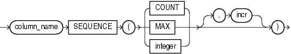

> ```
> sequence ::=
>  
> column_name SEQUENCE ( {COUNT | MAX | integer} [, incr]  )
> ```
>
> [  
> Copyright © 2002, 2026, Oracle and/or its affiliates.](https://docs.oracle.com/en/database/oracle/oracle-database/dcommon/html/cpyr.htm)


Table 10-5 describes the parameters used for column specification.

Table 10-5 Parameters Used for Column Specification

| Parameter | Description |
| --- | --- |
| `column_name` | The name of the column in the database to which to assign the sequence. |
| `SEQUENCE` | Use the `SEQUENCE` parameter to specify the value for a column. |
| `COUNT` | The sequence starts with the number of records already in the table plus the increment. |
| `MAX` | The sequence starts with the current maximum value for the column plus the increment. |
| `integer` | Specifies the specific sequence number to begin with. |
| `incr` | The value that the sequence number is to increment after a record is loaded or rejected. This is optional. The default is 1. |

If a record is rejected (that is, it has a format error or causes an Oracle error), then the generated sequence numbers are not reshuffled to mask this. If four rows are assigned sequence numbers 10, 12, 14, and 16 in a particular column, and the row with 12 is rejected, then the three rows inserted are numbered 10, 14, and 16, not 10, 12, and 14. This allows the sequence of inserts to be preserved despite data errors. When you correct the rejected data and reinsert it, you can manually set the columns to agree with the sequence.

Case study 3, Loading a Delimited Free-Format File, provides an example of using the `SEQUENCE` parameter. (See [SQL\*Loader Case Studies](oracle-sql-loader-concepts.md) for information on how to access case studies.)

**Parent topic:** Setting a Column to a Unique Sequence Number

#### 10.15.7 Generating Sequence Numbers for Multiple Tables

Because a unique sequence number is generated for each logical input record, rather than for each table insert, the same sequence number can be used when inserting data into multiple tables.

This is frequently useful.

Sometimes, however, you might want to generate different sequence numbers for each `INTO` `TABLE` clause. For example, your data format might define three logical records in every input record. In that case, you can use three `INTO` `TABLE` clauses, each of which inserts a different part of the record into the same table. When you use `SEQUENCE(MAX)`, SQL\*Loader will use the maximum from each table, which can lead to inconsistencies in sequence numbers.

To generate sequence numbers for these records, you must generate unique numbers for each of the three inserts. Use the number of table-inserts per record as the sequence increment, and start the sequence numbers for each insert with successive numbers.

- Example: Generating Different Sequence Numbers for Each Insert

**Parent topic:** Using SQL\*Loader to Generate Data for Input

##### 10.15.7.1 Example: Generating Different Sequence Numbers for Each Insert

Suppose you want to load the following department names into the `dept` table. Each input record contains three department names, and you want to generate the department numbers automatically.

```
Accounting     Personnel      Manufacturing
Shipping       Purchasing     Maintenance 
...
```

You could use the following control file entries to generate unique department numbers:

```
INTO TABLE dept 
(deptno  SEQUENCE(1, 3), 
 dname   POSITION(1:14) CHAR) 
INTO TABLE dept 
(deptno  SEQUENCE(2, 3), 
 dname   POSITION(16:29) CHAR) 
INTO TABLE dept 
(deptno  SEQUENCE(3, 3), 
 dname   POSITION(31:44) CHAR)
```

The first `INTO` `TABLE` clause generates department number 1, the second number 2, and the third number 3. They all use 3 as the sequence increment (the number of department names in each record). This control file loads Accounting as department number 1, Personnel as 2, and Manufacturing as 3.

The sequence numbers are then incremented for the next record, so Shipping loads as 4, Purchasing as 5, and so on.

**Parent topic:** Generating Sequence Numbers for Multiple Tables