## B SQL\*Loader Syntax Diagrams

This appendix describes SQL\*Loader syntax in graphic form (sometimes called railroad diagrams or DDL diagrams).

How to Read Graphic Syntax Diagrams

Syntax diagrams are drawings that illustrate valid SQL syntax. To read a diagram, trace it from left to right, in the direction shown by the arrows.

For more information about standard SQL syntax notation, see:

[How to Read Syntax Diagrams in Oracle Database SQL Language Reference](https://docs.oracle.com/pls/topic/lookup?ctx=en/database/oracle/oracle-database/21/sutil&id=SQLRF-GUID-6DFBA035-DBCB-4F37-984D-37E9EBC1038B)

The following diagrams are shown with certain clauses collapsed (such as `pos_spec`). These diagrams are expanded and explained further along in the appendix.

Options Clause

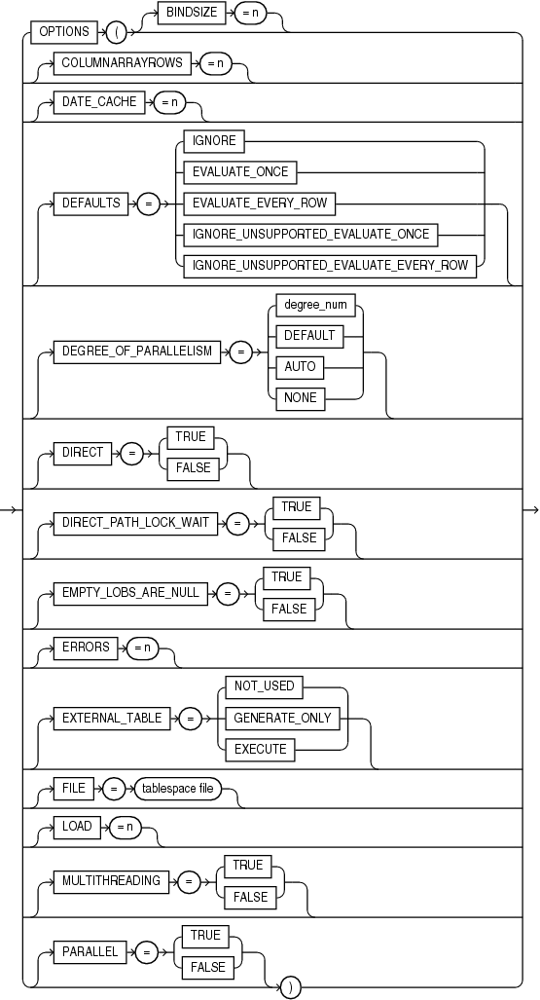

> ```
> options ::=
>
> OPTIONS
> (
> BINDSIZE = n
> COLUMNARRAYROWS = n
> DATE_CACHE = n
> DEFAULTS = {IGNORE| EVALUATE_ONCE | EVALUATE_EVERY_ROW | IGNORE_UNSUPPORTED_EVALUATE_ONCE | 
> IGNORE_UNSUPPORTED_EVALUATE_EVERY_ROW}
> DEGREE_OF_PARALLELISM = {degree_num | DEFAULT | AUTO | NONE}
> DIRECT = {TRUE | FALSE}
> DIRECT_PATH_LOCK_WAIT = {TRUE | FALSE}
> EMPTY_LOBS_ARE_NULL = {TRUE | FALSE}
> ERRORS = n
> EXTERNAL_TABLE = {NOT_USED | GENERATE_ONLY | EXECUTE}
> FILE = tablespace file
> LOAD = n
> MULTITHREADING = {TRUE | FALSE}
> PARALLEL = {TRUE | FALSE}
>
> )
> ```


Options\_Cont

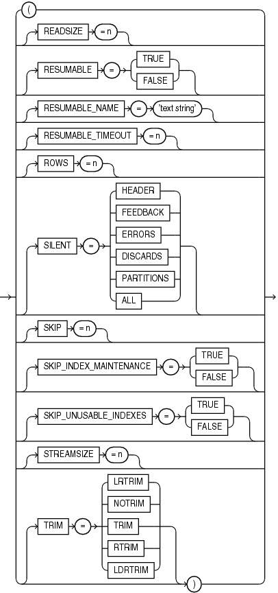

> ```
> options2 ::=
>
> (
> READSIZE = n
> RESUMABLE = {TRUE | FALSE}
> RESUMABLE_NAME = 'text string'
> RESUMABLE_TIMEOUT = n
> ROWS = n
> SILENT = {HEADER | FEEDBACK| ERRORS | DISCARDS | PARTITIONS | ALL}
> SKIP = n
> SKIP_INDEX_MAINTENANCE = {TRUE | FALSE}
> SKIP_UNUSABLE_INDEXES = {TRUE | FALSE}
> STREAMSIZE = n
> TRIM = {LRTRIM | NOTRIM | TRIM | RTRIM | LDRTRIM}
> )
> ```


Load Statement

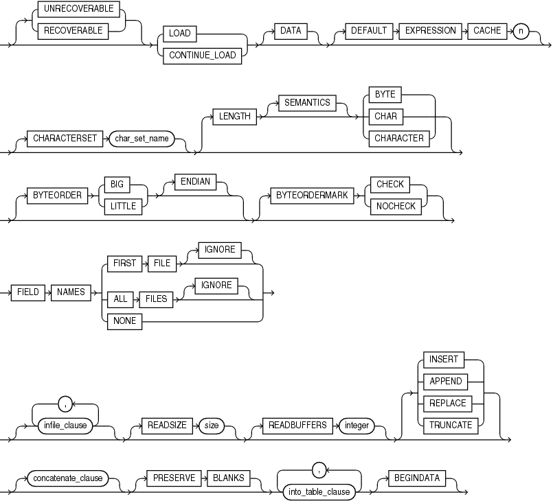

> ```
> load_statement ::=
>  
>   [{ UNRECOVERABLE | RECOVERABLE }] { LOAD | CONTINUE_LOAD } [DATA] 
> [DEFAULT EXPRESSION CACHE n] | [CHARACTERSET char_set_name]
> [LENGTH [SEMANTICS] { BYTE | CHAR | CHARACTER }] [BYTEORDER { BIG | LITTLE } [ENDIAN]]
> [BYTEORDERMARK { CHECK | NOCHECK }]
> [FIELD NAMES {FIRST FILE | FIRST FILE IGNORE | ALL FILES | ALL FILES IGNORE | NONE}]
> [infile_clause] [, infile_clause]... [READSIZE size] [READBUFFERS integer] 
> [{ INSERT | APPEND | REPLACE | TRUNCATE }] 
> [concatenate_clause][PRESERVE BLANKS] into_table_clause [, into_table_clause]... [BEGINDATA]
> ```


infile\_clause

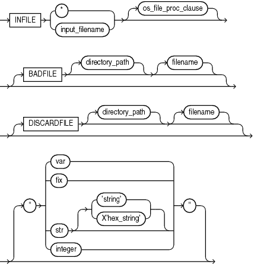

> ```
> infile_clause ::= 
>  
>   INFILE { * | input_filename } [os_file_proc_clause] 
>  [BADFILE [directory_path] [filename ] ]
>  [DISCARDFILE [directory_path] [filename]]
>  [" { var | fix | [str [ 'string' | X'hex_string ] ] | integer } "]
> ```
>
> [  
> Copyright © 2002, 2026, Oracle and/or its affiliates.](https://docs.oracle.com/en/database/oracle/oracle-database/dcommon/html/cpyr.htm)


Note:

On the `BADFILE` `and DISCARDFILE` clauses, you must specify either a directory path, or a filename, or both.

concatenate\_clause


> ```
> concatenate ::= 
>  
>   CONCATENATE { integer | (integer) }
>   |CONTINUEIF 
>   { { THIS | NEXT } [PRESERVE] [(] (pos_spec)
>   |[LAST [PRESERVE] [(] } operator { str | X'hex_str' } [)]
> ```
>
> [  
> Copyright © 2002, 2026, Oracle and/or its affiliates.](https://docs.oracle.com/en/database/oracle/oracle-database/dcommon/html/cpyr.htm)


into\_table\_clause

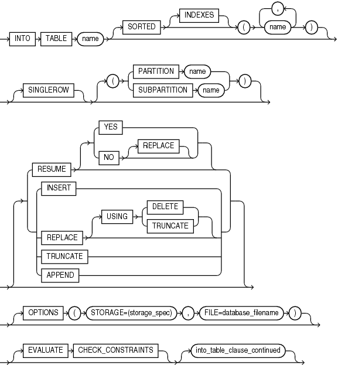

> ```
> intotab_clause ::= 
>  
>  INTO TABLE name [SORTED [INDEXES] (name)]
>  [SINGLEROW] [ ( { PARTITION name | SUBPARTITION name } ) ]  
>  [ {RESUME [ { YES | NO [REPLACE] } ] | INSERT | REPLACE [ USING  {DELETE | TRUNCATE} ]
>  | TRUNCATE | APPEND} ]
> [OPTIONS (STORAGE=storage_spec, FILE=database_filename)]
> [ [EVALUATE CHECK_CONSTRAINTS] [into_table_clause_continued]
> ```


into\_table\_clause\_continued

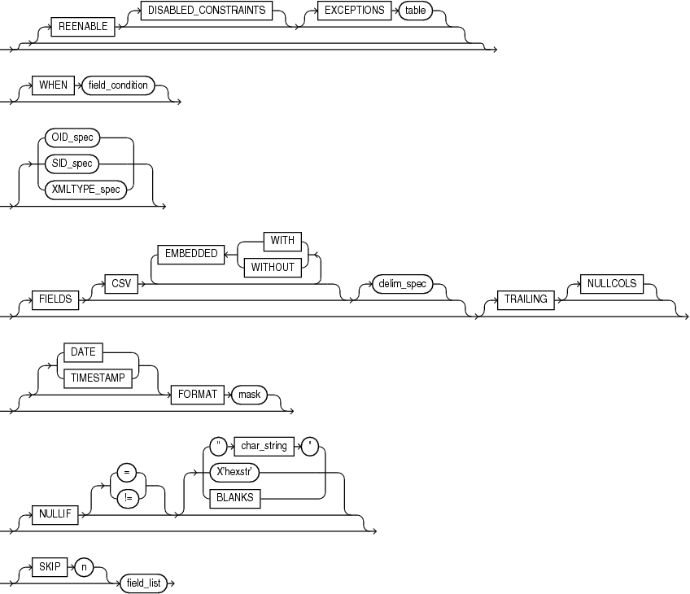

> ```
> intotab_clause ::= 
>  
> [REENABLE] [DISABLED_CONSTRAINTS] ]
> [EXCEPTIONS table]
>  [WHEN field_condition]
> [ OID_spec| SID_spec  | XMLTYPE_spec] 
> [FIELDS [CSV [WITH EMBEDDED | WITHOUT EMBEDDED]][delim_spec]] [TRAILING [NULCOLS]] 
> [[DATE | TIMESTAMP] FORMAT "mask"]
> [NULLIF {= | != } {"char_string" | x'hex_string' | BLANKS} ]
> [TREAT AS typename]
> [SKIP n] field_list
> ```
>
> [  
> Copyright © 2002, 2026, Oracle and/or its affiliates.](https://docs.oracle.com/en/database/oracle/oracle-database/dcommon/html/cpyr.htm)


field\_condition


> ```
> fld_cond  ::= 
>  
>   [(] 
>   {full_fieldname | pos_spec } operator { 'char_string' | X'hex_string' | BLANKS} 
>   [)] AND
>   [(]
>   {full_fieldname | pos_spec } operator { 'char_string' | X'hex_string' | BLANKS}
>   [)]...
> ```
>
> [  
> Copyright © 2002, 2026, Oracle and/or its affiliates.](https://docs.oracle.com/en/database/oracle/oracle-database/dcommon/html/cpyr.htm)


delim\_spec


> ```
> delim_spec ::= 
>  
>    { termination_spec [[OPTIONALLY] enclosure_spec] | enclosure_spec }
> ```
>
> [  
> Copyright © 2002, 2026, Oracle and/or its affiliates.](https://docs.oracle.com/en/database/oracle/oracle-database/dcommon/html/cpyr.htm)


full\_fieldname

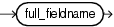

> ```
> fieldname ::= 
>  
>   full_fieldname
> ```
>
> [  
> Copyright © 2002, 2026, Oracle and/or its affiliates.](https://docs.oracle.com/en/database/oracle/oracle-database/dcommon/html/cpyr.htm)


termination\_spec


> ```
> terminat ::= 
>  
>   TERMINATED [BY] { WHITESPACE | X'hexstr' | 'string' | EOF }
> ```
>
> [  
> Copyright © 2002, 2026, Oracle and/or its affiliates.](https://docs.oracle.com/en/database/oracle/oracle-database/dcommon/html/cpyr.htm)


enclosure\_spec


> ```
> enclose ::= 
>  
>   ENCLOSED [BY] [ 'string' | X'hexstr' ] [AND] [ 'string' | X'hexstr' ]
> ```
>
> [  
> Copyright © 2002, 2026, Oracle and/or its affiliates.](https://docs.oracle.com/en/database/oracle/oracle-database/dcommon/html/cpyr.htm)


oid\_spec

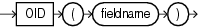

> ```
> oid_spec ::= 
>  
>   OID (fieldname)
> ```
>
> [  
> Copyright © 2002, 2026, Oracle and/or its affiliates.](https://docs.oracle.com/en/database/oracle/oracle-database/dcommon/html/cpyr.htm)


sid\_spec


> ```
> sid_spec ::= 
>  
>   SID ( { fieldname | CONSTANT SID_val } )
> ```
>
> [  
> Copyright © 2002, 2026, Oracle and/or its affiliates.](https://docs.oracle.com/en/database/oracle/oracle-database/dcommon/html/cpyr.htm)


xmltype\_spec

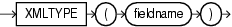

> ```
> xmltype_spec ::=
>
>    XMLTYPE (fieldname)
> ```
>
> [  
> Copyright © 2002, 2026, Oracle and/or its affiliates.](https://docs.oracle.com/en/database/oracle/oracle-database/dcommon/html/cpyr.htm)


field\_list

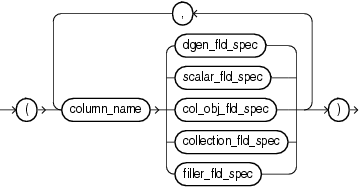

> ```
> field_list :==
>  
> (column_name { dgen_fld_spec 
> | scalar_fld_spec 
> | col_obj_fld_spec 
> | collection_fld_spec
> | filler_fld_spec }
> )
> [(, column_name { d_gen_fld_spec 
> | scalar_fld_spec 
> | col_obj_fld_spec 
> | collection_fld_spec
> | filler_fld_spec }
> )]...
> ```
>
> [  
> Copyright © 2002, 2026, Oracle and/or its affiliates.](https://docs.oracle.com/en/database/oracle/oracle-database/dcommon/html/cpyr.htm)


dgen\_fld\_spec

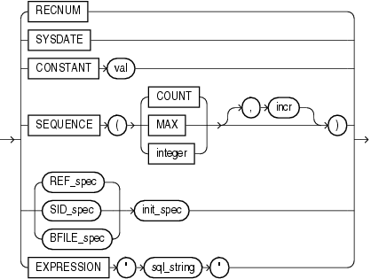

> ```
> dgen_fld ::= 
>   
>   { RECNUM 
>   | SYSDATE 
>   | CONSTANT val 
>   | SEQUENCE [( { COUNT | MAX | integer } [, incr] )] 
>   | { REF_spec init_spec | SID_spec init_spec | BFILE_spec init_spec }
>   | EXPRESSION "sql_string" }
> ```
>
> [  
> Copyright © 2002, 2026, Oracle and/or its affiliates.](https://docs.oracle.com/en/database/oracle/oracle-database/dcommon/html/cpyr.htm)


ref\_spec


> ```
> ref ::= 
>  
>   REF ( { fieldname | CONSTANT val } [, { fieldname | CONSTANT val }]... )
> ```
>
> [  
> Copyright © 2002, 2026, Oracle and/or its affiliates.](https://docs.oracle.com/en/database/oracle/oracle-database/dcommon/html/cpyr.htm)


init\_spec


> ```
> init ::= 
>  
>   { NULLIF | DEFAULTIF } field_condition
> ```
>
> [  
> Copyright © 2002, 2026, Oracle and/or its affiliates.](https://docs.oracle.com/en/database/oracle/oracle-database/dcommon/html/cpyr.htm)


bfile\_spec

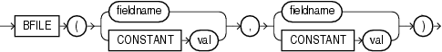

> ```
> bfile ::= 
>  
>   BFILE ( { fieldname | CONSTANT val } , { fieldname | CONSTANT val } )
> ```
>
> [  
> Copyright © 2002, 2026, Oracle and/or its affiliates.](https://docs.oracle.com/en/database/oracle/oracle-database/dcommon/html/cpyr.htm)


filler\_fld\_spec


> ```
> filler_fld ::= 
>  
>  { FILLER | BOUNDFILLER } [pos_spec] [datatype_spec] [PIECED]
> ```
>
> [  
> Copyright © 2002, 2026, Oracle and/or its affiliates.](https://docs.oracle.com/en/database/oracle/oracle-database/dcommon/html/cpyr.htm)


scalar\_fld\_spec

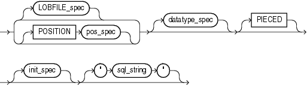

> ```
> scalar ::=
>  
>  { [LOBFILE_spec] | [POSITION pos_spec] } [datatype_spec] [PIECED]
>  [init_spec] ["sql_string"]
> ```
>
> [  
> Copyright © 2002, 2026, Oracle and/or its affiliates.](https://docs.oracle.com/en/database/oracle/oracle-database/dcommon/html/cpyr.htm)


lobfile\_spec


> ```
> lobfile_spec ::= 
>  
>   LOBFILE ({ fieldname | CONSTANT filename } [CHARACTERSET name]
>  [LENGTH [SEMANTICS] { BYTE | CHAR | CHARACTER }] [BYTEORDER { BIG | LITTLE } [ENDIAN]]
> [BYTEORDERMARK { CHECK | NOCHECK }] )
> ```
>
> [  
> Copyright © 2002, 2026, Oracle and/or its affiliates.](https://docs.oracle.com/en/database/oracle/oracle-database/dcommon/html/cpyr.htm)


lls\_field\_spec


> ```
> lls_field_spec ::= 
>
>  (lob_column_name { [init_spec] LLS ["sql_string"] })
> ```
>
> [  
> Copyright © 2002, 2026, Oracle and/or its affiliates.](https://docs.oracle.com/en/database/oracle/oracle-database/dcommon/html/cpyr.htm)


pos\_spec


> ```
> pos_spec ::= 
> ( { start | * [+integer] } [{ : | - } end] )
> ```
>
> [  
> Copyright © 2002, 2026, Oracle and/or its affiliates.](https://docs.oracle.com/en/database/oracle/oracle-database/dcommon/html/cpyr.htm)


datatype\_spec


> ```
> datatype_spec ::= 
>  
>   delim_spec                                                      
>  |INTEGER { [(length)] [{ SIGNED | UNSIGNED }] |               
>  [EXTERNAL [(length)] [delim_spec]] }        
>  |FLOAT [EXTERNAL [(length)] [delim_spec] ]                
>  |{ DECIMAL | ZONED } { [EXTERNAL [(length)] [delim_spec]] | 
>  (precision [, scale]) }            
>  |{ DOUBLE | BYTEINT | SMALLINT { SIGNED | UNSIGNED } }                
>  |RAW [(length)]                                         
>  |GRAPHIC [EXTERNAL] [(graphic_char_length)]                
>  |{ VARGRAPHIC | VARCHAR } [(max_length)]                      
>  datatype_spec_cont
> ```


datatype\_spec\_cont


> ```
> datatype_spec_cont ::= 
>            
>  CHAR [(length)] [delim_spec]                             
>  |VARCHARC (length_of_length [, max_size_bytes])       
>  |VARRAWC  (length_of_length [, max_size_bytes])        
>  |[LONG] VARRAW [(max_bytes)]                            
>  |DATE [EXTERNAL] [(length)] [\"mask\"] [delim_spec] 
>  |{ TIME|TIMESTAMP } [(fractional_second_precision)] [WITH [LOCAL] TIME ZONE] [\"mask\"]        
>  |INTERVAL [ { YEAR [(year_precision)] TO MONTH | DAY [(day_precision)] TO SECOND [(fractional_second_precision)]} ]
> ```
>
> [  
> Copyright © 2002, 2026, Oracle and/or its affiliates.](https://docs.oracle.com/en/database/oracle/oracle-database/dcommon/html/cpyr.htm)


col\_obj\_fld\_spec

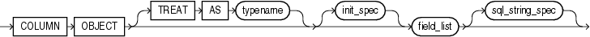

> ```
> col_obj_fld_spec ::= 
>  
>   COLUMN OBJECT [TREAT AS typename] [init_spec] field_list [sql_string_spec]
> ```
>
> [  
> Copyright © 2002, 2026, Oracle and/or its affiliates.](https://docs.oracle.com/en/database/oracle/oracle-database/dcommon/html/cpyr.htm)


collection\_fld\_spec


> ```
> coll_fld ::= 
>  
>   { nested_table_spec | [BOUNDFILLER] varray_spec }
> ```
>
> [  
> Copyright © 2002, 2026, Oracle and/or its affiliates.](https://docs.oracle.com/en/database/oracle/oracle-database/dcommon/html/cpyr.htm)


nested\_table\_spec

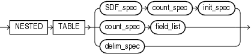

> ```
> nested_table ::= 
>  
>   NESTED TABLE (SDF_spec count_spec init_spec  | count_spec field_list |delim_spec)
> ```
>
> [  
> Copyright © 2002, 2026, Oracle and/or its affiliates.](https://docs.oracle.com/en/database/oracle/oracle-database/dcommon/html/cpyr.htm)


varray\_spec

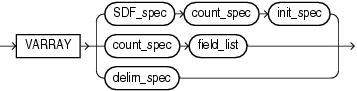

> ```
> varray ::= 
>  
>   VARRAY (SDF_spec count_spec init_spec |count_spec field_list | delim_spec)
> ```
>
> [  
> Copyright © 2002, 2026, Oracle and/or its affiliates.](https://docs.oracle.com/en/database/oracle/oracle-database/dcommon/html/cpyr.htm)


sdf\_spec


> ```
> sdf ::=
>  
>   SDF ( [ field_name | CONSTANT filename ] [os_file_proc_clause] [READSIZE size] 
>  
>  [CHARACTERSET name] [LENGTH [SEMANTICS] {BYTE | CHAR | CHARACTER}] 
>  
>  [BYTEORDER { BIG | LITTLE } [ENDIAN]] [BYTEORDERMARK { CHECK | NOCHECK }] [delim_spec] )
> ```
>
> [  
> Copyright © 2002, 2026, Oracle and/or its affiliates.](https://docs.oracle.com/en/database/oracle/oracle-database/dcommon/html/cpyr.htm)


count\_spec

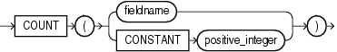

> ```
> count ::= 
>  
>   COUNT ({ fieldname | CONSTANT positive_integer })
> ```
>
> [  
> Copyright © 2002, 2026, Oracle and/or its affiliates.](https://docs.oracle.com/en/database/oracle/oracle-database/dcommon/html/cpyr.htm)


**Parent topic:** [Appendices](appendices.md)