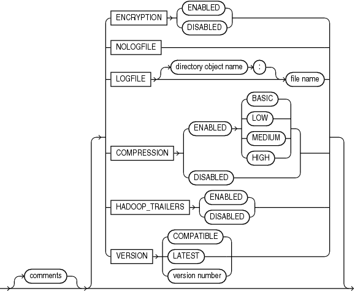

## 16 The ORACLE\_DATAPUMP Access Driver

The `ORACLE_DATAPUMP` access driver provides a set of access parameters that are unique to external tables of the type `ORACLE_DATAPUMP`.

- Using the ORACLE\_DATAPUMP Access Driver  
	To modify the default behavior of the access driver, use `ORACLE_DATAPUMP` access parameters.
- access\_parameters Clause  
	When you create the `ORACLE_DATAPUMP` access driver external table, you can specify certain parameters in an `access_parameters` clause.
- Unloading and Loading Data with the ORACLE\_DATAPUMP Access Driver  
	As part of creating an external table with a SQL `CREATE TABLE AS SELECT` statement, the `ORACLE_DATAPUMP` access driver can write data to a dump file.
- Supported Data Types  
	The `ORACLE_DATAPUMP` access driver resolves many data types automatically during loads and unloads.
- Unsupported Data Types  
	You can use the `ORACLE_DATAPUMP` access driver to unload and reload data for some of the unsupported data types
- Performance Hints When Using the ORACLE\_DATAPUMP Access Driver  
	Learn how to improve `ORACLE_DATAPUMP` access driver performance.
- Restrictions When Using the ORACLE\_DATAPUMP Access Driver  
	Be aware of restrictions that apply to accessing external tables with the `ORACLE_DATAPUMP` access driver.
- Reserved Words for the ORACLE\_DATAPUMP Access Driver  
	If you use words in identifiers that are reserved by the `ORACLE_DATAPUMP` access driver, then they must be enclosed in double quotation marks.

**Parent topic:** [External Tables](oracle-external-tables.md)

### 16.1 Using the ORACLE\_DATAPUMP Access Driver

To modify the default behavior of the access driver, use `ORACLE_DATAPUMP` access parameters.

The information that you provide through the `ORACLE_DATAPUMP` access driver ensures that data from the data source is processed, so that it matches the definition of the external table.

To use the `ORACLE_DATAPUMP` access driver successfully, you must know a little about the file format and record format of the data files on your platform, including character sets and field data types. You must also be able to use SQL to create an external table, and to perform queries against the table that you create.

Note:

- It is sometimes difficult to describe syntax without using other syntax that is documented in other topics. If it is not clear what some syntax is supposed to do, then read about that particular element by checking the topic navigation tree.
- When identifiers (for example, column or table names) are specified in the external table access parameters, certain values are considered to be reserved words by the access parameter parser. If a reserved word is used as an identifier, then it must be enclosed in double quotation marks.
- Starting with Oracle Database 21c, the `ORACLE_DATAPUMP` access driver in SQL mode can write Object Storage URIs.

### 16.2 access\_parameters Clause

When you create the `ORACLE_DATAPUMP` access driver external table, you can specify certain parameters in an `access_parameters` clause.

This clause is optional, as are its individual parameters. For example, you can specify `LOGFILE`, but not `VERSION`, or vice versa. The syntax for the `access_parameters` clause is as follows.

Note:

These access parameters are collectively referred to as the `opaque_format_spec` in the SQL `CREATE                         TABLE...ORGANIZATION EXTERNAL` statement.



> et\_oracle\_datapump::=  
> \[comments\]  
> (\[ {ENCRYPTION {ENABLED | DISABLED} |  
> {NOLOGFILE | LOGFILE \[directory object name:\] file name} |  
> COMPRESSION {ENABLED \[BASIC |LOW | MEDIUM | HIGH\] | DISABLED}}|  
> HADOOP\_TRAILERS {ENABLED | DISABLED}  
> VERSION {COMPATIBLE | LATEST | version number}\])
>
> [  
> Copyright © 2002, 2026, Oracle and/or its affiliates.](https://docs.oracle.com/en/database/oracle/oracle-database/dcommon/html/cpyr.htm)


- Comments  
	The `ORACLE_DATAPUMP` access driver `comments` access parameter enables you to place comments with external tables
- ENCRYPTION  
	The `ORACLE_DATAPUMP` access driver `encryption` access parameter specifies whether to encrypt data before it is written to the dump file set.
- LOGFILE | NOLOGFILE  
	The `ORACLE_DATAPUMP` access driver `LOGFILE|NOLOGFILE` access parameter specifies the name of the log file that contains any messages generated while the dump file was being accessed.t.
- COMPRESSION  
	The `ORACLE_DATAPUMP` access driver `compression` access parameter specifies whether and how data is compressed before the external table data is written to the dump file set.
- VERSION Clause  
	The `ORACLE_DATAPUMP` access driver `version` clause access parameter enables you to specify generating a dump file that can be read with an earlier Oracle Database release.
- HADOOP\_TRAILERS Clause  
	The `ORACLE_DATAPUMP` access driver provides a `HADOOP_TRAILERS` clause that specifies whether to write Hadoop trailers to the dump file.
- Effects of Using the SQL ENCRYPT Clause  
	Review the requirements and guidelines for external tables when you encrypt columns using the `ORACLE_DATAPUMP` access driver `ENCRYPT` clause.

See Also:

Oracle Database SQL Language Reference `CREATE TABLE` for information about specifying `opaque_format_spec` when using the SQL `CREATE                         TABLE...ORGANIZATION EXTERNAL` statement.

**Parent topic:** The ORACLE\_DATAPUMP Access Driver

#### 16.2.1 Comments

The `ORACLE_DATAPUMP` access driver `comments` access parameter enables you to place comments with external tables

Purpose

Comments are lines that begin with two hyphens followed by text.

Example

```
--This is a comment.
--This is another comment.
NOLOG
```

All text to the right of the double hyphen is ignored until the end of the line.

**Parent topic:** access\_parameters Clause

#### 16.2.2 ENCRYPTION

The `ORACLE_DATAPUMP` access driver `encryption` access parameter specifies whether to encrypt data before it is written to the dump file set.

Default

`DISABLED`

Purpose

Specifies whether to encrypt data before it is written to the dump file set.

Syntax and Description

```
ENCRYPTION [ENABLED | DISABLED]
```

If `ENABLED` is specified, then all data is written to the dump file set in encrypted format.

If `DISABLED` is specified, then no data is written to the dump file set in encrypted format.

Restrictions

This parameter is used only for export operations.

Example

In the following example, the `ENCRYPTION` parameter is set to `ENABLED`. Therefore, all data written to the `dept.dmp` file will be in encrypted format.

```
CREATE TABLE deptXTec3
 ORGANIZATION EXTERNAL (TYPE ORACLE_DATAPUMP DEFAULT DIRECTORY def_dir1
 ACCESS PARAMETERS (ENCRYPTION ENABLED) LOCATION ('dept.dmp'));
```

**Parent topic:** access\_parameters Clause

#### 16.2.3 LOGFILE | NOLOGFILE

The `ORACLE_DATAPUMP` access driver `LOGFILE|NOLOGFILE` access parameter specifies the name of the log file that contains any messages generated while the dump file was being accessed.t.

Default

If `LOGFILE` is not specified, then a log file is created in the default directory and the name of the log file is generated from the table name and the process ID with an extension of.`log`. If a log file already exists by the same name, then the access driver reopens that log file and appends the new log information to the end.

Purpose

`LOGFILE` specifies the name of the log file that contains any messages generated while the dump file was being accessed. `NOLOGFILE` prevents the creation of a log file.

Syntax and Description

```
NOLOGFILE
```

or

```
LOGFILE [directory_object:]logfile_name
```

If a directory object is not specified as part of the log file name, then the directory object specified by the `DEFAULT DIRECTORY` attribute is used. If a directory object is not specified and no default directory was specified, then an error is returned. See File Names for LOGFILE for information about using substitution variables to create unique file names during parallel loads or unloads.

Example

In the following example, the dump file, `dept_dmp`, is in the directory identified by the directory object, `load_dir`, but the log file, `deptxt.log`, is in the directory identified by the directory object, `log_dir`.

```
CREATE TABLE dept_xt (dept_no INT, dept_name CHAR(20), location CHAR(20))
ORGANIZATION EXTERNAL (TYPE ORACLE_DATAPUMP DEFAULT DIRECTORY load_dir 
ACCESS PARAMETERS (LOGFILE log_dir:deptxt) LOCATION ('dept_dmp'));
```

- Log File Naming in Parallel Loads

**Parent topic:** access\_parameters Clause

##### 16.2.3.1 Log File Naming in Parallel Loads

The access driver does some symbol substitution to help make file names unique in the case of parallel loads. The symbol substitutions supported are as follows:

- `%p` is replaced by the process ID of the current process. For example, if the process ID of the access driver is 12345, then `exttab_%p`.`log` becomes `exttab_12345.log`.
- `%a` is replaced by the agent number of the current process. The agent number is the unique number assigned to each parallel process accessing the external table. This number is padded to the left with zeros to fill three characters. For example, if the third parallel agent is creating a file and `exttab_%a`.`log ` was specified as the file name, then the agent would create a file named ` exttab_003.log`.
- `%%` is replaced by `%`. If there is a need to have a percent sign in the file name, then this symbol substitution must be used.

If the `%` character is followed by anything other than one of the characters in the preceding list, then an error is returned.

If `%p` or `%a` is not used to create unique file names for output files and an external table is being accessed in parallel, then output files may be corrupted or agents may be unable to write to the files.

If no extension is supplied for the file, then a default extension of.`log` is used. If the name generated is not a valid file name, then an error is returned and no data is loaded or unloaded.

**Parent topic:** LOGFILE | NOLOGFILE

#### 16.2.4 COMPRESSION

The `ORACLE_DATAPUMP` access driver `compression` access parameter specifies whether and how data is compressed before the external table data is written to the dump file set.

Default

`DISABLED`

Purpose

Specifies whether to compress data (and optionally, which compression algorithm to use) before the data is written to the dump file set.

Syntax and Description

```
COMPRESSION [ENABLED {BASIC | LOW| MEDIUM | HIGH} | DISABLED]
```
- If `ENABLED` is specified, then all data is compressed for the entire unload operation. You can additionally specify one of the following compression options:
	- `BASIC` - Offers a good combination of compression ratios and speed; the algorithm used is the same as in previous versions of Oracle Data Pump.
		- `LOW` - Least impact on unload throughput and suited for environments where CPU resources are the limiting factor.
		- `MEDIUM` - Recommended for most environments. This option, like the `BASIC` option, provides a good combination of compression ratios and speed, but it uses a different algorithm than `BASIC`.
		- `HIGH` - Best suited for unloads over slower networks where the limiting factor is network speed.
	Note:
	To use these compression algorithms, the `COMPATIBLE` initialization parameter must be set to at least 12.0.0. This feature requires that the Oracle Advanced Compression option is enabled.
	The performance of a compression algorithm is characterized by its CPU usage and by the compression ratio (the size of the compressed output as a percentage of the uncompressed input). These measures vary on the size and type of inputs as well as the speed of the compression algorithms used. The compression ratio generally increases from low to high, with a trade-off of potentially consuming more CPU resources.
	Oracle recommends that you run tests with the different compression levels on the data in your environment. The only way to ensure that the exported dump file set compression level meets your performance and storage requirements is to test a compression level based on your environment, workload characteristics, and size and type of data.
- If `DISABLED` is specified, then no data is compressed for the upload operation.

Example

In the following example, the `COMPRESSION` parameter is set to `ENABLED`. Therefore, all data written to the `dept.dmp` dump file will be in compressed format.

```
CREATE TABLE deptXTec3
 ORGANIZATION EXTERNAL (TYPE ORACLE_DATAPUMP DEFAULT DIRECTORY def_dir1
 ACCESS PARAMETERS (COMPRESSION ENABLED) LOCATION ('dept.dmp'));
```

**Parent topic:** access\_parameters Clause

#### 16.2.5 VERSION Clause

The `ORACLE_DATAPUMP` access driver `version` clause access parameter enables you to specify generating a dump file that can be read with an earlier Oracle Database release.

Default

`COMPATIBLE`

Purpose

Specifies the version of database that can read the dump file.

The legal values for the `VERSION` parameter are as follows:

- `COMPATIBLE` - This value is the default value. The version of the metadata corresponds to the database compatibility level as specified on the `COMPATIBLE` initialization parameter.
	Note: Database compatibility must be set to 9.2 or later.
- `LATEST` - The version of the metadata and resulting SQL DDL corresponds to the database release, regardless of its compatibility level.
- `version_string` - A specific database release (for example, 11.2.0).This value cannot be lower than 9.2.

You can use the `VERSION` clause to create a dump file set that is compatible with a previous release of Oracle Database. The `VERSION` clause enables you to identify the compatibility version of objects that you export. `COMPATIBLE` indicates that the source and target database releases versions are compatible. However, if the source and target databases are not compatible (for example, when you unload data from an Oracle Database 19c release to an Oracle Database 11g (Release 11.2) database, where compatibility is set to 11.2), then you can specify the `VERSION` clause to indicate the compatibility level of the dump file is readable by the earlier release Oracle Database

Syntax and Description

```
VERSION=[COMPATIBLE | LATEST | version_string]
```

Example

If you use the access parameter `VERSION` clause to specify `11.2`, then an Oracle Database 11g Release 11.2 database is the earliest Oracle Database release that can read the dump file. Oracle Databases with compatibility set to 11.2 or later can read the dump file. However, if you set the `VERSION` clause to 19, then only Oracle Database 19c and later Oracle Database releases can read the dump file that you generate.

**Parent topic:** access\_parameters Clause

#### 16.2.6 HADOOP\_TRAILERS Clause

The `ORACLE_DATAPUMP` access driver provides a `HADOOP_TRAILERS` clause that specifies whether to write Hadoop trailers to the dump file.

Default

`DISABLED`

Purpose

Specifies whether to write Hadoop trailers to the dump file.

Syntax and Description

```
HADOOP_TRAILERS [ENABLED|DISABLED]
```

When the `HADOOP_TRAILERS` clause is set to `ENABLED`, Hadoop trailers are written to the dump file. Hadoop trailers include information about locations and sizes of different parts of the file. The information is written in a dump trailer block at the end of the file, and at the end of the stream data, instead of at the beginning.

**Parent topic:** access\_parameters Clause

#### 16.2.7 Effects of Using the SQL ENCRYPT Clause

Review the requirements and guidelines for external tables when you encrypt columns using the `ORACLE_DATAPUMP` access driver `ENCRYPT` clause.

Purpose

The `ENCRYPT` clause lets you use the Transparent Data Encryption (TDE) feature to encrypt the dump file

If you specify the SQL `ENCRYPT` clause when you create an external table, then keep the following in mind:

- The columns for which you specify the `ENCRYPT` clause will be encrypted before being written into the dump file.
- If you move the dump file to another database, then the same encryption password must be used for both the encrypted columns in the dump file, and for the external table used to read the dump file.
- If you do not specify a password for the correct encrypted columns in the external table on the second database, then an error is returned. If you do not specify the correct password, then garbage data is written to the dump file.
- The dump file that is produced must be at release 10.2 or higher. Otherwise, an error is returned.

Syntax and Description

See Oracle Database SQL Language Reference for more information about using the `ENCRYPT` clause on a `CREATE TABLE` statement

### 16.3 Unloading and Loading Data with the ORACLE\_DATAPUMP Access Driver

As part of creating an external table with a SQL `CREATE TABLE AS SELECT` statement, the `ORACLE_DATAPUMP` access driver can write data to a dump file.

The data in the file is written in a binary format that can only be read by the `ORACLE_DATAPUMP` access driver. Once the dump file is created, it cannot be modified (that is, no data manipulation language (DML) operations can be performed on it). However, the file can be read any number of times and used as the dump file for another external table in the same database or in a different database.

The following steps use the sample schema, `oe`, to show an extended example of how you can use the `ORACLE_DATAPUMP` access driver to unload and load data. (The example assumes that the directory object `def_dir1` already exists, and that user `oe` has read and write access to it.)

1. An external table will populate a file with data only as part of creating the external table with the `AS` `SELECT` clause. The following example creates an external table named `inventories_xt` and populates the dump file for the external table with the data from table `inventories` in the `oe` schema.
	```
	SQL> CREATE TABLE inventories_xt
	  2  ORGANIZATION EXTERNAL
	  3  (
	  4    TYPE ORACLE_DATAPUMP
	  5    DEFAULT DIRECTORY def_dir1
	  6    LOCATION ('inv_xt.dmp')
	  7  )
	  8  AS SELECT * FROM inventories;
	Table created.
	```
2. Describe both `inventories` and the new external table, as follows. They should both match.
	```
	SQL> DESCRIBE inventories
	 Name                                      Null?    Type
	 ---------------------------------------- --------- ----------------
	 PRODUCT_ID                                NOT NULL NUMBER(6)
	 WAREHOUSE_ID                              NOT NULL NUMBER(3)
	 QUANTITY_ON_HAND                          NOT NULL NUMBER(8)
	SQL> DESCRIBE inventories_xt
	 Name                                      Null?    Type
	 ----------------------------------------- -------- -----------------
	 PRODUCT_ID                                NOT NULL NUMBER(6)
	 WAREHOUSE_ID                              NOT NULL NUMBER(3)
	 QUANTITY_ON_HAND                          NOT NULL NUMBER(8)
	```
3. Now that the external table is created, it can be queried just like any other table. For example, select the count of records in the external table, as follows:
	```
	SQL> SELECT COUNT(*) FROM inventories_xt;
	  COUNT(*)
	----------
	      1112
	```
4. Compare the data in the external table against the data in `inventories`. There should be no differences.
	```
	SQL> SELECT * FROM inventories MINUS SELECT * FROM inventories_xt;
	no rows selected
	```
5. After an external table has been created and the dump file populated by the `CREATE` `TABLE` `AS` `SELECT` statement, no rows may be added, updated, or deleted from the external table. Any attempt to modify the data in the external table will fail with an error.
	The following example shows an attempt to use data manipulation language (DML) on an existing external table. This will return an error, as shown.
	```
	SQL> DELETE FROM inventories_xt WHERE warehouse_id = 5;
	DELETE FROM inventories_xt WHERE warehouse_id = 5
	            *
	ERROR at line 1:
	ORA-30657: operation not supported on external organized table
	```
6. The dump file created for the external table can now be moved and used as the dump file for another external table in the same database or different database. Note that when you create an external table that uses an existing file, there is no `AS` `SELECT` clause for the `CREATE` `TABLE` statement.
	```
	SQL> CREATE TABLE inventories_xt2
	  2  (
	  3    product_id          NUMBER(6),
	  4    warehouse_id        NUMBER(3),
	  5    quantity_on_hand    NUMBER(8)
	  6  )
	  7  ORGANIZATION EXTERNAL
	  8  (
	  9    TYPE ORACLE_DATAPUMP
	 10    DEFAULT DIRECTORY def_dir1
	 11    LOCATION ('inv_xt.dmp')
	 12  );
	Table created.
	```
7. Compare the data for the new external table against the data in the `inventories` table. The `product_id` field will be converted to a compatible data type before the comparison is done. There should be no differences.
	```
	SQL> SELECT * FROM inventories MINUS SELECT * FROM inventories_xt2;
	no rows selected
	```
8. Create an external table with three dump files and with a degree of parallelism of three.
	```
	SQL> CREATE TABLE inventories_xt3
	  2  ORGANIZATION EXTERNAL
	  3  (
	  4    TYPE ORACLE_DATAPUMP
	  5    DEFAULT DIRECTORY def_dir1
	  6    LOCATION ('inv_xt1.dmp', 'inv_xt2.dmp', 'inv_xt3.dmp')
	  7  )
	  8  PARALLEL 3
	  9  AS SELECT * FROM inventories;
	Table created.
	```
9. Compare the data unload against `inventories`. There should be no differences.
	```
	SQL> SELECT * FROM inventories MINUS SELECT * FROM inventories_xt3;
	no rows selected
	```
10. Create an external table containing some rows from table `inventories`.
	```
	SQL> CREATE TABLE inv_part_xt
	  2  ORGANIZATION EXTERNAL
	  3  (
	  4  TYPE ORACLE_DATAPUMP
	  5  DEFAULT DIRECTORY def_dir1
	  6  LOCATION ('inv_p1_xt.dmp')
	  7  )
	  8  AS SELECT * FROM inventories WHERE warehouse_id < 5;
	 
	Table created.
	```
11. Create another external table containing the rest of the rows from `inventories`.
	```
	SQL> drop table inv_part_xt;
	 
	Table dropped.
	 
	SQL> 
	SQL> CREATE TABLE inv_part_xt
	  2  ORGANIZATION EXTERNAL
	  3  (
	  4  TYPE ORACLE_DATAPUMP
	  5  DEFAULT DIRECTORY def_dir1
	  6  LOCATION ('inv_p2_xt.dmp')
	  7  )
	  8  AS SELECT * FROM inventories WHERE warehouse_id >= 5;
	 
	Table created.
	```
12. Create an external table that uses the two dump files created in Steps 10 and 11.
	```
	SQL> CREATE TABLE inv_part_all_xt
	  2  (
	  3  product_id NUMBER(6),
	  4  warehouse_id NUMBER(3),
	  5  quantity_on_hand NUMBER(8)
	  6  )
	  7  ORGANIZATION EXTERNAL
	  8  (
	  9  TYPE ORACLE_DATAPUMP
	 10  DEFAULT DIRECTORY def_dir1
	 11  LOCATION ('inv_p1_xt.dmp','inv_p2_xt.dmp')
	 12  );
	 
	Table created.
	```
13. Compare the new external table to the `inventories` table. There should be no differences. This is because the two dump files used to create the external table have the same metadata (for example, the same table name `inv_part_xt` and the same column information).
	```
	SQL> SELECT * FROM inventories MINUS SELECT * FROM inv_part_all_xt;
	no rows selected
	```

- Parallel Loading and Unloading  
	This topic describes parallel loading and unloading.
- Combining Dump Files  
	Dump files populated by different external tables can all be specified in the `LOCATION` clause of another external table.

**Parent topic:** The ORACLE\_DATAPUMP Access Driver

#### 16.3.1 Parallel Loading and Unloading

This topic describes parallel loading and unloading.

The dump file must be on a disk big enough to hold all the data being written. If there is insufficient space for all of the data, then an error is returned for the `CREATE` `TABLE` `AS` `SELECT` statement. One way to alleviate the problem is to create multiple files in multiple directory objects (assuming those directories are on different disks) when executing the `CREATE` `TABLE` `AS` `SELECT ` statement. Multiple files can be created by specifying multiple locations in the form `directory:file` in the `LOCATION` clause and by specifying the `PARALLEL` clause. Each parallel I/O server process that is created to populate the external table writes to its own file. The number of files in the `LOCATION` clause should match the degree of parallelization because each I/O server process requires its own files. Any extra files that are specified will be ignored. If there are not enough files for the degree of parallelization specified, then the degree of parallelization is lowered to match the number of files in the `LOCATION` clause.

Here is an example of unloading the `inventories` table into three files.

```
SQL> CREATE TABLE inventories_XT_3
  2  ORGANIZATION EXTERNAL
  3  (
  4    TYPE ORACLE_DATAPUMP
  5    DEFAULT DIRECTORY def_dir1
  6    LOCATION ('inv_xt1.dmp', 'inv_xt2.dmp', 'inv_xt3.dmp')
  7  )
  8  PARALLEL 3
  9  AS SELECT * FROM oe.inventories;

Table created.
```

When the `ORACLE_DATAPUMP` access driver is used to load data, parallel processes can read multiple dump files or even chunks of the same dump file concurrently. Thus, data can be loaded in parallel even if there is only one dump file, as long as that file is large enough to contain multiple file offsets. The degree of parallelization is not tied to the number of files in the `LOCATION` clause when reading from `ORACLE_DATAPUMP` external tables.

**Parent topic:** Unloading and Loading Data with the ORACLE\_DATAPUMP Access Driver

#### 16.3.2 Combining Dump Files

Dump files populated by different external tables can all be specified in the `LOCATION` clause of another external table.

For example, data from different production databases can be unloaded into separate files, and then those files can all be included in an external table defined in a data warehouse. This provides an easy way of aggregating data from multiple sources. The only restriction is that the metadata for all of the external tables be exactly the same. This means that the character set, time zone, schema name, table name, and column names must all match. Also, the columns must be defined in the same order, and their data types must be exactly alike. This means that after you create the first external table you must drop it so that you can use the same table name for the second external table. This ensures that the metadata listed in the two dump files is the same and they can be used together to create the same external table.

```
SQL> CREATE TABLE inv_part_1_xt
  2  ORGANIZATION EXTERNAL
  3  (
  4    TYPE ORACLE_DATAPUMP
  5    DEFAULT DIRECTORY def_dir1
  6    LOCATION ('inv_p1_xt.dmp')
  7  )
  8  AS SELECT * FROM oe.inventories WHERE warehouse_id < 5;

Table created.

SQL> DROP TABLE inv_part_1_xt;

SQL> CREATE TABLE inv_part_1_xt
  2  ORGANIZATION EXTERNAL
  3  (
  4    TYPE ORACLE_DATAPUMP
  5    DEFAULT directory def_dir1
  6    LOCATION ('inv_p2_xt.dmp')
  7  )
  8  AS SELECT * FROM oe.inventories WHERE warehouse_id >= 5;

Table created.

SQL> CREATE TABLE inv_part_all_xt
  2  (
  3    PRODUCT_ID          NUMBER(6),
  4    WAREHOUSE_ID        NUMBER(3),
  5    QUANTITY_ON_HAND    NUMBER(8)
  6  )
  7  ORGANIZATION EXTERNAL
  8  (
  9    TYPE ORACLE_DATAPUMP
 10    DEFAULT DIRECTORY def_dir1
 11    LOCATION ('inv_p1_xt.dmp','inv_p2_xt.dmp')
 12  );

Table created.

SQL> SELECT * FROM inv_part_all_xt MINUS SELECT * FROM oe.inventories;

no rows selected
```

**Parent topic:** Unloading and Loading Data with the ORACLE\_DATAPUMP Access Driver

### 16.4 Supported Data Types

The `ORACLE_DATAPUMP` access driver resolves many data types automatically during loads and unloads.

When you use external tables to move data between databases, you may encounter the following situations:

- The database character set and the database national character set may be different between the two platforms.
- The endianness of the platforms for the two databases may be different.

The `ORACLE_DATAPUMP` access driver automatically resolves some of these situations.

The following data types are automatically converted during loads and unloads:

- Character (`CHAR`, `NCHAR`, `VARCHAR2`, `NVARCHAR2`)
- `RAW`
- `NUMBER`
- Date/Time
- `BLOB`
- `CLOB` and `NCLOB`
- `ROWID` and `UROWID`

If you attempt to use a data type that is not supported for external tables, then you receive an error. This is demonstrated in the following example, in which the unsupported data type, `LONG`, is used:

```
SQL> CREATE TABLE bad_datatype_xt
  2  (
  3    product_id             NUMBER(6),
  4    language_id            VARCHAR2(3),
  5    translated_name        NVARCHAR2(50),
  6    translated_description LONG
  7  )
  8  ORGANIZATION EXTERNAL
  9  (
 10    TYPE ORACLE_DATAPUMP
 11    DEFAULT DIRECTORY def_dir1
 12    LOCATION ('proddesc.dmp')
 13  );
  translated_description LONG
  *
ERROR at line 6:
ORA-30656: column type not supported on external organized table
```

**Parent topic:** The ORACLE\_DATAPUMP Access Driver

### 16.5 Unsupported Data Types

You can use the `ORACLE_DATAPUMP` access driver to unload and reload data for some of the unsupported data types

An external table supports a subset of all possible data types for columns. In particular, it supports character data types (except `LONG`), the `RAW` data type, all numeric data types, and all date, timestamp, and interval data types.

The unsupported data types for which you can use the `ORACLE_DATAPUMP` access driver to unload and reload data include the following:

- `BFILE`
- `LONG` and `LONG RAW`
- Final object types
- Tables of final object types

- Unloading and Loading BFILE Data Types  
	The `BFILE` data type has two pieces of information stored in it: the directory object for the file and the name of the file within that directory object.
- Unloading LONG and LONG RAW Data Types  
	The `ORACLE_DATAPUMP` access driver can be used to unload `LONG` and `LONG` `RAW` columns, but that data can only be loaded back into LOB fields.
- Unloading and Loading Columns Containing Final Object Types  
	Final column objects are populated into an external table by moving each attribute in the object type into a column in the external table.
- Tables of Final Object Types  
	Object tables have an object identifier that uniquely identifies every row in the table.

**Parent topic:** The ORACLE\_DATAPUMP Access Driver

#### 16.5.1 Unloading and Loading BFILE Data Types

The `BFILE` data type has two pieces of information stored in it: the directory object for the file and the name of the file within that directory object.

You can unload `BFILE` columns using the `ORACLE_DATAPUMP` access driver by storing the directory object name and the file name in two columns in the external table. The procedure `DBMS_LOB`.`FILEGETNAME` will return both parts of the name. However, because this is a procedure, it cannot be used in a `SELECT` statement. Instead, two functions are needed. The first will return the name of the directory object, and the second will return the name of the file.

The steps in the following extended example demonstrate the unloading and loading of `BFILE` data types.

1. Create a function to extract the directory object for a `BFILE ` column. Note that if the column is `NULL`, then `NULL` is returned.
	```
	SQL> CREATE FUNCTION get_dir_name (bf BFILE) RETURN VARCHAR2 IS
	  2  DIR_ALIAS VARCHAR2(255);
	  3  FILE_NAME VARCHAR2(255);
	  4  BEGIN
	  5    IF bf is NULL
	  6    THEN
	  7      RETURN NULL;
	  8    ELSE
	  9      DBMS_LOB.FILEGETNAME (bf, dir_alias, file_name);
	 10      RETURN dir_alias;
	 11    END IF;
	 12  END;
	 13  /
	Function created.
	```
2. Create a function to extract the file name for a `BFILE` column.
	```
	SQL> CREATE FUNCTION get_file_name (bf BFILE) RETURN VARCHAR2 is
	  2  dir_alias VARCHAR2(255);
	  3  file_name VARCHAR2(255);
	  4  BEGIN
	  5    IF bf is NULL
	  6    THEN
	  7      RETURN NULL;
	  8    ELSE
	  9      DBMS_LOB.FILEGETNAME (bf, dir_alias, file_name);
	 10      RETURN file_name;
	 11    END IF;
	 12  END;
	 13  /
	Function created.
	```
3. You can then add a row with a `NULL` value for the `BFILE` column, as follows:
	```
	SQL> INSERT INTO PRINT_MEDIA (product_id, ad_id, ad_graphic)
	  2  VALUES (3515, 12001, NULL);
	1 row created.
	```
	You can use the newly created functions to populate an external table. Note that the functions should set columns `ad_graphic_dir` and `ad_graphic_file` to `NULL` if the `BFILE` column is `NULL`.
4. Create an external table to contain the data from the `print_media` table. Use the `get_dir_name` and `get_file_name` functions to get the components of the `BFILE` column.
	```
	SQL> CREATE TABLE print_media_xt
	  2  ORGANIZATION EXTERNAL
	  3  (
	  4    TYPE oracle_datapump
	  5    DEFAULT DIRECTORY def_dir1
	  6    LOCATION ('pm_xt.dmp')
	  7  ) AS
	  8  SELECT product_id, ad_id,
	  9         get_dir_name (ad_graphic) ad_graphic_dir,
	 10         get_file_name(ad_graphic) ad_graphic_file
	 11  FROM print_media;
	Table created.
	```
5. Create a function to load a `BFILE` column from the data that is in the external table. This function will return `NULL` if the `ad_graphic_dir` column in the external table is `NULL`.
	```
	SQL> CREATE FUNCTION get_bfile (dir VARCHAR2, file VARCHAR2) RETURN
	BFILE is
	  2  bf BFILE;
	  3  BEGIN
	  4    IF dir IS NULL
	  5    THEN
	  6      RETURN NULL;
	  7    ELSE
	  8      RETURN BFILENAME(dir,file);
	  9    END IF;
	 10  END;
	 11  /
	Function created.
	```
6. The `get_bfile` function can be used to populate a new table containing a `BFILE` column.
	```
	SQL> CREATE TABLE print_media_int AS
	  2  SELECT product_id, ad_id,
	  3         get_bfile (ad_graphic_dir, ad_graphic_file) ad_graphic
	  4  FROM print_media_xt;
	Table created.
	```
7. The data in the columns of the newly loaded table should match the data in the columns of the `print_media` table.
	```
	SQL> SELECT product_id, ad_id,
	  2         get_dir_name(ad_graphic),
	  3         get_file_name(ad_graphic)
	  4  FROM print_media_int
	  5  MINUS
	  6  SELECT product_id, ad_id,
	  7         get_dir_name(ad_graphic),
	  8         get_file_name(ad_graphic)
	  9  FROM print_media;
	no rows selected
	```

**Parent topic:** Unsupported Data Types

#### 16.5.2 Unloading LONG and LONG RAW Data Types

The `ORACLE_DATAPUMP` access driver can be used to unload `LONG` and `LONG` `RAW` columns, but that data can only be loaded back into LOB fields.

The steps in the following extended example demonstrate the unloading of `LONG` and `LONG` `RAW` data types.

1. If a table to be unloaded contains a `LONG` or `LONG` `RAW` column, then define the corresponding columns in the external table as `CLOB` for `LONG` columns or `BLOB` for `LONG` `RAW` columns.
	```
	SQL> CREATE TABLE long_tab
	  2  (
	  3    key                   SMALLINT,
	  4    description           LONG
	  5  );
	Table created.
	SQL> INSERT INTO long_tab VALUES (1, 'Description Text');
	1 row created.
	```
2. Now, an external table can be created that contains a `CLOB` column to contain the data from the `LONG` column. Note that when loading the external table, the `TO_LOB` operator is used to convert the `LONG` column into a `CLOB`.
	```
	SQL> CREATE TABLE long_tab_xt
	  2  ORGANIZATION EXTERNAL
	  3  (
	  4    TYPE ORACLE_DATAPUMP
	  5    DEFAULT DIRECTORY def_dir1
	  6    LOCATION ('long_tab_xt.dmp')
	  7  )
	  8  AS SELECT key, TO_LOB(description) description FROM long_tab;
	Table created.
	```
3. The data in the external table can be used to create another table exactly like the one that was unloaded except the new table will contain a LOB column instead of a `LONG` column.
	```
	SQL> CREATE TABLE lob_tab
	  2  AS SELECT * from long_tab_xt;
	Table created.
	```
4. Verify that the table was created correctly.
	```
	SQL> SELECT * FROM lob_tab;
	       KEY  DESCRIPTION
	----------------------------------------------------------------------------
	         1  Description Text
	```

**Parent topic:** Unsupported Data Types

#### 16.5.3 Unloading and Loading Columns Containing Final Object Types

Final column objects are populated into an external table by moving each attribute in the object type into a column in the external table.

In addition, the external table needs a new column to track whether the column object is atomically `NULL`. The following steps demonstrate the unloading and loading of columns containing final object types.

1. In the following example, the `warehouse` column in the external table is used to track whether the `warehouse` column in the source table is atomically `NULL`.
	```
	SQL> CREATE TABLE inventories_obj_xt
	  2  ORGANIZATION EXTERNAL
	  3  (
	  4    TYPE ORACLE_DATAPUMP
	  5    DEFAULT DIRECTORY def_dir1
	  6    LOCATION ('inv_obj_xt.dmp')
	  7  )
	  8  AS
	  9  SELECT oi.product_id,
	 10         DECODE (oi.warehouse, NULL, 0, 1) warehouse,
	 11         oi.warehouse.location_id location_id,
	 12         oi.warehouse.warehouse_id warehouse_id,
	 13         oi.warehouse.warehouse_name warehouse_name,
	 14         oi.quantity_on_hand
	 15  FROM oc_inventories oi;
	Table created.
	```
	The columns in the external table containing the attributes of the object type can now be used as arguments to the type constructor function when loading a column of that type. Note that the `warehouse` column in the external table is used to determine whether to call the constructor function for the object or set the column to `NULL`.
2. Load a new internal table that looks exactly like the `oc_inventories` view. (The use of the `WHERE` ` 1=0` clause creates a new table that looks exactly like the old table but does not copy any data from the old table into the new table.)
	```
	SQL> CREATE TABLE oc_inventories_2 AS SELECT * FROM oc_inventories
	WHERE 1 = 0;
	Table created.
	SQL> INSERT INTO oc_inventories_2
	  2  SELECT product_id,
	  3         DECODE (warehouse, 0, NULL,
	  4                 warehouse_typ(warehouse_id, warehouse_name,
	  5                 location_id)), quantity_on_hand
	  6  FROM inventories_obj_xt;
	1112 rows created.
	```

**Parent topic:** Unsupported Data Types

#### 16.5.4 Tables of Final Object Types

Object tables have an object identifier that uniquely identifies every row in the table.

The following situations can occur:

- If there is no need to unload and reload the object identifier, then the external table only needs to contain fields for the attributes of the type for the object table.
- If the object identifier (OID) needs to be unloaded and reloaded and the OID for the table is one or more fields in the table, (also known as primary-key-based OIDs), then the external table has one column for every attribute of the type for the table.
- If the OID needs to be unloaded and the OID for the table is system-generated, then the procedure is more complicated. In addition to the attributes of the type, another column needs to be created to hold the system-generated OID.

The steps in the following example demonstrate this last situation.

1. Create a table of a type with system-generated OIDs:
	```
	SQL> CREATE TYPE person AS OBJECT (name varchar2(20)) NOT FINAL
	  2  /
	Type created.
	SQL> CREATE TABLE people OF person;
	Table created.
	SQL> INSERT INTO people VALUES ('Euclid');
	1 row created.
	```
2. Create an external table in which the column `OID` is used to hold the column containing the system-generated OID.
	```
	SQL> CREATE TABLE people_xt
	  2  ORGANIZATION EXTERNAL
	  3  (
	  4    TYPE ORACLE_DATAPUMP
	  5    DEFAULT DIRECTORY def_dir1
	  6    LOCATION ('people.dmp')
	  7  )
	  8  AS SELECT SYS_NC_OID$ oid, name FROM people;
	Table created.
	```
3. Create another table of the same type with system-generated OIDs. Then, execute an `INSERT` statement to load the new table with data unloaded from the old table.
	```
	SQL> CREATE TABLE people2 OF person;
	Table created.
	SQL> 
	SQL> INSERT INTO people2 (SYS_NC_OID$, SYS_NC_ROWINFO$)
	  2  SELECT oid, person(name) FROM people_xt;
	1 row created.
	SQL> 
	SQL> SELECT SYS_NC_OID$, name FROM people
	  2  MINUS
	  3  SELECT SYS_NC_OID$, name FROM people2;
	no rows selected
	```

**Parent topic:** Unsupported Data Types

### 16.6 Performance Hints When Using the ORACLE\_DATAPUMP Access Driver

Learn how to improve `ORACLE_DATAPUMP` access driver performance.

When you monitor performance, the most important measurement is the elapsed time for a load. Other important measurements are CPU usage, memory usage, and I/O rates.

You can alter performance by increasing or decreasing the degree of parallelism. The degree of parallelism indicates the number of access drivers that can be started to process the data files. The degree of parallelism enables you to choose on a scale between slower load with little resource usage and faster load with all resources utilized. The access driver cannot automatically tune itself, because it cannot determine how many resources you want to dedicate to the access driver.

An additional consideration is that the access drivers use large I/O buffers for better performance. On databases with shared servers, all memory used by the access drivers comes out of the system global area (SGA). For this reason, you should be careful when using external tables on shared servers.

**Parent topic:** The ORACLE\_DATAPUMP Access Driver

### 16.7 Restrictions When Using the ORACLE\_DATAPUMP Access Driver

Be aware of restrictions that apply to accessing external tables with the `ORACLE_DATAPUMP` access driver.

The restrictions that apply to using the `ORACLE_DATAPUMP` access driver with external tables includes the following:

- Encrypted columns: Exporting and importing of external tables with encrypted columns is not supported.
- Column processing: By default, the external tables feature fetches all columns defined for an external table. This guarantees a consistent result set for all queries. However, for performance reasons you can decide to process only the referenced columns of an external table, thus minimizing the amount of data conversion and data handling required to execute a query. In this case, a row that is rejected because a column in the row causes a data type conversion error will not get rejected in a different query if the query does not reference that column. You can change this column-processing behavior with the `ALTER TABLE` command.
- `LONG` columns: An external table cannot load data into a `LONG` column.
- Handling of byte-order marks during a load: In an external table load for which the data file character set is UTF8 or UTF16, it is not possible to suppress checking for byte-order marks. Suppression of byte-order mark checking is necessary only if the beginning of the data file contains binary data that matches the byte-order mark encoding. (It is possible to suppress byte-order mark checking with SQL\*Loader loads.) Note that checking for a byte-order mark does not mean that a byte-order mark must be present in the data file. If no byte-order mark is present, then the byte order of the server platform is used.
- Backslash escape characters: The external tables feature does not support the use of the backslash (`\`) escape character within strings.
- Reserved words: When identifiers (for example, column or table names) are specified in the external table access parameters, certain values are considered to be reserved words by the access parameter parser. If a reserved word is used as an identifier, then it must be enclosed in double quotation marks.

### 16.8 Reserved Words for the ORACLE\_DATAPUMP Access Driver

If you use words in identifiers that are reserved by the `ORACLE_DATAPUMP` access driver, then they must be enclosed in double quotation marks.

When identifiers (for example, column or table names) are specified in the external table access parameters, certain values are considered to be reserved words by the access parameter parser. If a reserved word is used as an identifier, then it must be enclosed in double quotation marks. The following are the reserved words for the `ORACLE_DATAPUMP` access driver:

- `BADFILE`
- `COMPATIBLE`
- `COMPRESSION`
- `DATAPUMP`
- `DEBUG`
- `ENCRYPTION`
- `INTERNAL`
- `JOB`
- `LATEST`
- `LOGFILE`
- `NOBADFILE`
- `NOLOGFILE`
- `PARALLEL`
- `TABLE`
- `VERSION`
- `WORKERID`

**Parent topic:** The ORACLE\_DATAPUMP Access Driver